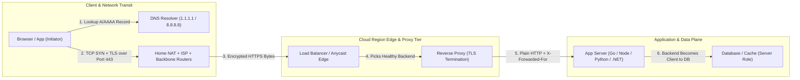
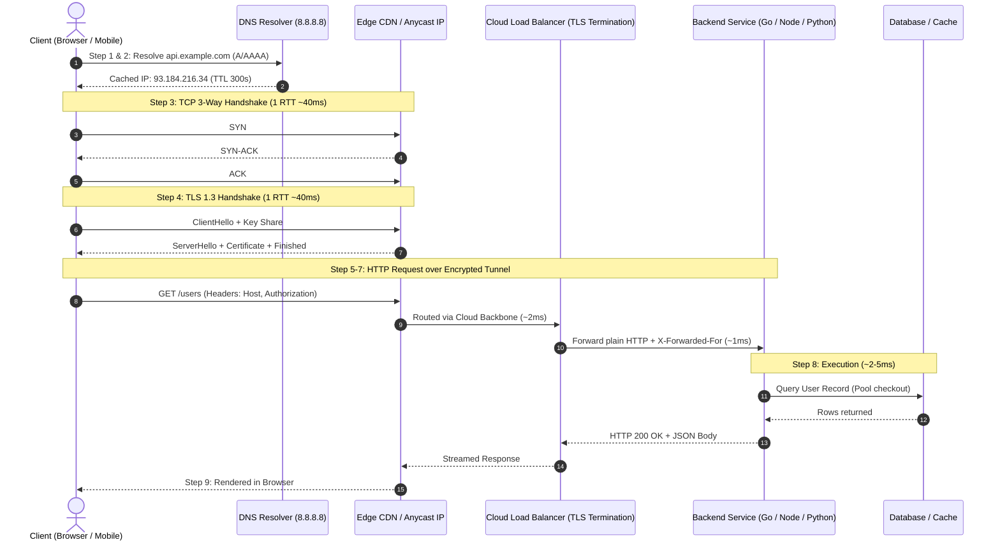
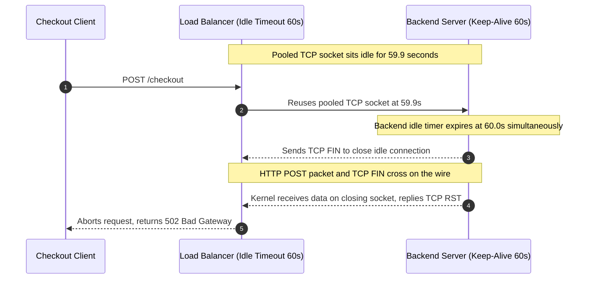

# Module 00: System Overview and Request Flow

> **Prerequisites:** Basic terminal familiarity (`curl`, `python`), conceptual understanding of containers (`learn/02-docker`, `learn/03-kubernetes`).  
> **Estimated Reading Time:** 30 minutes  
> **Target Audience:** Aspiring Backend Engineers, Full-Stack Developers, Site Reliability Engineers.

> [!TIP]
> **The Golden Rule of Request Flow:** Never blame your application handler for latency or silent drops until you have attributed every phase of the journey—**DNS resolution, TCP 3-way handshake, TLS handshake, network hops, and reverse-proxy routing**—because most waiting and connection failures occur long before line 1 of your code ever executes.

---

## Why This Matters

Before you can debug a `502 Bad Gateway`, tune a cache header, or reason about why a request is slow, you need a physical, concrete picture of what actually happens when someone types `https://api.example.com/users` and hits Enter. Most people carry a vague cartoon in their head — "the browser asks the server and the server answers" — and that cartoon is where almost every misconception about latency, TLS, CORS, and caching comes from. This module replaces the cartoon with an accurate mental model you'll lean on for the entire rest of this track.

Here's the thing that surprises people: by the time your backend code runs a single line, the request has already crossed a dozen distinct systems — a DNS resolver, your home router, your ISP's network, several internet backbone routers, a cloud provider's edge, a load balancer, and possibly a reverse proxy — each of which can add latency, drop the connection, rewrite headers, or reject the request outright. When you later see a header you didn't set (`X-Forwarded-For`), a timeout you didn't cause, or a request that never reached your code, you'll know *which box* to look inside because you built the map here first.

This is the "how a request travels" module. We deliberately don't dig into the *format* of HTTP messages yet (that's module 01) — here we care about the *journey*: browser → DNS → network hops → the internet → a remote server in a cloud region → back again. Get the journey right and every protocol detail later has a place to hang.

---

## 1. Architectural Mental Model: The End-to-End Request Journey

Type `https://api.example.com/users` and press Enter. Here is the whole trip, in order, before your backend function runs:

1. **The browser parses the URL.** It splits it into scheme (`https`), host (`api.example.com`), port (implied `443` for https), and path (`/users`). The host is a *name* — the network can't route to a name, only to a numeric IP address. So step 1's real output is: "I need the IP address for `api.example.com`."
2. **DNS resolution turns the name into an IP.** The browser asks a DNS resolver (usually your OS's configured resolver, often your router or a public one like `1.1.1.1` or `8.8.8.8`): "what's the A/AAAA record for `api.example.com`?" The answer comes back as something like `93.184.216.34`. This can involve several cached lookups or a full recursive walk (root → `.com` → `example.com`'s nameservers). It's cached aggressively (see the TTL concept below).
3. **A TCP connection is opened to that IP on port 443.** This is the three-way handshake: your machine sends `SYN`, the server replies `SYN-ACK`, your machine sends `ACK`. Now there's a reliable byte pipe between you and the server. This one round trip happens *before* any HTTP is sent.
4. **A TLS handshake secures the pipe** (because it's `https`). Keys are exchanged, the server proves its identity with a certificate, and an encrypted channel is established on top of the TCP connection. (Full details in module 09.) Only now can real HTTP flow safely.
5. **The browser sends an HTTP request** — a small block of text (module 01) — down the encrypted pipe: the method (`GET`), the path (`/users`), and headers (`Host`, `User-Agent`, `Accept`, cookies…).
6. **The packets traverse the internet.** Your request doesn't teleport. It leaves your machine, goes to your router, to your ISP, hops across a series of backbone routers (each hop is one router forwarding the packet closer to the destination), possibly crosses an ocean via undersea cable, and arrives at the cloud provider's network edge (AWS, Azure, GCP…). Firewalls and NAT devices along the way may inspect or translate the traffic.
7. **Inside the cloud, the request is routed to a backend server.** It usually doesn't hit your application process directly. It typically lands on a **load balancer** (which picks one of N identical backend instances), often then a **reverse proxy** (nginx, Envoy) that terminates TLS and forwards a plain-HTTP request internally to your **application server** (e.g. a Uvicorn/Gunicorn process running your FastAPI app).
8. **Your backend code finally runs.** Your route handler for `/users` executes, maybe queries a database, and produces a **response** — a status code (`200 OK`), headers, and a body (e.g. JSON).
9. **The response travels all the way back** along the same connection, through the proxy, the load balancer, back across the internet, into your browser, which parses it and hands the data to the page.



*One request, end to end. The shaded part is setup and transit: most of the wait is over before your handler starts.*



The same journey, drawn with where the milliseconds actually go — notice how little of the total is your handler:



The reader who internalizes this list stops being surprised by latency ("why is my API 300ms even though my handler runs in 2ms?" — because steps 2-4 and 6 dominate) and stops being confused by "phantom" behavior ("the request never hit my logs" — it died at step 7's load balancer).

### Client and server are roles, not machines

A **client** is whoever *initiates* a request. A **server** is whoever *listens* and *responds*. Your browser is a client. But your backend, when it calls a database or another API, is itself a client of *that* service. The same physical machine can be a server for one connection and a client for another, simultaneously. This is the same idea you met with containers in `learn/02-docker` talking to each other — "who dials whom" is what defines the roles, not the hardware.

```
   role: CLIENT              role: SERVER + CLIENT           role: SERVER
  ┌───────────┐   request   ┌──────────────────┐   request  ┌───────────┐
  │  browser  │ ──────────► │   your backend   │ ─────────► │  database │
  │           │ ◄────────── │ (serves browser, │ ◄───────── │           │
  └───────────┘   response  │  dials the DB)   │  response  └───────────┘
                            └──────────────────┘
   who initiates = client; who listens/answers = server (same box can be both)
```

The relationship is **request/response**: the client sends exactly one request and gets back exactly one response, per exchange. The server never speaks first on a plain HTTP connection — it only ever answers. (Server-initiated messaging needs WebSockets or Server-Sent Events, a later track's topic — and they still *start* with a client request.)

### DNS: the internet's phone book (and its cache)

Names are for humans; the network routes on IP addresses. DNS is the distributed lookup system that maps one to the other. The critical practical fact for a backend engineer is **caching via TTL** (time-to-live): every DNS record comes with a TTL in seconds saying "you may cache this answer for this long." A record with `TTL 300` means resolvers will reuse the cached IP for 5 minutes before asking again. This is why, when you change where `api.example.com` points, the change doesn't take effect everywhere instantly — old IPs stay cached until TTLs expire. You'll meet this exact TTL idea again in module 06 for HTTP caching; it's the same "how long may I reuse this answer" concept.

### The hops in between: routers, firewalls, NAT, proxies

Between your machine and the server sit many intermediaries:

- **Routers** forward packets one hop closer to the destination. A request from your laptop to a US-East server might pass through 12-20 routers. `traceroute` / `tracert` shows them.
- **Firewalls** allow or block traffic by rule (e.g. "only allow inbound on ports 80 and 443"). A request to a port nothing listens on, or one a firewall blocks, simply never arrives — the client eventually times out. This is a very common "my server is up but I can't reach it" cause.
- **NAT (Network Address Translation)** lets many devices behind one public IP share it — your home network's devices all appear to the internet as your router's single public IP. This is why the server sees your router's IP, not your laptop's private `192.168.x.x`.
- **Load balancers and reverse proxies** at the destination spread load across many identical backends and often terminate TLS. They frequently *add* headers so your backend still knows the real client — e.g. `X-Forwarded-For: <original client IP>` and `X-Forwarded-Proto: https`. When you later wonder "why does my app think every request comes from `10.0.0.5`?", it's because that's the load balancer's IP and the *real* client IP is in `X-Forwarded-For`.

### Where "the backend server" actually lives

When we say the request is "routed to a remote backend server, e.g. on AWS or Azure," here's the concrete stack it typically lands on inside a cloud region:

```
Internet
   │
   ▼
[ Cloud region edge / public IP ]
   │
   ▼
[ Load balancer ]      ← picks one healthy backend instance
   │
   ▼
[ Reverse proxy: nginx / Envoy ]   ← terminates TLS, may cache/route
   │  (plain HTTP over the internal network)
   ▼
[ App server: Uvicorn/Gunicorn ]   ← runs your Python/FastAPI process
   │
   ▼
[ Your route handler ]  → maybe a database, cache, other services
```

Every layer here is a place a request can be delayed, rejected, or rewritten — and a place you'll learn to inspect. In `learn/03-kubernetes` you saw the in-cluster version of this: a Service load-balancing across Pods, an Ingress as the reverse proxy. Same shape, different words.

### What the response is (a preview)

The server's answer is not "the data." It's a structured message: a **status line** (`HTTP/1.1 200 OK`), a set of **headers** (metadata like `Content-Type: application/json`, `Content-Length: 1523`), a blank line, and then the **body** (the actual JSON/HTML/bytes). The status code is the server's one-glance summary — `2xx` success, `3xx` redirect, `4xx` "you messed up," `5xx` "I messed up." Modules 01 and 05 make this precise; for now, just hold the shape: *status + headers + body*, mirroring the request's *method/path + headers + body*.

---

## 2. Systematic Comparison Grids & Command Reference

### Request Journey Phase Comparison Matrix

| Phase | Network Layer / Protocol | Typical Latency | Common Failure Mode | Diagnostic Tool |
| :--- | :--- | :--- | :--- | :--- |
| **1–2. URL Parse & DNS** | Application / UDP Port 53 (or DoH) | 1–50 ms (cached vs recursive) | `NXDOMAIN`, stale IP from high TTL | `dig`, `nslookup` |
| **3. TCP 3-Way Handshake** | Transport (Layer 4) | 1 RTT (10–120 ms) | `Connection refused`, firewall drop timeout | `curl -v`, `nc -zv`, `ping` |
| **4. TLS Handshake** | Session / Security (TLS 1.3) | 1 RTT (1–2 RTTs on TLS 1.2) | Expired cert, hostname mismatch, ALPN fail | `curl -v`, `openssl s_client` |
| **6. Internet Backbone Hops** | Network (Layer 3 IP) | 5–150 ms (distance-bound) | Asymmetric routing, packet loss, MTU blackhole | `traceroute`, `tracert`, `mtr` |
| **7. Edge / Load Balancer / Proxy** | Layer 4 / Layer 7 Proxy | 1–10 ms | `502 Bad Gateway`, `504 Timeout`, IP masking | Proxy access logs, `X-Forwarded-For` |
| **8. Backend Handler Execution** | Application Process + DB | 2–50 ms | Slow SQL query, pool exhaustion, `500` error | App traces, `curl -w` (`ttfb`) |

### Role & Boundary Matrix: Client vs. Intermediary vs. Origin

| Component | Connection Role | Sees Real Client IP? | Terminates TLS? | Timeout Rule of Thumb |
| :--- | :--- | :--- | :--- | :--- |
| **Browser / Mobile App** | Pure Client (Initiator) | Yes (Originator) | Initiates TLS | Enforces user-facing request timeout |
| **Load Balancer / Reverse Proxy** | Server (to client) + Client (to origin) | Yes (from TCP peer) | Usually terminates TLS | Idle timeout must be **shorter** than backend |
| **Backend App Server** | Server (to proxy) + Client (to DB/APIs) | Only via `X-Forwarded-For` | Usually receives plain HTTP internally | `keepAliveTimeout` must be **strictly greater** than proxy |

### Command Reference

Real commands to observe each stage of the journey yourself. (This module is about the journey, so these are diagnostic commands, not HTTP message internals — those start in module 01.)

| Command | What it shows you | Which journey step |
|---|---|---|
| `nslookup api.example.com` | The IP a name resolves to | Step 2 (DNS) |
| `dig api.example.com` | DNS answer *with TTL* and record details | Step 2 (DNS) |
| `dig +trace api.example.com` | The full recursive walk root → TLD → authoritative | Step 2 (DNS) |
| `tracert example.com` (Win) / `traceroute` (Linux/macOS) | Every router hop between you and the host | Step 6 (network hops) |
| `ping example.com` | Round-trip time to the host; reachability | Steps 3/6 (reachability, latency) |
| `curl -v https://example.com/` | The whole exchange verbosely: DNS, TCP, TLS, request, response | Steps 2-9 |
| `curl -w '...' -o /dev/null -s URL` | A timing breakdown of each phase | Steps 2-6 (latency attribution) |
| `python -c "import socket; print(socket.gethostbyname('example.com'))"` | Resolve a name to an IP from Python | Step 2 (DNS) |

Breakdown of the key options:

- **`dig api.example.com`** — the answer section shows a line like `api.example.com. 300 IN A 93.184.216.34`. That `300` is the TTL in seconds. `dig +short api.example.com` prints just the IP.
- **`tracert` / `traceroute`** — each numbered line is one router hop, with the round-trip time to that hop. Increasing hop numbers = getting physically/topologically farther. A row of `* * *` means a hop that won't answer probes (common; not necessarily a problem).
- **`curl -v`** — the `-v` (verbose) flag prints, with prefixes: `*` lines = curl's own notes (DNS, "Trying <IP>...", TLS handshake, cert info); `>` lines = the request curl sent; `<` lines = the response the server sent. This single command lets you *see* steps 2 through 9.
- **`curl -w`** — the write-out flag substitutes timing variables. We use it in exercise 4 to attribute latency to DNS vs. connect vs. TLS vs. the server itself.

---

## 3. Production War Story Post-Mortem: The 502 Bad Gateway Keep-Alive Race

| Field | Incident Details |
| :--- | :--- |
| **Severity** | **SEV-1** (Checkout API Intermittent `502 Bad Gateway` Errors) |
| **Detection / Resolution Time** | Detected in 6 minutes via synthetic checkout monitors / Resolved in 22 minutes |
| **Impact** | 1.2% of flash-sale checkout requests failed with `502 Bad Gateway` while backend CPU/DB were idle |

### What Happened

During a flash-sale traffic spike on an e-commerce platform, the API gateway fronted by an AWS Application Load Balancer (ALB) began logging sporadic `502 Bad Gateway` errors on 1.2% of customer checkout requests. The backend services reported healthy CPU and memory utilization, database query latencies were sub-10ms, and application error logs showed zero unhandled exceptions.



### Root Cause Analysis

A critical Keep-Alive idle timeout mismatch between the reverse proxy and the backend application server caused an asynchronous socket race:

1. **Equal or shorter backend timeout:** The **Load Balancer (AWS ALB)** maintained an **idle connection timeout** of **60 seconds**, while the **Node.js application server** was configured with a default `keepAliveTimeout` of **5 seconds** (or matched to **60 seconds**).
2. **The Wire Race Condition:** At second 59.9, the load balancer selected an existing persistent TCP socket from its pool to dispatch an incoming checkout request. Simultaneously, the backend reached its idle timer and initiated connection teardown by transmitting a TCP `FIN` packet.
3. **Kernel `RST` -> Proxy `502`:** The HTTP request packets crossed paths with the `FIN` packet in transit. When the backend kernel received HTTP bytes on a closing socket, it replied with a TCP `RST` (Reset). The load balancer received the `RST` instead of an HTTP status line, immediately aborted the client's request, and returned `502 Bad Gateway` without the app ever logging an error.

### The Fix & Architectural Hardening

> [!IMPORTANT]
> **The Upstream/Backend Timeout Rule:** Your backend application's Keep-Alive timeout must **always be strictly greater** than the upstream reverse proxy's idle timeout.

- **Upstream Reverse Proxy (AWS ALB / Cloudflare / Nginx):** `idle_timeout = 60s`
- **Backend Application Server:** `keepAliveTimeout = 65s` (plus `headersTimeout = 66s` in Node.js)
- **Additional Hardening:** Enabled structured connection-reset telemetry on the ALB target group (`HTTPCode_ELB_502_Count`) and configured graceful SIGTERM draining longer than in-flight request timeouts.

---

## 4. Multi-Language Production Implementation: Hardened HTTP Server Config

Real-world production services must configure explicit socket timeouts (`IdleTimeout > 60s` upstream proxy timeout) and accurately parse proxy headers (`X-Forwarded-For`, `X-Forwarded-Proto`):

````carousel
```go
package main

import (
	"encoding/json"
	"log"
	"net/http"
	"strings"
	"time"
)

func main() {
	mux := http.NewServeMux()
	mux.HandleFunc("/users", func(w http.ResponseWriter, r *http.Request) {
		// Accurately extract real client IP behind reverse proxy / load balancer
		clientIP := r.Header.Get("X-Forwarded-For")
		if clientIP != "" {
			// First IP in comma-separated list is the original client
			clientIP = strings.TrimSpace(strings.Split(clientIP, ",")[0])
		} else {
			clientIP = r.RemoteAddr
		}
		proto := r.Header.Get("X-Forwarded-Proto")
		if proto == "" {
			proto = "http"
		}

		w.Header().Set("Content-Type", "application/json")
		w.WriteHeader(http.StatusOK)
		_ = json.NewEncoder(w).Encode(map[string]string{
			"status":    "ok",
			"client_ip": clientIP,
			"proto":     proto,
		})
	})

	server := &http.Server{
		Addr:              ":8080",
		Handler:           mux,
		ReadHeaderTimeout: 3 * time.Second,
		ReadTimeout:       5 * time.Second,   // Max time to read request headers and body
		WriteTimeout:      10 * time.Second,  // Max time to write response
		IdleTimeout:       120 * time.Second, // Must be strictly > load balancer idle timeout (60s)
	}

	log.Println("Server running on :8080...")
	log.Fatal(server.ListenAndServe())
}
```
<!-- slide -->
```typescript
import http from 'node:http';

const server = http.createServer((req, res) => {
  // Extract real client IP and original scheme from reverse proxy headers
  const forwarded = req.headers['x-forwarded-for'];
  const clientIP = typeof forwarded === 'string'
    ? forwarded.split(',')[0].trim()
    : req.socket.remoteAddress;

  const protoHeader = req.headers['x-forwarded-proto'];
  const proto = typeof protoHeader === 'string' ? protoHeader : 'http';

  res.writeHead(200, { 'Content-Type': 'application/json' });
  res.end(JSON.stringify({ status: 'ok', client_ip: clientIP, proto }));
});

// CRITICAL: Prevent 502 race conditions behind Cloud Load Balancers
server.keepAliveTimeout = 65_000; // Must be strictly > ALB 60s idle timeout
server.headersTimeout = 66_000;   // Must be > keepAliveTimeout
server.requestTimeout = 30_000;   // Bound total incoming request duration

server.listen(8080, () => {
  console.log('Server listening on port 8080');
});
```
<!-- slide -->
```python
from fastapi import FastAPI, Request
from uvicorn.middleware.proxy_headers import ProxyHeadersMiddleware

app = FastAPI()

# Trust reverse proxy X-Forwarded-For and X-Forwarded-Proto headers
app.add_middleware(ProxyHeadersMiddleware, trusted_hosts=["10.0.0.0/8", "127.0.0.1"])


@app.get("/users")
async def get_users(request: Request):
    # request.client.host and request.url.scheme reflect trusted proxy headers
    return {
        "status": "ok",
        "client_ip": request.client.host if request.client else "unknown",
        "is_secure": request.url.is_secure,
    }


# Run with keepalive strictly higher than upstream load balancer (e.g., 60s ALB):
# uvicorn main:app --host 0.0.0.0 --port 8000 --timeout-keep-alive 65
```
<!-- slide -->
```csharp
using Microsoft.AspNetCore.HttpOverrides;

var builder = WebApplication.CreateBuilder(args);

// Configure Kestrel timeouts to stay strictly above upstream ALB 60s idle timeout
builder.WebHost.ConfigureKestrel(options =>
{
    options.Limits.KeepAliveTimeout = TimeSpan.FromSeconds(65);
    options.Limits.RequestHeadersTimeout = TimeSpan.FromSeconds(15);
});

builder.Services.Configure<ForwardedHeadersOptions>(options =>
{
    options.ForwardedHeaders =
        ForwardedHeaders.XForwardedFor | ForwardedHeaders.XForwardedProto;
});

var app = builder.Build();
app.UseForwardedHeaders();

app.MapGet("/users", (HttpContext ctx) => Results.Ok(new
{
    status = "ok",
    client_ip = ctx.Connection.RemoteIpAddress?.ToString() ?? "unknown",
    is_secure = ctx.Request.IsHttps
}));

app.Run("http://0.0.0.0:8080");
```
````

---

## 5. Practical Hands-On Verification CLI Workflows

You don't need a backend of your own yet — the internet is your test subject. A couple of exercises stand up a trivial local server so you can watch a request arrive. Use `example.com` (a real IANA-reserved domain meant exactly for this) as a safe target.

### 1. Watch the whole journey with one command

```bash
curl -v https://example.com/ 2>&1 | head -40
```

**Expected Output:**
```text
* Host example.com:443 was resolved.
*   Trying 93.184.215.14:443...
* Connected to example.com (93.184.215.14) port 443
* TLSv1.3 (OUT), TLS handshake, Client hello (1):
* TLSv1.3 (IN), TLS handshake, Server hello (2):
* Server certificate:
*  subject: CN=www.example.org
> GET / HTTP/2
> Host: example.com
< HTTP/2 200
< content-type: text/html; charset=UTF-8
```

Read the output slowly and label each part:
- `* Host example.com:443 was resolved.` and `*   Trying ...:443...` → **DNS (step 2)** and **TCP connect (step 3)**.
- `* TLSv1.3 (OUT), TLS handshake` lines and `* Server certificate:` → **TLS handshake (step 4)**.
- Lines starting with `>` (e.g. `> GET / HTTP/2` and `> Host: example.com`) → **the request you sent (step 5)**.
- Lines starting with `<` (e.g. `< HTTP/2 200` and `< content-type: text/html`) → **the response (steps 8-9)**.

### 2. Resolve the name yourself and see the TTL

```bash
dig +noall +answer example.com
dig +short example.com
python -c "import socket; print(socket.gethostbyname('example.com'))"
```

**Expected Output:**
```text
example.com.		278	IN	A	93.184.215.14
93.184.215.14
93.184.215.14
```

That middle number (`278`) is the TTL in seconds — how long resolvers may cache this. Run it again a few seconds later and watch the number *decrease* (it's counting down within a shared cache), then jump back up after it expires and is re-fetched.

### 3. Count the hops

```bash
tracert example.com        # Windows
# or: traceroute example.com   (Linux/macOS)
```

**Expected Output:**
```text
  1     2 ms     1 ms     1 ms  router.local [192.168.1.1]
  2     9 ms     8 ms     9 ms  isp-gw.example.net [100.64.0.1]
  3    18 ms    19 ms    17 ms  core-1.backbone.net [203.0.113.4]
  4     *        *        *     Request timed out.
  5    41 ms    40 ms    42 ms  93.184.215.14
```

Count them. Note how the times generally climb as hop numbers increase. Rows of `* * *` are hops that don't reply to probes — normal.

### 4. Attribute the latency

Create a file `curl-timing.txt`:

```text
    dns_lookup:  %{time_namelookup}s
    tcp_connect: %{time_connect}s
    tls_done:    %{time_appconnect}s
    ttfb:        %{time_starttransfer}s
    total:       %{time_total}s
```

Then run:

```bash
curl -w "@curl-timing.txt" -o /dev/null -s https://example.com/
```

**Expected Output:**
```text
    dns_lookup:  0.028104s
    tcp_connect: 0.079412s
    tls_done:    0.151883s
    ttfb:        0.204115s
    total:       0.205009s
```

Notice how much of the total is spent *before* the server even starts sending — that's steps 2-4 and 6, not your (hypothetical) backend code. This is *the* reason "my handler is fast but the API feels slow" is usually a network/setup story, not a code story.

### 5. Stand up a real server and watch a request arrive

In one terminal, start Python's built-in server (it logs each request):

```bash
python -m http.server 8000
```

In a second terminal:

```bash
curl -v http://localhost:8000/
```

**Expected Output (First Terminal Server Log):**
```text
Serving HTTP on :: port 8000 (http://[::]:8000/) ...
127.0.0.1 - - [26/Jul/2026 10:00:00] "GET / HTTP/1.1" 200 -
```

That line *is* step 8 — proof the request reached and ran on the server. Note the target was `localhost`: no DNS-over-the-internet, no TLS (`http`), so the journey collapses to steps 3, 5, 8, 9 only. Compare its `curl -v` output to exercise 1's — far fewer `*` lines because most stages are skipped.

### 6. See the client/server roles flip

Keep `python -m http.server 8000` running. Now write a tiny Python client that *is itself a client* of that server:

```python
# client.py
import http.client
conn = http.client.HTTPConnection("localhost", 8000)
conn.request("GET", "/")
resp = conn.getresponse()
print(resp.status, resp.reason)          # 200 OK
print(resp.getheader("Content-Type"))    # text/html; charset=utf-8
conn.close()
```

```bash
python client.py
```

**Expected Output:**
```text
200 OK
text/html; charset=utf-8
```

And another access-log line appears in the server terminal. Your Python process was the **client** here — the same role the browser played in exercise 1.

### 7. Diagnose and fix: the request that never arrives

Start the server on port 8000 again (`python -m http.server 8000`), then run this *broken* command and diagnose why it fails:

```bash
curl -v --max-time 5 http://localhost:9000/
```

**Expected Output (Broken):**
```text
*   Trying 127.0.0.1:9000...
* connect to 127.0.0.1 port 9000 failed: Connection refused
* Failed to connect to localhost port 9000 after 2048 ms: Could not connect to server
```

**Diagnose:** the server is listening on **8000**, but you asked for **9000** — nothing is listening there, so the TCP connect (step 3) fails and no HTTP is ever sent. This is the everyday "server is up but I can't reach it" bug in miniature (here it's a wrong port; in production it's often a firewall/security-group rule blocking the port).

**Fix:** point at the right port:

```bash
curl -v --max-time 5 http://localhost:8000/
```

**Expected Output (Fixed):**
```text
* Connected to localhost (127.0.0.1) port 8000
> GET / HTTP/1.1
< HTTP/1.1 200 OK
```

Lesson: when a request "never arrives," suspect step 3 first — wrong host, wrong port, or a firewall — *before* you suspect your application code.

### 8. Prove DNS caching is real

```bash
dig +noall +answer example.com          # note the TTL, e.g. 260
# wait ~5 seconds
dig +noall +answer example.com          # TTL is now lower, e.g. 255
```

**Expected Output:**
```text
example.com.		260	IN	A	93.184.215.14
example.com.		255	IN	A	93.184.215.14
```

The second TTL is *lower* than the first — you're reading the same cached record, counting down. This is exactly the "how long may I reuse this answer" mechanic you'll reuse for HTTP caching in module 06.

### Independent challenge

No commands given — work it out from this module.

**Task:** Pick any real public website you use (not `example.com`). Produce a single written "journey report" for loading its homepage that answers, with evidence you gathered yourself: (a) what IP(s) its hostname resolves to and what the DNS TTL is; (b) roughly how many network hops away it is from you and the round-trip time to the last hop; (c) how much of the total request time is spent in DNS + TCP + TLS setup versus waiting for the server's first byte; and (d) whether there's any sign it sits behind a load balancer or CDN (hint: re-resolve the name a few times, or from different tools, and see whether the IP changes). Tie each finding back to the numbered journey step it corresponds to. This uses the same tools from this module's command reference — the challenge is assembling them into one coherent picture and *interpreting* it, not running them.

<details>
<summary>Hint</summary>

For (d), a hostname that resolves to *different* IPs on repeated `dig` calls, or to many IPs at once, is a strong sign of a load balancer or CDN (step 7) fronting many servers behind one name. Compare the `time_appconnect` and `time_starttransfer` values from exercise 4's `curl -w` technique to separate "setup" cost from "server thinking" cost.

</details>

---

## 6. Common Mistakes & Troubleshooting

- **Thinking latency = your code's runtime.** Steps 2-4 and 6 (DNS, TCP, TLS, network transit) often dwarf handler execution. Always attribute latency to a *phase* before blaming code.
- **Assuming a request that isn't in your logs never left the client.** It may have died at a firewall, load balancer, or reverse proxy (step 7) *before* reaching your app. Check the intermediaries' logs too.
- **Confusing "server is running" with "server is reachable."** A running process on the wrong port, behind a closed firewall, or bound only to `127.0.0.1` (not `0.0.0.0`) is up but unreachable from outside.
- **Forgetting DNS is cached.** Changing where a name points is not instant globally; old IPs live until TTLs expire. "It works on my machine but not the server" is sometimes a stale-DNS story.
- **Trusting the source IP your app sees.** Behind a proxy/load balancer, the immediate peer IP is the proxy's; the real client is in `X-Forwarded-For`. Logging the wrong one misleads every later investigation.
- **Believing the server can "push" first.** On plain HTTP the server only ever responds to a request. If you need server-initiated messages, that's a different mechanism (WebSockets/SSE), covered in a later track.

---

## 7. Operational Validation Checkpoints & Cumulative Quiz

### Operational Validation Checkpoints

<details>
<summary><strong>Checkpoint 1: Diagnosing Intermittent 502s Behind a Load Balancer</strong></summary>

**Scenario:** Your FastAPI service runs behind an AWS ALB (`idle_timeout = 60s`). Application logs show zero errors, CPU is 15%, yet 0.8% of POST requests receive `502 Bad Gateway` during burst traffic. What is the most likely socket configuration bug?

**Answer:**
The backend's Keep-Alive timeout is equal to or shorter than the ALB's 60-second idle timeout (for example, Uvicorn's default `--timeout-keep-alive 5` or an exact `60s` match). When the ALB reuses a pooled socket just as the backend sends a TCP `FIN`, the in-flight request triggers a kernel TCP `RST`, causing the ALB to emit `502 Bad Gateway`. Set backend Keep-Alive strictly greater than the proxy idle timeout (e.g., `65s` or `120s`).

</details>

<details>
<summary><strong>Checkpoint 2: Isolating Network Setup Latency from Backend Execution Time</strong></summary>

**Scenario:** Mobile users in Europe report 480ms API latency against a US-East service, even though your distributed trace inside the backend records 4ms per request. How do you prove where the 476ms went?

**Answer:**
Run `curl -w` timing variables (`time_namelookup`, `time_connect`, `time_appconnect`, `time_starttransfer`). On a cold connection from Europe to US-East (~90ms RTT), DNS + TCP handshake (1 RTT) + TLS handshake (1–2 RTTs) + HTTP request RTT consume ~360–450ms before the server transmits byte 1. Adding HTTP Keep-Alive reuse or an edge CDN terminates TCP/TLS close to the user, eliminating repeated cross-ocean RTTs.

</details>

<details>
<summary><strong>Checkpoint 3: Spoofed `X-Forwarded-For` Client IP Rate-Limiting Bypass</strong></summary>

**Scenario:** Your API enforces per-IP rate limiting by reading `X-Forwarded-For`. Attackers bypass the rate limiter by sending a forged `X-Forwarded-For: 1.2.3.4` header on every request. Why did this happen and how do you fix it?

**Answer:**
When a reverse proxy appends the actual peer IP to an incoming `X-Forwarded-For` header (`forged_ip, real_client_ip`), reading index `[0]` unconditionally trusts client-supplied data. Configure your proxy middleware (`trusted_hosts` in Uvicorn, `ForwardedHeadersOptions.KnownProxies` in ASP.NET Core, or stripping/overwriting untrusted headers at the edge load balancer) so only the IP appended by your trusted edge proxy is accepted.

</details>

### Checkpoint quiz

Write down your answer to each question before expanding it — checking without attempting first is the single easiest way to fool yourself into thinking you've learned this.

1. Put these in the order they happen for `https://api.example.com/users`: TLS handshake, DNS resolution, TCP handshake, your route handler runs, HTTP request sent.
2. What defines whether a given machine is acting as a "client" or a "server" for a particular connection?
3. Your handler runs in 2ms but the browser reports 250ms for the request. Name three phases of the journey that could account for the other ~248ms.
4. You changed which IP `api.example.com` points to an hour ago, but some users still hit the old server. What mechanism explains this, and what controls how long it lasts?
5. Your app logs show every request coming from `10.0.0.5`, but real users are all over the world. What's going on, and where is the real client IP?
6. A request to your server "never arrives" — nothing shows in the app logs. List three distinct places/causes along the journey that could swallow it before it reaches your code.

<details>
<summary>Answers</summary>

1. DNS resolution → TCP handshake → TLS handshake → HTTP request sent → your route handler runs. (Name resolves to IP, then a connection is opened, then secured, then the request flows, then your code runs.)
2. The role is defined by who *initiates* the connection/request: the initiator is the client, the listener/responder is the server. The same machine can be both, for different connections, at the same time.
3. Any three of: DNS resolution, TCP handshake round trip, TLS handshake, network transit time across many router hops (step 6), plus time in intermediaries (load balancer/proxy). The point: most of it is setup and transit, not handler execution.
4. DNS caching: resolvers cache the old record until its TTL expires. The record's TTL (in seconds) controls how long the stale answer can linger.
5. Your app is behind a load balancer / reverse proxy, so the immediate peer it sees is the proxy's IP (`10.0.0.5`). The real client IP is in the `X-Forwarded-For` header the proxy added.
6. Any three of: a firewall/security group blocking the port; the wrong host/port so TCP connect fails (nothing listening); a load balancer with no healthy backends or a failing health check; a reverse proxy rejecting or misrouting it; TLS failure before any HTTP is exchanged.

</details>

---

## 8. Further Reading & Sources

- [MDN: What is a URL?](https://developer.mozilla.org/en-US/docs/Learn/Common_questions/Web_mechanics/What_is_a_URL) - breaks down the scheme/host/port/path the browser parses in step 1.
- [MDN: How the web works](https://developer.mozilla.org/en-US/docs/Learn/Getting_started_with_the_web/How_the_Web_works) - a beginner-level narration of the same client → DNS → server journey.
- [Cloudflare: What is DNS?](https://www.cloudflare.com/learning/dns/what-is-dns/) - clear explanation of recursive resolution and TTL caching from step 2.
- [Cloudflare: What is a load balancer?](https://www.cloudflare.com/learning/performance/what-is-load-balancing/) - the step-7 load balancer and reverse-proxy layer explained.
- [MDN: X-Forwarded-For](https://developer.mozilla.org/en-US/docs/Web/HTTP/Headers/X-Forwarded-For) - why your app sees the proxy IP and where the real client IP hides.
- [High Performance Browser Networking (free book)](https://hpbn.co/) - Ilya Grigorik's deep dive into TCP, TLS, and latency that underpins this whole module.

---

## 9. Next

[01-http-protocol-basics](../01-http-protocol-basics/README.md) — now that you have the journey in your head, we zoom into step 5 and 8: what an HTTP request and response *actually look like* as raw text on the wire.
