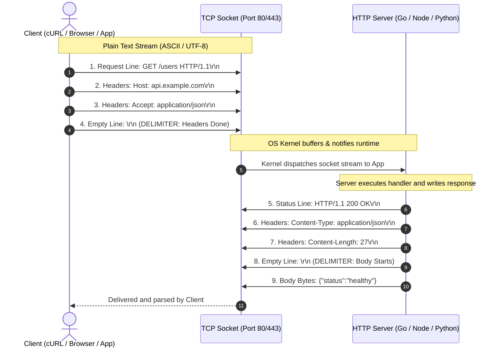
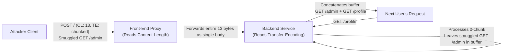

# Module 01: HTTP Protocol Basics

## Why This Matters

Every API call, mobile sync, and web page load relies on one simple foundation: **HTTP is plain, structured text sent over a byte pipe**. 

When you know its exact wire anatomy, troubleshooting becomes trivial:
* A `502 Bad Gateway` isn't magic — it's an upstream proxy failing to read a valid status line.
* A hanging request isn't a mysterious freeze — it's a missing `\r\n\r\n` boundary or a `Content-Length` mismatch.
* A security exploit like Request Smuggling isn't obscure — it's two servers disagreeing on message boundaries.

---

## The Mental Model



---

## 1. Anatomy of the Wire Format

Both requests and responses follow an identical 4-part skeleton:

```
┌────────────────────────────────────────────────────────┐
│ 1. Start Line (Request Target OR Response Status)      │ \r\n
├────────────────────────────────────────────────────────┤
│ 2. Headers Block (Key: Value metadata lines)           │ \r\n
│    Header-Name: Value                                  │ \r\n
├────────────────────────────────────────────────────────┤
│ 3. Empty Line Separator (CRLF delimiter)               │ \r\n (Mandatory!)
├────────────────────────────────────────────────────────┤
│ 4. Optional Body (JSON, bytes, form data)              │ Raw bytes
└────────────────────────────────────────────────────────┘
```

### Request vs. Response Comparison

| Component | HTTP Request | HTTP Response |
| :--- | :--- | :--- |
| **Start Line** | `POST /api/v1/orders HTTP/1.1` *(Method + Path + Version)* | `HTTP/1.1 201 Created` *(Version + Status Code + Reason)* |
| **Key Headers** | `Host: api.example.com`<br>`Content-Type: application/json` | `Content-Type: application/json`<br>`Content-Length: 32` |
| **Boundary** | `\r\n\r\n` (Double carriage return + line feed) | `\r\n\r\n` (Double carriage return + line feed) |
| **Body** | `{"item_id": 402, "qty": 1}` | `{"order_id": "ord_987", "status": "ok"}` |


> [!CAUTION]
> **The `\r\n\r\n` Trap:** 
> HTTP mandates CRLF (`0x0D 0x0A`). If you send bare `\n` or forget the trailing empty line, the server will keep the socket open waiting for more headers until it hits an idle timeout (`408 Request Timeout`).

---

## 2. Concrete Examples on the Wire

### Example A: Minimal GET Request
```http
GET /healthz HTTP/1.1
Host: api.example.com
User-Agent: curl/8.5.0
Accept: */*

```
*(Notice the blank line after `Accept: */*` — without it, the request is incomplete).*

### Example B: POST Request with JSON Body
```http
POST /checkout HTTP/1.1
Host: api.example.com
Content-Type: application/json
Content-Length: 26

{"plan": "pro", "seats": 3}
```
*(Here `Content-Length: 26` tells the parser to read exactly 26 bytes after the blank line).*

### Example C: Chunked Streaming Response (Unknown Size)
When generating real-time data or large exports, calculating `Content-Length` upfront is impossible. HTTP uses `Transfer-Encoding: chunked`:

```http
HTTP/1.1 200 OK
Content-Type: text/plain
Transfer-Encoding: chunked

7
Backend
8
 Roadmap
0

```
*(Each chunk starts with its size in hex: `7` bytes (`Backend`), `8` bytes (` Roadmap`), terminated by a final `0` byte chunk).*

---

## 3. Production War Story: The Request Smuggling Catastrophe



### The Incident
A financial dashboard running an Nginx reverse proxy fronting Python Gunicorn backend services discovered that non-admin users were intermittently receiving administrative settings payloads and seeing other users' session tokens.

### The Root Cause: Desync Between Proxy and Backend
HTTP/1.1 allows both `Content-Length` (CL) and `Transfer-Encoding` (TE) headers. When both are present:
1. **The Front-End Proxy** parsed `Content-Length: 13` and thought the entire request was finished.
2. **The Backend Server** prioritized `Transfer-Encoding: chunked`. It saw `0\r\n\r\n` and concluded the first request ended early.
3. **The Smuggled Payload:** The remaining bytes in the TCP socket (`GET /admin/export HTTP/1.1`) sat unread in the backend's persistent connection buffer.
4. **The Hijack:** When the *next customer* sent `GET /profile`, the backend concatenated it with the leftover socket buffer, executing the attacker's smuggled admin request with the victim's credentials!

### Production Fix
1. **Enforce RFC 9112:** Strictly reject any incoming request containing both `Content-Length` and `Transfer-Encoding` with `400 Bad Request`.
2. **End-to-End HTTP/2 or HTTP/3:** Use binary framing instead of plain text delimitations, making boundary ambiguity mathematically impossible.

---

## 4. Multi-Language Implementation: Raw Socket Inspection

Here is how production systems read and write raw HTTP streams across Go, TypeScript/Node, and Python:

### Go: Raw TCP HTTP Parser
```go
package main

import (
	"bufio"
	"fmt"
	"net"
	"net/http"
	"strings"
)

func main() {
	ln, err := net.Listen("tcp", ":8080")
	if err != nil {
		panic(err)
	}
	defer ln.Close()
	fmt.Println("Listening on :8080 (Raw TCP Socket)...")

	for {
		conn, _ := ln.Accept()
		go func(c net.Conn) {
			defer c.Close()
			// Read raw HTTP using standard reader
			req, err := http.ReadRequest(bufio.NewReader(c))
			if err != nil {
				return
			}
			fmt.Printf("Received %s %s from %s\n", req.Method, req.URL.Path, req.RemoteAddr)

			// Hand-craft raw HTTP response directly onto the TCP socket
			body := `{"message":"Hello from raw Go socket"}`
			resp := fmt.Sprintf(
				"HTTP/1.1 200 OK\r\n"+
					"Content-Type: application/json\r\n"+
					"Content-Length: %d\r\n"+
					"Connection: close\r\n\r\n%s",
				len(body), body,
			)
			c.Write([]byte(resp))
		}(conn)
	}
}
```

### Node.js / TypeScript: Raw Byte Streaming
```typescript
import net from 'node:net';

// Raw TCP server handling HTTP without the 'http' abstraction
const server = net.createServer((socket) => {
  socket.once('data', (data) => {
    const raw = data.toString('utf8');
    const [headerBlock] = raw.split('\r\n\r\n');
    const [startLine] = headerBlock.split('\r\n');

    console.log(`[RAW HTTP INCOMING] ${startLine}`);

    const payload = JSON.stringify({ framework: 'Node.js Raw Socket', status: 'ready' });
    const response = 
      `HTTP/1.1 200 OK\r\n` +
      `Content-Type: application/json\r\n` +
      `Content-Length: ${Buffer.byteLength(payload)}\r\n` +
      `Connection: close\r\n` +
      `\r\n` +
      payload;

    socket.write(response);
    socket.end();
  });
});

server.listen(8080, () => console.log('Raw socket server running on port 8080'));
```

### Python: Low-Level Socket Request
```python
import socket

# Handcraft an exact HTTP request byte-for-byte
sock = socket.socket(socket.AF_INET, socket.SOCK_STREAM)
sock.connect(("example.com", 80))

raw_request = (
    b"GET / HTTP/1.1\r\n"
    b"Host: example.com\r\n"
    b"User-Agent: RawSocketPython/1.0\r\n"
    b"Connection: close\r\n"
    b"\r\n"  # Mandatory blank line
)

sock.sendall(raw_request)

response = b""
while True:
    chunk = sock.recv(4096)
    if not chunk:
        break
    response += chunk

sock.close()

# Split response into header block and body
headers, _, body = response.partition(b"\r\n\r\n")
print(f"Status & Headers:\n{headers.decode('latin-1')}")
print(f"\nBody preview: {len(body)} bytes received.")
```

---

## 5. Command Reference Cheat Sheet

| Command | Why you use it | What to inspect |
| :--- | :--- | :--- |
| `curl --http1.1 -v http://example.com/` | View exact raw wire text | `>` lines (Request), `<` lines (Response) |
| `curl -s -D - -o /dev/null http://example.com/` | Dump only status and headers | Check `Content-Length`, `Server`, cache tags |
| `curl -X POST -H "Content-Type: application/json" -d '{"ping":1}' -v URL` | Test body framing & payload length | Verify `Content-Length` matches payload bytes |
| `printf "GET / HTTP/1.1\r\nHost: example.com\r\n\r\n" \| nc example.com 80` | Speak raw HTTP directly via netcat | Test socket behavior and proxy timeouts |

---

## 6. Hands-On Lab: Diagnosing Wire Protocol Bugs

### Lab 1: Inspect Raw HTTP Framing with cURL
```bash
curl --http1.1 -v http://example.com/ 2>&1 | head -25
```
**Look for:**
* `> GET / HTTP/1.1` (Request line)
* `> Host: example.com` (Mandatory header)
* `>` (The empty delimiter line)
* `< HTTP/1.1 200 OK` (Status line)

### Lab 2: Intentionally Trigger a Socket Hang
Run this Python snippet that forgets the trailing `\r\n\r\n`:
```python
import socket
s = socket.create_connection(("example.com", 80))
s.sendall(b"GET / HTTP/1.1\r\nHost: example.com\r\n")  # Missing final blank line!
s.settimeout(3.0)
try:
    s.recv(1024)
except socket.timeout:
    print("Socket timed out! Server is waiting forever for header completion.")
s.close()
```

---

## 7. Operational Validation Checkpoint

<details>
<summary><strong>Question 1: The Hanging Webhook (Production Scenario)</strong></summary>

**Scenario:** A 3rd-party payment gateway sends JSON webhooks to your API. Under high load, 10% of their requests hang for 30 seconds and fail with `ETIMEDOUT`. When you inspect raw TCP packets, the payload is:
```http
POST /webhook HTTP/1.1
Host: api.yourapp.com
Content-Type: application/json
Content-Length: 50

{"event": "payment_success"}
```
What is the root cause?

**Answer:**
The `Content-Length` is declared as `50`, but the JSON body `{"event": "payment_success"}` is only **28 bytes**. The server read 28 bytes and is holding the TCP socket open waiting for the remaining 22 bytes before handing the request to your application code.
</details>

<details>
<summary><strong>Question 2: Why HTTP/1.1 Mandates the Host Header</strong></summary>

**Scenario:** Why is `Host: example.com` mandatory in HTTP/1.1, whereas in HTTP/1.0 it was optional? What breaks on modern cloud infrastructure if it is omitted?

**Answer:**
Modern cloud servers use **Virtual Hosting** (one IP address hosting hundreds of different domains via SNI/reverse proxy). In HTTP/1.0, the server only received the path (`GET /index.html`), making it impossible to know which website's files to serve. Omitting `Host` in HTTP/1.1 causes modern web servers to reject the request with `400 Bad Request`.
</details>

<details>
<summary><strong>Question 3: Identifying Request Smuggling Vectors</strong></summary>

**Scenario:** A load balancer forwards requests using `Content-Length`. An internal microservice uses `Transfer-Encoding: chunked`. What vulnerability occurs if an attacker sends both headers on a persistent connection?

**Answer:**
**HTTP Request Smuggling (CL.TE Desync)**. The proxy determines request boundaries using `Content-Length`, while the backend determines them using `Transfer-Encoding`. This allows the attacker to hide a second request inside the body of the first, poisoning the backend socket for the next unsuspecting customer.
</details>

---

## Free PDF Notes

Download these notes as a printable PDF, with every diagram and interview question: [SD-B-010: HTTP Fundamentals](https://backendroadmap.com/notes/system-design/SD-B-010.pdf). Each section in one file: [Phase 2, Networking (PDF)](https://backendroadmap.com/notes/system-design/Phase2_Networking_Notes.pdf).

---

## Next Step

Now that you've mastered the wire framing, proceed to **[02-http-headers-deep-dive](../02-http-headers-deep-dive/README.md)** to categorize and master request, response, representation, and security headers.
