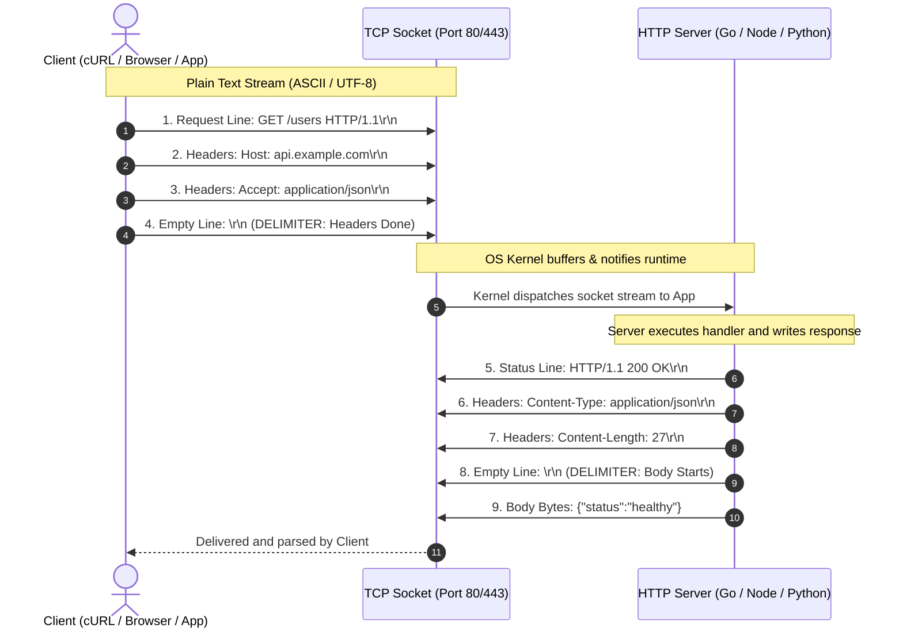
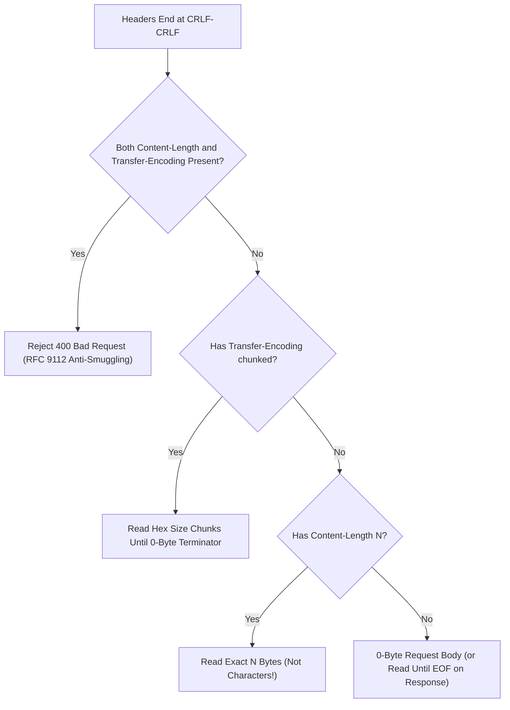
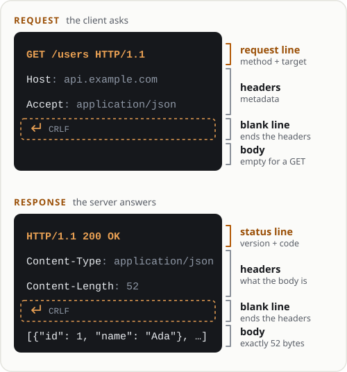
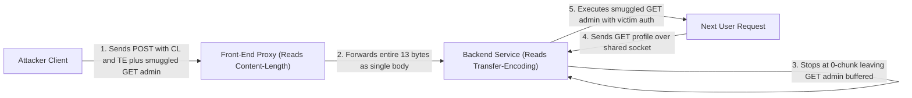
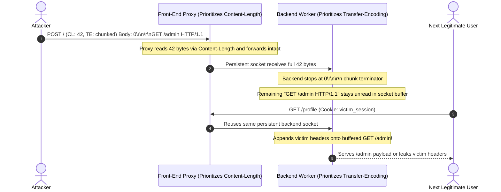

# Module 01: HTTP Protocol Basics

> **Prerequisites:** System overview, DNS, and TCP/TLS handshakes ([Module 00](../00-system-overview-and-request-flow/README.md)).  
> **Estimated Reading Time:** 30 minutes  
> **Target Audience:** Backend Engineers, API Developers, Security & Platform Engineers.  
> **Free PDF Notes:** [SD-B-010: HTTP Fundamentals](https://backendroadmap.com/notes/system-design/SD-B-010.pdf) · [Phase 2, Networking (PDF)](https://backendroadmap.com/notes/system-design/Phase2_Networking_Notes.pdf)

> [!TIP]
> **The Golden Rule of HTTP Wire Framing:** HTTP/1.1 is an ASCII/UTF-8 byte stream delimited strictly by CRLF (`\r\n`) and an empty line (`\r\n\r\n`), with body boundaries governed unambiguously by either `Content-Length` (exact byte count) or `Transfer-Encoding: chunked`—never both, and never bare `\n`.

---

## Why This Matters

Every API call, mobile sync, and web page load relies on one simple foundation: **HTTP is plain, structured text sent over a byte pipe**.

When you know its exact wire anatomy, troubleshooting becomes trivial:
* A `502 Bad Gateway` isn't magic — it's an upstream proxy failing to read a valid status line.
* A hanging request isn't a mysterious freeze — it's a missing `\r\n\r\n` boundary or a `Content-Length` mismatch.
* A security exploit like Request Smuggling isn't obscure — it's two servers disagreeing on message boundaries.

---

## 1. Architectural Mental Model & Wire Anatomy



When an HTTP/1.1 parser finishes reading the `\r\n\r\n` delimiter, it determines where the body ends using a strict RFC 9112 precedence tree:



### Anatomy of the Wire Format

Both requests and responses follow an identical 4-part skeleton:

```
┌────────────────────────────────────────────────────────┐
│ 1. Start Line (Request Target OR Response Status)      │ \r\n
├────────────────────────────────────────────────────────┤
│ 2. Headers Block (Key: Value metadata lines)           │ \r\n
│    Header-Name: Value                                  │ \r\n
├────────────────────────────────────────────────────────┤
│ 3. Empty Line Separator (CRLF delimiter)               │ \r\n (Mandatory!)
├────────────────────────────────────────────────────────┤
│ 4. Optional Body (JSON, bytes, form data)              │ Raw bytes
└────────────────────────────────────────────────────────┘
```

### Request vs. Response Comparison

| Component | HTTP Request | HTTP Response |
| :--- | :--- | :--- |
| **Start Line** | `POST /api/v1/orders HTTP/1.1` *(Method + Path + Version)* | `HTTP/1.1 201 Created` *(Version + Status Code + Reason)* |
| **Key Headers** | `Host: api.example.com`<br>`Content-Type: application/json` | `Content-Type: application/json`<br>`Content-Length: 32` |
| **Boundary** | `\r\n\r\n` (Double carriage return + line feed) | `\r\n\r\n` (Double carriage return + line feed) |
| **Body** | `{"item_id": 402, "qty": 1}` | `{"order_id": "ord_987", "status": "ok"}` |



> [!CAUTION]
> **The `\r\n\r\n` Trap:**
> HTTP mandates CRLF (`0x0D 0x0A`). If you send bare `\n` or forget the trailing empty line, the server will keep the socket open waiting for more headers until it hits an idle timeout (`408 Request Timeout`).

### Concrete Examples on the Wire

#### Example A: Minimal GET Request
```http
GET /healthz HTTP/1.1
Host: api.example.com
User-Agent: curl/8.5.0
Accept: */*

```
*(Notice the blank line after `Accept: */*` — without it, the request is incomplete).*

#### Example B: POST Request with JSON Body
```http
POST /checkout HTTP/1.1
Host: api.example.com
Content-Type: application/json
Content-Length: 26

{"plan": "pro", "seats": 3}
```
*(Here `Content-Length: 26` tells the parser to read exactly 26 bytes after the blank line).*

#### Example C: Chunked Streaming Response (Unknown Size)
When generating real-time data or large exports, calculating `Content-Length` upfront is impossible. HTTP uses `Transfer-Encoding: chunked`:

```http
HTTP/1.1 200 OK
Content-Type: text/plain
Transfer-Encoding: chunked

7
Backend
8
 Roadmap
0

```
*(Each chunk starts with its size in hex: `7` bytes (`Backend`), `8` bytes (` Roadmap`), terminated by a final `0` byte chunk).*

---

## 2. Systematic Comparison Grids & Command Reference

### Framing Mechanism & Protocol Evolution Matrix

| Mechanism | Message Boundary Marker | Streaming Support? | Keep-Alive Reuse Safe? | Primary Risk / Failure Mode |
| :--- | :--- | :--- | :--- | :--- |
| **`Content-Length: N`** | Exact `N` bytes after `\r\n\r\n` | No (size must be known upfront) | Yes | Hang/timeout if actual body `< N`; smuggling if `> N` |
| **`Transfer-Encoding: chunked`** | Hex chunk sizes ending in `0\r\n\r\n` | Yes (writes incrementally) | Yes | CL.TE desync if paired with `Content-Length` |
| **`Connection: close` (EOF)** | TCP `FIN` packet closes stream | Yes (responses only) | No (destroys TCP socket) | Truncated payload looks valid if network drops |
| **HTTP/2 & HTTP/3 Binary Frames** | Binary frame length prefix + `END_STREAM` flag | Yes (multiplexed streams) | Yes (single connection) | Eliminates HTTP/1.1 text boundary smuggling |

### Command Reference Cheat Sheet

| Command | Why you use it | What to inspect |
| :--- | :--- | :--- |
| `curl --http1.1 -v http://example.com/` | View exact raw wire text | `>` lines (Request), `<` lines (Response) |
| `curl -s -D - -o /dev/null http://example.com/` | Dump only status and headers | Check `Content-Length`, `Server`, cache tags |
| `curl -X POST -H "Content-Type: application/json" -d '{"ping":1}' -v URL` | Test body framing & payload length | Verify `Content-Length` matches payload bytes |
| `printf "GET / HTTP/1.1\r\nHost: example.com\r\n\r\n" \| nc example.com 80` | Speak raw HTTP directly via netcat | Test socket behavior and proxy timeouts |

---

## 3. Production War Story Post-Mortem: The Request Smuggling Catastrophe

| Field | Incident Details |
| :--- | :--- |
| **Severity** | **SEV-1** (Cross-Tenant Session Hijacking & Admin Exposure) |
| **Detection / Resolution Time** | Detected in 40 minutes via anomaly alert on `/admin/export` logs / Patched in 18 minutes |
| **Impact** | Non-admin customers received administrative payloads and leaked victim `Authorization` cookies |

### What Happened

A financial dashboard running an Nginx reverse proxy fronting Python Gunicorn backend services discovered that non-admin users were intermittently receiving administrative settings payloads and seeing other users' session tokens.





### Root Cause Analysis: Desync Between Proxy and Backend

HTTP/1.1 historically left ambiguity when both `Content-Length` (CL) and `Transfer-Encoding` (TE) headers appeared on the same request:

1. **The Front-End Proxy** parsed `Content-Length` and believed the entire message (including the smuggled prefix) belonged to Request 1's body, forwarding all bytes down a persistent backend connection.
2. **The Backend Server** prioritized `Transfer-Encoding: chunked`. It read `0\r\n\r\n` and concluded Request 1 ended early.
3. **The Smuggled Payload:** The remaining bytes (`GET /admin/export HTTP/1.1`) sat unread in the backend's persistent TCP buffer.
4. **The Hijack:** When the *next customer* sent `GET /profile`, the backend concatenated it with the leftover socket buffer, executing the attacker's smuggled admin request with the victim's credentials.

### The Fix & Architectural Hardening

1. **Enforce RFC 9112:** Strictly reject any incoming request containing both `Content-Length` and `Transfer-Encoding` (or duplicate conflicting `Content-Length` headers) with `400 Bad Request`.
2. **End-to-End HTTP/2 or HTTP/3:** Use binary length-prefixed framing on proxy-to-origin links instead of plain text delimitations, making boundary ambiguity mathematically impossible.

---

## 4. Multi-Language Production Implementation: Raw Socket Inspection

Here is how production systems read and write raw HTTP/1.1 streams across Go, TypeScript/Node.js, Python, and C# directly over TCP sockets:

````carousel
```go
package main

import (
	"bufio"
	"fmt"
	"net"
	"net/http"
)

func main() {
	ln, err := net.Listen("tcp", ":8080")
	if err != nil {
		panic(err)
	}
	defer ln.Close()
	fmt.Println("Listening on :8080 (Raw TCP Socket)...")

	for {
		conn, err := ln.Accept()
		if err != nil {
			continue
		}
		go func(c net.Conn) {
			defer c.Close()
			// Read raw HTTP/1.1 message while enforcing RFC 9112 header validation
			req, err := http.ReadRequest(bufio.NewReader(c))
			if err != nil {
				_, _ = c.Write([]byte("HTTP/1.1 400 Bad Request\r\nConnection: close\r\n\r\n"))
				return
			}
			fmt.Printf("Received %s %s from %s\n", req.Method, req.URL.Path, req.RemoteAddr)

			// Hand-craft raw HTTP response directly onto the TCP socket
			body := `{"message":"Hello from raw Go socket"}`
			resp := fmt.Sprintf(
				"HTTP/1.1 200 OK\r\n"+
					"Content-Type: application/json\r\n"+
					"Content-Length: %d\r\n"+
					"Connection: close\r\n\r\n%s",
				len(body), body,
			)
			_, _ = c.Write([]byte(resp))
		}(conn)
	}
}
```
<!-- slide -->
```typescript
import net from 'node:net';

// Raw TCP server handling HTTP/1.1 framing without the 'http' abstraction
const server = net.createServer((socket) => {
  let buffer = Buffer.alloc(0);

  socket.on('data', (chunk) => {
    buffer = Buffer.concat([buffer, chunk]);
    const headerEnd = buffer.indexOf('\r\n\r\n');
    if (headerEnd === -1) {
      return; // Wait until full CRLF-CRLF header delimiter arrives
    }

    const headerBlock = buffer.subarray(0, headerEnd).toString('utf8');
    const [startLine, ...headerLines] = headerBlock.split('\r\n');
    const hasCL = headerLines.some((h) => h.toLowerCase().startsWith('content-length:'));
    const hasTE = headerLines.some((h) => h.toLowerCase().startsWith('transfer-encoding:'));

    if (hasCL && hasTE) {
      socket.end('HTTP/1.1 400 Bad Request\r\nConnection: close\r\n\r\n');
      return;
    }

    console.log(`[RAW HTTP INCOMING] ${startLine}`);
    const payload = JSON.stringify({ framework: 'Node.js Raw Socket', status: 'ready' });
    const response =
      `HTTP/1.1 200 OK\r\n` +
      `Content-Type: application/json\r\n` +
      `Content-Length: ${Buffer.byteLength(payload)}\r\n` +
      `Connection: close\r\n` +
      `\r\n` +
      payload;

    socket.end(response);
  });
});

server.listen(8080, () => console.log('Raw socket server running on port 8080'));
```
<!-- slide -->
```python
import socket

# Handcraft an exact HTTP/1.1 request byte-for-byte
sock = socket.socket(socket.AF_INET, socket.SOCK_STREAM)
sock.settimeout(5.0)
sock.connect(("example.com", 80))

raw_request = (
    b"GET / HTTP/1.1\r\n"
    b"Host: example.com\r\n"
    b"User-Agent: RawSocketPython/1.0\r\n"
    b"Connection: close\r\n"
    b"\r\n"  # Mandatory blank CRLF line
)

sock.sendall(raw_request)

response = b""
while True:
    chunk = sock.recv(4096)
    if not chunk:
        break
    response += chunk

sock.close()

# Split response into header block and body on exact CRLF-CRLF delimiter
headers, _, body = response.partition(b"\r\n\r\n")
print(f"Status & Headers:\n{headers.decode('latin-1')}")
print(f"\nBody preview: {len(body)} bytes received.")
```
<!-- slide -->
```csharp
using System.Net;
using System.Net.Sockets;
using System.Text;

var listener = new TcpListener(IPAddress.Loopback, 8080);
listener.Start();
Console.WriteLine("Listening on 127.0.0.1:8080 (Raw TCP Socket)...");

while (true)
{
    using TcpClient client = await listener.AcceptTcpClientAsync();
    using NetworkStream stream = client.GetStream();

    var buffer = new byte[4096];
    int bytesRead = await stream.ReadAsync(buffer);
    string raw = Encoding.ASCII.GetString(buffer, 0, bytesRead);

    // Require strict CRLF-CRLF header delimiter
    int boundary = raw.IndexOf("\r\n\r\n", StringComparison.Ordinal);
    if (boundary == -1)
    {
        byte[] badReq = Encoding.ASCII.GetBytes("HTTP/1.1 400 Bad Request\r\nConnection: close\r\n\r\n");
        await stream.WriteAsync(badReq);
        continue;
    }

    string startLine = raw[..boundary].Split("\r\n")[0];
    Console.WriteLine($"[RAW HTTP INCOMING] {startLine}");

    string body = """{"framework":"C# Raw Socket","status":"ready"}""";
    int bodyByteLength = Encoding.UTF8.GetByteCount(body);
    string response =
        "HTTP/1.1 200 OK\r\n" +
        "Content-Type: application/json\r\n" +
        $"Content-Length: {bodyByteLength}\r\n" +
        "Connection: close\r\n\r\n" +
        body;

    await stream.WriteAsync(Encoding.UTF8.GetBytes(response));
}
```
````

---

## 5. Practical Hands-On Verification CLI Workflows

### Lab 1: Inspect Raw HTTP Framing with cURL

```bash
curl --http1.1 -v http://example.com/ 2>&1 | head -25
```

**Expected Output:**
```text
> GET / HTTP/1.1
> Host: example.com
> User-Agent: curl/8.5.0
> Accept: */*
>
< HTTP/1.1 200 OK
< Content-Type: text/html; charset=UTF-8
< Content-Length: 1256
<
```

**Look for:**
* `> GET / HTTP/1.1` (Request line)
* `> Host: example.com` (Mandatory header)
* `>` (The empty delimiter line)
* `< HTTP/1.1 200 OK` (Status line)

### Lab 2: Intentionally Trigger a Socket Hang (Missing `\r\n\r\n`)

Run this Python snippet that forgets the trailing `\r\n\r\n`:

```python
import socket
s = socket.create_connection(("example.com", 80))
s.sendall(b"GET / HTTP/1.1\r\nHost: example.com\r\n")  # Missing final blank line!
s.settimeout(3.0)
try:
    s.recv(1024)
except socket.timeout:
    print("Socket timed out! Server is waiting forever for header completion.")
s.close()
```

**Expected Output:**
```text
Socket timed out! Server is waiting forever for header completion.
```

### Lab 3: Verify Multi-Byte UTF-8 `Content-Length` Counting

Check why `len(str)` in characters differs from `Content-Length` in bytes when sending UTF-8 payloads:

```bash
python -c "payload = '{\"note\":\"café 🚀\"}'; print('Chars:', len(payload), 'Bytes:', len(payload.encode('utf-8')))"
curl -s -D - -o /dev/null http://example.com/
```

**Expected Output:**
```text
Chars: 17 Bytes: 21
HTTP/1.1 200 OK
Content-Type: text/html; charset=UTF-8
Content-Length: 1256
```

If a client declares `Content-Length: 17` instead of `21`, the server truncates the final 4 bytes (`🚀"`), producing corrupt JSON!

---

## 6. Common Mistakes & Troubleshooting

- **Sending bare `\n` instead of `\r\n` when testing raw sockets.** Many strict proxies and RFC 9112 servers reject bare LF or hang waiting for `\r\n\r\n`. Always emit explicit CRLF (`0x0D 0x0A`).
- **Using string character length instead of UTF-8 byte length for `Content-Length`.** Accented characters and emojis occupy 2–4 bytes in UTF-8. Always compute `Buffer.byteLength()` / `len(s.encode('utf-8'))` / `Encoding.UTF8.GetByteCount()`.
- **Forwarding both `Content-Length` and `Transfer-Encoding` across proxy hops.** This opens CL.TE / TE.CL Request Smuggling vectors. Reject dual-framed requests immediately with `400 Bad Request`.
- **Omitting the `Host` header in HTTP/1.1.** Virtual hosting relies on `Host` to route traffic on shared IP addresses; omitting it yields an immediate `400 Bad Request`.

---

## 7. Operational Validation Checkpoints

<details>
<summary><strong>Question 1: The Hanging Webhook (Production Scenario)</strong></summary>

**Scenario:** A 3rd-party payment gateway sends JSON webhooks to your API. Under high load, 10% of their requests hang for 30 seconds and fail with `ETIMEDOUT`. When you inspect raw TCP packets, the payload is:
```http
POST /webhook HTTP/1.1
Host: api.yourapp.com
Content-Type: application/json
Content-Length: 50

{"event": "payment_success"}
```
What is the root cause?

**Answer:**
The `Content-Length` is declared as `50`, but the JSON body `{"event": "payment_success"}` is only **28 bytes**. The server read 28 bytes and is holding the TCP socket open waiting for the remaining 22 bytes before handing the request to your application code.

</details>

<details>
<summary><strong>Question 2: Why HTTP/1.1 Mandates the Host Header</strong></summary>

**Scenario:** Why is `Host: example.com` mandatory in HTTP/1.1, whereas in HTTP/1.0 it was optional? What breaks on modern cloud infrastructure if it is omitted?

**Answer:**
Modern cloud servers use **Virtual Hosting** (one IP address hosting hundreds of different domains via SNI/reverse proxy). In HTTP/1.0, the server only received the path (`GET /index.html`), making it impossible to know which website's files to serve. Omitting `Host` in HTTP/1.1 causes modern web servers to reject the request with `400 Bad Request`.

</details>

<details>
<summary><strong>Question 3: Identifying Request Smuggling Vectors</strong></summary>

**Scenario:** A load balancer forwards requests using `Content-Length`. An internal microservice uses `Transfer-Encoding: chunked`. What vulnerability occurs if an attacker sends both headers on a persistent connection?

**Answer:**
**HTTP Request Smuggling (CL.TE Desync)**. The proxy determines request boundaries using `Content-Length`, while the backend determines them using `Transfer-Encoding`. This allows the attacker to hide a second request inside the body of the first, poisoning the backend socket for the next unsuspecting customer.

</details>

---

## 8. Free PDF Notes

Download these notes as a printable PDF, with every diagram and interview question: [SD-B-010: HTTP Fundamentals](https://backendroadmap.com/notes/system-design/SD-B-010.pdf). Each section in one file: [Phase 2, Networking (PDF)](https://backendroadmap.com/notes/system-design/Phase2_Networking_Notes.pdf).

---

## 9. Next Step

Now that you've mastered the wire framing, proceed to **[02-http-headers-deep-dive](../02-http-headers-deep-dive/README.md)** to categorize and master request, response, representation, and security headers.
