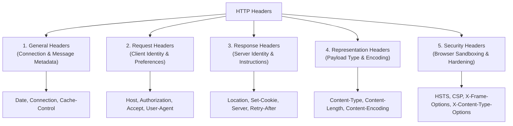
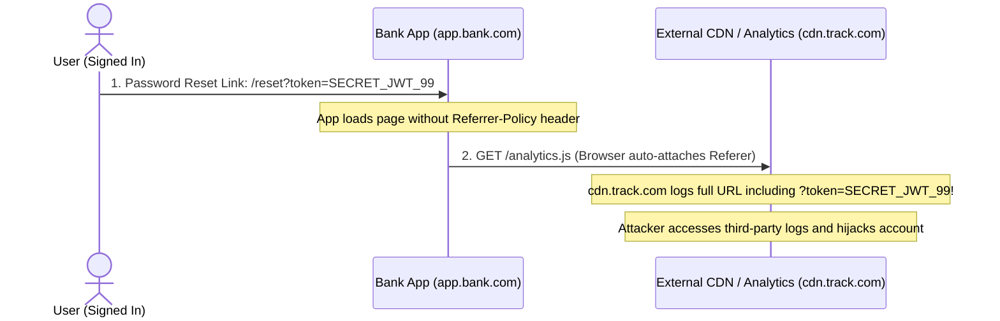

# Module 02: HTTP Headers Deep Dive

## Why This Matters

Headers are the control plane of the web. While the request line specifies *what* you want (`GET /users`), **headers dictate *how* the exchange behaves**:
* **Security:** Preventing clickjacking, MIME-confusion attacks, and protocol downgrade.
* **Performance:** Dictating browser and CDN caching, compression, and connection reuse.
* **Authentication:** Transmitting Bearer JWTs, API tokens, and session cookies.
* **Content Negotiation:** Translating JSON vs. Protocol Buffers vs. XML on the fly.

> [!TIP]
> **The Golden Rule:** Don't memorize 80 random headers. Memorize the **5 functional categories**: *General, Request, Response, Representation, and Security*. Once you know the category, you immediately know who sets it and what it controls.

---

## The Mental Model: 5 Functional Categories



---

## 1. Quick Reference: The 5 Categories

```
  CLIENT REQUEST                             SERVER RESPONSE
  ┌─────────────────────────────────┐        ┌─────────────────────────────────┐
  │ GET /orders/102 HTTP/1.1        │        │ HTTP/1.1 200 OK                 │
  │ Host: api.example.com           │ Req    │ Date: Wed, 21 Oct 2026 07:28 GMT│ Gen
  │ Authorization: Bearer eyJ...    │ Req    │ Server: envoy                   │ Res
  │ Accept: application/json        │ Req    │ Content-Type: application/json  │ Rep
  │ Accept-Encoding: gzip, zstd     │ Req    │ Content-Encoding: gzip          │ Rep
  │ Connection: keep-alive          │ Gen    │ Content-Length: 142             │ Rep
  │                                 │        │ Strict-Transport-Security: ...  │ Sec
  │                                 │        │ X-Content-Type-Options: nosniff │ Sec
  └─────────────────────────────────┘        └─────────────────────────────────┘
```

### The Negotiation Pair
Notice the symmetry between what the client requests and what the server delivers:

| Client Asks (`Accept-*`) | Server Answers (`Content-*`) | What it controls |
| :--- | :--- | :--- |
| `Accept: application/json` | `Content-Type: application/json; charset=utf-8` | Data format & MIME type |
| `Accept-Encoding: gzip, br` | `Content-Encoding: br` | Payload compression algorithm |
| `Accept-Language: en-US, fr` | `Content-Language: en-US` | Natural language localization |

---

## 2. Essential Security Headers (The Defense Kit)

Omitting these headers is the #1 finding in automated vulnerability scans:

| Header | Production Setting | Vulnerability Prevented |
| :--- | :--- | :--- |
| **HSTS** | `Strict-Transport-Security: max-age=31536000; includeSubDomains` | **SSL Stripping:** Forces browser to use HTTPS exclusively for 1 year. |
| **MIME Sniffing** | `X-Content-Type-Options: nosniff` | **MIME Confusion:** Prevents browsers from executing user uploads as scripts. |
| **Clickjacking** | `X-Frame-Options: DENY`<br>*(or CSP `frame-ancestors 'none'`)* | **UI Redressing:** Forbids embedding your site inside malicious `<iframe>` tags. |
| **CSP** | `Content-Security-Policy: default-src 'self'` | **XSS (Cross-Site Scripting):** Restricts where scripts and assets can load from. |
| **Referrer Leak** | `Referrer-Policy: strict-origin-when-cross-origin` | **Token Leakage:** Prevents leaking private URL parameters to external sites. |

---

## 3. Production War Story: The Leaked Auth Token in Referer



### The Incident
A financial SaaS platform allowed users to invite team members via URL links: `https://app.example.com/join?invite_token=secret_abc123`. A third-party analytics script embedded on the page recorded traffic. Within hours, unauthorized accounts were joining private workspaces.

### The Root Cause
By default, older browser specifications transmitted the **full URL** (including path and query parameters) in the `Referer` header to all external images, scripts, and links. Because the application did not specify a `Referrer-Policy` header, the sensitive `invite_token` was transmitted in plain text to the third-party analytics servers.

### The Fix
Always set a strict referrer policy on your API gateway or application server:
```http
Referrer-Policy: strict-origin-when-cross-origin
```
*(This ensures external domains only receive the origin `https://app.example.com`, completely stripping the path and sensitive query tokens).*

---

## 4. Multi-Language Implementation: Reading & Setting Headers

### Go (`net/http`)
```go
package main

import (
	"net/http"
	"strings"
)

func secureHandler(w http.ResponseWriter, r *http.Request) {
	// 1. Reading Request Headers
	authHeader := r.Header.Get("Authorization")
	if !strings.HasPrefix(authHeader, "Bearer ") {
		w.Header().Set("WWW-Authenticate", `Bearer error="invalid_token"`)
		http.Error(w, "Unauthorized", http.StatusUnauthorized)
		return
	}

	// 2. Setting Production Security & Representation Headers
	w.Header().Set("Content-Type", "application/json; charset=utf-8")
	w.Header().Set("Strict-Transport-Security", "max-age=31536000; includeSubDomains")
	w.Header().Set("X-Content-Type-Options", "nosniff")
	w.Header().Set("X-Frame-Options", "DENY")
	w.Header().Set("Cache-Control", "no-store") // Sensitive data must never be cached

	w.WriteHeader(http.StatusOK)
	w.Write([]byte(`{"status":"authenticated"}`))
}
```

### Node.js / Express
```typescript
import express, { Request, Response } from 'express';

const app = express();

app.get('/api/data', (req: Request, res: Response) => {
  // 1. Read header (case-insensitive in Node)
  const clientAgent = req.headers['user-agent'] || 'unknown';

  // 2. Set security and custom metadata headers
  res.set({
    'Content-Type': 'application/json',
    'X-Content-Type-Options': 'nosniff',
    'X-Frame-Options': 'DENY',
    'Referrer-Policy': 'strict-origin-when-cross-origin',
    'X-Response-Time-Ms': '12' // Custom observability header
  });

  res.json({ message: 'Secure payload', agent: clientAgent });
});
```

### Python (FastAPI)
```python
from fastapi import FastAPI, Header, Response, HTTPException

app = FastAPI()

@app.get("/api/account")
async def get_account(response: Response, authorization: str = Header(None)):
    if not authorization or not authorization.startswith("Bearer "):
        response.headers["WWW-Authenticate"] = "Bearer"
        raise HTTPException(status_code=401, detail="Missing or invalid token")

    # Harden response with standard security headers
    response.headers["X-Content-Type-Options"] = "nosniff"
    response.headers["X-Frame-Options"] = "DENY"
    response.headers["Strict-Transport-Security"] = "max-age=31536000; includeSubDomains"
    
    return {"account_id": "acc_84920", "tier": "enterprise"}
```

---

## 5. Practical Hands-On Exercises

### Exercise 1: Inspect Real Production Headers
Run this against GitHub's public API to view their complete response header block:
```bash
curl -s -D - -o /dev/null https://api.github.com/
```
**Look for:**
* `x-ratelimit-remaining` (Custom rate-limiting header)
* `content-security-policy` (Hardening against XSS)
* `x-content-type-options: nosniff` (Preventing MIME confusion)

### Exercise 2: Simulate Client Content Negotiation
Send two requests to the same endpoint requesting different content formats:
```bash
# Request JSON
curl -s -I -H "Accept: application/json" https://httpbin.org/headers | grep -i content-type

# Request HTML
curl -s -I -H "Accept: text/html" https://httpbin.org/headers | grep -i content-type
```

---

## 6. Operational Validation Checkpoint

<details>
<summary><strong>Question 1: The Avatar Upload Attack (MIME Sniffing)</strong></summary>

**Scenario:** A user uploads a file named `avatar.jpg` containing malicious JavaScript: `<script>alert(document.cookie)</script>`. Your backend serves it directly from S3 without headers. In Internet Explorer or older browsers, the script executes and steals user cookies. 

Which single response header prevents this vulnerability?

**Answer:**
`X-Content-Type-Options: nosniff`. 
By default, browsers that encounter HTML tags inside an image file will "sniff" the payload, override the file extension, and execute it as HTML/JavaScript. `nosniff` forces the browser to treat the file strictly as the declared `Content-Type` (`image/jpeg`).
</details>

<details>
<summary><strong>Question 2: Handling Rate Limits Gracefully</strong></summary>

**Scenario:** Your microservice calls an external SMS provider API. The provider starts returning `HTTP 429 Too Many Requests`. What header should your client code check before deciding when to retry?

**Answer:**
**`Retry-After`**. 
Compliant HTTP servers send `Retry-After: 60` (wait 60 seconds) or `Retry-After: Wed, 21 Oct 2026 07:28:00 GMT` (wait until timestamp). Good client backoff algorithms read this header to avoid getting permanently IP-banned.
</details>

<details>
<summary><strong>Question 3: Case Sensitivity on the Wire</strong></summary>

**Scenario:** A junior developer writes:
`if (req.headers["Content-Type"] === "application/json")`
In Node.js this works, but in another raw framework it fails because the client sent `content-type: application/json`. Who is correct according to the HTTP specification?

**Answer:**
The client is correct. **HTTP header field names are strictly case-insensitive** (RFC 9110). In HTTP/2 and HTTP/3, all header keys are strictly lowercased at the protocol level. Backend code must always look up headers case-insensitively.
</details>

---

## Next Step

Now that you understand headers, proceed to **[03-http-methods-and-semantics](../03-http-methods-and-semantics/README.md)** to master idempotency, safe methods, and RESTful routing rules.
