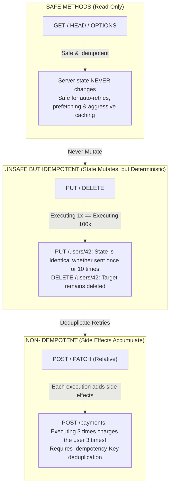
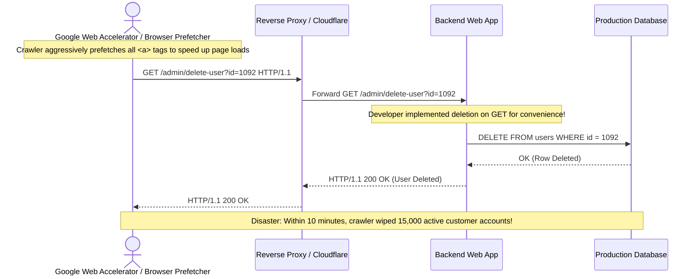
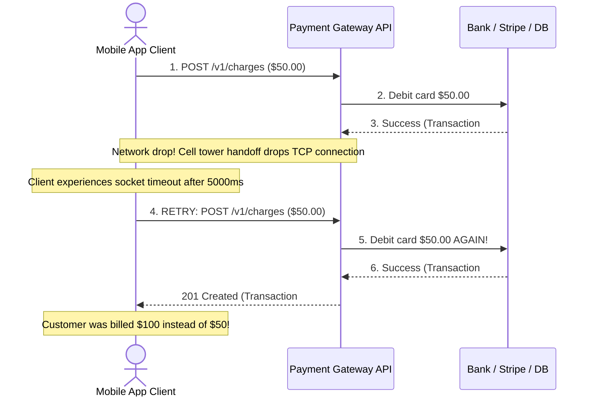

# Module 03: HTTP Methods and Semantics

## Why This Matters

The HTTP method is the verb of a web request. While the URL identifies *which* resource you are targeting (`/orders/42`), **the method specifies *what* you intend to do to it**:
* **Safety:** Declares whether an operation is strictly read-only and safe for search engine crawlers, browsers, and CDNs to prefetch or retry automatically.
* **Idempotency:** Dictates whether repeating the identical request $N$ times leaves the system in the exact same state as running it once—the cornerstone of building reliable microservices over unreliable networks.
* **Predictable Contracts:** Distinguishes between wholesale entity replacement (`PUT`), surgical partial edits (`PATCH`), and new entity allocation (`POST`).

> [!TIP]
> **The Golden Rule:** Never mutate state on a `GET` request, and never expose a billing, creation, or checkout `POST` endpoint without an `Idempotency-Key` mechanism.

---

## The Mental Model: Safety vs. Idempotency



### The Safety & Idempotency Decision Matrix

| Method | Safe? | Idempotent? | Request Body? | Typical Success Status | Core Responsibility |
| :--- | :---: | :---: | :---: | :---: | :--- |
| **`GET`** | **Yes** | **Yes** | No | `200 OK` | Retrieve resource representation without side effects. |
| **`HEAD`** | **Yes** | **Yes** | No | `200 OK` | Fetch exact headers as `GET`, omitting the body (existence & freshness check). |
| **`OPTIONS`** | **Yes** | **Yes** | No | `204 No Content` / `200 OK` | Query server capabilities and allowed verbs (CORS preflight). |
| **`PUT`** | No | **Yes** | **Yes** | `200 OK` / `204 No Content` | **Wholesale replacement** of resource at client-specified URL. |
| **`DELETE`** | No | **Yes** | Rare | `204 No Content` / `200 OK` | Purge resource; consecutive calls leave state unchanged. |
| **`PATCH`** | No | **Conditional** | **Yes** | `200 OK` | **Surgical update** of specific fields; delta modification. |
| **`POST`** | No | **No** | **Yes** | `201 Created` | Subordinate resource creation, processing, or non-idempotent action. |

---

## 1. Quick Reference: PUT vs. POST vs. PATCH

The single most common source of confusion in REST API design is distinguishing between these three mutation verbs:

```
PUT /users/42                           POST /users                             PATCH /users/42
┌─────────────────────────────┐        ┌─────────────────────────────┐        ┌─────────────────────────────┐
│ Replace ENTIRE Resource     │        │ Create NEW Subordinate      │        │ Partial / Delta Update      │
├─────────────────────────────┤        ├─────────────────────────────┤        ├─────────────────────────────┤
│ Sent: {"name": "Alice"}     │        │ Sent: {"name": "Bob"}       │        │ Sent: {"status": "active"}  │
│ Existing: {name, email, age}│        │ Target: Collection /users   │        │ Existing: {name, email, age}│
│ Result: email & age ERASED! │        │ Result: Creates /users/43   │        │ Result: Only status updated!│
│ Idempotent: YES             │        │ Idempotent: NO              │        │ Idempotent: Usually YES     │
└─────────────────────────────┘        └─────────────────────────────┘        └─────────────────────────────┘
```

### The Key Distinctions
1. **URI Allocation:**
   * In `PUT /users/42`, the **client** decides the exact URI of the resource.
   * In `POST /users`, the **server** decides the URI (e.g. assigning UUID/ID `43`) and announces it via the `Location: /users/43` header.
2. **Wholesale vs. Partial (The "Omitted Field" Trap):**
   * If you send `PUT /users/42` with only `{"name": "Alice"}`, any existing fields like `"email"` or `"roles"` **must be wiped clean** according to HTTP semantics.
   * If you want to alter only the `"email"` without disturbing other fields, use `PATCH /users/42`.

---

## 2. Production War Story: The Accidental Deletion Web Accelerator Outage



### The Incident
In 2005, shortly after Google released the Google Web Accelerator (a browser plugin that prefetched web links in the background to accelerate browsing), multiple corporate intranets and discussion boards suffered catastrophic data loss. Moderators reported that thousands of accounts, threads, and databases were mysteriously deleted in minutes without any human clicking "Confirm".

### The Root Cause
Developers had created administrative action links in HTML:
```html
<a href="/admin/users/delete?id=42">Delete User</a>
```
Because HTML links emit `GET` requests, the developers coded the backend route to execute database mutations on `GET`. Google Web Accelerator followed the HTTP specification (RFC 9110), which guarantees that **`GET` is a safe, read-only method**. The crawler crawled every link on the page to cache the response, inadvertently triggering mass deletions.

### The Fix
1. **Strictly enforce Safe Method semantics:** Never trigger database writes, deletions, or external state changes in `GET` or `HEAD` handlers.
2. Require destructive actions to use `POST` or `DELETE` with CSRF protection:
```html
<form method="POST" action="/admin/users/42/delete">
  <input type="hidden" name="_csrf" value="...">
  <button type="submit">Delete User</button>
</form>
```

---

## 3. Production War Story: The Double-Charge Timeout Disaster



### The Solution: The `Idempotency-Key` Pattern
Because `POST` is not idempotent, network timeouts leave clients in an ambiguous state: **did the server fail before charging, or did the response drop after charging?**
By attaching a client-generated UUID in the `Idempotency-Key` header:
```http
POST /v1/charges HTTP/1.1
Host: api.stripe.com
Idempotency-Key: 9b1deb4d-3b7d-4bad-9bdd-2b0d7b3dcb6d
Content-Type: application/json

{"amount": 5000, "currency": "usd"}
```
The server checks Redis/Postgres for the key. If seen, it returns the cached original response without re-executing the payment.

---

## 4. Multi-Language Implementation: Idempotency & Safe Routing

### Go (`net/http`)
Production implementation of safe methods, `405 Method Not Allowed`, and an in-memory Idempotency Cache:

```go
package main

import (
	"encoding/json"
	"fmt"
	"net/http"
	"sync"
)

type OrderRequest struct {
	Item   string  `json:"item"`
	Amount float64 `json:"amount"`
}

type OrderResponse struct {
	ID     string  `json:"id"`
	Status string  `json:"status"`
	Item   string  `json:"item"`
	Amount float64 `json:"amount"`
}

var (
	idempotencyStore = make(map[string]OrderResponse)
	storeMu          sync.Mutex
)

func ordersHandler(w http.ResponseWriter, r *http.Request) {
	// 1. Guard Supported Methods (Return 405 Method Not Allowed with Allow header)
	if r.Method != http.MethodGet && r.Method != http.MethodPost {
		w.Header().Set("Allow", "GET, POST")
		http.Error(w, "Method Not Allowed", http.StatusMethodNotAllowed)
		return
	}

	// 2. GET is safe and idempotent
	if r.Method == http.MethodGet {
		w.Header().Set("Content-Type", "application/json")
		w.WriteHeader(http.StatusOK)
		w.Write([]byte(`[{"id":"ord_1","item":"MacBook","amount":1999.00}]`))
		return
	}

	// 3. POST: Enforce Idempotency-Key for write operations
	idempotencyKey := r.Header.Get("Idempotency-Key")
	if idempotencyKey == "" {
		http.Error(w, "Missing mandatory 'Idempotency-Key' header", http.StatusBadRequest)
		return
	}

	storeMu.Lock()
	defer storeMu.Unlock()

	// Check if this exact request was already processed
	if cachedResp, exists := idempotencyStore[idempotencyKey]; exists {
		w.Header().Set("Content-Type", "application/json")
		w.Header().Set("X-Cache-Lookup", "HIT-IDEMPOTENT")
		w.WriteHeader(http.StatusOK)
		json.NewEncoder(w).Encode(cachedResp)
		return
	}

	// Process new order
	var req OrderRequest
	if err := json.NewDecoder(r.Body).Decode(&req); err != nil {
		http.Error(w, "Invalid JSON payload", http.StatusBadRequest)
		return
	}

	orderID := fmt.Sprintf("ord_%d", len(idempotencyStore)+100)
	resp := OrderResponse{
		ID:     orderID,
		Status: "confirmed",
		Item:   req.Item,
		Amount: req.Amount,
	}

	idempotencyStore[idempotencyKey] = resp

	w.Header().Set("Content-Type", "application/json")
	w.Header().Set("Location", "/orders/"+orderID)
	w.WriteHeader(http.StatusCreated) // 201 Created for new resource
	json.NewEncoder(w).Encode(resp)
}

func main() {
	http.HandleFunc("/orders", ordersHandler)
	http.ListenAndServe(":8080", nil)
}
```

### Node.js / Express
```typescript
import express, { Request, Response, NextFunction } from 'express';

const app = express();
app.use(express.json());

const idempotencyCache = new Map<string, { status: number; body: any }>();

// Idempotency Middleware for mutating routes
function idempotencyMiddleware(req: Request, res: Response, next: NextFunction) {
  if (req.method !== 'POST') return next();

  const key = req.headers['idempotency-key'] as string;
  if (!key) {
    return res.status(400).json({ error: "Missing required 'Idempotency-Key' header" });
  }

  if (idempotencyCache.has(key)) {
    const cached = idempotencyCache.get(key)!;
    res.setHeader('X-Cache-Lookup', 'HIT-IDEMPOTENT');
    return res.status(cached.status).json(cached.body);
  }

  // Intercept response to store in cache
  const originalJson = res.json.bind(res);
  res.json = (body: any) => {
    if (res.statusCode >= 200 && res.statusCode < 300) {
      idempotencyCache.set(key, { status: res.statusCode, body });
    }
    return originalJson(body);
  };

  next();
}

app.post('/api/orders', idempotencyMiddleware, (req: Request, res: Response) => {
  const newOrderId = `ord_${Date.now()}`;
  const order = { id: newOrderId, ...req.body, status: 'processed' };

  res.setHeader('Location', `/api/orders/${newOrderId}`);
  res.status(201).json(order);
});

// Explicit 405 Method Not Allowed handler
app.all('/api/orders', (req: Request, res: Response) => {
  res.setHeader('Allow', 'GET, POST');
  res.status(405).json({ error: `Method ${req.method} not allowed on /api/orders` });
});
```

### Python (FastAPI)
```python
from fastapi import FastAPI, Header, HTTPException, Response, status
from pydantic import BaseModel
from typing import Dict, Optional
import uuid

app = FastAPI()

class OrderInput(BaseModel):
    item: str
    price: float

orders_db: Dict[str, dict] = {}
idempotency_table: Dict[str, dict] = {}

@app.post("/orders", status_code=status.HTTP_201_CREATED)
def create_order(
    order: OrderInput,
    response: Response,
    idempotency_key: Optional[str] = Header(None)
):
    if not idempotency_key:
        raise HTTPException(
            status_code=status.HTTP_400_BAD_REQUEST,
            detail="Header 'Idempotency-Key' is required for order creation"
        )

    # Return cached response if idempotency key exists
    if idempotency_key in idempotency_table:
        response.headers["X-Cache-Lookup"] = "HIT-IDEMPOTENT"
        return idempotency_table[idempotency_key]

    order_id = f"ord_{uuid.uuid4().hex[:8]}"
    created_order = {
        "id": order_id,
        "item": order.item,
        "price": order.price,
        "status": "confirmed"
    }

    orders_db[order_id] = created_order
    idempotency_table[idempotency_key] = created_order

    response.headers["Location"] = f"/orders/{order_id}"
    return created_order

@app.delete("/orders/{order_id}", status_code=status.HTTP_204_NO_CONTENT)
def delete_order(order_id: str):
    # Idempotent deletion: popping non-existent key leaves system in same deleted state
    orders_db.pop(order_id, None)
    return Response(status_code=status.HTTP_204_NO_CONTENT)
```

---

## 5. Practical Hands-On Exercises

### Exercise 1: Witness PUT "Wholesale Wipeout" vs. PATCH
Run these commands against a test endpoint or your local server to observe the destructive nature of `PUT`:

```bash
# 1. Inspect existing resource
curl -s https://jsonplaceholder.typicode.com/posts/1

# 2. Issue a PUT updating ONLY the title
curl -s -X PUT -H "Content-Type: application/json" \
  -d '{"title": "Only Title Provided"}' \
  https://jsonplaceholder.typicode.com/posts/1

# Observe: The returned object lacks "body" and "userId" because PUT wiped unmentioned fields!

# 3. Issue a PATCH updating ONLY the title
curl -s -X PATCH -H "Content-Type: application/json" \
  -d '{"title": "Only Title Provided"}' \
  https://jsonplaceholder.typicode.com/posts/1

# Observe: The returned object preserves "body" and "userId", editing only the title!
```

### Exercise 2: Verify `405 Method Not Allowed` & the `Allow` Header
Verify that well-behaved HTTP servers inform the client which verbs are supported:

```bash
# Attempt to send DELETE to the root of GitHub's API
curl -s -i -X DELETE https://api.github.com/ | grep -E "(HTTP\/|Allow:)"
```
**Look for:**
* Status `405 Method Not Allowed`
* Header `Allow: GET, POST, HEAD, OPTIONS`

---

## 6. Operational Validation Checkpoint

<details>
<summary><strong>Question 1: The Safe Method Violation</strong></summary>

**Scenario:** An engineering team notices that email unsubscribe links look like:
`https://api.newsletter.com/unsubscribe?user_id=8192`
When Microsoft Outlook's automated spam scanner previews inbound email links, thousands of users are unsubscribed without ever opening the email.

What HTTP design error occurred, and what is the standard fix?

**Answer:**
The endpoint violated **Safety Semantics** by executing a state mutation (database update) on a `GET` request. 

RFC 9110 specifies that `GET` is safe and read-only. Automated bots, virus scanners, and web crawlers are permitted to pre-fetch any `GET` URL without warning. The fix is to make the email link lead to a landing page with a confirmation button that submits a `POST` request (`POST /subscriptions/unsubscribe`), or require an explicit confirmation token.
</details>

<details>
<summary><strong>Question 2: Idempotency Under Network Partitions</strong></summary>

**Scenario:** A client submits `DELETE /items/99`. The server finds item 99, deletes it from Postgres, and returns `204 No Content`. 

Due to a temporary Wi-Fi blip, the client never receives the packet and times out after 3 seconds. The client's retry engine re-sends `DELETE /items/99`. This time, the server returns `404 Not Found`.

Did the server violate HTTP idempotency guarantees?

**Answer:**
**No.** Idempotency is defined by the **resulting server state**, not the HTTP status code. 

Before the first request, item 99 existed. After the first request, item 99 was gone. After the second (retried) request, item 99 was still gone. Because $N$ requests left the server state identical to 1 request, the method is strictly idempotent.
</details>

<details>
<summary><strong>Question 3: Choosing Between PUT and POST</strong></summary>

**Scenario:** You are architecting an IoT sensor ingest pipeline. 10,000 temperature sensors report readings every 10 seconds. Network connectivity in the field is unstable, causing frequent request timeouts and automatic retries.

Should the ingest endpoint be designed as:
Option A: `POST /readings`
Option B: `PUT /devices/{device_id}/readings/{timestamp}`

Why?

**Answer:**
**Option B (`PUT`) is vastly superior for unstable networks.**

Because `PUT` is idempotent and uses a client-known URI (`{device_id}/readings/{timestamp}`), if a sensor experiences a timeout and retries the upload 5 times, it will simply overwrite the reading with the exact same data without creating duplicates. 

Option A (`POST /readings`) is non-idempotent; every retry would insert duplicate rows into the database unless complex idempotency-key deduplication tables are maintained.
</details>

---

## Next Step

Now that you have mastered HTTP method semantics and idempotency, proceed to **[04-cors-and-preflight-requests](../04-cors-and-preflight-requests/README.md)** to understand cross-origin browser security, preflight `OPTIONS` handshakes, and credential rules.
