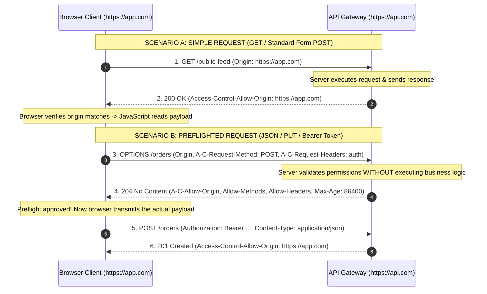
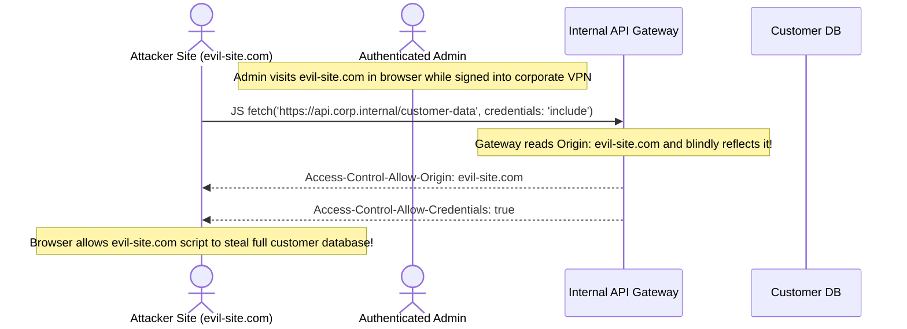
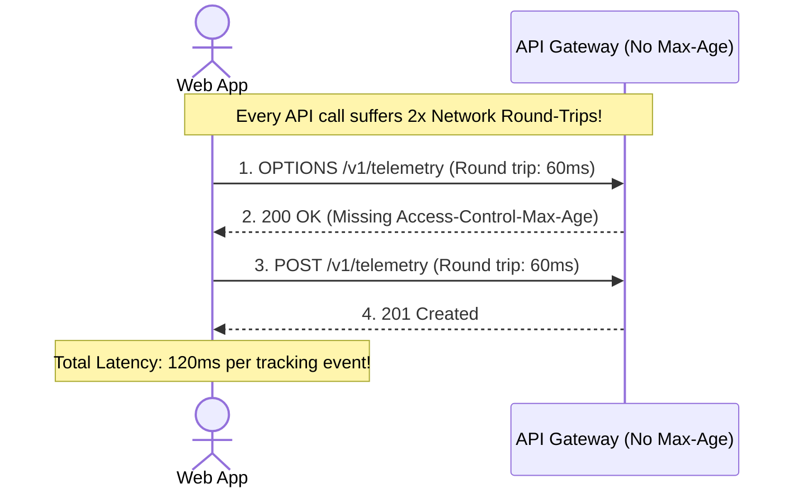

# Module 04: CORS and Preflight Requests

## Why This Matters

CORS (Cross-Origin Resource Sharing) is the single most misunderstood topic in backend engineering. Almost every engineer has encountered the dreaded browser error:
```text
Access to fetch at 'https://api.company.com' from origin 'https://app.company.com' 
has been blocked by CORS policy: No 'Access-Control-Allow-Origin' header is present.
```

The fundamental mental unlock: **CORS is enforced by the browser, not your server, and it protects the *user*, not your backend.**
* **CORS protects user sessions:** Without CORS and the Same-Origin Policy (SOP), any malicious website you visit could silently run background JavaScript to fetch private bank statements or read internal company dashboards using your active browser cookies.
* **Non-browser clients are immune:** `curl`, Postman, Python scripts, and backend microservices do not enforce CORS. If an endpoint works in `curl` but breaks in a React frontend, the API is healthy—you simply haven't granted the browser permission to share the response.
* **Preflight latency overhead:** For complex requests (JSON, PUT/DELETE, Bearer tokens), browsers transmit an automatic preliminary `OPTIONS` request before the real payload. Misconfiguring preflight caching doubles the latency of every API call.

> [!TIP]
> **The Golden Rule:** Never configure `Access-Control-Allow-Origin: *` alongside `Access-Control-Allow-Credentials: true`. Always validate the inbound `Origin` header against an explicit, trusted domain allowlist.

---

## The Mental Model: Simple vs. Preflighted Requests



---

## 1. Quick Reference: Origin Anatomy & The CORS Header Family

An **Origin** consists strictly of the three-tuple: **Scheme + Hostname + Port**:

```
https://api.example.com:443
│       │               │
Scheme  Hostname        Port
```

| Source Page Origin | Target Request URI | Cross-Origin? | Reason |
| :--- | :--- | :---: | :--- |
| `https://example.com` | `https://example.com/api` | **No** | Identical scheme, host, and port (Same-Origin). |
| `https://app.example.com` | `https://api.example.com` | **YES** | Host differs (`app` vs `api`). |
| `http://example.com` | `https://example.com` | **YES** | Scheme differs (`http` vs `https`). |
| `http://localhost:3000` | `http://localhost:8080` | **YES** | Port differs (`3000` vs `8080`). |

### The CORS Header Reference

| Header | Direction | Category | Role |
| :--- | :--- | :--- | :--- |
| **`Origin`** | Request | Standard | Injected automatically by the browser with the calling page's origin. |
| **`Access-Control-Request-Method`** | Request | Preflight | Informs the server which HTTP verb the real request will use. |
| **`Access-Control-Request-Headers`** | Request | Preflight | Informs the server which custom headers the real request will send. |
| **`Access-Control-Allow-Origin`** | Response | Core | Specifies which origins are permitted to read the response (`https://app.com` or `*`). |
| **`Access-Control-Allow-Methods`** | Response | Preflight | Comma-delimited list of permitted HTTP methods (`GET, POST, PUT, DELETE`). |
| **`Access-Control-Allow-Headers`** | Response | Preflight | Comma-delimited list of permitted request headers (`Content-Type, Authorization`). |
| **`Access-Control-Allow-Credentials`** | Response | Security | When `true`, permits browsers to send cookies and HTTP auth cross-origin. |
| **`Access-Control-Max-Age`** | Response | Performance | Number of seconds the browser may cache the preflight response (e.g. `86400`). |
| **`Access-Control-Expose-Headers`** | Response | Visibility | Whitelist of response headers that browser JavaScript is allowed to read. |

---

## 2. Production War Story: The Wildcard Credential Reflection Hole



### The Incident
A SaaS company deployed an internal administrative API to manage enterprise customer accounts. A developer encountered a CORS error during staging and fixed it by configuring the reverse proxy to dynamically echo the inbound `Origin` header into `Access-Control-Allow-Origin`:
```nginx
# VULNERABLE NGINX CONFIGURATION:
add_header 'Access-Control-Allow-Origin' "$http_origin";
add_header 'Access-Control-Allow-Credentials' 'true';
```

### The Root Cause
Because browsers forbid `Access-Control-Allow-Origin: *` when credentials (cookies) are enabled, the developer thought "reflecting" the incoming origin was a clever workaround. When an employee visited an untrusted forum containing a malicious script, the script issued cross-origin requests to the internal corporate API. The proxy blindly reflected `evil-site.com` as an authorized origin and enabled credentials, allowing the attacker's script to read confidential customer data.

### The Fix
Validate the `Origin` header against an explicit, immutable allowlist before setting the header:
```nginx
# SECURE CONFIGURATION:
map $http_origin $cors_origin {
    default "";
    "https://admin.company.com" "$http_origin";
    "https://app.company.com"   "$http_origin";
}
add_header 'Access-Control-Allow-Origin' $cors_origin always;
```

---

## 3. Production War Story 2: The Double Latency Penalty



### The Incident
An e-commerce single-page app reported that customer checkout buttons felt sluggish on mobile connections. Network traces revealed that every single `POST /cart/add` took **320ms**, even though backend database execution was only **15ms**.

### The Root Cause
The frontend sent `Content-Type: application/json` and an `Authorization` header, triggering a CORS preflight on every interaction. The backend API omitted the `Access-Control-Max-Age` header. As a result, the browser discarded the preflight permission immediately, forcing a separate `OPTIONS` handshake before **every single API call**.

### The Fix
Set `Access-Control-Max-Age: 86400` (24 hours). The browser executes the preflight handshake once, caches the grant, and makes all subsequent requests in a single round-trip.

---

## 4. Multi-Language Implementation: Production CORS Configs

### Go (`net/http`)
Production CORS middleware with explicit origin checking, preflight caching, and 204 No Content response:

```go
package main

import (
	"net/http"
	"strings"
)

var allowedOrigins = map[string]bool{
	"https://app.example.com":   true,
	"https://admin.example.com": true,
}

func corsMiddleware(next http.Handler) http.Handler {
	return http.HandlerFunc(func(w http.ResponseWriter, r *http.Request) {
		origin := r.Header.Get("Origin")

		// 1. Verify Origin against allowlist
		if allowedOrigins[origin] {
			w.Header().Set("Access-Control-Allow-Origin", origin)
			w.Header().Set("Access-Control-Allow-Credentials", "true")
			w.Header().Set("Vary", "Origin") // Critical for downstream caching
		}

		// 2. Intercept and Handle Preflight (OPTIONS)
		if r.Method == http.MethodOptions {
			w.Header().Set("Access-Control-Allow-Methods", "GET, POST, PUT, DELETE, OPTIONS")
			w.Header().Set("Access-Control-Allow-Headers", "Content-Type, Authorization, X-Requested-With")
			w.Header().Set("Access-Control-Max-Age", "86400") // Cache preflight for 24 hours
			w.WriteHeader(http.StatusNoContent)               // Return 204 No Content
			return
		}

		next.ServeHTTP(w, r)
	})
}
```

### Node.js / Express
```typescript
import express from 'express';
import cors, { CorsOptions } from 'cors';

const app = express();

const whitelist = ['https://app.example.com', 'https://admin.example.com'];

const corsOptions: CorsOptions = {
  origin: (origin, callback) => {
    // Allow non-browser requests (e.g. curl, mobile apps with no origin header)
    if (!origin || whitelist.includes(origin)) {
      callback(null, true);
    } else {
      callback(new Error('Blocked by CORS policy'));
    }
  },
  methods: ['GET', 'POST', 'PUT', 'PATCH', 'DELETE', 'OPTIONS'],
  allowedHeaders: ['Content-Type', 'Authorization', 'X-Request-Id'],
  exposedHeaders: ['X-Total-Count', 'X-RateLimit-Remaining'],
  credentials: true,
  maxAge: 86400 // 24 hours preflight caching
};

app.use(cors(corsOptions));
```

### Python (FastAPI)
```python
from fastapi import FastAPI
from fastapi.middleware.cors import CORSMiddleware

app = FastAPI()

app.add_middleware(
    CORSMiddleware,
    allow_origins=[
        "https://app.example.com",
        "https://admin.example.com",
    ],
    allow_credentials=True,
    allow_methods=["GET", "POST", "PUT", "PATCH", "DELETE", "OPTIONS"],
    allow_headers=["Content-Type", "Authorization", "X-Request-Id"],
    expose_headers=["X-Total-Count", "X-RateLimit-Remaining"],
    max_age=86400, # Cache preflight in browser for 24 hours
)
```

---

## 5. Practical Hands-On Exercises

### Exercise 1: Simulate a Cross-Origin Preflight Handshake
Use `curl` to simulate the exact headers a browser sends when performing a cross-origin JSON request:

```bash
curl -s -i -X OPTIONS https://api.github.com/ \
  -H "Origin: https://github.com" \
  -H "Access-Control-Request-Method: POST" \
  -H "Access-Control-Request-Headers: content-type, authorization" \
  | grep -i "access-control"
```
**Look for:**
* `access-control-allow-origin`
* `access-control-allow-methods`
* `access-control-allow-headers`

### Exercise 2: Verify that Non-Browser Tools Ignore CORS
Send a request without an `Origin` header, or with an invalid one, using `curl`:

```bash
curl -s -i https://jsonplaceholder.typicode.com/posts/1 | grep -E "(HTTP\/|title)"
```
**Observe:** The request succeeds and returns `200 OK` with full data. Why? Because CORS is a client-side sandbox enforced **strictly by web browsers**.

---

## 6. Operational Validation Checkpoint

<details>
<summary><strong>Question 1: The Wildcard and Credentials Collision</strong></summary>

**Scenario:** A developer configures their API gateway with:
```http
Access-Control-Allow-Origin: *
Access-Control-Allow-Credentials: true
```
A frontend application running on `https://mybank.com` executes:
`fetch('https://api.mybank.com/profile', { credentials: 'include' })`

What does the browser do, and why?

**Answer:**
**The browser immediately blocks the JavaScript from reading the response and logs a CORS violation error.**

According to the W3C/WHATWG CORS specification, `Access-Control-Allow-Origin` **cannot be set to `*`** if `Access-Control-Allow-Credentials` is `true`. Allowing this combination would enable any website on the internet to make authenticated cross-origin requests with the victim's session cookies and steal their private data. The server must return the exact origin (`https://mybank.com`).
</details>

<details>
<summary><strong>Question 2: The Mystified Mobile Developer</strong></summary>

**Scenario:** An iOS developer using Swift calls your backend API and complains: *"Our iPhone app is getting blocked by CORS! Please add our app bundle ID to your CORS configuration."*

How should you respond from an architectural perspective?

**Answer:**
**Native mobile applications (iOS/Android) do not enforce CORS.**

CORS is an engine rule inside web browsers (Chrome, Safari, Firefox) to enforce the Same-Origin Policy for untrusted JavaScript. Native Swift or Kotlin networking code does not have a browser DOM sandbox, never enforces CORS, and does not send an `Origin` header. 

The mobile app failure is likely due to an invalid TLS certificate, missing request headers, DNS failure, or a standard HTTP `4xx/5xx` status code.
</details>

<details>
<summary><strong>Question 3: Missing Custom Header in Preflight</strong></summary>

**Scenario:** A frontend team introduces distributed tracing by adding an `X-Correlation-ID` header to every outbound request. Immediately, all `POST` and `PUT` requests fail in production with a CORS error, while `GET` requests with standard headers continue working.

Why did this occur, and what is the fix?

**Answer:**
`X-Correlation-ID` is a non-safelisted custom header. Adding it turns standard requests into **preflighted requests**, causing the browser to send an `OPTIONS` check with:
`Access-Control-Request-Headers: x-correlation-id`

Because the backend's `Access-Control-Allow-Headers` configuration did not include `X-Correlation-ID`, the server's preflight response omitted it. The browser rejected the preflight and aborted the real `POST` and `PUT` calls.

**Fix:** Add `X-Correlation-ID` to the server's `Access-Control-Allow-Headers` allowlist.
</details>

---

## Next Step

Now that you have mastered browser cross-origin security, proceed to **[05-http-responses-and-status-codes](../05-http-responses-and-status-codes/README.md)** to master status code taxonomies, error payloads (RFC 9457), and client handling patterns.
