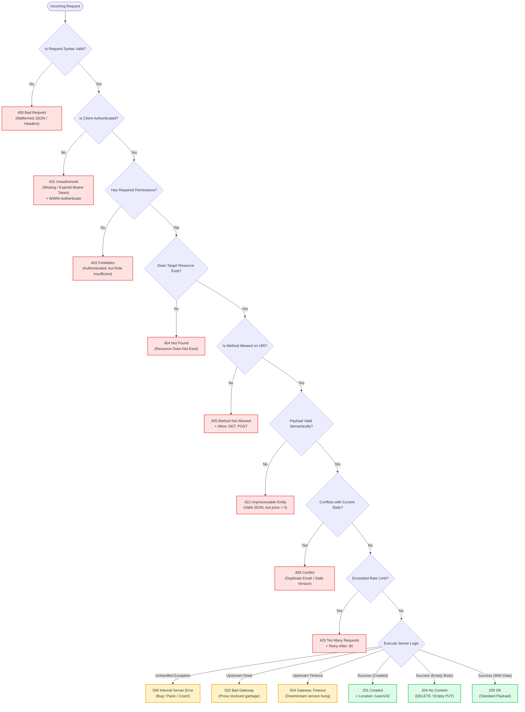
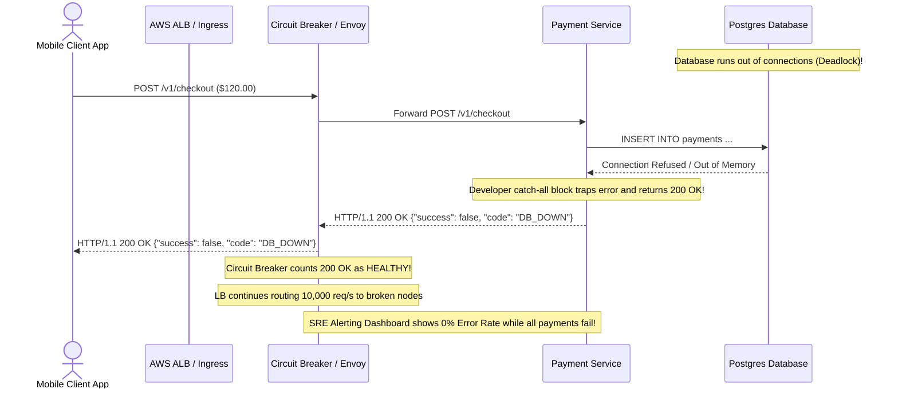
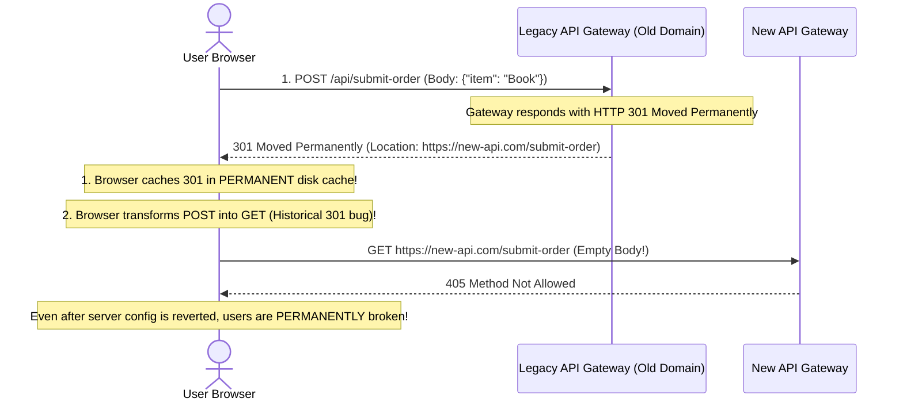

# Module 05: HTTP Responses and Status Codes

## Why This Matters

The HTTP status code is the server's three-digit executive summary of what happened on the wire. It is the primary signal consumed by every browser, API gateway, reverse proxy, CDN, SDK retry loop, and observability system (Datadog, Prometheus):
* **Automated Client Decisions:** A `304` tells a client to serve instantly from local disk cache, a `429` signals an exponential backoff loop, and a `503` commands a load balancer to eject the container from the pool.
* **The Blame Line ($4xx$ vs. $5xx$):** $4xx$ signifies a client-side mistake (invalid JSON, bad credentials)—retrying unchanged is futile. $5xx$ signifies server infrastructure distress—retrying with jitter is warranted.
* **Observability Integrity:** If your backend returns `200 OK` with `{"error": "database down"}`, every monitoring dashboard reports green while your users experience a 100% outage.

> [!TIP]
> **The Golden Rule:** Never return `200 OK` for error states. Classify the outcome using standard HTTP status codes, and elaborate machine-readable error details using RFC 9457 (`application/problem+json`).

---

## The Mental Model: The Decision Flowchart



---

## 1. Quick Reference: The 5 Status Code Classes

```
1xx ── Informational   Protocol handshakes & streaming interim states (101 Switching Protocols)
2xx ── Success         Action understood, accepted, and processed (200, 201, 204)
3xx ── Redirection     Additional client action required (301, 304 Not Modified, 307, 308)
4xx ── Client Error    Client sent invalid request; DO NOT retry unchanged (400, 401, 403, 404, 422, 429)
5xx ── Server Error    Server or downstream dependency failed; SAFE to retry with backoff (500, 502, 503, 504)
```

### The Standard Error Payload: RFC 9457 (Problem Details)
Instead of inventing arbitrary error schemas like `{"err": "bad"}`, high-reliability APIs use the standardized RFC 9457 format (`Content-Type: application/problem+json`):

```json
{
  "type": "https://api.example.com/errors/invalid-order",
  "title": "Unprocessable Order Payload",
  "status": 422,
  "detail": "The 'items' list contains an item with negative quantity.",
  "instance": "/orders/req_9a8f23",
  "invalid_params": [
    {
      "name": "quantity",
      "reason": "Must be greater than 0, received -2"
    }
  ]
}
```

---

## 2. Production War Story: The 200 OK Error Outage



### The Incident
During a Black Friday promotion, an e-commerce checkout service experienced a Postgres database connection pool exhaustion. Instead of returning `500 Internal Server Error` or `503 Service Unavailable`, the application catch-all block returned:
```json
HTTP/1.1 200 OK
Content-Type: application/json

{"status": "failure", "message": "Database pool exhausted"}
```

### The Root Cause
1. **Circuit Breakers Failed to Open:** The Envoy proxy was configured to trip and shed load if the 5xx rate exceeded 5%. Because the server returned `200 OK`, Envoy believed the backend was 100% healthy and continued routing full traffic into the saturated database.
2. **Alerting Was Blind:** Automated PagerDuty alerts configured for `sum(rate(http_requests_total{status=~"5.."}[5m])) > 1%` showed a flatline of zero. The outage went undetected for 45 minutes until customers flooded customer support.

### The Fix
Never mask failures with `200 OK`. Allow exceptions to map directly to appropriate HTTP status codes (`500` or `503`):
```http
HTTP/1.1 503 Service Unavailable
Retry-After: 30
Content-Type: application/problem+json

{
  "type": "https://api.example.com/errors/service-unavailable",
  "title": "Database Capacity Exhausted",
  "status": 503,
  "detail": "Temporary pool saturation. Retry after 30 seconds."
}
```

---

## 3. Production War Story: The Permanent 301 Cache Trap



### The Root Cause & The Fix
* **The Problem:** `301 Moved Permanently` is cached indefinitely by browser engines (often persisting until the user manually clears browser data). Furthermore, RFC 7231 acknowledges that older HTTP/1.0 clients frequently converted `POST` into `GET` upon receiving a `301` or `302`.
* **The Modern Standard:** When redirecting API requests where the HTTP method and payload must be strictly preserved, always use:
  * **`307 Temporary Redirect`** (Method and body preserved; not cached indefinitely).
  * **`308 Permanent Redirect`** (Method and body preserved; permanent).

---

## 4. Multi-Language Implementation: Standardized RFC 9457 Errors

### Go (`net/http`)
Production Problem Details error responder:

```go
package main

import (
	"encoding/json"
	"net/http"
)

type ProblemDetail struct {
	Type     string            `json:"type"`
	Title    string            `json:"title"`
	Status   int               `json:"status"`
	Detail   string            `json:"detail"`
	Instance string            `json:"instance,omitempty"`
	Errors   map[string]string `json:"errors,omitempty"`
}

func WriteProblem(w http.ResponseWriter, r *http.Request, status int, title, detail string, errs map[string]string) {
	w.Header().Set("Content-Type", "application/problem+json")
	w.WriteHeader(status)
	json.NewEncoder(w).Encode(ProblemDetail{
		Type:     "https://api.example.com/errors/" + http.StatusText(status),
		Title:    title,
		Status:   status,
		Detail:   detail,
		Instance: r.URL.Path,
		Errors:   errs,
	})
}

func checkoutHandler(w http.ResponseWriter, r *http.Request) {
	if r.Method != http.MethodPost {
		w.Header().Set("Allow", "POST")
		WriteProblem(w, r, http.StatusMethodNotAllowed, "Method Not Allowed", "Use POST to submit checkout", nil)
		return
	}

	auth := r.Header.Get("Authorization")
	if auth == "" {
		w.Header().Set("WWW-Authenticate", `Bearer realm="checkout"`)
		WriteProblem(w, r, http.StatusUnauthorized, "Authentication Required", "Valid Bearer token must be supplied", nil)
		return
	}

	// Example 422 Unprocessable Entity
	WriteProblem(w, r, http.StatusUnprocessableEntity, "Validation Error", "Item out of stock", map[string]string{
		"item_id": "SKU-9901 is out of inventory",
	})
}
```

### Node.js / Express
```typescript
import express, { Request, Response, NextFunction } from 'express';

export class AppError extends Error {
  constructor(
    public statusCode: number,
    public title: string,
    public detail: string,
    public errors?: Record<string, string>
  ) {
    super(detail);
  }
}

const app = express();

// Global RFC 9457 Error Middleware
app.use((err: Error, req: Request, res: Response, next: NextFunction) => {
  const isAppError = err instanceof AppError;
  const status = isAppError ? err.statusCode : 500;
  const title = isAppError ? err.title : 'Internal Server Error';
  const detail = isAppError ? err.detail : 'An unexpected infrastructure error occurred.';

  res.setHeader('Content-Type', 'application/problem+json');
  res.status(status).json({
    type: `https://api.example.com/errors/${status}`,
    title,
    status,
    detail,
    instance: req.originalUrl,
    ...(isAppError && err.errors ? { errors: err.errors } : {})
  });
});
```

### Python (FastAPI)
```python
from fastapi import FastAPI, Request, status
from fastapi.responses import JSONResponse
from fastapi.exceptions import RequestValidationError
from pydantic import BaseModel, Field

app = FastAPI()

class OrderInput(BaseModel):
    sku: str = Field(min_length=3)
    quantity: int = Field(gt=0, description="Quantity must be at least 1")

# Standardized RFC 9457 Validation Error Handler
@app.exception_handler(RequestValidationError)
async def validation_exception_handler(request: Request, exc: RequestValidationError):
    errors = {
        ".".join(str(loc) for loc in err["loc"]): err["msg"]
        for err in exc.errors()
    }
    return JSONResponse(
        status_code=status.HTTP_422_UNPROCESSABLE_ENTITY,
        media_type="application/problem+json",
        content={
            "type": "https://api.example.com/errors/validation",
            "title": "Request Validation Failed",
            "status": 422,
            "detail": "One or more input fields failed validation constraints.",
            "instance": request.url.path,
            "errors": errors
        }
    )
```

---

## 5. Practical Hands-On Exercises

### Exercise 1: Extract Just the HTTP Status Code for Health Scripting
Run this against any endpoint to extract the exact 3-digit status code without printing HTML/JSON bodies:

```bash
curl -o /dev/null -s -w "%{http_code}\n" https://api.github.com/
# Output: 200

curl -o /dev/null -s -w "%{http_code}\n" https://api.github.com/non-existent-route
# Output: 404
```

### Exercise 2: Observe 307 vs. 301 Behavior
Send a request that triggers a URL canonicalization redirect:

```bash
curl -s -i https://httpbin.org/status/307 -H "Origin: https://example.com"
```
**Look for:**
* Status `307 Temporary Redirect`
* `Location` header indicating target destination

---

## 6. Operational Validation Checkpoint

<details>
<summary><strong>Question 1: The Authentication vs. Authorization Mismatch</strong></summary>

**Scenario:** An employee calls an internal payroll endpoint: `GET /api/v1/salaries/executive`.
The client provides a valid, unexpired Bearer JWT for user `john.doe`, but John is an intern and not in the `Executive-HR` security group.

Should the server respond with `401 Unauthorized` or `403 Forbidden`?

**Answer:**
**The server MUST return `403 Forbidden`.**

* `401 Unauthorized` specifically means **unauthenticated** (missing, invalid, or expired credentials). Returning `401` instructs the client SDK to dump the token and present a login screen.
* `403 Forbidden` means **authenticated, but unauthorized** (the server knows who you are, but your role/permissions do not permit access). Re-authenticating with the same credentials will not help.
</details>

<details>
<summary><strong>Question 2: Diagnosing 502 vs. 504 on an AWS ALB</strong></summary>

**Scenario:** Your application load balancer (ALB) suddenly spikes in 5xx errors during peak traffic.
In the ALB access logs, half the errors are logged as `502` and the other half as `504`.

What is the operational difference between these two error states?

**Answer:**
* **`502 Bad Gateway`** indicates that the ALB connected to the backend container, but the container **terminated the connection abruptly** (TCP RST), crashed with an uncaught SIGSEGV/OOM, or returned malformed HTTP bytes.
* **`504 Gateway Timeout`** indicates that the ALB connected to the backend container, but the backend **failed to respond within the ALB idle timeout limit** (e.g. 60 seconds) due to slow database queries or CPU starvation.
</details>

<details>
<summary><strong>Question 3: Validation Error Code Selection</strong></summary>

**Scenario:** A client submits a `POST /v1/users` request with the body:
`{"email": "not-an-email", "age": -10}`
The JSON parser parses the bytes successfully into an object, but your schema validator rejects the fields.

Why should a modern API return `422 Unprocessable Entity` instead of `400 Bad Request`?

**Answer:**
* **`400 Bad Request`** indicates that the server **could not understand or parse the request** (e.g. malformed syntax, truncated bytes, invalid HTTP headers).
* **`422 Unprocessable Entity`** (RFC 9110) indicates that the syntax is completely valid and parseable (the JSON is well-formed), but the enclosed instructions or business rules are semantically invalid. 

Returning `422` allows clients to differentiate between transport/syntax corruption (`400`) and field validation errors (`422`) that can be highlighted directly in user form interfaces.
</details>

---

## Next Step

Now that you have mastered HTTP status codes and error taxonomy, proceed to **[06-http-caching](../06-http-caching/README.md)** to master `Cache-Control`, `ETags`, `Last-Modified`, and 304 conditional validation.
