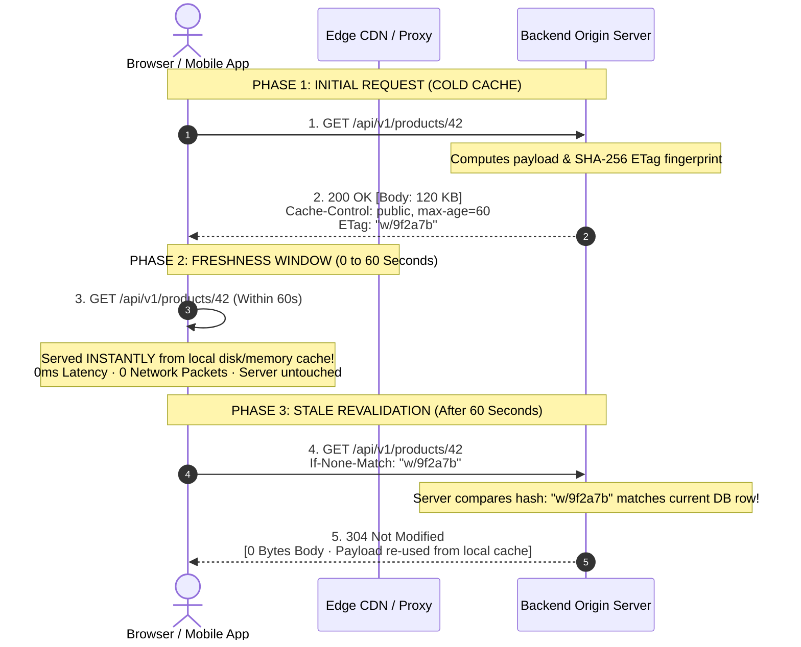
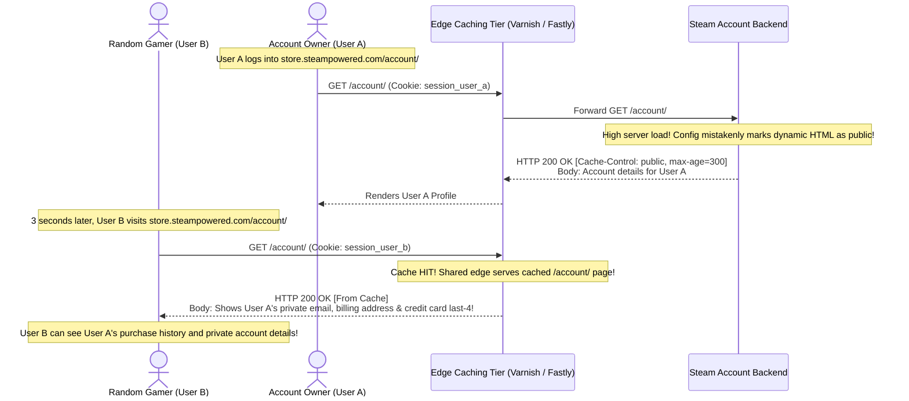
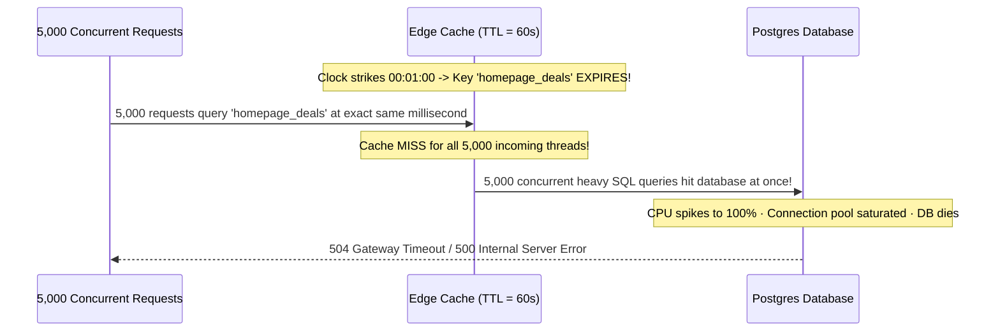

# Module 06: HTTP Caching

## Why This Matters

HTTP caching is the single most powerful scalability mechanism on the internet. Properly configured caching transforms expensive backend database queries into $0\text{ms}$ local memory lookups or sub-$10\text{ms}$ edge CDN hits:
* **Freshness vs. Validation:** Freshness (`Cache-Control: max-age`) eliminates network round-trips entirely during the validity window. Validation (`ETag`, `If-None-Match`) ensures that once content goes stale, clients revalidate with $0$-byte `304 Not Modified` payloads rather than re-downloading megabytes of unchanged data.
* **Security & Privacy:** Marking an authenticated user response (e.g. `/profile` or `/cart`) as `Cache-Control: public` instructs shared edge CDNs to cache that specific user's private data and serve it to complete strangers.
* **Bandwidth & Compute Savings:** High-volume APIs (GitHub, Stripe, Cloudflare) achieve 70–90% cache hit ratios, shielding upstream databases from thundering herds.

> [!TIP]
> **The Golden Rule:** Remember that `no-cache` does **NOT** mean "do not cache." It means "store the response, but **revalidate** with the origin server before every reuse." To forbid caching completely, you must specify `no-store`.

---

## The Mental Model: Freshness Window vs. Conditional Validation



---

## 1. Quick Reference: Directives & Header Taxonomy

```
Cache-Control: [Visibility], [Freshness Directive], [Revalidation Constraint]
Example:       Cache-Control: public, s-maxage=3600, max-age=60, must-revalidate
```

| Directive | Cache Level | Meaning & Production Use Case |
| :--- | :--- | :--- |
| **`public`** | Shared (CDN / Proxy) | May be cached by any intermediate cache (CDNs, Cloudflare, proxies). Safe for public, shared data. |
| **`private`** | Browser Only | May **only** be stored by the user's browser. Shared CDNs must never store it. Required for authenticated user data. |
| **`no-cache`** | All Caches | Caches may store the asset, but **must revalidate** with origin via `ETag` before every reuse. |
| **`no-store`** | All Caches | **Never store** any part of this response anywhere (RAM or disk). Used for bank balances and secrets. |
| **`max-age=<sec>`** | Browser + Shared | Specifies freshness lifetime in seconds (e.g. `max-age=3600` for 1 hour). |
| **`s-maxage=<sec>`** | Shared Only (CDN) | Overrides `max-age` specifically for shared caches/CDNs. Ignored by private browsers. |
| **`immutable`** | Browser | Content will never change during its `max-age`. Browser skips revalidation even on page reload. Used for hashed static assets (`app.5d8e.js`). |
| **`must-revalidate`** | All Caches | Once stale, the cache **must not** serve the stale copy under any circumstances without revalidating. |

### The Conditional Request Pair

| Initial Server Response | Subsequent Client Request | Cache Hit Response | Cache Miss Response |
| :--- | :--- | :--- | :--- |
| `ETag: "c5a-8b1"` | `If-None-Match: "c5a-8b1"` | **`304 Not Modified`** (No body) | **`200 OK`** (New body + new ETag) |
| `Last-Modified: Wed, 21 Oct 2026 07:28:00 GMT` | `If-Modified-Since: Wed, 21 Oct 2026 07:28:00 GMT` | **`304 Not Modified`** (No body) | **`200 OK`** (New body + new timestamp) |

---

## 2. Production War Story: The Steam Christmas Day Account Leak



### The Incident
On Christmas Day 2015, Valve's Steam service experienced intense traffic spikes during the Winter Holiday Sale. In an effort to mitigate database overload, caching rules were adjusted on the reverse proxy and CDN tier. Shortly thereafter, millions of users worldwide reported that clicking "Account Details" displayed other players' full names, purchase histories, billing addresses, and credit card digits.

### The Root Cause
A misconfigured caching profile applied `Cache-Control: public` to the authenticated `/account/` route. The edge caching layer ignored session cookies and cached the complete HTML payload under the URL key `/account/`. Every user who visited the page received the cached HTML of whoever had requested the page seconds earlier.

### The Fix
All dynamic, authenticated, and per-user endpoints must explicitly forbid shared caching:
```http
Cache-Control: private, no-cache, no-store, must-revalidate
Pragma: no-cache
Expires: 0
```

---

## 3. Production War Story: The Thundering Herd Cache Stampede



### The Solution: Probabilistic Early Expiration (XFetch) & Singleflight
When millions of requests read the same cache key, having it expire sharply creates a **cache stampede** (thundering herd). 

**The Remedy:**
1. **Mutex / Singleflight Pattern:** Ensure that upon a cache miss, only **one** backend thread is permitted to compute the query, while the other 4,999 threads await that single result.
2. **Stale-While-Revalidate (`Cache-Control: max-age=60, stale-while-revalidate=30`):** Instructs the CDN/browser to immediately serve the stale copy for 30 seconds while an asynchronous background request fetches the fresh version from the origin.

---

## 4. Multi-Language Implementation: ETag Generation & 304 Validation

### Go (`net/http`)
Production SHA-256 ETag middleware with conditional validation:

```go
package main

import (
	"bytes"
	"crypto/sha256"
	"encoding/hex"
	"net/http"
)

type responseRecorder struct {
	http.ResponseWriter
	body   *bytes.Buffer
	status int
}

func (r *responseRecorder) Write(b []byte) (int, error) {
	return r.body.Write(b)
}

func (r *responseRecorder) WriteHeader(status int) {
	r.status = status
}

func ETagMiddleware(next http.Handler) http.Handler {
	return http.HandlerFunc(func(w http.ResponseWriter, r *http.Request) {
		rec := &responseRecorder{
			ResponseWriter: w,
			body:           &bytes.Buffer{},
			status:         http.StatusOK,
		}

		next.ServeHTTP(rec, r)

		// Compute cryptographic hash of the generated response body
		hash := sha256.Sum256(rec.body.Bytes())
		etag := `"` + hex.EncodeToString(hash[:8]) + `"`

		w.Header().Set("ETag", etag)
		w.Header().Set("Cache-Control", "public, max-age=120, stale-while-revalidate=30")
		w.Header().Set("Vary", "Accept-Encoding")

		// 304 Validation Check
		if match := r.Header.Get("If-None-Match"); match == etag {
			w.WriteHeader(http.StatusNotModified)
			return // Return 304 with ZERO body bytes
		}

		w.WriteHeader(rec.status)
		w.Write(rec.body.Bytes())
	})
}
```

### Node.js / Express
```typescript
import express, { Request, Response } from 'express';
import crypto from 'crypto';

const app = express();

// Express includes built-in ETag generation, but you can explicitly control it:
app.set('etag', 'strong'); // 'strong' or 'weak'

app.get('/api/catalog', (req: Request, res: Response) => {
  const catalogData = {
    updated_at: '2026-11-09T18:00:00Z',
    items: ['Server Rack', 'Managed Switch', 'Fiber Cable']
  };

  const payload = JSON.stringify(catalogData);
  const etag = `"${crypto.createHash('md5').update(payload).digest('hex')}"`;

  res.setHeader('ETag', etag);
  res.setHeader('Cache-Control', 'public, max-age=60, stale-while-revalidate=30');
  res.setHeader('Vary', 'Accept-Encoding');

  // Check if client sent matching If-None-Match
  if (req.headers['if-none-match'] === etag) {
    return res.status(304).end(); // Empty body, 304 Not Modified
  }

  res.status(200).send(payload);
});
```

### Python (FastAPI)
```python
import hashlib
import json
from fastapi import FastAPI, Request, Response, status

app = FastAPI()

ITEMS = {"catalog_version": 4, "products": ["Router", "Server", "Firewall"]}

def compute_etag(data: dict) -> str:
    raw = json.dumps(data, sort_keys=True).encode("utf-8")
    return f'"{hashlib.sha256(raw).hexdigest()[:16]}"'

@app.get("/api/catalog")
def get_catalog(request: Request, response: Response):
    current_etag = compute_etag(ITEMS)
    
    # Check conditional validation
    client_etag = request.headers.get("if-none-match")
    if client_etag == current_etag:
        return Response(
            status_code=status.HTTP_304_NOT_MODIFIED,
            headers={
                "ETag": current_etag,
                "Cache-Control": "public, max-age=60, stale-while-revalidate=30"
            }
        )

    response.headers["ETag"] = current_etag
    response.headers["Cache-Control"] = "public, max-age=60, stale-while-revalidate=30"
    response.headers["Vary"] = "Accept-Encoding"
    return ITEMS
```

---

## 5. Practical Hands-On Exercises

### Exercise 1: Verify 304 Bandwidth Reduction
Run this sequence against a live API to witness bandwidth savings first-hand:

```bash
# 1. Fetch resource and capture the ETag header
ETAG=$(curl -s -D - -o /dev/null https://api.github.com/ | grep -i etag | tr -d '\r' | awk '{print $2}')
echo "Captured ETag: $ETAG"

# 2. Make conditional request with If-None-Match
curl -s -i -H "If-None-Match: $ETAG" https://api.github.com/ | grep -E "(HTTP\/|ETag:)"
```
**Look for:**
* `HTTP/2 304 Not Modified`
* Body length is exactly **0 bytes**

### Exercise 2: Inspecting Cache-Control on Static vs. Dynamic Content
Compare the caching headers of Google's homepage vs. a static asset:

```bash
# HTML: Must be dynamic or short-lived
curl -s -D - -o /dev/null https://www.google.com/ | grep -i "cache-control"

# Fingerprinted static JS: Cached for 1 year (immutable)
curl -s -D - -o /dev/null https://cdnjs.cloudflare.com/ajax/libs/react/18.2.0/umd/react.production.min.js | grep -i "cache-control"
```
**Observe:** The static React library has `max-age=31536000, immutable` (365 days).

---

## 6. Operational Validation Checkpoint

<details>
<summary><strong>Question 1: The "no-cache" Interview Trap</strong></summary>

**Scenario:** A software engineer configures an API endpoint returning live stock prices with:
`Cache-Control: no-cache`
The engineer expects that no browser or proxy will ever store the response and that every single request will fetch the latest price from the database.

Did the engineer configure this correctly?

**Answer:**
**No.** `no-cache` does **NOT** mean "do not cache." 

`no-cache` instructs browsers and CDNs: *"You are permitted to store this response in cache, but you MUST revalidate with the server using `If-None-Match` before reusing it."* 

If the database or server returns `304 Not Modified`, the client continues using the cached copy. If the engineer wanted to ensure the response is never written to disk or memory under any circumstances, the correct directive is **`Cache-Control: no-store`**.
</details>

<details>
<summary><strong>Question 2: The Missing Vary Header Disaster</strong></summary>

**Scenario:** A backend service supports content negotiation:
* Desktop clients send `Accept-Encoding: gzip` $\rightarrow$ Server returns compressed JSON.
* Embedded IoT microcontrollers send no compression headers $\rightarrow$ Server returns raw plain JSON.

The service uses an upstream Cloudflare CDN edge cache. IoT clients suddenly crash with JSON parsing errors.

What header was missing on the server's response?

**Answer:**
The server was missing **`Vary: Accept-Encoding`**.

Without the `Vary` header, the CDN edge cache uses only the URL as the cache lookup key. When a desktop client requested the URL first, Cloudflare cached the gzipped binary payload. When the IoT client subsequently requested the same URL, Cloudflare served the cached gzipped bytes. Because the IoT device expected raw plain text, its JSON parser failed. 

Adding `Vary: Accept-Encoding` forces the CDN to store separate cache buckets for gzipped and uncompressed clients.
</details>

<details>
<summary><strong>Question 3: Fingerprinted Assets and Immutable Caching</strong></summary>

**Scenario:** You are deploying a Single Page Application (React/Vite). The build produces two files:
1. `index.html`
2. `assets/main.9f8b1c.js` (content-hashed filename)

What `Cache-Control` policy should you configure for each file on your CDN?

**Answer:**
* **`index.html` $\rightarrow$ `Cache-Control: no-cache` (or `max-age=0, must-revalidate`):**
  The entry point must never be aggressively cached. The browser must revalidate `index.html` on every visit so it immediately discovers when a new deployment points to a new JavaScript bundle hash.
* **`assets/main.9f8b1c.js` $\rightarrow$ `Cache-Control: public, max-age=31536000, immutable`:**
  Because the filename contains a cryptographic content hash, its contents will never change. If the code changes, a new build generates `main.4e7d2a.js`. Therefore, the current file can be safely cached on user disks and edge CDNs for 1 full year without ever revalidating.
</details>

---

## Next Step

Now that you have mastered HTTP caching, proceed to **[07-http-1-1-vs-2-vs-3](../07-http-1-1-vs-2-vs-3/README.md)** to understand binary framing, stream multiplexing, head-of-line blocking, and HTTP/3 QUIC over UDP.
