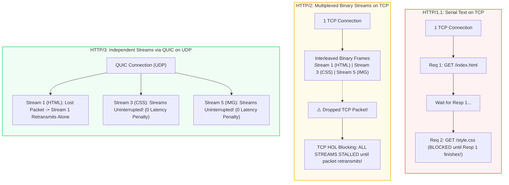
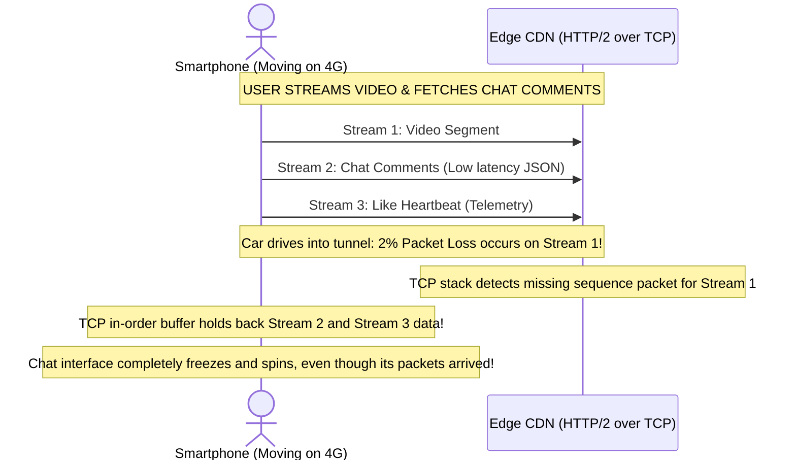
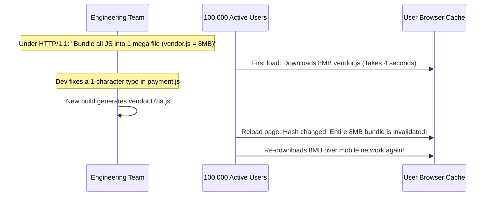

# Module 07: HTTP/1.1 vs HTTP/2 vs HTTP/3

## Why This Matters

Everything you have learned so far—methods, headers, status codes, and caching rules—is the **semantic layer** of HTTP. The crucial insight: **HTTP semantics are identical across HTTP/1.1, HTTP/2, and HTTP/3.** A `GET` is still a `GET`, an `ETag` operates the same way, and a `404` carries the same meaning.

What changes between versions is purely **how bytes are framed, multiplexed, and transported over the physical wire**:
* **HTTP/1.1 (1997):** Plain-text wire format with persistent TCP keep-alive, but crippled by **request-level Head-of-Line (HOL) blocking** (requests on a single connection must be answered serially in order).
* **HTTP/2 (2015):** Binary framing and true stream **multiplexing** over a single TCP connection, combined with HPACK header compression. However, on lossy mobile networks, it suffers from **TCP-level Head-of-Line blocking** (one dropped packet stalls all multiplexed streams).
* **HTTP/3 (2022):** Replaces TCP with **QUIC over UDP**. Streams are truly independent at the transport layer, handshakes are combined into a fast 0-RTT/1-RTT flow, and connections seamlessly survive network migration (e.g. moving from Wi-Fi to 5G).

> [!TIP]
> **The Golden Rule:** In production architectures, your backend application code rarely speaks HTTP/2 or HTTP/3 directly. The edge CDN or reverse proxy (Cloudflare, Envoy, AWS ALB) terminates HTTP/2 or HTTP/3 with the client and forwards requests to your internal services via HTTP/1.1 or gRPC.

---

## The Mental Model: Wire Transport Comparison



---

## 1. Quick Reference: Comprehensive Comparison Matrix

| Architectural Dimension | HTTP/1.1 | HTTP/2 | HTTP/3 |
| :--- | :--- | :--- | :--- |
| **Wire Protocol** | Human-readable ASCII plain text | Binary framing (`HEADERS`, `DATA` frames) | Binary framing over QUIC frames |
| **Transport Layer** | TCP (Layer 4) | TCP (Layer 4) | **QUIC over UDP** (Layer 4) |
| **Connection Model** | Serial requests per connection | Interleaved multiplexing on 1 TCP socket | Independent multiplexed streams |
| **Request-Level HOL Blocking** | **Yes** (Req 2 waits for Resp 1) | **No** (Streams execute concurrently) | **No** (Streams execute concurrently) |
| **TCP-Level HOL Blocking** | N/A (Serial) | **Yes** (1 dropped packet freezes all streams) | **No** (Each stream has its own loss recovery) |
| **Header Compression** | None (Sent repeatedly in plain text) | **HPACK** (Static & dynamic Huffman tables) | **QPACK** (Out-of-order decompression) |
| **Connection Handshake** | TCP (1 RTT) + TLS 1.3 (1 RTT) = **2 RTT** | TCP (1 RTT) + TLS 1.3 (1 RTT) = **2 RTT** | Combined QUIC + TLS 1.3 = **1 RTT (0-RTT resume)** |
| **Connection Migration** | Breaks on IP change (Wi-Fi $\rightarrow$ Cellular) | Breaks on IP change | **Survives** via 64-bit Connection ID |
| **Negotiation Mechanism** | Default plain HTTP/1.1 | TLS ALPN (`h2`) | `Alt-Svc: h3=":443"` header advertisement |

### HTTP/2 & HTTP/3 Pseudo-Headers
In HTTP/1.1, the request line is plain text (`GET /users HTTP/1.1`). In binary HTTP/2 and HTTP/3, the request line is replaced with standardized **pseudo-headers** that begin with a colon:

```http
:method: GET
:path: /users
:scheme: https
:authority: api.example.com
:status: 200
```

---

## 2. Production War Story: The 2% Packet Loss Multi-Stream Freeze



### The Incident
A video streaming and live-chat platform observed that mobile users experiencing weak cellular coverage (subway commutes, cell tower handoffs) reported that chat comments and real-time buttons froze completely whenever high-definition video chunks were buffering, despite chat requiring minimal bandwidth.

### The Root Cause
The platform used HTTP/2 over a single TCP connection to multiplex video chunks, chat WebSockets, and UI REST queries. When packet loss occurred on the video stream, the operating system's **TCP stack halted the delivery of all incoming data** to preserve strict byte-order guarantees. Until the missing video packet was acknowledged and retransmitted, the browser could not read the chat frames, causing an application-wide freeze.

### The Fix
The infrastructure team enabled HTTP/3 (QUIC) on their Cloudflare edge distribution:
1. When video packets dropped, only the QUIC state machine for the video stream entered loss recovery.
2. The chat stream packets were processed immediately by the application runtime without waiting for video packet retransmissions.
3. Chat latency during packet loss dropped by **82%**.

---

## 3. Production War Story: The Frontend Bundling Anti-Pattern



### The Shift from HTTP/1.1 to HTTP/2/3
* **In HTTP/1.1:** Because browsers were limited to 6 parallel connections, opening 50 individual JS files created severe request queueing. Engineers used Webpack to merge thousands of modules into single monolithic bundles (`bundle.js`).
* **In HTTP/2 & HTTP/3:** Stream multiplexing allows 50 independent small files to download concurrently over a single socket without per-connection handshake penalties. 
* **The Performance Win:** Keeping modules fine-grained allows caching (Module 06) to work surgically. Modifying `payment.js` only invalidates a $12\text{KB}$ file; the remaining $7.9\text{MB}$ of cached application code remains valid on client disks.

---

## 4. Multi-Language Implementation: Configuring HTTP/2 and HTTP/3

### Go (`net/http` & `quic-go`)
Go has native first-class support for HTTP/2 in standard library `net/http` when TLS is enabled:

```go
package main

import (
	"crypto/tls"
	"fmt"
	"net/http"
	"golang.org/x/net/http2"
)

func handler(w http.ResponseWriter, r *http.Request) {
	// Inspect negotiated protocol version
	w.Header().Set("Content-Type", "application/json")
	// Advertise HTTP/3 availability to modern clients
	w.Header().Set("Alt-Svc", `h3=":443"; ma=86400`)
	
	fmt.Fprintf(w, `{"proto": "%s", "tls_cipher": "%s"}`, 
		r.Proto, 
		tls.CipherSuiteName(r.TLS.CipherSuite),
	)
}

func main() {
	server := &http.Server{
		Addr:    ":8443",
		Handler: http.HandlerFunc(handler),
	}

	// Enable HTTP/2 explicitly
	http2.ConfigureServer(server, &http2.Server{
		MaxConcurrentStreams: 250,
	})

	fmt.Println("HTTP/2 server running on https://localhost:8443")
	server.ListenAndServeTLS("server.crt", "server.key")
}
```

### Node.js (Native `http2` Module)
```typescript
import http2 from 'http2';
import fs from 'fs';

const server = http2.createSecureServer({
  key: fs.readFileSync('server.key'),
  cert: fs.readFileSync('server.crt'),
  allowHTTP1: true // Fallback to HTTP/1.1 for legacy clients
});

server.on('stream', (stream, headers) => {
  // Read HTTP/2 pseudo-headers
  const method = headers[':method'];
  const path = headers[':path'];

  stream.respond({
    ':status': 200,
    'content-type': 'application/json',
    'alt-svc': 'h3=":443"; ma=86400'
  });

  stream.end(JSON.stringify({
    message: 'Multiplexed stream response',
    stream_id: stream.id,
    path
  }));
});

server.listen(8443);
```

### Python (Hypercorn ASGI for HTTP/2 & HTTP/3)
```python
# Save as app.py
from fastapi import FastAPI, Request

app = FastAPI()

@app.get("/api/info")
async def info(request: Request):
    return {
        "http_version": request.scope.get("http_version"),
        "client": request.client.host,
    }

# Run with Hypercorn for native HTTP/2 & QUIC/HTTP/3 support:
# hypercorn app:app --bind 0.0.0.0:443 --certfile cert.pem --keyfile key.pem --quic-bind 0.0.0.0:443
```

---

## 5. Practical Hands-On Exercises

### Exercise 1: Force HTTP/1.1 vs. HTTP/2 and Inspect the Output
Run these commands against a high-performance CDN to compare the wire handshake:

```bash
# 1. Force HTTP/1.1
curl -s -v --http1.1 https://www.cloudflare.com/ 2>&1 | grep -E "(> GET|< HTTP)"

# 2. Prefer HTTP/2
curl -s -v --http2 https://www.cloudflare.com/ 2>&1 | grep -iE "(using http/2|alpn|>\s:)"
```
**Look for:**
* In HTTP/1.1: Text verbs (`> GET / HTTP/1.1`)
* In HTTP/2: ALPN negotiation (`ALPN: server accepted h2`) and pseudo-headers (`> :method: GET`)

### Exercise 2: Discover HTTP/3 (Alt-Svc) Advertisements
Inspect how major web properties advertise QUIC support:

```bash
curl -s -I https://www.google.com/ | grep -i "alt-svc"
```
**Look for:**
`alt-svc: h3=":443"; ma=2592000` (Informs the browser: *"We support HTTP/3 on UDP port 443; cache this capability for 30 days."*)

---

## 6. Operational Validation Checkpoint

<details>
<summary><strong>Question 1: The Lossy Network Paradox</strong></summary>

**Scenario:** An engineering team migrates a high-throughput mobile application from HTTP/1.1 (with 6 parallel TCP connections) to HTTP/2 (with 1 multiplexed TCP connection). 

In metropolitan areas with fiber Wi-Fi, page load times improve by 35%. However, on rural cellular networks with 3% packet loss, page load times **degraded by 20%**. 

Why did HTTP/2 perform worse than HTTP/1.1 under packet loss?

**Answer:**
**Due to TCP-level Head-of-Line (HOL) blocking.**

Under HTTP/1.1, the browser used 6 independent TCP connections. If a packet was lost on connection 1, only the request on connection 1 stalled; the other 5 TCP connections continued receiving packets uninterrupted.

Under HTTP/2, all 50 requests were multiplexed over a **single TCP connection**. Because TCP guarantees strict in-order byte delivery, a single dropped packet forces the receiver's TCP buffer to hold back all subsequent packets for **every stream** until the lost segment is retransmitted. This makes HTTP/2 fragile on lossy networks—a problem solved only by HTTP/3's transport-level streams over QUIC/UDP.
</details>

<details>
<summary><strong>Question 2: Why My Container Only Sees HTTP/1.1</strong></summary>

**Scenario:** You configure your AWS Application Load Balancer (ALB) to accept HTTP/2 from user browsers. Inside your Docker container running FastAPI / Go, your access logs show `HTTP/1.1` for 100% of incoming requests.

Did the HTTP/2 negotiation fail?

**Answer:**
**No, this is normal and expected.**

The AWS ALB terminates HTTP/2 at the public edge with the client browser. The ALB then originates a **new, internal connection** across the private AWS VPC to your backend container target group. By default, ALBs communicate with backend targets using HTTP/1.1 persistent keep-alive pools. 

The client still gets full HTTP/2 multiplexing across the high-latency public internet, while your backend container enjoys simplified HTTP/1.1 parsing within the sub-millisecond local network.
</details>

<details>
<summary><strong>Question 3: Connection Migration in QUIC</strong></summary>

**Scenario:** A user is downloading a 2GB file on their laptop connected to home Wi-Fi. They close their laptop lid, walk outside, and their laptop reconnects to their mobile 5G hotspot, changing their client IP address from `192.168.1.50` to `172.56.21.9`.

What happens to an active HTTP/2 download vs. an active HTTP/3 download?

**Answer:**
* **Under HTTP/2 (TCP): The download fails immediately with a broken socket connection.**
  TCP connections are strictly bound to the 4-tuple (`Source IP, Source Port, Dest IP, Dest Port`). Changing networks changes the Source IP, forcing the operating system to send a TCP RST and terminate the transfer.
* **Under HTTP/3 (QUIC): The download continues seamlessly without interruption.**
  QUIC connections are identified by a random **64-bit Connection ID (CID)** independent of IP addresses. When the client's IP changes, the client simply transmits a QUIC packet containing the existing CID from the new 5G IP. The server authenticates the packet cryptographic token and continues streaming data.
</details>

---

## Free PDF Notes

Download these notes as a printable PDF, with every diagram and interview questions: [SD-B-013: HTTP/1.1 vs HTTP/2 vs HTTP/3](https://backendroadmap.com/notes/system-design/SD-B-013.pdf). Each section in one file: [Phase 2, Networking (PDF)](https://backendroadmap.com/notes/system-design/Phase2_Networking_Notes.pdf).

---

## Next Step

Now that you have mastered transport protocols and multiplexing, proceed to **[08-content-negotiation-and-compression](../08-content-negotiation-and-compression/README.md)** to master `Accept-*`, `Content-*`, Brotli/Gzip compression algorithms, and content translation.
