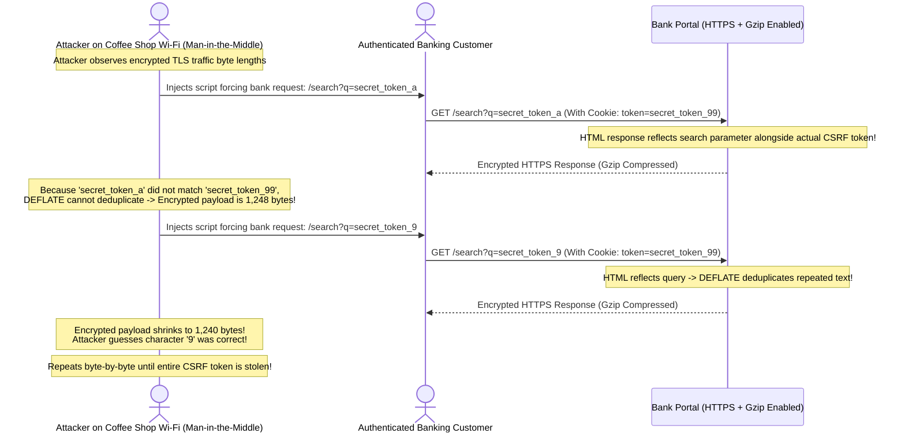

# Module 08: Content Negotiation and Compression

## Why This Matters

A single backend resource (such as `/v1/reports/monthly`) rarely serves only one client type. A web dashboard requires JSON, an automated reporting pipeline requests CSV, an internal high-scale microservice expects binary Protocol Buffers, and a browser requests localized English or French.

**Content Negotiation** is the mechanism by which clients and servers establish this agreement per-request without creating fragmented URLs (`/reports.json`, `/reports.csv`).
* **Massive Bandwidth Reductions:** Gzip, Brotli (`br`), and Zstandard (`zstd`) shrink repetitive text data (JSON, HTML, CSV) by **70% to 90%**, slashing cloud network egress costs and cutting mobile load times.
* **Localization & Multi-Tenancy:** `Accept-Language` headers allow APIs to localize notification messages, error details, and currency formatting dynamically.
* **The `Vary` Header Invariant:** Whenever content negotiation or compression is active, omitting `Vary: Accept-Encoding, Accept` causes shared caches (CDNs) to serve compressed binary garbage or the wrong language to subsequent users.

> [!TIP]
> **The Golden Rule:** Always enable compression for text formats (JSON, HTML, CSS, SVG) exceeding $1\text{KB}$, **never** compress binary media (JPEG, PNG, MP4, Zip), and always pair negotiated responses with `Vary: Accept-Encoding`.

---

## The Mental Model: Content Negotiation Handshake

```mermaid
sequenceDiagram
    autonumber
    actor Client as Client App (Web / Mobile)
    participant Gateway as API Gateway / Reverse Proxy
    participant Origin as Backend Application

    Note over Client,Gateway: 1. CLIENT PROPOSES PREFERENCES (Quality Values q)
    Client->>Gateway: GET /v1/analytics HTTP/1.1<br/>Accept: application/json, text/csv;q=0.5<br/>Accept-Encoding: br, gzip;q=0.8<br/>Accept-Language: fr-FR, en;q=0.7

    Note over Gateway,Origin: 2. NEGOTIATION & SERIALIZATION
    Gateway->>Origin: Forward request with client capabilities
    Note over Origin: Server evaluates best match:<br/>1. Format: application/json (Highest q)<br/>2. Language: fr-FR (Supported)<br/>3. Compression: br (Brotli selected)

    Note over Origin,Client: 3. SERVER RESPONDS WITH CONCRETE ENCODING
    Origin-->>Client: HTTP/1.1 200 OK<br/>Content-Type: application/json; charset=utf-8<br/>Content-Encoding: br<br/>Content-Language: fr-FR<br/>Vary: Accept, Accept-Encoding, Accept-Language<br/>[Brotli Compressed JSON Payload: 14 KB (was 110 KB)]
```

---

## 1. Quick Reference: Header Taxonomy & Compression Algorithms

### The Paired Negotiation Headers

| Client Request Header | Server Response Header | Dimension Negotiated | Example Values |
| :--- | :--- | :--- | :--- |
| **`Accept`** | **`Content-Type`** | MIME Data Format | `application/json`, `application/x-protobuf`, `text/csv` |
| **`Accept-Encoding`** | **`Content-Encoding`** | Compression Algorithm | `br`, `gzip`, `zstd`, `deflate` |
| **`Accept-Language`** | **`Content-Language`** | Natural Language & Locale | `en-US`, `es-ES`, `de;q=0.8` |
| **`Accept-Charset`** | `Content-Type: ...; charset=utf-8` | Character Encoding | `utf-8`, `iso-8859-1` |

### Understanding Quality Values (`q-factor`)
Clients use `;q=` (ranging from `0.0` to `1.0`, default `1.0`) to rank preferred representations:
```http
Accept: application/json;q=1.0, text/csv;q=0.8, */*;q=0.1
```
* `q=1.0`: Highest priority (JSON preferred).
* `q=0.8`: Secondary fallback (CSV accepted).
* `q=0.1`: Last resort (Any format).
* `q=0.0`: Explicitly forbidden. If the server can only produce this format, it should return **`406 Not Acceptable`**.

### Compression Algorithm Face-Off

| Algorithm | Header Token | Compression Ratio (JSON) | Compression Speed | Production Recommendation |
| :--- | :--- | :---: | :---: | :--- |
| **Brotli** | `br` | **Highest** (~85–92%) | Moderate to Slow | **Gold standard for static assets** (pre-compressed) and modern browser HTTPS traffic. |
| **Gstandard (Zstd)** | `zstd` | **Very High** (~84–90%) | **Ultra-Fast** | Ideal for high-throughput internal microservice-to-microservice traffic. |
| **Gzip** | `gzip` | High (~75–85%) | Fast | **Universal default fallback**; supported by 100% of HTTP clients, SDKs, and IoT runtimes. |
| **Deflate** | `deflate` | Medium (~70–80%) | Fast | **Legacy / Deprecated**; historical zlib header discrepancies make it unreliable. |

---

## 2. Production War Story: The BREACH Attack on Compressed HTTPS



### The Incident
In 2013, security researchers demonstrated the **BREACH** (Browser Reconnaissance and Exfiltration via Adaptive Compression of Hypertext) attack against major banks and SaaS providers using HTTPS. Despite TLS encryption being cryptographically unbroken, attackers stole sensitive session tokens in seconds.

### The Root Cause
1. HTTP responses used Gzip/Deflate compression over TLS.
2. The web application reflected user-controlled input (e.g. `?search=...`) in the same HTML page containing a secret secret token (e.g. CSRF token or API key).
3. The DEFLATE compression algorithm replaces repeated string occurrences with pointers. When the attacker's reflected probe matches characters of the secret token, the overall response body **compresses into fewer bytes**.
4. By measuring the length of encrypted TLS packets, the attacker exfiltrated the secret character-by-character.

### The Fix
1. Separate secrets from user-reflected input.
2. Mask CSRF tokens with random nonces (XOR masks) on every page render.
3. Disable HTTP compression specifically for dynamic HTML pages containing sensitive user credentials.

---

## 3. Production War Story: The Double-Compression CPU Meltdown

```mermaid
sequenceDiagram
    actor Users as 10,000 Concurrent Mobile Users
    participant Edge as Edge Reverse Proxy (Nginx)
    participant Origin as Asset Storage (S3 / Images)

    Note over Edge: Misconfiguration: gzip_types *; (Compress ALL MIME types!)
    Users->>Edge: GET /assets/banner_4k.jpg (4.2 MB JPEG)
    Edge->>Origin: Fetch raw JPEG
    Origin-->>Edge: Returns 4.2 MB JPEG
    Note over Edge: Nginx attempts to run Gzip compression on already compressed JPEG!
    Note over Edge: CPU utilization skyrockets to 100%!
    Note over Edge: 4.2 MB compressed into 4.21 MB (Actually LARGER due to headers!)
    Edge-->>Users: 504 Gateway Timeout / Extreme Latency
```

### The Incident
A media streaming company updated their reverse proxy configuration to optimize bandwidth, adding `gzip_types *;` to compress all server responses. Within 5 minutes of deploying, proxy CPU utilization spiked to 100%, request latency climbed from $20\text{ms}$ to $3500\text{ms}$, and multiple server instances crashed from kernel thread starvation.

### The Root Cause
Binary file formats—such as JPEG, PNG, MP4, WebP, and Zip files—are **already compressed using entropy encoding**. Attempting to pass pre-compressed binary data through Gzip or Brotli consumes immense CPU cycles and often **increases** the resulting file size due to compression header overhead.

### The Fix
Strictly limit compression to text and structured serialization media types with a minimum size threshold:
```nginx
gzip on;
gzip_min_length 1024; # Skip payloads smaller than 1 KB
gzip_types
    application/json
    application/javascript
    text/css
    text/plain
    text/xml
    image/svg+xml;
```

---

## 4. Multi-Language Implementation: Content Negotiation & Compression

### Go (`net/http`)
Production content negotiation with automatic Gzip fallback:

```go
package main

import (
	"compress/gzip"
	"encoding/json"
	"encoding/xml"
	"io"
	"net/http"
	"strings"
)

type AnalyticsReport struct {
	XMLName xml.Name `json:"-" xml:"report"`
	Period  string   `json:"period" xml:"period"`
	Visits  int      `json:"visits" xml:"visits"`
	Revenue float64  `json:"revenue" xml:"revenue"`
}

type gzipResponseWriter struct {
	io.Writer
	http.ResponseWriter
}

func (w gzipResponseWriter) Write(b []byte) (int, error) {
	return w.Writer.Write(b)
}

func reportHandler(w http.ResponseWriter, r *http.Request) {
	// 1. Mandatory Vary header whenever content negotiation is used
	w.Header().Set("Vary", "Accept, Accept-Encoding")

	data := AnalyticsReport{
		Period:  "2026-Q3",
		Visits:  128500,
		Revenue: 49200.50,
	}

	// 2. Negotiate Media Type (Accept)
	accept := r.Header.Get("Accept")
	var contentType string
	var serialized []byte
	var err error

	if strings.Contains(accept, "application/xml") {
		contentType = "application/xml"
		serialized, err = xml.MarshalIndent(data, "", "  ")
	} else if strings.Contains(accept, "application/json") || strings.Contains(accept, "*/*") {
		contentType = "application/json"
		serialized, err = json.Marshal(data)
	} else {
		// Client explicitly requested unsupported format
		http.Error(w, "Not Acceptable: Supported formats are JSON, XML", http.StatusNotAcceptable)
		return
	}

	if err != nil {
		http.Error(w, "Serialization error", http.StatusInternalServerError)
		return
	}

	// 3. Negotiate Compression (Accept-Encoding)
	encodings := r.Header.Get("Accept-Encoding")
	w.Header().Set("Content-Type", contentType)

	if strings.Contains(encodings, "gzip") && len(serialized) > 100 {
		w.Header().Set("Content-Encoding", "gzip")
		w.WriteHeader(http.StatusOK)
		gz := gzip.NewWriter(w)
		defer gz.Close()
		gz.Write(serialized)
		return
	}

	w.WriteHeader(http.StatusOK)
	w.Write(serialized)
}
```

### Node.js / Express
```typescript
import express, { Request, Response } from 'express';
import compression from 'compression';

const app = express();

// Apply production compression filter (skip small payloads and binaries)
app.use(compression({
  threshold: 1024, // Only compress responses > 1 KB
  filter: (req: Request, res: Response) => {
    if (req.headers['x-no-compression']) return false;
    return compression.filter(req, res);
  }
}));

app.get('/api/report', (req: Request, res: Response) => {
  res.setHeader('Vary', 'Accept, Accept-Encoding');

  const report = {
    period: '2026-Q3',
    status: 'finalized',
    active_users: 85200
  };

  // Express built-in content negotiation
  res.format({
    'application/json': () => {
      res.json(report);
    },
    'text/csv': () => {
      res.type('text/csv').send('period,status,active_users\n2026-Q3,finalized,85200');
    },
    default: () => {
      res.status(406).send('Not Acceptable');
    }
  });
});
```

### Python (FastAPI)
```python
from fastapi import FastAPI, Request, Response, status
from fastapi.middleware.gzip import GZipMiddleware
import json

app = FastAPI()

# Add automatic GZip compression for responses > 1000 bytes
app.add_middleware(GZipMiddleware, minimum_size=1000)

REPORT = {"quarter": "Q3", "active_nodes": 450, "bandwidth_gb": 9820}

@app.get("/api/metrics")
async def get_metrics(request: Request, response: Response):
    response.headers["Vary"] = "Accept, Accept-Encoding"
    accept = request.headers.get("accept", "application/json")

    if "application/json" in accept or "*/*" in accept:
        return REPORT
    elif "text/plain" in accept:
        return Response(content="nodes=450 bandwidth=9820", media_type="text/plain")
    else:
        return Response(
            content="Unsupported Media Type. Acceptable: application/json, text/plain",
            status_code=status.HTTP_406_NOT_ACCEPTABLE
        )
```

---

## 5. Practical Hands-On Exercises

### Exercise 1: Compare Compressed vs. Uncompressed Wire Bytes
Inspect how much compression reduces a large public JSON response:

```bash
# 1. Fetch uncompressed
curl -s -w 'Uncompressed: %{size_download} bytes\n' \
  -H "Accept-Encoding: identity" \
  -o /dev/null https://api.github.com/events

# 2. Fetch with Gzip compression
curl -s -w 'Gzipped:      %{size_download} bytes\n' \
  -H "Accept-Encoding: gzip" \
  -o /dev/null https://api.github.com/events
```
**Expected Outcome:** The uncompressed response is typically ~80 KB; the gzipped transfer drops to ~12 KB (**>80% savings**).

### Exercise 2: Trigger `406 Not Acceptable`
Simulate a client refusing everything except an unparseable format:

```bash
curl -s -i -H "Accept: application/x-unsupported-format" https://httpbin.org/status/406 | grep "HTTP/"
```
**Look for:** `HTTP/1.1 406 Not Acceptable`

---

## 6. Operational Validation Checkpoint

<details>
<summary><strong>Question 1: The Negative Compression Paradox</strong></summary>

**Scenario:** A backend service returns small user status messages:
`{"status": "ok"}` (21 bytes).
The developer enables Gzip on all responses. After enabling, network tracing reveals the wire payload increased from 21 bytes to 45 bytes.

Why did compression make the response larger?

**Answer:**
**Because compression algorithms require header and metadata framing overhead.**

The Gzip file format includes a mandatory 10-byte header, an optional filename, and an 8-byte CRC32 checksum footer. Furthermore, the DEFLATE dictionary cannot find repeated patterns in a 20-byte string. 

Adding the compression overhead to a payload that cannot be compressed yields a net increase in bytes. This is why production proxies specify `gzip_min_length 1024` (do not compress payloads under 1 KB).
</details>

<details>
<summary><strong>Question 2: Content-Encoding vs. Transfer-Encoding</strong></summary>

**Scenario:** In an architecture review, an engineer suggests: *"Let's remove `Transfer-Encoding: chunked` because our API already uses `Content-Encoding: gzip`."*

Is this suggestion semantically sound?

**Answer:**
**No. `Content-Encoding` and `Transfer-Encoding` solve completely orthogonal problems.**

* **`Content-Encoding: gzip`** is an **end-to-end representation property**. It indicates that the underlying resource body is compressed. It is preserved across intermediate proxies and stored compressed in client caches.
* **`Transfer-Encoding: chunked`** is a **hop-by-hop transport framing property**. It informs the next network node that the payload is being streamed in dynamic chunks without an upfront `Content-Length`. 

A response can easily be both: a gzipped payload streamed dynamically over the wire via chunked transfer framing.
</details>

<details>
<summary><strong>Question 3: Missing Vary Header in Multi-Lingual CDN</strong></summary>

**Scenario:** An international news portal serves content in Spanish when `Accept-Language: es` is sent, and English otherwise. 
The team deploys a Cloudflare CDN in front of the origin. Shortly after, users in Madrid complain they are seeing English articles, while users in London complain they are seeing Spanish articles.

What single response header was omitted by the backend origin?

**Answer:**
**`Vary: Accept-Language`**

Without `Vary: Accept-Language`, the CDN edge cache uses only the URL path (`/news/breaking`) as the cache key. When a user in London requested the article first, Cloudflare stored the English response. When a Spanish user in Madrid requested the same URL, Cloudflare served the cached English copy. 

Emitting `Vary: Accept-Language` forces the CDN to maintain independent cache entries partitioned by language preference.
</details>

---

## Next Step

Now that you have mastered content negotiation and compression, proceed to **[09-tls-ssl-and-https](../09-tls-ssl-and-https/README.md)** to master TLS handshakes, asymmetric vs. symmetric encryption, cipher suites, and certificate validation.
