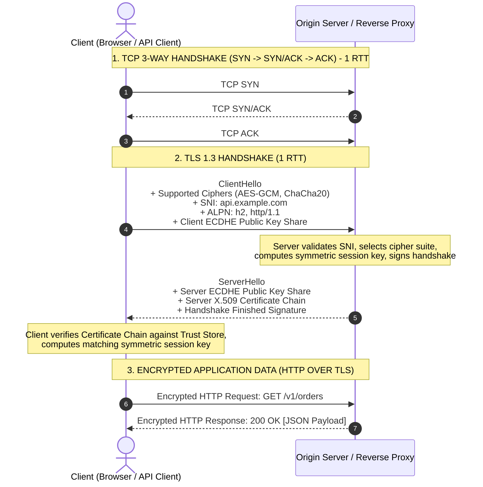
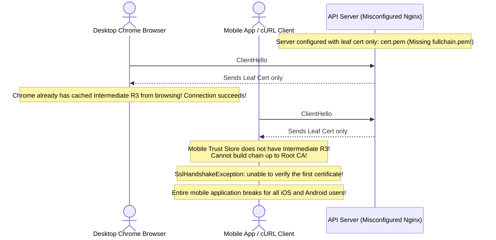
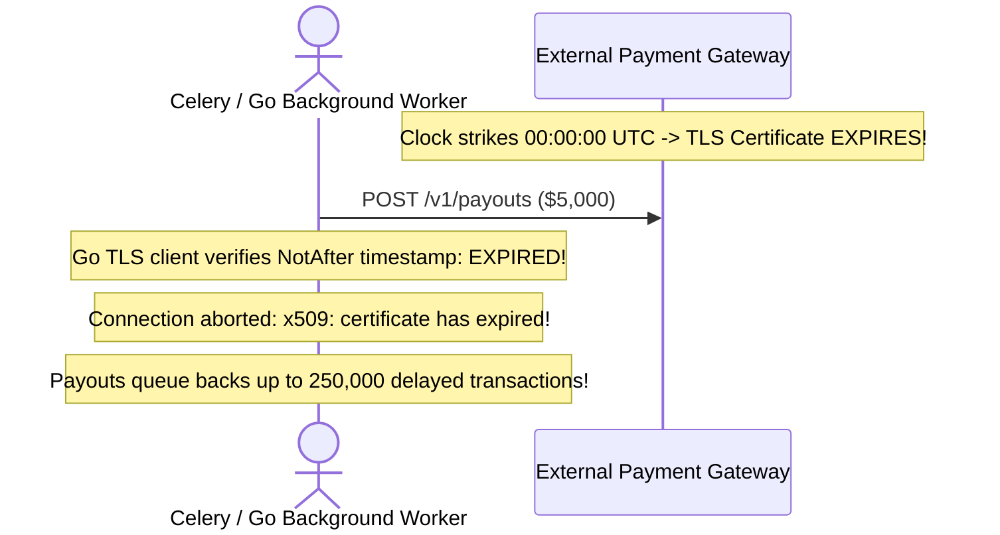

# Module 09: TLS/SSL and HTTPS

## Why This Matters

HTTPS is not a separate protocol from HTTP. **HTTPS is standard HTTP running inside an encrypted, authenticated cryptographic tunnel provided by TLS** (Transport Layer Security). Every HTTP header, status code, method, and JSON body discussed in modules 01–08 is preserved intact inside this tunnel.

For backend and DevOps engineers, TLS is a core operational responsibility:
* **The Three Security Pillars:** TLS guarantees **Confidentiality** (eavesdroppers see only ciphertext), **Integrity** (payload tampering causes immediate connection abortion), and **Authentication** (proves you are connecting to `api.stripe.com` and not a man-in-the-middle).
* **Certificate Chain Failures:** Misconfigured intermediate certificates or unmonitored expirations cause catastrophic downtime across mobile applications, payment webhooks, and B2B integrations.
* **Modern Cryptographic Standards:** Deprecated protocols (SSLv3, TLS 1.0, TLS 1.1) and broken ciphers (RC4, 3DES, CBC mode) expose systems to automated compliance failures (PCI-DSS) and active network interception.

> [!TIP]
> **The Golden Rule:** Always enforce **TLS 1.3** as the preferred protocol (minimum TLS 1.2), require Perfect Forward Secrecy (PFS via ECDHE), and never write client code or integration tests that bypass certificate verification (`rejectUnauthorized: false` or `curl -k`).

---

## The Mental Model: The TLS 1.3 1-RTT Handshake

In modern TLS 1.3, the cryptographic negotiation and key agreement occur in **a single round-trip (1-RTT)** before encrypted HTTP application data begins flowing:



---

## 1. Quick Reference: Certificate Chain of Trust & SNI

### The Chain of Trust
Servers prove their identity by presenting a **Certificate Chain** terminating at a root Certificate Authority pre-installed in the operating system or browser **Trust Store**:

```
┌────────────────────────────────────────────────────────┐
│  Leaf Certificate (Issued to: api.example.com)         │
│  Public Key: ECDSA 256-bit                             │
│  Signed by: Let's Encrypt Intermediate (R3)            │
└───────────────────────────┬────────────────────────────┘
                            │ Verified by signature
┌───────────────────────────▼────────────────────────────┐
│  Intermediate CA Certificate (Let's Encrypt R3)       │
│  Signed by: ISRG Root X1                               │
└───────────────────────────┬────────────────────────────┘
                            │ Verified by signature
┌───────────────────────────▼────────────────────────────┐
│  Root CA Certificate (ISRG Root X1)                    │
│  Self-Signed · Permanently Trusted in OS/Browser Store │
└────────────────────────────────────────────────────────┘
```

### Critical TLS Architectural Concepts

| Concept | What It Does | Why It Matters |
| :--- | :--- | :--- |
| **SNI** *(Server Name Indication)* | Transmits the requested hostname in plain text within the initial `ClientHello`. | Allows a single reverse proxy or IP address to host hundreds of distinct TLS domains and serve the correct certificate. |
| **PFS** *(Perfect Forward Secrecy)* | Uses ephemeral session keys (ECDHE) for each session rather than a static private key. | If the server's master private key is leaked in the future, past recorded encrypted network traffic **cannot be decrypted**. |
| **ALPN** *(Application-Layer Protocol Negotiation)* | Negotiates the application protocol (`h2`, `http/1.1`) during the TLS handshake. | Eliminates an extra network round-trip when determining whether the server supports HTTP/2. |
| **mTLS** *(Mutual TLS)* | Both server **and client** present X.509 certificates to authenticate each other. | The gold standard for Zero-Trust internal service-to-service microservice authentication. |

---

## 2. Production War Story: The Missing Intermediate Certificate Outage



### The Incident
Following a routine certificate renewal, an API team replaced their SSL certificates. Web developers testing in Google Chrome verified that `https://api.company.com` displayed a valid green padlock. However, within minutes, mobile apps worldwide crashed, background cron jobs failed, and payment webhooks threw:
```text
x509: certificate signed by unknown authority
Error: unable to verify the first certificate
```

### The Root Cause
The web server was configured using `cert.pem` (which contained only the leaf certificate) instead of `fullchain.pem` (which bundles the leaf plus the intermediate CA certificate). 

Desktop web browsers often succeed in this scenario because they cache previously encountered intermediate certificates or automatically fetch missing intermediates using AIA (Authority Information Access) chasing. Native mobile clients, cURL, and Go/Node runtimes do not perform AIA fetching—they strictly require the server to transmit the complete intermediate certificate bundle.

### The Fix
Always bundle the leaf certificate and intermediate certificates into a unified bundle:
```nginx
# INCORRECT:
ssl_certificate /etc/ssl/certs/cert.pem;

# PRODUCTION CORRECT:
ssl_certificate /etc/letsencrypt/live/api.example.com/fullchain.pem;
ssl_certificate_key /etc/letsencrypt/live/api.example.com/privkey.pem;
```

---

## 3. Production War Story 2: The Silent Expiration Disaster



### The Root Cause & The Fix
* **The Failure:** 90-day automated certificates (Let's Encrypt) fail to renew due to DNS challenge errors, firewall changes, or expired API tokens. Because engineers didn't set up alert thresholds, the certificate expired unnoticed.
* **The Production Fix:**
  1. Monitor certificates externally using tools like Prometheus `blackbox_exporter` or Datadog Synthetic Monitoring.
  2. Configure PagerDuty alerts when any production certificate has **less than 21 days** remaining before expiration.

---

## 4. Multi-Language Implementation: Hardened TLS Configuration

### Go (`crypto/tls`)
Production server enforcing TLS 1.2+ with modern cipher suites and HTTP/2:

```go
package main

import (
	"crypto/tls"
	"fmt"
	"net/http"
	"time"
)

func main() {
	mux := http.NewServeMux()
	mux.HandleFunc("/api/secure", func(w http.ResponseWriter, r *http.Request) {
		w.Header().Set("Content-Type", "application/json")
		fmt.Fprintf(w, `{"status":"secure","proto":"%s"}`, r.Proto)
	})

	tlsConfig := &tls.Config{
		MinVersion: tls.VersionTLS12,
		// Prefer modern, hardware-accelerated AEAD cipher suites
		CipherSuites: []uint16{
			tls.TLS_AES_128_GCM_SHA256,
			tls.TLS_AES_256_GCM_SHA384,
			tls.TLS_CHACHA20_POLY1305_SHA256,
			tls.TLS_ECDHE_ECDSA_WITH_AES_128_GCM_SHA256,
			tls.TLS_ECDHE_RSA_WITH_AES_128_GCM_SHA256,
		},
		CurvePreferences: []tls.CurveID{
			tls.X25519, // Modern fast elliptic curve
			tls.CurveP256,
		},
	}

	server := &http.Server{
		Addr:         ":8443",
		Handler:      mux,
		TLSConfig:    tlsConfig,
		ReadTimeout:  5 * time.Second,
		WriteTimeout: 10 * time.Second,
	}

	fmt.Println("Hardened HTTPS server running on :8443")
	server.ListenAndServeTLS("fullchain.pem", "privkey.pem")
}
```

### Node.js (Hardened HTTPS Configuration)
```typescript
import https from 'https';
import fs from 'fs';
import express from 'express';

const app = express();
app.get('/api/secure', (req, res) => {
  res.json({ status: 'secure', authorized: req.socket.authorized });
});

const options: https.ServerOptions = {
  key: fs.readFileSync('privkey.pem'),
  cert: fs.readFileSync('fullchain.pem'),
  // Enforce TLS 1.2 minimum
  minVersion: 'TLSv1.2',
  ciphers: [
    'ECDHE-ECDSA-AES128-GCM-SHA256',
    'ECDHE-RSA-AES128-GCM-SHA256',
    'ECDHE-ECDSA-AES256-GCM-SHA384',
    'ECDHE-RSA-AES256-GCM-SHA384'
  ].join(':'),
  honorCipherOrder: true
};

https.createServer(options, app).listen(8443, () => {
  console.log('Node.js HTTPS server active on port 8443');
});
```

### Python (FastAPI with Uvicorn SSL)
```python
# Start hardened Uvicorn server via CLI with TLS 1.2 minimum:
# uvicorn app:app --host 0.0.0.0 --port 8443 \
#   --ssl-keyfile privkey.pem \
#   --ssl-certfile fullchain.pem \
#   --ssl-version 5 # PROTOCOL_TLSv1_2 or higher
```

---

## 5. Practical Hands-On Exercises

### Exercise 1: Inspect a Live Production Certificate Chain
Use OpenSSL to inspect the complete certificate chain, validity dates, and issuer for any public domain:

```bash
openssl s_client -connect api.github.com:443 -servername api.github.com -showcerts </dev/null
```
**Look for:**
* `Certificate chain`: The leaf certificate and intermediate signer.
* `Verify return code: 0 (ok)`: Confirms complete cryptographic verification.
* `Protocol : TLSv1.3`
* `Cipher : TLS_AES_128_GCM_SHA256`

### Exercise 2: Check Certificate Expiration Days from CLI
Quickly verify how many days remain before an endpoint's certificate expires:

```bash
curl -v -I https://api.github.com/ 2>&1 | grep -i "expire date"
```

---

## 6. Operational Validation Checkpoint

<details>
<summary><strong>Question 1: The Danger of Bypassing Certificate Verification</strong></summary>

**Scenario:** A junior backend developer encounters `x509: certificate signed by unknown authority` when connecting to an internal staging microservice. To make their code work, they add:
```go
// In Go:
tr := &http.Transport{
    TLSClientConfig: &tls.Config{InsecureSkipVerify: true},
}
```
What vulnerability does this create, even though traffic is still technically "encrypted"?

**Answer:**
**It completely eliminates Authentication, exposing the service to trivial Man-in-the-Middle (MITM) attacks.**

While traffic between the client and the recipient remains encrypted, `InsecureSkipVerify: true` instructs the client to accept **any certificate presented by anyone**. 

An attacker on the internal network or a compromised DNS resolver can intercept the connection, present their own self-generated certificate, decrypt all payload data (including authentication tokens, passwords, and private records), re-encrypt it, and forward it to the real server without detection. 

The correct fix is to add the internal corporate CA certificate to the application's trusted root store.
</details>

<details>
<summary><strong>Question 2: Forward Secrecy Under Key Theft</strong></summary>

**Scenario:** An intelligence agency intercepts and stores 100 terabytes of encrypted HTTPS traffic flowing into your company's servers throughout 2026. In 2028, an intruder compromises your data center and steals the server's long-term TLS private key (`privkey.pem`).

Can the attacker retroactively decrypt the recorded traffic from 2026?

**Answer:**
**No, provided the server utilized Ephemeral Diffie-Hellman cipher suites (ECDHE / DHE) providing Perfect Forward Secrecy (PFS).**

Under PFS, the server's long-term private key is used **strictly for digital signature authentication** during the initial handshake, never to encrypt the payload. The actual symmetric session keys are negotiated dynamically using ephemeral (one-time) key pairs generated uniquely for each connection and discarded from memory immediately after termination. 

Because the ephemeral keys were erased from RAM years earlier, possessing the long-term private key does not allow retroactive decryption of past sessions.
</details>

<details>
<summary><strong>Question 3: Diagnosing SNI Hostname Mismatches</strong></summary>

**Scenario:** A reverse proxy hosts two domains on a single IP address: `alpha.com` and `beta.com`. 
An older HTTP client connects and requests `https://beta.com/orders`, but receives a certificate for `alpha.com`, causing an SSL verification failure.

What TLS extension was omitted by the client?

**Answer:**
**SNI (Server Name Indication).**

Because TLS negotiation occurs **before** any HTTP request line or `Host: beta.com` header is transmitted, a server hosting multiple virtual domains has no way of knowing which certificate to present during the handshake unless the client includes the hostname inside the initial `ClientHello` packet via the SNI extension. 

Clients that do not support SNI receive the server's default fallback certificate (`alpha.com`), triggering a hostname mismatch error.
</details>

---

## Next Step

Now that you have mastered TLS and HTTPS transport security, proceed to **[10-routing-fundamentals](../10-routing-fundamentals/README.md)** to master trie-based request multiplexing, path parameters, and high-performance URL pattern matching.
