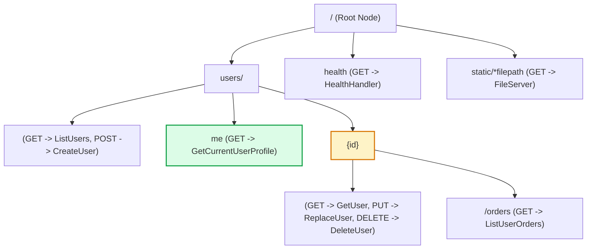
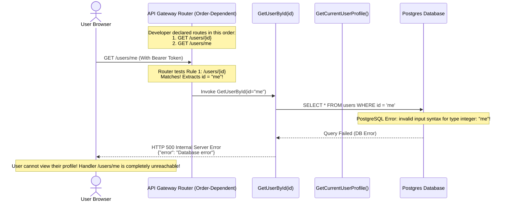
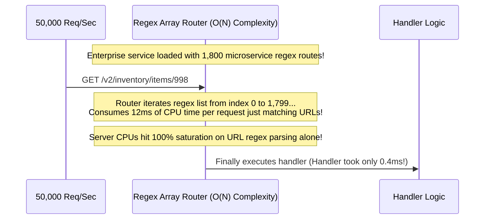

# Module 10: Routing Fundamentals

## Why This Matters

Once an incoming HTTP request has traversed the network (module 00), completed TLS decryption (module 09), and parsed its method (module 03) and headers (module 02), the server must answer the core operational question: **which specific function in my codebase should execute for this request?**

That decision engine is **Routing**, and it is the backbone of every backend framework (FastAPI, Go Chi, Express, Spring Boot, Rails):
* **Deterministic Matching:** An API router maps the tuple `(HTTP Method, URL Path)` $\rightarrow$ `Handler Function`.
* **Path vs. Query Separation:** Path parameters (`/orders/42`) designate **identity** (which specific entity), while query parameters (`/orders?status=active&sort=desc`) designate **modifiers** (filtering, pagination, sorting).
* **Algorithmic Performance:** In high-scale services hosting thousands of routes, naive linear list searches ($O(N)$) cause severe CPU overhead. Production routers use **Radix Trees (Prefix Tries)** to achieve $O(K)$ lookup speeds proportional strictly to the length of the URL path.

> [!TIP]
> **The Golden Rule:** In order-dependent routers (such as Express and FastAPI), always declare literal static routes (like `/users/me`) **before** dynamic parameter routes (like `/users/{id}`). Otherwise, the dynamic wildcard will "shadow" and intercept the literal path.

---

## The Mental Model: The Radix Tree (Prefix Trie)

Production web routers compile declared endpoints into a **Prefix Tree (Radix Trie)**. Each node represents a path segment or dynamic parameter, allowing millisecond route resolution regardless of whether you have 10 routes or 10,000 routes:



---

## 1. Quick Reference: URL Dissection & Route Shapes

### The Anatomy of a Web Address
```
https://api.example.com:443/v1/users/42/orders?status=open&limit=10#invoice-summary
\___/   \_______________/\_/\________________/\________________/\______________/
Scheme       Host       Port       Path             Query String     Fragment (DOM only)
```
* **Path (`/v1/users/42/orders`):** Used by backend routers to locate code handlers.
* **Query (`?status=open&limit=10`):** Key-value parameters parsed into handler request dictionaries.
* **Fragment (`#invoice-summary`):** **Never transmitted across the network.** Browsers strip the `#fragment` before sending the HTTP request; backends never see it.

### The 5 Standard Route Shapes

| Route Type | Pattern Example | Matches | Use Case |
| :--- | :--- | :--- | :--- |
| **Literal Static** | `/healthz`, `/v1/auth/login` | Exact string match only | System health, login endpoints, static actions. |
| **Dynamic Parameter** | `/users/{id}` | `/users/42`, `/users/usr_9a8` | Fetching or mutating a specific resource by ID. |
| **Nested Resource** | `/teams/{tid}/members/{mid}` | `/teams/10/members/502` | Expressing relational hierarchy directly in the URL. |
| **Typed Constrained** | `/orders/{order_id:int}` | `/orders/1092` (Rejects `/orders/abc` with `422`) | Early validation before handler invocation. |
| **Catch-All Wildcard** | `/assets/{filepath:path}` | `/assets/css/theme/dark.css` | Serving static file directories, CDN origin proxies. |

---

## 2. Production War Story: The Route Shadowing Outage



### The Incident
An identity provider pushed a new release allowing users to manage their own settings via `GET /users/me`. Immediately after deployment, customer support received thousands of tickets: whenever users clicked "Profile", the web app crashed with an uncaught `500 Internal Server Error`.

### The Root Cause
The web application router evaluated routes **sequentially in order of registration**:
```python
# BROKEN ORDER:
@app.get("/users/{user_id}") # Matches ANY string segment, including "me"
def get_user(user_id: int):
    return db.fetch_user(user_id)

@app.get("/users/me")         # DEAD CODE: Never reached!
def get_me(current_user: User = Depends(get_current_user)):
    return current_user
```
Because the dynamic `{user_id}` route was registered first, the router captured `"me"` as the `user_id`. When passed to the database query expecting an integer, Postgres threw an unhandled type conversion exception.

### The Fix
Always position literal routes ahead of dynamic variable patterns, or enforce integer regex constraints:
```python
# PRODUCTION CORRECT:
@app.get("/users/me")         # 1. Specific static route evaluated FIRST
def get_me(current_user: User = Depends(get_current_user)):
    return current_user

@app.get("/users/{user_id}") # 2. General dynamic fallback
def get_user(user_id: int):
    return db.fetch_user(user_id)
```

---

## 3. Production War Story: The Linear Scan CPU Degradation



### The Solution: Radix Trees vs. Regex Arrays
* **The Problem:** In frameworks using linear regex arrays (early Express/Sinatra), the router iterates through every declared endpoint from top to bottom until a match is found. As enterprise monolithic services grow to thousands of endpoints, route resolution latency compounds, creating massive CPU overhead.
* **The Radix Tree Fix:** Modern frameworks (Fastify, Go `chi`, `httprouter`, Spring Boot) compile URLs into a prefix tree. Resolution traverses node branches character-by-character, resolving in **$O(K)$ time** (where $K$ is the length of the URL path, typically $< 50$ characters), regardless of whether the application has 10 routes or 10,000 routes.

---

## 4. Multi-Language Implementation: Production Routing

### Go (Standard Library `net/http` in Go 1.22+)
Starting in Go 1.22, the standard library includes built-in pattern matching and method-aware routing without external dependencies:

```go
package main

import (
	"encoding/json"
	"fmt"
	"net/http"
	"strconv"
)

func main() {
	mux := http.NewServeMux()

	// 1. Literal route
	mux.HandleFunc("GET /users/me", func(w http.ResponseWriter, r *http.Request) {
		w.Header().Set("Content-Type", "application/json")
		w.Write([]byte(`{"id": 1, "username": "admin", "role": "superuser"}`))
	})

	// 2. Dynamic path parameter using {id}
	mux.HandleFunc("GET /users/{id}", func(w http.ResponseWriter, r *http.Request) {
		idStr := r.PathValue("id")
		id, err := strconv.Atoi(idStr)
		if err != nil {
			http.Error(w, "Invalid user ID: must be an integer", http.StatusBadRequest)
			return
		}

		w.Header().Set("Content-Type", "application/json")
		fmt.Fprintf(w, `{"id": %d, "username": "user_%d"}`, id, id)
	})

	// 3. Catch-all wildcard using {path...}
	mux.HandleFunc("GET /static/{path...}", func(w http.ResponseWriter, r *http.Request) {
		filePath := r.PathValue("path")
		fmt.Fprintf(w, "Serving asset from disk: %s", filePath)
	})

	fmt.Println("Server running on :8080")
	http.ListenAndServe(":8080", mux)
}
```

### Node.js / Express (Modular Sub-Routers)
```typescript
import express, { Request, Response } from 'express';

const app = express();
const usersRouter = express.Router();

// Static route MUST precede dynamic parameter route
usersRouter.get('/me', (req: Request, res: Response) => {
  res.json({ id: 'usr_current', role: 'admin' });
});

// Dynamic parameter route
usersRouter.get('/:id', (req: Request, res: Response) => {
  const userId = req.params.id;
  if (!/^\d+$/.test(userId)) {
    return res.status(400).json({ error: 'User ID must be numeric' });
  }
  res.json({ id: userId, name: `User ${userId}` });
});

// Mount sub-router under /api/v1/users prefix
app.use('/api/v1/users', usersRouter);

app.listen(3000, () => console.log('API listening on port 3000'));
```

### Python (FastAPI with Typed Parameters & Sub-Routers)
```python
from fastapi import FastAPI, APIRouter, HTTPException, Query, status

app = FastAPI()
orders_router = APIRouter(prefix="/v1/orders", tags=["Orders"])

# 1. Path parameter with strict integer validation
@orders_router.get("/{order_id}")
async def get_order(
    order_id: int, # FastAPI automatically returns 422 if order_id is not integer
    expand: bool = Query(False, description="Expand line items") # Query parameter
):
    return {
        "order_id": order_id,
        "expanded": expand,
        "status": "processing"
    }

# 2. Nested sub-resource route
@orders_router.get("/{order_id}/items/{item_id}")
async def get_order_item(order_id: int, item_id: int):
    return {"order_id": order_id, "item_id": item_id}

app.include_router(orders_router)
```

---

## 5. Practical Hands-On Exercises

### Exercise 1: Observe Path vs. Query Parameters
Send requests demonstrating how routers distinguish path identification from query filters:

```bash
# 1. Path parameter (Identifying specific resource #42)
curl -s https://jsonplaceholder.typicode.com/posts/42 | grep -E "(id|title)"

# 2. Query parameter (Filtering collection by userId=1)
curl -s "https://jsonplaceholder.typicode.com/posts?userId=1" | grep -c '"userId": 1'
```

### Exercise 2: Witness Type-Constrained Route Rejections (422)
Demonstrate how modern typed routers stop invalid path parameter types before handler logic executes:

```bash
# If using FastAPI from the snippet above:
# Valid integer path:
curl -s -o /dev/null -w "%{http_code}\n" http://localhost:8000/v1/orders/102
# Output: 200

# Invalid string passed to integer path parameter:
curl -s -i http://localhost:8000/v1/orders/invalid-string | grep -E "(HTTP\/|detail)"
# Output: 422 Unprocessable Entity
```

---

## 6. Operational Validation Checkpoint

<details>
<summary><strong>Question 1: The Missing URL Fragment</strong></summary>

**Scenario:** A frontend engineer calls:
`fetch('https://api.example.com/checkout#payment-step')`
In the backend router logs, you observe that the request path is logged strictly as `/checkout`. The `#payment-step` fragment is nowhere to be found in the path, headers, or query parameters.

Why did the backend router not receive the fragment?

**Answer:**
**Because URL fragments (`#...`) are strictly client-side DOM identifiers and are never transmitted over the wire.**

According to RFC 3986 and RFC 9110, the fragment component of a URI is interpreted solely by the user agent (web browser) for local document anchor scrolling or client-side SPA state. 

Web browsers and compliant HTTP client libraries deliberately strip everything from the `#` symbol onward before constructing the HTTP request line. Backends will never receive or route on URL fragments.
</details>

<details>
<summary><strong>Question 2: Path Parameter vs. Query Parameter Placement</strong></summary>

**Scenario:** You are designing an API to fetch invoices. An engineer proposes:
`GET /invoices?id=10294`
Another proposes:
`GET /invoices/10294`

Which design is semantically superior in REST architecture, and why?

**Answer:**
**`GET /invoices/10294` is semantically superior.**

* **Path parameters** represent the **unique identity and hierarchy** of a specific resource. In REST semantics, every distinct entity has its own canonical URI. Removing `10294` fundamentally alters *which resource* is being addressed.
* **Query parameters** represent **optional modifiers, filters, or views** on a collection (e.g. `GET /invoices?status=unpaid&limit=20`).

Using query parameters for identity (`?id=10294`) mimics RPC (Remote Procedure Call) patterns and creates awkward caching and nested sub-resource routing (`GET /invoices?id=10294&action=items` vs `GET /invoices/10294/items`).
</details>

<details>
<summary><strong>Question 3: Resolving Route Ambiguities in Catch-Alls</strong></summary>

**Scenario:** You register two routes:
Route A: `GET /reports/annual`
Route B: `GET /reports/{report_name}`

In a router that uses prefix-length scoring (Radix Trie), what happens when a client requests `GET /reports/annual`?

**Answer:**
**The router will invoke Route A (`/reports/annual`).**

In modern Radix Tree routers, literal static path matches always have a higher specificity weight than parameterized dynamic wildcards. Even if Route B was registered first, the tree evaluation engine prefers the exact static branch over the variable branch, preventing accidental shadowing. 

*(Note: In linear routers like Express, registration order still dictates the winner, which is why ordering static routes first is a universal best practice).*
</details>

---

## Next Step

Now that you have mastered backend routing architecture and path semantics, proceed to **[11-api-versioning-and-serialization](../11-api-versioning-and-serialization/README.md)** to master API versioning strategies, JSON/Protobuf serialization, and breaking-change mitigation.
