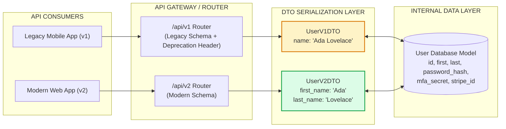
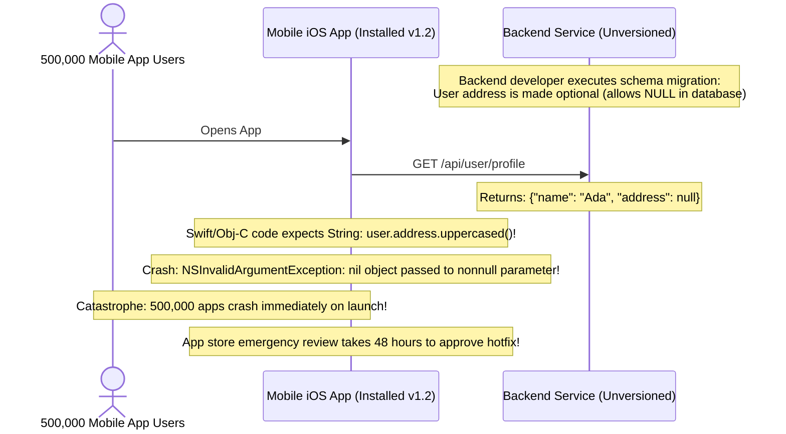
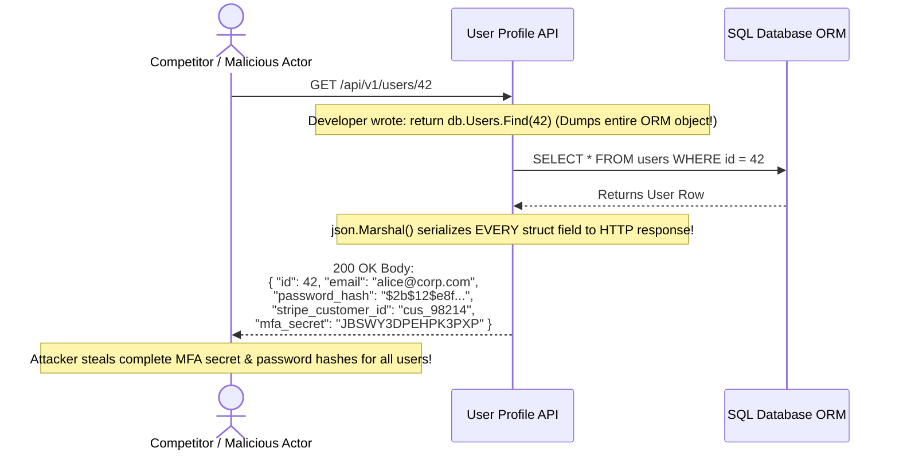

# Module 11: API Versioning and Serialization

## Why This Matters

An API is a binding contract between your backend services and downstream consumers (mobile apps, single-page web frontends, third-party partner integrations, and internal microservices). Once a client integrates with your API, **you can no longer freely rename fields or alter data structures** without breaking their application:
* **Contract Evolution:** A routine database schema migration (e.g. splitting `name` into `first_name` and `last_name`) will crash older mobile apps on launch unless isolated behind an API version.
* **Data Sanitization & Leakage:** Without strict serialization schemas (Data Transfer Objects / DTOs), backend handlers frequently dump raw database rows into JSON responses, accidentally exposing `password_hash`, internal billing identifiers, and private user metadata.
* **Wire Efficiency:** High-throughput microservices cannot afford the CPU and payload overhead of redundant JSON strings. Transitioning to binary serialization (Protocol Buffers, Avro, MessagePack) cuts payload size by **60–80%** and accelerates serialization throughput by $5\times$.

> [!TIP]
> **The Golden Rule:** Follow Postel's Law (*The Robustness Principle*): *"Be conservative in what you send, be liberal in what you accept."* Always use URL path versioning (`/v1`, `/v2`) for public APIs, and communicate retirement schedules using RFC 8594 `Deprecation` and `Sunset` headers.

---

## The Mental Model: Contract Evolution & DTO Serialization Pipeline



---

## 1. Quick Reference: The 4 Versioning Strategies

| Strategy | Example Request | Pros | Cons & Caveats |
| :--- | :--- | :--- | :--- |
| **URI Path** *(Recommended)* | `GET /api/v1/orders/42` | **Explicit, readable, and highly cacheable** by CDNs. Easiest to route and debug. | Violates strict URI purism (same logical resource has multiple addresses). |
| **Custom Header** | `GET /orders/42`<br>`X-API-Version: 2026-11` | Clean URLs. Enables Stripe-style date-based release versions. | Invisible in browser address bars; requires strict `Vary: X-API-Version` on CDNs. |
| **Accept Header** *(Content Negotiation)* | `GET /orders/42`<br>`Accept: application/vnd.company.v2+json` | Purest REST implementation; aligns with RFC 9110 content negotiation. | Harder to test with curl/browsers; requires complex proxy header routing rules. |
| **Query Parameter** | `GET /orders/42?version=2` | Simple to implement on simple endpoints. | Mixes version contract with resource filtering and query parameters. |

### Communicating Sunsets: RFC 8594 Standards
When retiring older endpoints, do not simply turn them off unannounced. Emit standard HTTP headers:
```http
HTTP/1.1 200 OK
Deprecation: @1794228800
Sunset: Wed, 11 Nov 2026 00:00:00 GMT
Link: <https://api.example.com/docs/migration-v2>; rel="deprecation"
```

---

## 2. Production War Story: The Nullable Field Mobile App Crash



### The Incident
An unversioned e-commerce API made the `shipping_address` field optional to accommodate digital goods. When a customer with no physical address logged into the mobile application, the API emitted `{"shipping_address": null}`. The native iOS client, compiled against the previous non-null contract, threw an uncaught null-pointer exception on launch. Half a million active users were locked out of the app.

### The Root Cause
The backend team treated the change as a minor bugfix without realizing that **altering field nullability is a breaking change for statically typed mobile clients**. Because the API had no version separation, the team could not alter the behavior of existing client installs.

### The Fix
1. **Preserve backwards compatibility on older versions:** Keep `/v1/user/profile` returning an empty string `""` or omitting the key entirely, while exposing `null` on `/v2/user/profile`.
2. **Implement automated schema validation contracts:** Run contract testing (Pact / OpenAPI diff) in CI/CD to block pull requests that alter existing field types.

---

## 3. Production War Story: The Raw Database Entity Leak



### The Solution: Explicit DTOs (Data Transfer Objects)
Never serialize database models directly to HTTP responses. Always map database models into explicit public DTO structs:
```go
// NEVER EXPOSE THIS DIRECTLY TO HTTP:
type UserModel struct {
    ID           int
    Email        string
    PasswordHash string
    MFASecret    string
}

// SAFE PUBLIC DTO:
type UserResponseDTO struct {
    ID    int    `json:"id"`
    Email string `json:"email"`
}
```

---

## 4. Multi-Language Implementation: Versioned API Routers & DTOs

### Go (`net/http` & Explicit DTOs)
```go
package main

import (
	"encoding/json"
	"net/http"
)

// Internal Domain Model
type User struct {
	ID           int
	FirstName    string
	LastName     string
	PasswordHash string // Must never leave backend
}

// V1 Response Contract (Legacy single name field)
type UserV1DTO struct {
	ID   int    `json:"id"`
	Name string `json:"name"`
}

// V2 Response Contract (Modern separated fields)
type UserV2DTO struct {
	ID        int    `json:"id"`
	FirstName string `json:"first_name"`
	LastName  string `json:"last_name"`
}

var sampleUser = User{ID: 101, FirstName: "Grace", LastName: "Hopper", PasswordHash: "secret_hash"}

func userV1Handler(w http.ResponseWriter, r *http.Request) {
	// Set standard deprecation warning
	w.Header().Set("Deprecation", "true")
	w.Header().Set("Sunset", "Fri, 01 Jan 2027 00:00:00 GMT")
	w.Header().Set("Content-Type", "application/json")

	dto := UserV1DTO{
		ID:   sampleUser.ID,
		Name: sampleUser.FirstName + " " + sampleUser.LastName,
	}
	json.NewEncoder(w).Encode(dto)
}

func userV2Handler(w http.ResponseWriter, r *http.Request) {
	w.Header().Set("Content-Type", "application/json")
	dto := UserV2DTO{
		ID:        sampleUser.ID,
		FirstName: sampleUser.FirstName,
		LastName:  sampleUser.LastName,
	}
	json.NewEncoder(w).Encode(dto)
}

func main() {
	mux := http.NewServeMux()
	mux.HandleFunc("GET /api/v1/users/profile", userV1Handler)
	mux.HandleFunc("GET /api/v2/users/profile", userV2Handler)
	http.ListenAndServe(":8080", mux)
}
```

### Node.js / Express (Modular Version Routers)
```typescript
import express, { Request, Response } from 'express';

const app = express();

const v1Router = express.Router();
const v2Router = express.Router();

// V1 Endpoint with Deprecation Headers
v1Router.get('/user', (req: Request, res: Response) => {
  res.setHeader('Deprecation', 'true');
  res.setHeader('Sunset', 'Wed, 31 Dec 2026 23:59:59 GMT');
  res.json({
    id: 42,
    name: 'Margaret Hamilton' // Old combined representation
  });
});

// V2 Endpoint with Clean DTO
v2Router.get('/user', (req: Request, res: Response) => {
  res.json({
    id: 42,
    first_name: 'Margaret',
    last_name: 'Hamilton' // New granular representation
  });
});

app.use('/api/v1', v1Router);
app.use('/api/v2', v2Router);

app.listen(3000, () => console.log('Versioned API running on 3000'));
```

### Python (FastAPI with Pydantic DTO Isolation)
```python
from fastapi import FastAPI, APIRouter, Response
from pydantic import BaseModel, ConfigDict

app = FastAPI()

# 1. Pydantic DTOs enforce field serialization boundaries
class UserV1Response(BaseModel):
    id: int
    name: str

class UserV2Response(BaseModel):
    id: int
    first_name: str
    last_name: str

v1_router = APIRouter(prefix="/v1")
v2_router = APIRouter(prefix="/v2")

@v1_router.get("/user", response_model=UserV1Response)
def get_user_v1(response: Response):
    response.headers["Deprecation"] = "true"
    response.headers["Sunset"] = "Fri, 01 Jan 2027 00:00:00 GMT"
    return {"id": 1, "name": "Alan Turing"}

@v2_router.get("/user", response_model=UserV2Response)
def get_user_v2():
    return {"id": 1, "first_name": "Alan", "last_name": "Turing"}

app.include_router(v1_router, prefix="/api")
app.include_router(v2_router, prefix="/api")
```

---

## 5. Practical Hands-On Exercises

### Exercise 1: Query Different Versions on the Same API
Test how production endpoints maintain distinct contracts across versions:

```bash
# Query v1 (legacy combined format):
curl -s -i https://jsonplaceholder.typicode.com/users/1 | grep -E "(name|username)"

# Observe sunset headers on deprecated APIs:
curl -s -I https://api.github.com/ | grep -iE "(deprecation|sunset)"
```

### Exercise 2: Compare JSON vs. Binary Protobuf Serialization
Inspect wire size differences between JSON and Protocol Buffers:
* A JSON payload with 50 fields: ~**1,850 bytes**
* The equivalent Protobuf binary message: ~**420 bytes** (**>75% wire reduction**)

---

## 6. Operational Validation Checkpoint

<details>
<summary><strong>Question 1: The Non-Breaking vs. Breaking Change Test</strong></summary>

**Scenario:** You need to update an active production API currently consumed by 200,000 mobile app users. 
Which of the following changes can be safely made **without** releasing a new `/v2` API version?

1. Renaming `created_date` to `created_at`.
2. Changing the type of `order_id` from an integer (`1092`) to a UUID string (`"9f8a-..."`).
3. Adding a new optional field `"loyalty_tier": "gold"` to the JSON response.
4. Changing an existing endpoint from returning `200 OK` to returning `301 Moved Permanently`.

**Answer:**
**Only Change 3 (Adding a new optional field) is non-breaking.**

* Changes 1 and 2 break statically typed client parsers that expect the exact old field names and types.
* Change 4 breaks older client libraries that do not automatically follow redirects on mutation requests.
* Change 3 adheres to Postel's Law and the "Tolerant Reader" pattern: compliant JSON deserializers ignore unexpected or unrecognized new fields, allowing old clients to continue functioning without modification.
</details>

<details>
<summary><strong>Question 2: Standardizing Timestamps in APIs</strong></summary>

**Scenario:** A developer serializes timestamps using their local machine format:
`{"created_at": "11/09/2026 07:30 PM"}`
Clients in London, Tokyo, and New York complain that events appear 8 hours off and sorting breaks.

What is the universal international standard for API timestamp serialization?

**Answer:**
**ISO 8601 UTC format with explicit offset or 'Z' timezone indicator (RFC 3339).**

Example: `2026-11-09T19:30:00Z` or `2026-11-09T19:30:00.000+00:00`.

* Timestamps must **always be stored and serialized in UTC**.
* The ISO 8601 format is strictly lexicographically sortable as plain strings (`YYYY-MM-DDTHH:MM:SSZ`), unambiguous across all international locales, and parseable by standard date libraries in every programming language without locale configuration.
</details>

<details>
<summary><strong>Question 3: Protobuf Field Numbering Trap</strong></summary>

**Scenario:** In a Protocol Buffers schema, a developer updates:
```protobuf
// OLD:
message User {
    string name = 1;
    string email = 2;
}

// NEW:
message User {
    string full_name = 1; // Renamed
    string phone = 2;     // Replaced email with phone!
}
```
What catastrophic error will occur when older microservices communicate with updated services?

**Answer:**
**Severe data corruption and type confusion.**

Protocol Buffers **does not transmit field names across the wire**; it transmits only the numeric tag field identifier (`1`, `2`, `3`). 

When an updated service sends a `User` message, field `2` contains a phone number (`"+1-555-0199"`). When an older service reads field `2`, it assumes tag `2` is the user's `email`. The older service will store the phone number directly into the user's email field without any serialization error. 

In Protocol Buffers, field tags must **never be reused**. When deprecating a field, tag it as `reserved 2;` so the tag can never be reassigned.
</details>

---

## Next Step

Now that you have mastered API versioning, deprecation lifecycle, and serialization boundaries, proceed to **[12-cdn-and-edge-caching](../12-cdn-and-edge-caching/README.md)** to master edge points of presence (PoPs), Anycast routing, Origin Shielding, and CDN cache invalidation.
