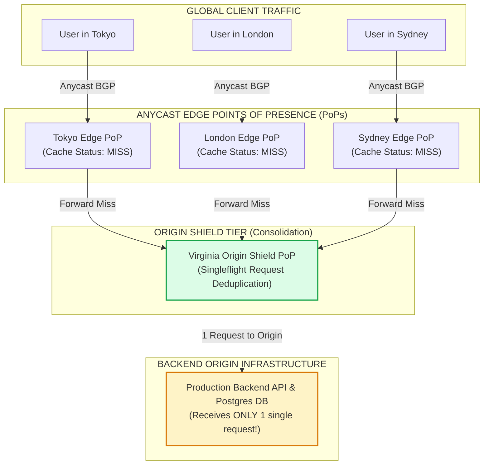
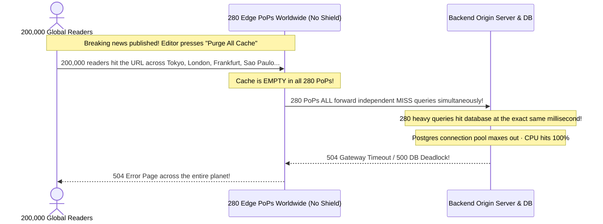
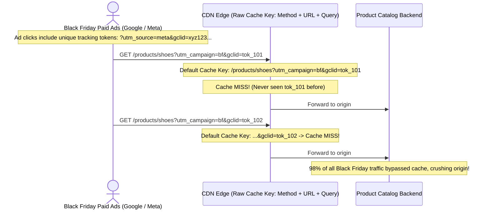

# Module 12: CDN and Edge Caching

## Why This Matters

Module 06 established the foundational HTTP caching contract (`Cache-Control`, `ETags`, `304 Not Modified`). A **Content Delivery Network (CDN)**—such as Cloudflare, Fastly, AWS CloudFront, or Akamai—takes that exact contract and scales it across hundreds of distributed Points of Presence (PoPs) globally:
* **The Speed of Light Limit:** Network latency has a physical minimum determined by distance. A user in Sydney requesting data from an AWS origin in Virginia suffers a minimum $\sim 180\text{ms}$ speed-of-light round-trip penalty. Serving cached assets from a Sydney edge PoP cuts response time to **sub-$8\text{ms}$**.
* **Origin Shielding:** Without an intermediate shield tier, a traffic spike across 300 global edge PoPs causes 300 simultaneous cache misses, creating a catastrophic distributed thundering herd that annihilates your database.
* **Instant Global Invalidation:** Relying on URL-by-URL cache purges during breaking changes is brittle and slow. Modern architectures use **Surrogate Keys (Cache-Tags)** to purge 50,000 related product pages across the entire planet in under $150\text{ms}$.

> [!TIP]
> **The Golden Rule:** Use `CDN-Cache-Control` (or `s-maxage`) to configure aggressive caching at the edge (e.g. 24 hours) while keeping browser `max-age` short (e.g. 60 seconds), and always configure edge query-string normalization to strip marketing tracking parameters (`utm_*`).

---

## The Mental Model: Global Anycast & Origin Shielding Architecture



---

## 1. Quick Reference: CDN Cache Header Taxonomy

### Hierarchical Cache Directives

```
Browser Cache Lifetime  <───  Cache-Control: max-age=60
Shared CDN Edge Lifetime <───  CDN-Cache-Control: max-age=86400 (Overrides for CDN only)
Surgical Invalidation    <───  Cache-Tag: product-99, category-electronics
```

| Header | Consumed By | Purpose & Behavior |
| :--- | :--- | :--- |
| **`Cache-Control: s-maxage=3600`** | Shared CDNs | Sets cache duration specifically for shared caches; browsers ignore this and follow `max-age`. |
| **`CDN-Cache-Control`** | Specific CDN | Dedicated standard (RFC 9213) directing the edge CDN without exposing directives to clients. |
| **`Surrogate-Control`** | Fastly / Akamai | Upstream reverse proxy cache instructions; stripped by the CDN before sending to browser. |
| **`Cache-Tag` / `Surrogate-Key`** | Edge CDN | Space-delimited metadata tags used to group responses for atomic multi-URL edge purges. |
| **`stale-while-revalidate=<sec>`** | Browser + CDN | Serves slightly stale response instantly while asynchronously updating cache in background. |
| **`stale-if-error=<sec>`** | Edge CDN | Serves cached copy if the backend origin returns `500/502/503/504`, preventing user-facing outages. |

### Inspecting CDN Status Headers
Every major CDN identifies its caching decision in standard response headers:
* **`CF-Cache-Status` (Cloudflare):** `HIT`, `MISS`, `DYNAMIC` (not eligible), `EXPIRED`, `REVALIDATED`.
* **`X-Cache` (CloudFront / Fastly):** `Hit from cloudfront`, `Miss from cloudfront`.
* **`Age: 342`:** Indicates the response was generated $342\text{ seconds}$ ago and served directly from edge RAM.

---

## 2. Production War Story: The 300-PoP Global Stampede



### The Incident
A high-traffic digital news publication published a breaking global scoop. To ensure immediate visibility, an editor triggered a full CDN cache purge. Within 10 seconds, the origin database crashed, and the site returned `504 Gateway Timeout` worldwide.

### The Root Cause
The CDN was configured with direct origin routing across **280 worldwide Points of Presence without Origin Shielding**. When all 280 PoPs experienced a concurrent cache miss, each PoP independently forwarded the request to the origin at the exact same millisecond, creating an accidental distributed denial-of-service attack against their own database.

### The Fix
1. **Enable Origin Shielding:** Designate a single central PoP (e.g. AWS Virginia or Frankfurt) as the Origin Shield. When edge PoPs worldwide miss cache, they route to the Shield. The Shield executes a single request to the origin and fans the response back out to all other PoPs.
2. **Enable `stale-while-revalidate` and `stale-if-error`:**
```http
Cache-Control: public, s-maxage=3600, stale-while-revalidate=60, stale-if-error=86400
```

---

## 3. Production War Story: The UTM Marketing Cache Invalidation Trap



### The Root Cause & The Fix
* **The Failure:** By default, CDNs include the complete URL query string in the cache key. When marketing teams launched ad campaigns with unique tracking query parameters (`utm_source`, `utm_medium`, `fbclid`, `gclid`), every single customer received a unique URL, driving the CDN cache hit ratio from **95% down to 2%**.
* **The Fix:** Configure edge **Query String Normalization** at the CDN tier. Strip all analytics and marketing parameters from the cache key before lookup while forwarding only the necessary application parameters to the origin.

---

## 4. Multi-Language Implementation: Edge Cache-Tagging

### Go (`net/http`)
Production handler setting Surrogate-Keys and multi-tier cache controls:

```go
package main

import (
	"encoding/json"
	"net/http"
)

type Product struct {
	ID       string  `json:"id"`
	Name     string  `json:"name"`
	Price    float64 `json:"price"`
	Category string  `json:"category"`
}

func productHandler(w http.ResponseWriter, r *http.Request) {
	// 1. Browser caches for 60s, CDN edge caches for 24 hours
	w.Header().Set("Cache-Control", "public, max-age=60")
	w.Header().Set("CDN-Cache-Control", "max-age=86400, stale-while-revalidate=300")

	// 2. Surrogate Keys for surgical, atomic cache purging via CDN API
	// Tagged by product ID, category, and global catalog tag
	w.Header().Set("Cache-Tag", "product-42 category-electronics store-us")
	w.Header().Set("Surrogate-Key", "product-42 category-electronics store-us") // Fastly convention

	w.Header().Set("Content-Type", "application/json")
	json.NewEncoder(w).Encode(Product{
		ID:       "prod_42",
		Name:     "Wireless Noise-Canceling Headphones",
		Price:    299.99,
		Category: "electronics",
	})
}

func main() {
	http.HandleFunc("/api/products/42", productHandler)
	http.ListenAndServe(":8080", nil)
}
```

### Node.js / Express (Cache-Tag Middleware)
```typescript
import express, { Request, Response } from 'express';

const app = express();

function edgeCache(tags: string[], browserTtl = 60, cdnTtl = 86400) {
  return (req: Request, res: Response, next: () => void) => {
    res.setHeader('Cache-Control', `public, max-age=${browserTtl}`);
    res.setHeader('CDN-Cache-Control', `max-age=${cdnTtl}, stale-while-revalidate=60`);
    res.setHeader('Cache-Tag', tags.join(' '));
    res.setHeader('Surrogate-Key', tags.join(' '));
    next();
  };
}

app.get('/catalog/:category', edgeCache(['catalog', 'category-appliances']), (req, res) => {
  res.json({
    category: req.params.category,
    items: ['Blender', 'Toaster', 'Microwave']
  });
});

app.listen(3000);
```

### Python (FastAPI with Cache-Tags & Stale-If-Error)
```python
from fastapi import FastAPI, Response

app = FastAPI()

@app.get("/api/v1/articles/{article_id}")
async def get_article(article_id: str, response: Response):
    # Short browser TTL, long CDN edge TTL, protect origin with stale-if-error
    response.headers["Cache-Control"] = "public, max-age=120"
    response.headers["CDN-Cache-Control"] = "max-age=604800, stale-while-revalidate=60, stale-if-error=86400"
    
    # Associate article with its specific ID and general news tag
    response.headers["Cache-Tag"] = f"article-{article_id} global-news"
    
    return {
        "article_id": article_id,
        "title": "Edge Caching at Scale",
        "content": "Deep dive into Anycast PoPs and Surrogate Keys."
    }
```

---

## 5. Practical Hands-On Exercises

### Exercise 1: Inspect CDN Edge Status Headers Live
Query popular web endpoints and inspect whether they hit edge cache:

```bash
# 1. Inspect Cloudflare Edge response
curl -s -I https://cdnjs.cloudflare.com/ajax/libs/jquery/3.6.0/jquery.min.js | grep -iE "(cf-cache-status|age:|cache-control)"

# 2. Inspect AWS CloudFront Edge response
curl -s -I https://aws.amazon.com/ | grep -iE "(x-cache|age:|cache-control)"
```
**Look for:**
* `cf-cache-status: HIT`
* `x-cache: Hit from cloudfront`
* `age: 18420` (Served directly from memory)

### Exercise 2: Observe Anycast IP Addressing
Run DNS resolution on a CDN-managed hostname to verify that it resolves to local edge IPs:

```bash
nslookup cdnjs.cloudflare.com
```
**Notice:** The returned IP addresses belong to Cloudflare's Anycast network and terminate at the datacenter geographically closest to your physical location.

---

## 6. Operational Validation Checkpoint

<details>
<summary><strong>Question 1: Browser TTL vs. CDN Edge TTL Separation</strong></summary>

**Scenario:** A company configures:
`Cache-Control: public, max-age=86400`
A typo is published on the home page. The DevOps engineer logs into Cloudflare and executes an immediate "Purge All Cache". 

However, users who visited the page 10 minutes ago continue seeing the typo for the next 24 hours. Why did purging the CDN fail to fix their browsers?

**Answer:**
**Because `max-age=86400` instructed user browsers to store the file in their local hard drive cache for 24 hours.**

When a user revisits the page, their browser reads the file directly from local disk without ever sending a network packet to Cloudflare. Purging the CDN edge only purges the CDN's servers—it has **zero control over private client browser caches**. 

**The Fix:** Use `Cache-Control: public, max-age=60` (short 1-minute browser cache) paired with `CDN-Cache-Control: max-age=86400` (long 24-hour CDN cache). When you purge the CDN, browser caches expire in under 60 seconds.
</details>

<details>
<summary><strong>Question 2: Surrogate Key (Cache-Tag) Invalidation</strong></summary>

**Scenario:** An e-commerce store has 200,000 product pages. A single brand ("Acme Corp") changes its corporate logo and pricing rules across 15,000 products. 

Why is purging by Cache-Tag (`Cache-Tag: brand-acme`) vastly superior to issuing 15,000 individual URL purge API calls?

**Answer:**
1. **Rate Limits & Latency:** CDN APIs limit URL purges to a few hundred per second; submitting 15,000 individual URLs takes minutes to execute and risks API throttling. A single tag purge (`PURGE tag: brand-acme`) is a single $O(1)$ control-plane message.
2. **Atomicity:** Purging by tag invalidates all 15,000 pages instantaneously and atomically across all 300 global PoPs within milliseconds.
3. **Completeness:** Tagging handles multiple variants (paginated lists, search results, category pages, currency views) that contain Acme products without needing to know every dynamic URL permutation.
</details>

<details>
<summary><strong>Question 3: The Role of Anycast BGP Routing</strong></summary>

**Scenario:** What is Anycast routing, and how does it prevent a DDoS attack from overwhelming a central backend origin?

**Answer:**
**Anycast assigns the exact same public IP address to hundreds of CDN data centers across the globe.**

Using BGP (Border Gateway Protocol), internet service providers route packets to the topologically closest data center announcing that IP. 

During a DDoS attack originating from 1,000,000 compromised botnet devices worldwide, the malicious traffic does not converge on a single server. Instead, it is distributed and absorbed locally across hundreds of edge PoPs (e.g. Frankfurt absorbs European bots, Tokyo absorbs Asian bots). The attack is neutralized at the edge before any packets reach the central backend origin.
</details>

---

## Next Step

Now that you have mastered CDNs, Anycast routing, and edge cache management, proceed to the **[13-capstone-project](../13-capstone-project/README.md)** to build and validate the production-grade HTTP Request-Response engine synthesizing all 12 modules.
