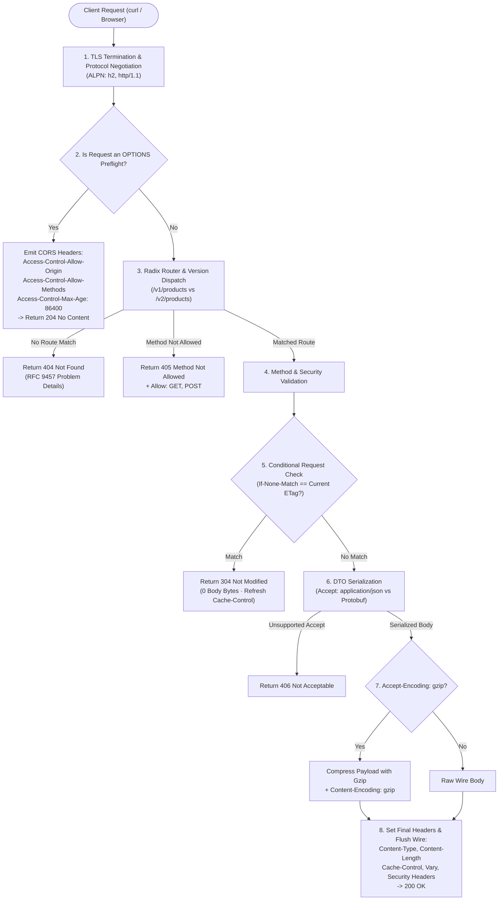
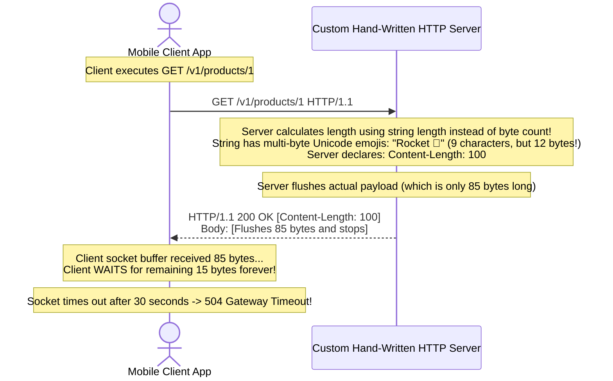

# Module 13: Capstone Project — Production HTTP Engine

## Why This Matters

Every module in this step taught a distinct facet of the HTTP request-response cycle in isolation:
* **The Wire & Headers:** TCP socket framing (00, 01) and the 5 header families (02).
* **Semantics & Security:** Safe vs. idempotent verbs (03), cross-origin browser sandboxing (04), and TLS 1.3 encryption (09).
* **Performance & Scale:** Multi-tier caching and 304 validation (06), HTTP/2 binary framing (07), Gzip/Brotli compression (08), and CDN edge architecture (12).
* **Application Architecture:** Trie-based routing (10), API versioning, and DTO serialization (11).

In production engineering, you never encounter these concepts in isolation. A single production request must negotiate content, validate conditional ETags, enforce strict CORS policies, route on versioned prefixes, and return machine-readable RFC 9457 errors simultaneously.

> [!TIP]
> **The Golden Rule:** High-level frameworks (FastAPI, NestJS, Spring Boot) hide HTTP mechanisms behind layers of abstraction. Building this capstone close to the metal ensures that when an automated production gateway starts failing with `502 Bad Gateway` or silent connection hangs, you can diagnose the root cause immediately.

---

## The Architecture Blueprint



---

## 1. Capstone Requirements Matrix

Your capstone project requires building a **Catalog & Inventory Service** without high-level framework abstraction (using Python's `http.server`, Go's `net/http`, or Node's `http` module):

| Requirement Pillar | Concrete Production Specification |
| :--- | :--- |
| **1. Versioned Routing** | • `/v1/products` and `/v1/products/{id}` (Legacy combined name field).<br>• `/v2/products/{id}` (Breaking change: separated `first_name`/`last_name` and 64-bit string ID).<br>• Static paths (`/v1/products/featured`) must **not** be shadowed by dynamic `{id}`. |
| **2. Status Code Fidelity** | • `200 OK` on standard retrieval.<br>• `201 Created` with `Location: /v1/products/{id}` on product creation.<br>• `204 No Content` on successful deletion.<br>• `304 Not Modified` on valid `If-None-Match`.<br>• `400 Bad Request` on unparseable JSON.<br>• `405 Method Not Allowed` with `Allow` header on invalid verbs.<br>• `406 Not Acceptable` if client rejects available formats.<br>• `422 Unprocessable Entity` when price is negative or title is empty. |
| **3. Caching & Validation** | • Every product response must carry `Cache-Control: public, max-age=60`.<br>• SHA-256 derived `ETag` header attached to every response.<br>• Full conditional validation: sending `If-None-Match: <etag>` must return **`304 Not Modified` with 0 body bytes**. |
| **4. Content Negotiation & Compression** | • Read `Accept`: Serve JSON by default; serve binary Protocol Buffers if requested.<br>• Read `Accept-Encoding`: If `gzip` is present, compress the response and attach `Content-Encoding: gzip`.<br>• Attach `Vary: Accept, Accept-Encoding` on all negotiated responses. |
| **5. CORS & Browser Hardening** | • Intercept `OPTIONS` and return `204 No Content` with `Access-Control-Allow-*` and `Access-Control-Max-Age: 86400`.<br>• Attach defense headers: `X-Content-Type-Options: nosniff`, `X-Frame-Options: DENY`, `Strict-Transport-Security`. |

---

## 2. Production War Story: The Content-Length Desync Hang



### The Incident
During a migration to a lightweight microservice, developers manually wrote raw HTTP response framing. When the API began returning localized Japanese and accented customer names, mobile clients started hanging indefinitely on 25% of all requests, eventually failing with `504 Gateway Timeout`.

### The Root Cause
The developers calculated the `Content-Length` header using language string length functions (e.g. `len(str)` in Python 2 or `str.length` in JavaScript), which return **character counts** rather than **raw binary byte counts**. 

Because UTF-8 characters and emojis consume 2 to 4 bytes each, the declared `Content-Length` did not match the actual byte count transmitted over the TCP socket. The client browser's TCP buffer held the socket open, waiting for the missing bytes that never arrived until the connection timed out.

### The Fix
Always calculate `Content-Length` from the encoded **byte slice / Buffer**:
```go
// In Go:
payloadBytes := []byte(jsonString)
w.Header().Set("Content-Length", strconv.Itoa(len(payloadBytes))) // Byte count, not runes!
```

---

## 3. Reference Implementation: Core Engine Skeletons

### Go (`net/http`) Engine Skeleton
```go
package main

import (
	"bytes"
	"compress/gzip"
	"crypto/sha256"
	"encoding/hex"
	"encoding/json"
	"fmt"
	"net/http"
	"strconv"
	"strings"
)

type Product struct {
	ID    string  `json:"id"`
	Title string  `json:"title"`
	Price float64 `json:"price"`
}

var database = map[string]Product{
	"1": {ID: "1", Title: "Mechanical Keyboard", Price: 149.99},
}

func catalogHandler(w http.ResponseWriter, r *http.Request) {
	// 1. Enforce CORS Preflight
	w.Header().Set("Access-Control-Allow-Origin", "*")
	w.Header().Set("Access-Control-Allow-Methods", "GET, POST, OPTIONS")
	w.Header().Set("Access-Control-Allow-Headers", "Content-Type, Authorization, If-None-Match")
	w.Header().Set("Access-Control-Max-Age", "86400")

	if r.Method == http.MethodOptions {
		w.WriteHeader(http.StatusNoContent)
		return
	}

	// 2. Security Defense Kit
	w.Header().Set("X-Content-Type-Options", "nosniff")
	w.Header().Set("X-Frame-Options", "DENY")
	w.Header().Set("Vary", "Accept, Accept-Encoding")

	// 3. Extract Path Parameter: /v1/products/{id}
	pathParts := strings.Split(strings.Trim(r.URL.Path, "/"), "/")
	if len(pathParts) != 3 || pathParts[0] != "v1" || pathParts[1] != "products" {
		http.Error(w, `{"error":"Not Found"}`, http.StatusNotFound)
		return
	}
	productID := pathParts[2]

	product, exists := database[productID]
	if !exists {
		w.Header().Set("Content-Type", "application/problem+json")
		w.WriteHeader(http.StatusNotFound)
		w.Write([]byte(`{"type":"not_found","title":"Product Not Found","status":404}`))
		return
	}

	// 4. Serialize to JSON
	rawJSON, _ := json.Marshal(product)

	// 5. Generate Cryptographic ETag
	hash := sha256.Sum256(rawJSON)
	etag := `"` + hex.EncodeToString(hash[:8]) + `"`
	w.Header().Set("ETag", etag)
	w.Header().Set("Cache-Control", "public, max-age=60")

	// 6. Conditional Revalidation (304 Not Modified)
	if match := r.Header.Get("If-None-Match"); match == etag {
		w.WriteHeader(http.StatusNotModified)
		return // Return immediately with 0 body bytes
	}

	// 7. Dynamic Gzip Compression
	w.Header().Set("Content-Type", "application/json; charset=utf-8")
	if strings.Contains(r.Header.Get("Accept-Encoding"), "gzip") {
		w.Header().Set("Content-Encoding", "gzip")
		w.WriteHeader(http.StatusOK)

		var gzBuf bytes.Buffer
		gz := gzip.NewWriter(&gzBuf)
		gz.Write(rawJSON)
		gz.Close()

		w.Header().Set("Content-Length", strconv.Itoa(gzBuf.Len()))
		w.Write(gzBuf.Bytes())
		return
	}

	// Uncompressed fallback
	w.Header().Set("Content-Length", strconv.Itoa(len(rawJSON)))
	w.WriteHeader(http.StatusOK)
	w.Write(rawJSON)
}

func main() {
	http.HandleFunc("/v1/products/", catalogHandler)
	fmt.Println("Capstone Engine listening on :8080")
	http.ListenAndServe(":8080", nil)
}
```

---

## 4. Automated Verification Test Suite

Run this complete test matrix against your running service to verify all requirements:

```bash
#!/usr/bin/env bash
BASE_URL="http://localhost:8080"
echo "=== RUNNING CAPSTONE VERIFICATION MATRIX ==="

# Test 1: Standard Retrieval (200 OK + Headers)
echo -n "Test 1: Standard Retrieval -> "
curl -s -i "$BASE_URL/v1/products/1" | grep -q "200 OK" && echo "PASS" || echo "FAIL"

# Test 2: Conditional Validation (304 Not Modified)
echo -n "Test 2: ETag Revalidation -> "
ETAG=$(curl -s -D - -o /dev/null "$BASE_URL/v1/products/1" | grep -i etag | tr -d '\r' | awk '{print $2}')
curl -s -i -H "If-None-Match: $ETAG" "$BASE_URL/v1/products/1" | grep -q "304 Not Modified" && echo "PASS" || echo "FAIL"

# Test 3: Not Found Resource (404)
echo -n "Test 3: Missing Resource 404 -> "
curl -s -o /dev/null -w "%{http_code}\n" "$BASE_URL/v1/products/999" | grep -q "404" && echo "PASS" || echo "FAIL"

# Test 4: Gzip Compression & Vary
echo -n "Test 4: Gzip & Vary Header -> "
curl -s -D - -o /dev/null -H "Accept-Encoding: gzip" "$BASE_URL/v1/products/1" | grep -qi "content-encoding: gzip" && echo "PASS" || echo "FAIL"

# Test 5: CORS Preflight
echo -n "Test 5: CORS Preflight Handshake -> "
curl -s -o /dev/null -w "%{http_code}\n" -X OPTIONS -H "Origin: https://app.example.com" "$BASE_URL/v1/products/1" | grep -q "204" && echo "PASS" || echo "FAIL"

echo "=== VERIFICATION COMPLETE ==="
```

---

## 5. Operational Validation Checkpoint

<details>
<summary><strong>Question 1: The ETag vs. 304 Body Zero-Byte Invariant</strong></summary>

**Scenario:** A developer writes a custom `304 Not Modified` handler:
```python
if client_etag == current_etag:
    return Response(content=json_data, status_code=304)
```
Why does returning content inside a `304` response violate the HTTP specification and damage network performance?

**Answer:**
According to RFC 9110 §15.4.5, a `304 Not Modified` response **must never contain a message body**. 

The entire purpose of conditional validation is to save network bandwidth by informing the client: *"Your local cached representation is byte-for-byte identical to the current server state; reuse your local copy."* 

Sending body bytes inside a `304` wastes network bandwidth and confuses client HTTP parsers, which expect the connection to terminate immediately after the header block.
</details>

<details>
<summary><strong>Question 2: Content-Length vs. Transfer-Encoding: Chunked</strong></summary>

**Scenario:** Can an HTTP response send both `Content-Length: 1024` and `Transfer-Encoding: chunked` simultaneously?

**Answer:**
**No. RFC 9112 strictly forbids sending both headers together.**

* `Content-Length` informs the receiver of the **exact fixed byte length** of the body.
* `Transfer-Encoding: chunked` informs the receiver that the body is being **streamed in dynamic, variable-length chunks** terminated by a zero-length chunk (`0\r\n\r\n`).

If both headers are present, modern HTTP clients and reverse proxies will reject the response as a potential HTTP Request Smuggling attack or ignore `Content-Length` entirely.
</details>

<details>
<summary><strong>Question 3: Postel's Law in Capstone Design</strong></summary>

**Scenario:** How does your capstone service demonstrate Postel's Law (*The Robustness Principle*)?

**Answer:**
1. **Conservative in what you send:** The service produces strictly compliant, deterministic HTTP responses: explicit `Content-Type: application/json; charset=utf-8`, accurate `Content-Length` calculated from binary byte counts, RFC 9457 structured error details, explicit `Cache-Control` directives, and security sandboxing headers.
2. **Liberal in what you accept:** The service tolerates case-insensitive header names, parses optional whitespace in `Accept` headers, tolerates missing trailing slashes, and ignores unneeded query parameters without crashing.
</details>

---

## Graduation & Next Track

Congratulations! You have successfully mastered and synthesized the complete **Request-Response Fundamentals** step.

Proceed to **[Track 02: RESTful API Design & Advanced Architecture](../../02-rest-apis/README.md)** to build high-scale, production-ready distributed API systems.
