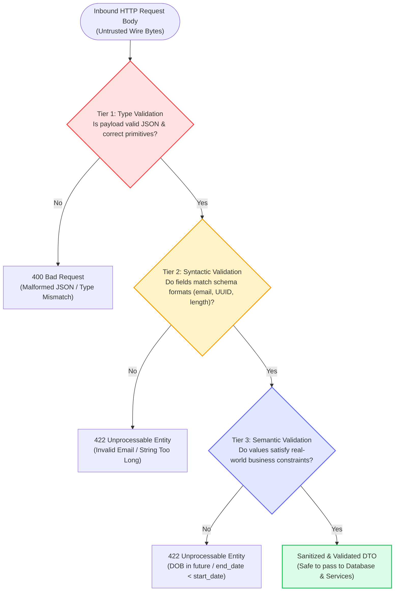
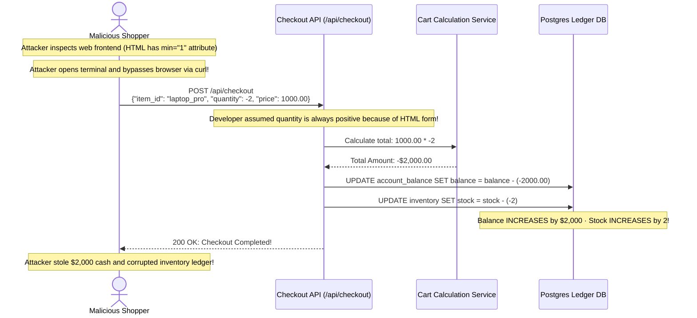
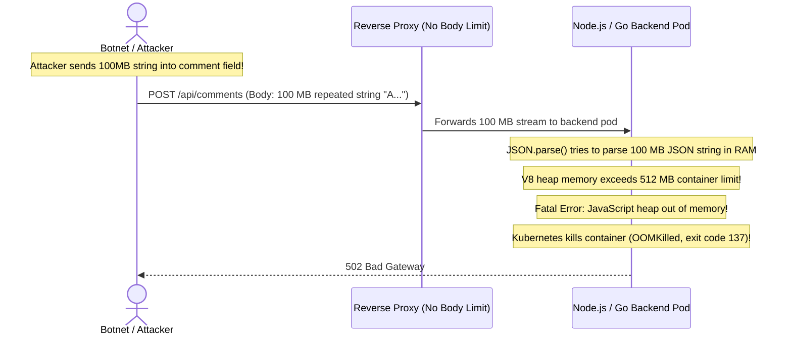

# Module 00: Validation Fundamentals

## Why This Matters

Every request arriving at your server is untrusted bytes sent by strangers over the internet. Before a single line of business logic executes or a single database transaction begins, your application must answer: **is this data safe, well-formed, and structurally valid?**

Validation is not an optional convenience feature—**it is your primary security boundary**:
* **Client-Side Validation is Only UX:** A React frontend form with red warning borders is easily bypassed. Any client can use `curl`, Postman, or a Python script to send arbitrary, corrupted, or malicious bytes directly to your API endpoint.
* **The 3 Validation Tiers:** Real validation requires three distinct checkpoints:
  1. **Type Validation:** Is the field even the expected primitive? (e.g. integer vs. string).
  2. **Syntactic Validation:** Does the string conform to an expected pattern? (e.g. valid RFC 5322 email).
  3. **Semantic Validation:** Does the value make logical real-world sense? (e.g. `birth_date` must be in the past; `order_quantity` must be greater than zero).
* **Database & Memory Protection:** Proper validation blocks SQL injection, prevents negative-quantity balance drains, and rejects 50MB string payloads before they trigger container Out-Of-Memory (OOM) crashes.

> [!TIP]
> **The Golden Rule:** Always adopt a **Whitelisting (Strict Allowlist)** approach. Explicitly define what fields and types are permitted; automatically strip or reject any unexpected input. Never rely on blacklists to filter "bad" data.

---

## The Mental Model: The 3 Validation Tiers



---

## 1. Quick Reference: The 3-Tier Validation Matrix

| Validation Tier | Question Answered | Example Input | Outcome & Status Code |
| :--- | :--- | :--- | :--- |
| **Tier 1: Type** | "Is this value the expected primitive data type?" | `{"age": "twenty"}` *(Expected integer)* | **`400 Bad Request`** or **`422`** |
| **Tier 2: Syntactic** | "Does the value conform to required formatting rules?" | `{"email": "not-an-email"}` | **`422 Unprocessable Entity`** |
| **Tier 3: Semantic** | "Is the value logically sound and valid in context?" | `{"birth_date": "2099-01-01"}` | **`422 Unprocessable Entity`** |
| **Cross-Field** | "Do related fields satisfy mutual dependencies?" | `{"start": "2026-12", "end": "2026-01"}` | **`422 Unprocessable Entity`** |

### Standard RFC 9457 Field-Level Error Format
When rejecting validation errors, never return vague messages like `"Validation error"`. Return an array specifying the exact path and error reason:

```json
{
  "type": "https://api.example.com/errors/validation",
  "title": "Validation Failed",
  "status": 422,
  "detail": "2 fields failed validation constraints.",
  "errors": [
    { "field": "email", "reason": "Must be a valid email address format" },
    { "field": "quantity", "reason": "Must be greater than 0" }
  ]
}
```

---

## 2. Production War Story: The Negative Quantity Shopping Cart Exploit



### The Incident
An online retailer launched a flash sale. Within hours, anomalous accounting alerts fired: several customer balances showed sudden credits of thousands of dollars, and inventory counts for luxury laptops were increasing rather than decreasing.

### The Root Cause
The frontend shopping cart used `<input type="number" min="1">` to restrict quantities. However, the backend Node.js checkout service did not validate `req.body.quantity > 0`. An attacker bypassed the browser using a simple Python script, submitting `quantity: -2`. The mathematical billing engine multiplied `price * quantity`, resulting in a negative total that credited the user's account and artificially inflated inventory.

### The Fix
Enforce strict integer range validation at the backend API boundary:
```typescript
import { z } from 'zod';

const CheckoutSchema = z.object({
  itemId: z.string().uuid(),
  quantity: z.number().int().positive().max(100), // Strictly > 0 and <= 100
});
```

---

## 3. Production War Story: The Payload Memory Bomb (OOM Crash)



### The Root Cause & The Fix
* **The Failure:** Without an explicit request size limit and string length validation, endpoints accepting JSON will attempt to parse massive strings in memory, exhausting container RAM and crashing application processes.
* **The Fix:**
  1. Restrict body payload size at the reverse proxy / middleware layer (e.g. `100KB` maximum).
  2. Constrain maximum string lengths on all schema fields (e.g. `comment: z.string().max(2000)`).

---

## 4. Multi-Language Implementation: Production Validation Schemas

### Go (`go-playground/validator/v10`)
```go
package main

import (
	"encoding/json"
	"fmt"
	"net/http"
	"time"

	"github.com/go-playground/validator/v10"
)

var validate = validator.New()

type CreateUserRequest struct {
	Email     string    `json:"email" validate:"required,email"`
	Age       int       `json:"age" validate:"required,gte=18,lte=120"`
	BirthDate string    `json:"birth_date" validate:"required,datetime=2006-01-02"`
	Role      string    `json:"role" validate:"required,oneof=user editor admin"`
}

func createUserHandler(w http.ResponseWriter, r *http.Request) {
	if r.Method != http.MethodPost {
		http.Error(w, "Method Not Allowed", http.StatusMethodNotAllowed)
		return
	}

	var req CreateUserRequest
	// 1. Type validation: decode JSON
	if err := json.NewDecoder(r.Body).Decode(&req); err != nil {
		http.Error(w, `{"error":"Malformed JSON payload"}`, http.StatusBadRequest)
		return
	}

	// 2. Syntactic validation: struct tags
	if err := validate.Struct(req); err != nil {
		w.Header().Set("Content-Type", "application/problem+json")
		w.WriteHeader(http.StatusUnprocessableEntity)
		w.Write([]byte(fmt.Sprintf(`{"title":"Validation Failed","detail":"%s"}`, err.Error())))
		return
	}

	// 3. Semantic validation: birth date must be in the past
	parsedDate, _ := time.Parse("2006-01-02", req.BirthDate)
	if parsedDate.After(time.Now()) {
		w.Header().Set("Content-Type", "application/problem+json")
		w.WriteHeader(http.StatusUnprocessableEntity)
		w.Write([]byte(`{"title":"Semantic Error","detail":"Birth date cannot be in the future"}`))
		return
	}

	w.WriteHeader(http.StatusCreated)
	w.Write([]byte(`{"status":"user_created"}`))
}
```

### Node.js / TypeScript (Zod Schema Validation)
```typescript
import express, { Request, Response } from 'express';
import { z, ZodError } from 'zod';

const app = express();
app.use(express.json({ limit: '100kb' })); // Guard against memory bomb payloads

// Explicit schema whitelist with syntactic and semantic constraints
const UserSchema = z.object({
  email: z.string().email('Invalid email address format'),
  age: z.number().int().min(18, 'Must be at least 18').max(120),
  birthDate: z.string().refine((date) => new Date(date) < new Date(), {
    message: 'Birth date must be in the past',
  }),
  role: z.enum(['user', 'editor', 'admin']),
});

app.post('/api/users', (req: Request, res: Response) => {
  try {
    const validData = UserSchema.parse(req.body);
    res.status(201).json({ status: 'success', data: validData });
  } catch (err) {
    if (err instanceof ZodError) {
      return res.status(422).json({
        type: 'https://api.example.com/errors/validation',
        title: 'Validation Failed',
        status: 422,
        errors: err.errors.map((e) => ({
          field: e.path.join('.'),
          message: e.message,
        })),
      });
    }
    res.status(500).json({ error: 'Internal Server Error' });
  }
});
```

### Python (FastAPI with Pydantic v2)
```python
from fastapi import FastAPI, HTTPException, status
from pydantic import BaseModel, EmailStr, Field, field_validator
from datetime import date
from typing import Literal

app = FastAPI()

class UserCreate(BaseModel):
    # Tier 1 & 2: Type and Syntactic constraints
    email: EmailStr
    age: int = Field(..., ge=18, le=120, description="Age must be between 18 and 120")
    birth_date: date
    role: Literal["user", "editor", "admin"] = "user"

    # Tier 3: Semantic constraint
    @field_validator("birth_date")
    @classmethod
    def validate_past_date(cls, v: date) -> date:
        if v >= date.today():
            raise ValueError("Birth date must be strictly in the past")
        return v

@app.post("/users", status_code=status.HTTP_201_CREATED)
def create_user(user: UserCreate):
    return {"status": "created", "user": user.model_dump()}
```

---

## 5. Practical Hands-On Exercises

### Exercise 1: Bypass Client-Side Form via Direct `curl`
Demonstrate why frontend validation is never a security guarantee by submitting illegal values directly to an endpoint:

```bash
# Attempt to send an invalid email and a negative age
curl -s -i -X POST http://localhost:8000/users \
  -H "Content-Type: application/json" \
  -d '{"email": "attacker@evil", "age": -10, "birth_date": "2099-01-01"}' \
  | grep -E "(HTTP\/|detail|errors)"
```
**Look for:**
* `HTTP/1.1 422 Unprocessable Entity`
* Explicit field rejection pointing to `age` and `birth_date`.

### Exercise 2: Trigger `400 Bad Request` via Broken Syntax
Verify that malformed JSON is caught at Tier 1 before schema validation runs:

```bash
curl -s -i -X POST http://localhost:8000/users \
  -H "Content-Type: application/json" \
  -d '{"email": "alice@corp.com", "age": ' \
  | grep "HTTP/"
```
**Look for:** `HTTP/1.1 400 Bad Request`

---

## 6. Operational Validation Checkpoint

<details>
<summary><strong>Question 1: The Client-Side Validation Fallacy</strong></summary>

**Scenario:** A frontend developer writes extensive JavaScript validation for a sign-up form: verifying email formats, checking password strength regex, and ensuring names contain only ASCII letters. The developer proposes removing validation logic from the backend API to "avoid duplicate code and reduce server CPU usage."

Why is this proposal an unacceptable security vulnerability?

**Answer:**
**Because client-side validation provides zero security.**

The client environment is completely under the user's control. Anyone can:
1. Disable JavaScript in their browser.
2. Intercept and modify HTTP packets using an HTTP proxy like Burp Suite or OWASP ZAP.
3. Completely bypass the browser by sending requests using `curl`, Postman, or automated bot scripts.

Removing backend validation allows arbitrary payloads, SQL injection strings, and invalid data structures to reach business logic and databases unimpeded. Client validation is purely for user experience; backend validation is the non-negotiable security boundary.
</details>

<details>
<summary><strong>Question 2: Cross-Field Semantic Validation</strong></summary>

**Scenario:** You are building a hotel reservation API:
`POST /api/bookings`
Body: `{"check_in": "2026-12-15", "check_out": "2026-12-10"}`
Both dates are syntactically valid ISO 8601 strings, and both dates are in the future. 

Which validation tier is responsible for rejecting this request, and why?

**Answer:**
**Tier 3: Semantic Cross-Field Validation.**

Individually, both `check_in` and `check_out` pass Type validation (valid string/date) and Syntactic validation (matches `YYYY-MM-DD`). 

However, they violate the **semantic business rule** that `check_out` must be strictly after `check_in`. Single-field schema validators cannot detect this error; the validation layer must compare both fields simultaneously before invoking the booking service.
</details>

<details>
<summary><strong>Question 3: Whitelisting vs. Blacklisting</strong></summary>

**Scenario:** What is the difference between a whitelisting (allowlist) validation policy and a blacklisting (denylist) policy, and why is blacklisting considered an antipattern?

**Answer:**
* **Blacklisting (Denylist):** Attempts to enumerate and reject known bad patterns (e.g. blocking `<script>` tags, filtering out `"admin"`).
  * *Why it fails:* Attackers find countless encoding variants, casing tricks (`<sCrIpt>`), or alternative injection syntax that the blacklist author failed to anticipate.
* **Whitelisting (Allowlist):** Strictly defines what is **permitted** (e.g. "age must be an integer between 18 and 100", "username must contain only `[a-z0-9_]{3,20}`") and automatically rejects everything else.
  * *Why it succeeds:* Any unlisted field, malicious string, or unexpected data type is rejected by default, providing true defense in depth.
</details>

---

## Next Step

Now that you have mastered validation tiers and boundary enforcement, proceed to **[01-transformation-and-normalization](../01-transformation-and-normalization/README.md)** to master string trimming, case normalization, date canonicalization, and safe type coercion.
