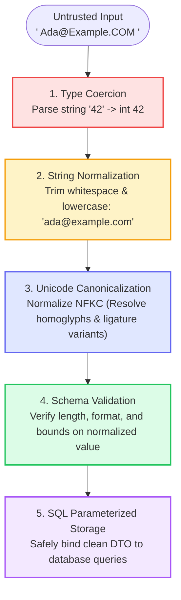
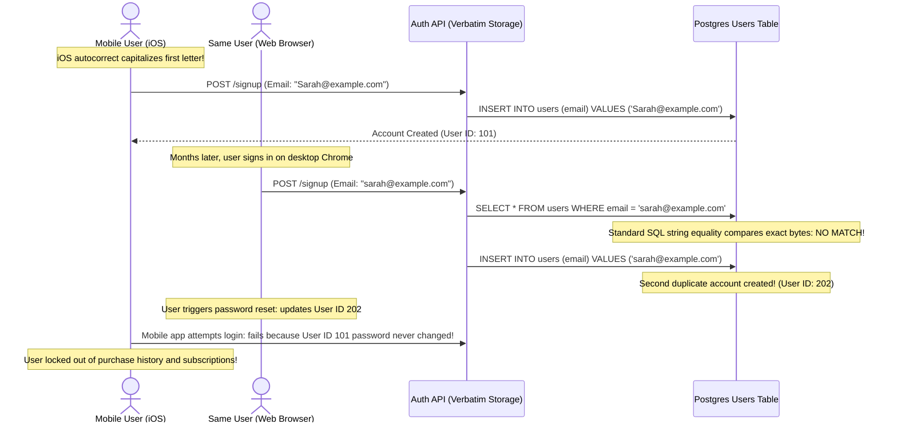
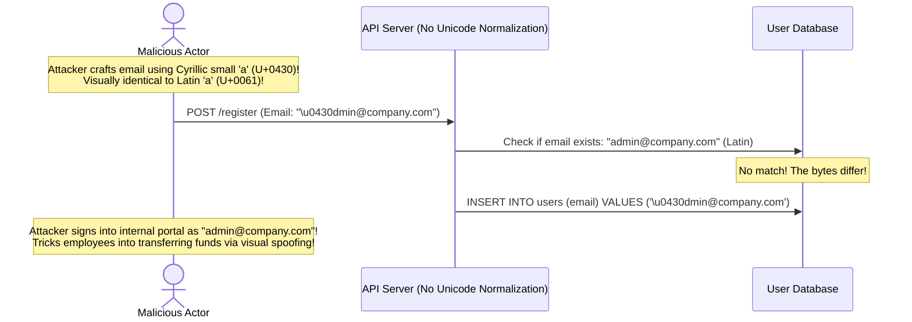

# Module 01: Transformation and Normalization

## Why This Matters

Validation (Module 00) answers: *"Is this data acceptable?"* 
Transformation and Normalization answer: **"The data is acceptable, but is it in the single canonical format our database, search indexes, and business logic require?"**

Skipping normalization is the root cause of subtle, destructive data bugs:
* **The Duplicate Identity Disaster:** A user registers as `Alex@Company.com`. Later, they log in as `alex@company.com`. If stored verbatim, your system creates two separate user accounts with conflicting states, broken billing records, and failed password resets.
* **Invisible Whitespace Failures:** Mobile autocorrect and copy-paste frequently append trailing whitespace (`"  alice@corp.com  "`). Without edge trimming, hash comparisons, uniqueness indexes, and foreign keys fail.
* **Security & Injection Defense:** Sanitization prepares data for safe storage and display, while **parameterization (prepared statements)** mathematically prevents untrusted strings from executing as SQL or shell code.

> [!TIP]
> **The Golden Rule:** Always **normalize before you validate**, and validate before you store. Trim whitespace, lowercase emails, canonicalize phone numbers to E.164 (`+14155552671`), and convert all incoming timestamps to UTC ISO 8601.

---

## The Mental Model: The Ingestion & Transformation Pipeline



---

## 1. Quick Reference: Canonical Data Formats Matrix

| Data Type | Raw Input Example | Canonical Target Format | Production Standard |
| :--- | :--- | :--- | :--- |
| **Email Address** | `"  Alice@Domain.COM  "` | `alice@domain.com` | Lowercased, trimmed whitespace. |
| **Phone Number** | `"(415) 555-0199"` | `+14155550199` | **E.164 standard** (Mandatory for Twilio / SMS APIs). |
| **Usernames** | `"  Cool_Coder  "` | `cool_coder` | Trimmed, lowercase (if case-insensitive). |
| **Names / Titles** | `"John   Doe"` | `John Doe` | Trimmed, multiple internal spaces collapsed to single space. |
| **Timestamps** | `"07/24/2026 3:30 PM EST"` | `2026-07-24T19:30:00Z` | **ISO 8601 / RFC 3339 in UTC**. |
| **Monetary Amounts**| `"$19.99"` | `1999` | Converted to integer **cents/micros** (avoids floating point errors). |

---

## 2. Production War Story: The Duplicate Account & Password Reset Lockout



### The Incident
A subscription streaming service reported a surging influx of angry customer support tickets. Long-time users reported that after requesting a password reset on their laptops, their mobile phone applications logged them out and reported "Invalid Credentials." Furthermore, their subscription history was completely missing.

### The Root Cause
The backend authentication service accepted email strings verbatim without normalising case:
* The mobile application registered the user as `Sarah@example.com` (iOS keyboard capitalized the first letter).
* The web portal registered the user as `sarah@example.com`.
* In PostgreSQL, the standard `VARCHAR` `UNIQUE` index enforces byte-for-byte uniqueness. Because `'S' != 's'`, the database allowed two conflicting accounts for the same human. Password resets updated the newer web account while leaving the older subscription account untouched.

### The Fix
1. **Normalize at the edge:** Force `email.strip().lower()` in the DTO transformation layer.
2. **Database Hardening:** Use the PostgreSQL `CITEXT` (case-insensitive text) data type or create a functional index:
```sql
CREATE UNIQUE INDEX idx_users_email_lower ON users (LOWER(email));
```

---

## 3. Production War Story: The Unicode Homoglyph Admin Spoof



### The Solution: Unicode Normalization (NFKC)
Unicode allows identical visual characters to be represented by completely different binary code points (homoglyphs). 
By applying **NFKC (Normalization Form KC - Compatibility Decomposition followed by Canonical Composition)**, visually and semantically equivalent Unicode characters are mapped to a standardized single byte sequence:
```python
import unicodedata
normalized_str = unicodedata.normalize('NFKC', raw_input)
```

---

## 4. Multi-Language Implementation: Production Transformation Pipelines

### Go (`net/http` & Custom Normalization)
```go
package main

import (
	"encoding/json"
	"net/http"
	"regexp"
	"strings"
	"golang.org/x/text/unicode/norm"
)

var phoneRegex = regexp.MustCompile(`\D`)

type UserRegistrationDTO struct {
	Email    string `json:"email"`
	FullName string `json:"full_name"`
	Phone    string `json:"phone"`
}

// Normalize modifies the DTO in-place to enforce canonical storage
func (u *UserRegistrationDTO) Normalize() {
	// 1. Email: Trim and lowercase
	u.Email = strings.ToLower(strings.TrimSpace(u.Email))

	// 2. Full Name: Unicode NFKC + Collapse multiple internal spaces
	u.FullName = norm.NFKC.String(strings.TrimSpace(u.FullName))
	spaceRegex := regexp.MustCompile(`\s+`)
	u.FullName = spaceRegex.ReplaceAllString(u.FullName, " ")

	// 3. Phone: Strip non-digits and standardize to E.164 (US example)
	digits := phoneRegex.ReplaceAllString(u.Phone, "")
	if len(digits) == 10 {
		u.Phone = "+1" + digits
	} else if len(digits) == 11 && strings.HasPrefix(digits, "1") {
		u.Phone = "+" + digits
	}
}

func registerHandler(w http.ResponseWriter, r *http.Request) {
	var dto UserRegistrationDTO
	if err := json.NewDecoder(r.Body).Decode(&dto); err != nil {
		http.Error(w, `{"error":"Invalid JSON"}`, http.StatusBadRequest)
		return
	}

	// Execute normalization pipeline before validation
	dto.Normalize()

	w.Header().Set("Content-Type", "application/json")
	w.WriteHeader(http.StatusOK)
	json.NewEncoder(w).Encode(dto)
}
```

### Node.js / TypeScript (Zod Transform Pipeline)
```typescript
import express, { Request, Response } from 'express';
import { z } from 'zod';

const app = express();
app.use(express.json());

// Zod pipeline: Normalize BEFORE validating length
const UserSignupSchema = z.object({
  email: z
    .string()
    .trim()
    .toLowerCase()
    .email('Invalid email address format'),

  fullName: z
    .string()
    .trim()
    .transform((val) => val.normalize('NFKC').replace(/\s+/g, ' '))
    .refine((val) => val.length >= 2, { message: 'Name must be at least 2 characters' }),

  phone: z
    .string()
    .transform((val) => val.replace(/\D/g, '')) // Strip formatting (555) 123-4567 -> 5551234567
    .transform((digits) => (digits.length === 10 ? `+1${digits}` : `+${digits}`))
    .refine((val) => /^\+[1-9]\d{1,14}$/.test(val), { message: 'Invalid E.164 phone format' }),
});

app.post('/api/signup', (req: Request, res: Response) => {
  const result = UserSignupSchema.safeParse(req.body);
  if (!result.success) {
    return res.status(422).json({ errors: result.error.errors });
  }

  // Guaranteed canonical data: email is lowercase, phone is +1..., name has no extra spaces
  res.status(200).json({ canonicalUser: result.data });
});
```

### Python (FastAPI with Pydantic v2 `field_validator(mode='before')`)
```python
from fastapi import FastAPI, HTTPException
from pydantic import BaseModel, EmailStr, field_validator
import re
import unicodedata

app = FastAPI()

class UserRegistration(BaseModel):
    email: EmailStr
    full_name: str
    phone: str

    @field_validator("email", mode="before")
    @classmethod
    def normalize_email(cls, v: str) -> str:
        if isinstance(v, str):
            return v.strip().lower()
        return v

    @field_validator("full_name", mode="before")
    @classmethod
    def normalize_name(cls, v: str) -> str:
        if isinstance(v, str):
            # NFKC Unicode normalization and internal space collapsing
            clean = unicodedata.normalize("NFKC", v.strip())
            return re.sub(r"\s+", " ", clean)
        return v

    @field_validator("phone", mode="before")
    @classmethod
    def normalize_phone(cls, v: str) -> str:
        if isinstance(v, str):
            digits = re.sub(r"\D", "", v)
            if len(digits) == 10:
                return f"+1{digits}"
            elif len(digits) > 10:
                return f"+{digits}"
        raise ValueError("Phone number must contain at least 10 valid digits")

@app.post("/signup")
def signup(user: UserRegistration):
    return {"message": "User registered", "data": user.model_dump()}
```

---

## 5. Practical Hands-On Exercises

### Exercise 1: Witness Normalization of Dirty Input
Send a dirty payload with trailing spaces, uppercase characters, and unstructured phone numbers:

```bash
curl -s -X POST http://localhost:8000/signup \
  -H "Content-Type: application/json" \
  -d '{
    "email": "   ALAN.TURING@Bletchley.ORG   ",
    "full_name": "Alan    Mathison   Turing  ",
    "phone": "(555) 234-5678"
  }' | jq .
```

**Expected Canonical Response:**
```json
{
  "message": "User registered",
  "data": {
    "email": "alan.turing@bletchley.org",
    "full_name": "Alan Mathison Turing",
    "phone": "+15552345678"
  }
}
```

---

## 6. Operational Validation Checkpoint

<details>
<summary><strong>Question 1: The Pipeline Ordering Rule</strong></summary>

**Scenario:** A developer implements validation and transformation in this order:
1. Validate string length: `len(raw_input) <= 20`
2. Trim whitespace: `raw_input.strip()`

A user submits `"  valid_username    "` (19 characters with whitespace, but 14 characters trimmed). What goes wrong, and how must the pipeline be structured?

**Answer:**
**The request is rejected unnecessarily or fails boundary guarantees.**

If you validate **before** trimming, a string with harmless padding whitespace might exceed length bounds and fail validation. Conversely, if an endpoint requires `min_length = 5`, a string of 6 spaces `"      "` would pass length validation, only to be trimmed to `""` (empty string) afterward, corrupting the database with empty records.

**The Golden Rule:** Always **normalize first** (trim, lowercase, unicode normalize), and then validate the canonical output.
</details>

<details>
<summary><strong>Question 2: Sanitization vs. SQL Parameterization</strong></summary>

**Scenario:** A junior developer attempts to prevent SQL injection by writing a custom sanitization function that strips single quotes (`'`) from user input before concatenating it into a SQL query:
```python
clean_name = raw_name.replace("'", "")
db.execute(f"SELECT * FROM users WHERE name = '{clean_name}'")
```
Why is this an architectural antipattern, and what is the only correct solution?

**Answer:**
**Blacklist sanitization is notoriously fragile and vulnerable to bypasses.**

Attackers can use backslashes (`\`), alternate encodings, or numeric injection points (where quotes were never needed, e.g. `WHERE id = {clean_input}`) to execute arbitrary SQL. 

Furthermore, stripping quotes corrupts legitimate names like `"O'Connor"`. 

The only production solution is **SQL Parameterization (Prepared Statements)**:
```python
db.execute("SELECT * FROM users WHERE name = %s", (raw_name,))
```
In a prepared statement, the database treats the user input strictly as literal data, mathematically isolating it from the SQL parsing engine regardless of what characters it contains.
</details>

<details>
<summary><strong>Question 3: Financial Precision & Float Serialization</strong></summary>

**Scenario:** An e-commerce API accepts product prices as floats:
`{"price": 19.99}`
In the backend, adding tax yields:
`19.99 * 1.07 = 21.389300000000002`

How should currency amounts be transformed and stored to prevent rounding errors?

**Answer:**
**Currency should always be converted and stored as integer cents / micros.**

Floating-point numbers (IEEE 754) cannot represent base-10 decimals precisely, resulting in rounding discrepancies that accumulate over millions of financial transactions. 

The API layer should transform monetary amounts into integer minor units (e.g. `$19.99` $\rightarrow$ `1999` cents) or utilize arbitrary-precision decimal types (such as `BigDecimal` in Java or Python's `Decimal`), completely avoiding standard floating-point arithmetic.
</details>

---

## Next Step

Now that you have mastered data transformation, string canonicalization, and parameterization, proceed to **[02-complex-validation-logic](../02-complex-validation-logic/README.md)** to master cross-field validation, conditional schemas, state-dependent constraints, and database uniqueness checks.
