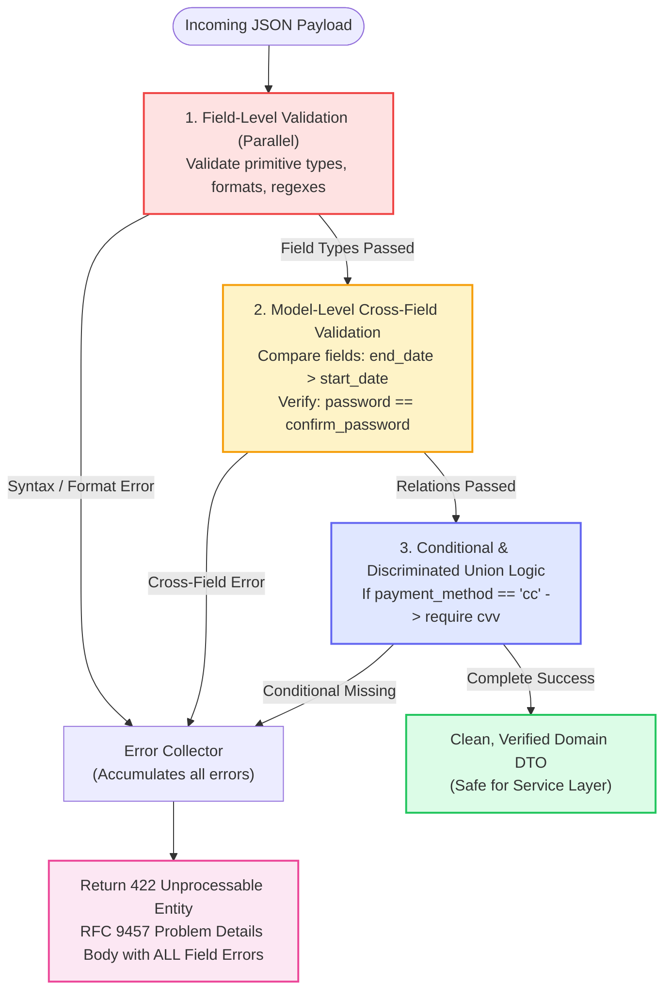
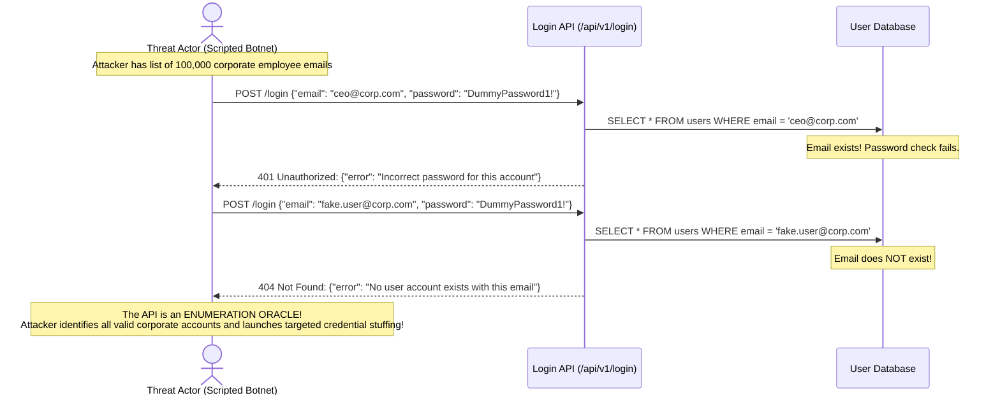
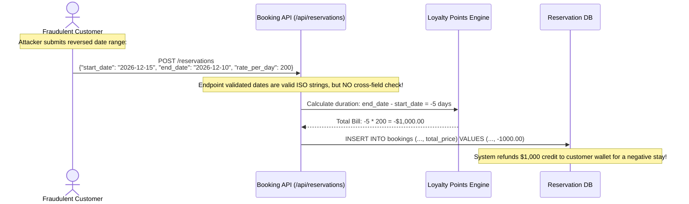

# Module 02: Complex Validation Logic

## Why This Matters

Single-field validation (Module 00) only answers: *"Is field X valid in isolation?"*
Real-world production engineering requires enforcing constraints that span multiple fields, depend on runtime conditions, or enforce domain invariants:
* **Cross-Field Dependencies:** *"New password"* must match *"Confirm password"*; `end_date` must be strictly after `start_date`.
* **Conditional Schemas:** A billing address is mandatory *if and only if* `payment_method == "credit_card"`.
* **Mutually Exclusive Inputs (XOR):** A payment payload may contain `crypto_wallet` OR `bank_account`, but never both.
* **The UX vs. Security Paradox:** On forms, you should accumulate and report **all** field errors simultaneously. But on authentication endpoints, being too specific (`"User does not exist"`) creates an **Account Enumeration Oracle** that allows attackers to harvest your user database.

> [!TIP]
> **The Golden Rule:** Accumulate and return all field errors at once in a standardized RFC 9457 error list for data payloads, but always return a generic constant-time response (`"Invalid email or password"`) on authentication endpoints.

---

## The Mental Model: Whole-Model Validation Lifecycle



---

## 1. Quick Reference: The 4 Complex Validation Patterns

| Pattern | Scenario | Implementation Mechanism | Typical Error Message |
| :--- | :--- | :--- | :--- |
| **Cross-Field Equality** | Password confirmation | Model validator comparing `password == confirm` | `"Passwords do not match"` |
| **Temporal Range** | Date range validation | Model validator comparing `end_date > start_date` | `"end_date must be strictly after start_date"` |
| **Conditional Requirement** | `vat_number` required only if `is_business == true` | Model validator checking presence based on boolean flag | `"vat_number is mandatory for business accounts"` |
| **Discriminated Union** | Polymorphic payloads (`credit_card` vs `paypal` vs `crypto`) | Discriminated union on a `type` discriminator tag | `"Invalid payment configuration for type 'paypal'"` |

---

## 2. Production War Story: The Account Enumeration Oracle



### The Incident
A SaaS healthcare platform suffered a targeted credential stuffing attack. The security operations center noticed an IP range testing millions of email addresses. Despite having rate limiting, the attacker successfully extracted a directory of all 42,000 registered doctor accounts within 24 hours.

### The Root Cause
The authentication endpoint attempted to be "helpful" by returning distinct error messages:
* If the email did not exist: `404 Not Found {"error": "Account not found"}`.
* If the password was wrong: `401 Unauthorized {"error": "Invalid password"}`.
This distinction provided an **enumeration oracle**, allowing an adversary to verify the existence of accounts without knowing any passwords.

### The Fix
Always return a completely uniform, constant-time response:
```http
HTTP/1.1 401 Unauthorized
Content-Type: application/problem+json

{
  "type": "https://api.example.com/errors/unauthorized",
  "title": "Invalid Credentials",
  "status": 401,
  "detail": "Invalid email address or password."
}
```

---

## 3. Production War Story 2: The Negative Duration Booking Arbitrage



### The Incident
A hotel reservation portal introduced an automated loyalty discount engine. Within weeks, fraud monitoring identified multiple users whose accounts accumulated tens of thousands of dollars in promotional credits without charging any credit card.

### The Root Cause
The booking endpoint validated that both `start_date` and `end_date` were valid future dates. However, it lacked a **cross-field validation check** verifying that `end_date > start_date`. The booking calculation subtracted the two timestamps, resulting in a negative stay duration that was credited to the user's account balance.

### The Fix
Enforce cross-field ordering at the schema validation boundary:
```typescript
const BookingSchema = z.object({
  startDate: z.string().datetime(),
  endDate: z.string().datetime(),
}).refine(data => new Date(data.endDate) > new Date(data.startDate), {
  message: "end_date must be strictly after start_date",
  path: ["endDate"],
});
```

---

## 4. Multi-Language Implementation: Cross-Field & Conditional Validation

### Go (`net/http` & Struct Validation)
```go
package main

import (
	"encoding/json"
	"net/http"
	"time"

	"github.com/go-playground/validator/v10"
)

type ReservationRequest struct {
	StartDate string  `json:"start_date" validate:"required,datetime=2006-01-02"`
	EndDate   string  `json:"end_date" validate:"required,datetime=2006-01-02"`
	IsBusiness bool   `json:"is_business"`
	VATNumber string  `json:"vat_number"`
}

var validate = validator.New()

func init() {
	// Register custom cross-field struct-level validator
	validate.RegisterStructValidation(reservationValidation, ReservationRequest{})
}

func reservationValidation(sl validator.StructLevel) {
	req := sl.Current().Interface().(ReservationRequest)

	start, err1 := time.Parse("2006-01-02", req.StartDate)
	end, err2 := time.Parse("2006-01-02", req.EndDate)

	// Cross-field: End date must be after Start date
	if err1 == nil && err2 == nil {
		if !end.After(start) {
			sl.ReportError(req.EndDate, "EndDate", "end_date", "after_start_date", "")
		}
	}

	// Conditional: VAT number is mandatory if IsBusiness == true
	if req.IsBusiness && req.VATNumber == "" {
		sl.ReportError(req.VATNumber, "VATNumber", "vat_number", "required_for_business", "")
	}
}

func bookHandler(w http.ResponseWriter, r *http.Request) {
	var req ReservationRequest
	if err := json.NewDecoder(r.Body).Decode(&req); err != nil {
		http.Error(w, `{"error":"Invalid JSON"}`, http.StatusBadRequest)
		return
	}

	if err := validate.Struct(req); err != nil {
		w.Header().Set("Content-Type", "application/problem+json")
		w.WriteHeader(http.StatusUnprocessableEntity)
		w.Write([]byte(`{"type":"validation_error","title":"Cross-field constraints failed"}`))
		return
	}

	w.WriteHeader(http.StatusCreated)
	w.Write([]byte(`{"status":"booked"}`))
}
```

### Node.js / TypeScript (Zod Cross-Field Refinement)
```typescript
import express, { Request, Response } from 'express';
import { z } from 'zod';

const app = express();
app.use(express.json());

// 1. Cross-field date check
const DateRangeSchema = z
  .object({
    startDate: z.string().date(),
    endDate: z.string().date(),
    isBusiness: z.boolean(),
    vatNumber: z.string().optional(),
  })
  .refine((data) => new Date(data.endDate) > new Date(data.startDate), {
    message: 'endDate must be strictly after startDate',
    path: ['endDate'],
  })
  .refine((data) => !data.isBusiness || !!data.vatNumber, {
    message: 'vatNumber is required when isBusiness is true',
    path: ['vatNumber'],
  });

// 2. Discriminated Union for Payment Methods
const PaymentSchema = z.discriminatedUnion('type', [
  z.object({
    type: z.literal('credit_card'),
    cardNumber: z.string().length(16),
    cvv: z.string().length(3),
  }),
  z.object({
    type: z.literal('paypal'),
    paypalEmail: z.string().email(),
  }),
]);

app.post('/api/reservations', (req: Request, res: Response) => {
  const result = DateRangeSchema.safeParse(req.body);
  if (!result.success) {
    return res.status(422).json({
      type: 'https://api.example.com/errors/validation',
      title: 'Validation Failed',
      status: 422,
      errors: result.error.errors.map((e) => ({
        field: e.path.join('.'),
        message: e.message,
      })),
    });
  }

  res.status(201).json({ status: 'confirmed', data: result.data });
});
```

### Python (FastAPI with Pydantic v2 Model Validator)
```python
from fastapi import FastAPI, HTTPException, status
from pydantic import BaseModel, model_validator
from datetime import date
from typing import Optional

app = FastAPI()

class ReservationCreate(BaseModel):
    start_date: date
    end_date: date
    is_business: bool
    vat_number: Optional[str] = None

    # Whole-model validator running after fields are parsed
    @model_validator(mode="after")
    def validate_cross_field_rules(self) -> "ReservationCreate":
        # 1. Temporal range check
        if self.end_date <= self.start_date:
            raise ValueError("end_date must be strictly after start_date")

        # 2. Conditional requirement check
        if self.is_business and not self.vat_number:
            raise ValueError("vat_number is mandatory for business reservations")

        return self

@app.post("/reservations", status_code=status.HTTP_201_CREATED)
def create_reservation(res: ReservationCreate):
    return {"status": "created", "reservation": res.model_dump()}
```

---

## 5. Practical Hands-On Exercises

### Exercise 1: Trigger Cross-Field Temporal Validation Failure
Submit a reversed date range and observe the field-level error output:

```bash
curl -s -i -X POST http://localhost:8000/reservations \
  -H "Content-Type: application/json" \
  -d '{
    "start_date": "2026-12-20",
    "end_date": "2026-12-10",
    "is_business": false
  }' | grep -E "(HTTP\/|detail|message)"
```
**Look for:**
* Status `422 Unprocessable Entity`
* Error indicating `end_date must be strictly after start_date`.

### Exercise 2: Trigger Conditional Requirement Failure
Submit a business account without a VAT number:

```bash
curl -s -i -X POST http://localhost:8000/reservations \
  -H "Content-Type: application/json" \
  -d '{
    "start_date": "2026-12-10",
    "end_date": "2026-12-20",
    "is_business": true
  }' | grep -E "(HTTP\/|detail|message)"
```
**Look for:** Error indicating `vat_number is mandatory for business reservations`.

---

## 6. Operational Validation Checkpoint

<details>
<summary><strong>Question 1: All-at-Once vs. Fail-Fast Validation</strong></summary>

**Scenario:** A backend developer configures validation logic:
```python
if not valid_email(req.email):
    return error("Invalid email")
if not valid_age(req.age):
    return error("Invalid age")
```
Why is returning only the first error an antipattern for API consumers?

**Answer:**
**It forces clients into an agonizing "validation ping-pong" cycle.**

If a user submits a form with 4 invalid fields, a fail-fast validator forces the user to click submit, see Error 1, fix Error 1, click submit again, see Error 2, fix Error 2, and so forth across 4 separate round-trips. 

High-reliability APIs accumulate **all** validation errors across all fields in a single pass and return the complete list in one RFC 9457 response, allowing the frontend to highlight every broken field simultaneously.
</details>

<details>
<summary><strong>Question 2: Discriminated Unions vs. Optional Sprawl</strong></summary>

**Scenario:** You need to support 3 notification delivery channels: Email (requires `email_address`), SMS (requires `phone_number`), and Webhook (requires `webhook_url` and `auth_token`).

Why is a **Discriminated Union** mathematically superior to a single flat model with 4 optional fields?

**Answer:**
**A flat optional model allows illegal combinations that compile and parse successfully.**

With flat optional fields, a client could accidentally submit `channel = "email"` while providing only `phone_number`, or provide all 4 fields simultaneously, forcing cumbersome conditional logic inside your service layer. 

A **Discriminated Union** partitions the schema on a discriminator tag (`channel: "email" | "sms" | "webhook"`). The parser strictly requires the exact fields for that specific channel and forbids illegal cross-channel fields, eliminating defensive checks in business logic.
</details>

<details>
<summary><strong>Question 3: Timing Attacks in Authentication Validation</strong></summary>

**Scenario:** How can an attacker discover valid usernames on an authentication endpoint using a stopwatch even if the endpoint returns the exact same error message: `"Invalid username or password"`?

**Answer:**
**Through Execution Time Differences (Side-Channel Timing Attacks).**

If the server code executes:
```python
user = db.find_by_username(username)
if not user:
    return "Invalid credentials" # Returns in 2ms
if not bcrypt.verify(password, user.password_hash): # Bcrypt takes 250ms!
    return "Invalid credentials" # Returns in 252ms
```
When a username does **not** exist, the endpoint returns in $2\text{ms}$. When a username **does** exist, the expensive password hashing function executes, taking $250\text{ms}$. 

By measuring response latency, an attacker can reliably deduce which usernames exist in the database. 

**The Fix:** Always execute dummy hash computation on non-existent users so the response time remains constant regardless of whether the user was found.
</details>

---

## Next Step

Now that you have mastered complex cross-field and conditional validation, proceed to **[03-middleware-fundamentals](../03-middleware-fundamentals/README.md)** to master onion-layer request pipelines, execution ordering, and cross-cutting request interception.
