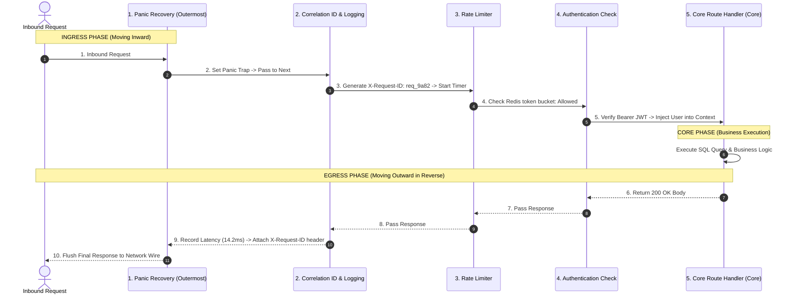
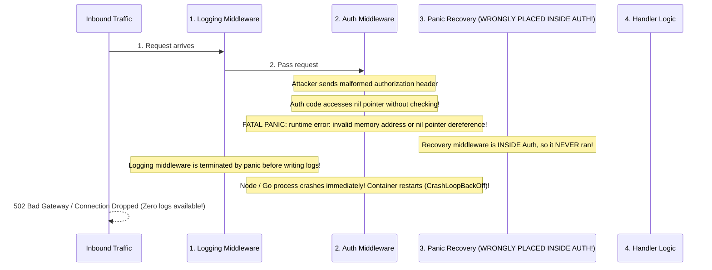
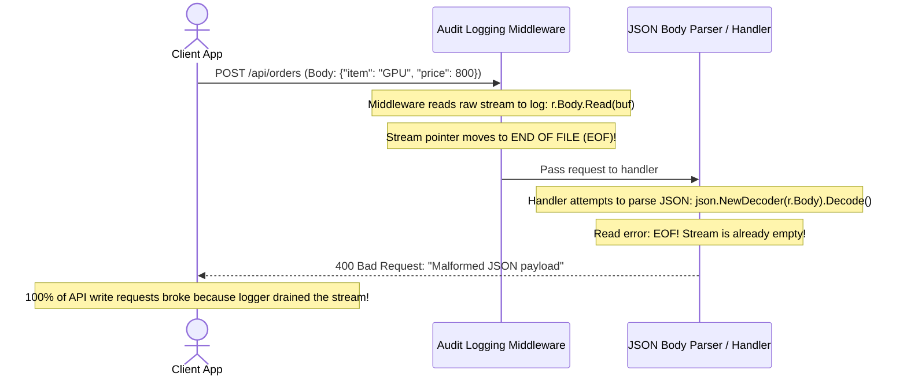

# Module 03: Middleware Fundamentals

## Why This Matters

In production backends, applications do not merely route requests to database queries. Every request must pass through essential operational checkpoints:
* **Distributed Tracing & Correlation:** Injecting a unique `X-Request-ID` before any code executes so logs can be correlated across microservices.
* **Security & Auth Gates:** Rejecting unauthenticated or throttled requests before they consume database connection pool slots.
* **Crash & Panic Recovery:** Catching unhandled null-pointer panics or exceptions, preventing container crashes, and returning a clean RFC 9457 `500 Internal Server Error`.
* **Telemetry & Metrics:** Accurately measuring the true end-to-end latency of requests, including database and rendering time.

Copying these checks into 50 individual route handlers guarantees security drift and maintenance failures. **Middleware** provides a composable, centralized pipeline that wraps the entire request-response lifecycle.

> [!TIP]
> **The Golden Rule:** The middleware registration order defines the **Onion Layering**. Outermost middleware runs first on ingress and last on egress. Always place **Panic Recovery** and **Correlation IDs** as the outermost layers.

---

## The Mental Model: The Onion Architecture



---

## 1. Quick Reference: Ingress vs. Egress Pipeline Stages

Every middleware wraps `next()` and executes in two distinct chronological phases:

```
                  ┌───────────────────────────────────────────────┐
  Request  ──────►│ 1. INGRESS: Pre-Request Phase                 │
                  │    - Generate Request ID                      │
                  │    - Check Rate Limits (Can Short-Circuit)    │
                  │    - Authenticate Token                       │
                  │                                               │
                  │       await next() / next.ServeHTTP()         │  ◄── THE BOUNDARY
                  │                                               │
  Response ◄──────│ 2. EGRESS: Post-Response Phase                │
                  │    - Catch Unhandled Exceptions               │
                  │    - Inject Security / Timing Headers         │
                  │    - Write Structured Audit Log               │
                  └───────────────────────────────────────────────┘
```

### The Standard Middleware Pipeline Order

| Execution Order | Middleware Layer | Ingress Action (Pre-Request) | Egress Action (Post-Response) |
| :---: | :--- | :--- | :--- |
| **1 (Outermost)** | **Panic / Crash Recovery** | Arm exception handler / `defer recover()` | Catch unhandled crashes; return clean 500 error. |
| **2** | **Correlation ID** | Extract or generate `X-Request-ID` | Attach `X-Request-ID` to response headers. |
| **3** | **Structured Logging** | Record start timestamp ($T_0$) | Log HTTP method, path, status, and duration ($T - T_0$). |
| **4** | **CORS & Security** | Handle `OPTIONS` preflight early | Attach `X-Content-Type-Options`, HSTS, CSP headers. |
| **5** | **Rate Limiting** | Check client IP/Token bucket in Redis | Add `X-RateLimit-Remaining` and `Retry-After`. |
| **6 (Innermost)** | **Authentication** | Validate JWT / Session; attach user context | Refresh sliding session cookies if required. |

---

## 2. Production War Story: The Silent Panic Swallowing Outage



### The Incident
During a major marketing campaign, backend containers began crashing intermittently with zero application error logs. In Kubernetes, the pods showed `CrashLoopBackOff` with exit code 137 / 2. SREs were blind because the centralized logging dashboard showed no 500 errors or stack traces prior to container deaths.

### The Root Cause
The engineering team registered their middleware in the following incorrect order:
```go
// BROKEN ORDER:
router.Use(LoggingMiddleware)
router.Use(AuthMiddleware)     // <-- Bug occurred here
router.Use(RecoveryMiddleware) // <-- Placed INSIDE Auth!
```
When an unauthenticated request arrived with a malformed header, the authentication middleware crashed with an unhandled nil pointer exception. Because the **Panic Recovery middleware was placed *after* the Auth middleware**, the panic escaped unhandled, tearing down the operating system thread before the logging middleware could record the failure.

### The Fix
Always register Panic Recovery as the **very first (outermost)** middleware in the chain:
```go
// PRODUCTION CORRECT:
router.Use(RecoveryMiddleware) // 1. Catches panics from ALL deeper layers
router.Use(RequestIDMiddleware)
router.Use(LoggingMiddleware)
router.Use(AuthMiddleware)     // 4. Any panic here is safely caught by #1
```

---

## 3. Production War Story 2: The Consumed Body Stream Drain



### The Root Cause & The Fix
* **The Problem:** In streaming runtimes (Go, Node.js streams), `r.Body` is a **one-time readable stream**. Once consumed by a logging or HMAC signature middleware, the stream is exhausted. When downstream route handlers attempt to parse the JSON body, they encounter an immediate `EOF` error.
* **The Fix:** If you must inspect the request body in middleware, you must read the bytes and **restore the stream** with a duplicate buffer before calling `next()`:
```go
bodyBytes, _ := io.ReadAll(r.Body)
r.Body.Close()
// Restore the stream so downstream handlers can read it:
r.Body = io.NopCloser(bytes.NewBuffer(bodyBytes))
```

---

## 4. Multi-Language Implementation: Production Middleware Pipelines

### Go (`net/http` Canonical Middleware Chain)
```go
package main

import (
	"context"
	"fmt"
	"log"
	"net/http"
	"time"

	"github.com/google/uuid"
)

type contextKey string
const RequestIDKey contextKey = "RequestID"

// 1. Outermost: Panic Recovery Middleware
func RecoveryMiddleware(next http.Handler) http.Handler {
	return http.HandlerFunc(func(w http.ResponseWriter, r *http.Request) {
		defer func() {
			if err := recover(); err != nil {
				log.Printf("[PANIC RECOVERED] %v", err)
				w.Header().Set("Content-Type", "application/problem+json")
				w.WriteHeader(http.StatusInternalServerError)
				w.Write([]byte(`{"type":"internal_error","title":"Internal Server Error","status":500}`))
			}
		}()
		next.ServeHTTP(w, r)
	})
}

// 2. Correlation ID & Timing Middleware
func TracingMiddleware(next http.Handler) http.Handler {
	return http.HandlerFunc(func(w http.ResponseWriter, r *http.Request) {
		start := time.Now()

		// Ingress: Extract or generate Request ID
		reqID := r.Header.Get("X-Request-ID")
		if reqID == "" {
			reqID = "req_" + uuid.New().String()[:8]
		}

		ctx := context.WithValue(r.Context(), RequestIDKey, reqID)
		w.Header().Set("X-Request-ID", reqID)

		// Pass inward
		next.ServeHTTP(w, r.WithContext(ctx))

		// Egress: Log execution duration
		duration := time.Since(start)
		log.Printf("[%s] %s %s - %v", reqID, r.Method, r.URL.Path, duration)
	})
}

func orderHandler(w http.ResponseWriter, r *http.Request) {
	reqID := r.Context().Value(RequestIDKey).(string)
	w.WriteHeader(http.StatusOK)
	fmt.Fprintf(w, `{"status":"processed","request_id":"%s"}`, reqID)
}

func main() {
	mux := http.NewServeMux()
	mux.HandleFunc("/orders", orderHandler)

	// Chain middlewares: Outermost wraps inner layers
	pipeline := RecoveryMiddleware(TracingMiddleware(mux))

	fmt.Println("Server running on :8080")
	http.ListenAndServe(":8080", pipeline)
}
```

### Node.js / Express (Onion Execution Pipeline)
```typescript
import express, { Request, Response, NextFunction } from 'express';
import crypto from 'crypto';

const app = express();

// 1. Correlation ID & Ingress Timing
app.use((req: Request, res: Response, next: NextFunction) => {
  const start = process.hrtime();
  const requestId = (req.headers['x-request-id'] as string) || `req_${crypto.randomUUID().slice(0, 8)}`;
  
  req.headers['x-request-id'] = requestId;
  res.setHeader('X-Request-ID', requestId);

  // Intercept response finish event (Egress phase)
  res.on('finish', () => {
    const [seconds, nanoseconds] = process.hrtime(start);
    const durationMs = (seconds * 1000 + nanoseconds / 1e6).toFixed(2);
    console.log(`[${requestId}] ${req.method} ${req.url} -> ${res.statusCode} (${durationMs}ms)`);
  });

  next();
});

// 2. Short-Circuiting Auth Gate
app.use('/api/protected', (req: Request, res: Response, next: NextFunction) => {
  const auth = req.headers['authorization'];
  if (!auth || !auth.startsWith('Bearer ')) {
    return res.status(401).json({
      type: 'https://api.example.com/errors/unauthorized',
      title: 'Missing Authorization Token',
      status: 401,
    });
  }
  next();
});

app.get('/api/protected/profile', (req, res) => {
  res.json({ user: 'Ada Lovelace', status: 'authenticated' });
});

// 3. Outermost Error Catcher (Must have 4 arguments in Express)
app.use((err: Error, req: Request, res: Response, next: NextFunction) => {
  console.error('[UNHANDLED ERROR]', err);
  res.status(500).json({ error: 'Internal Server Error' });
});

app.listen(3000);
```

### Python (FastAPI with Starlette `BaseHTTPMiddleware`)
```python
from fastapi import FastAPI, Request, Response
from starlette.middleware.base import BaseHTTPMiddleware
import time
import uuid
import logging

app = FastAPI()

class ObservabilityMiddleware(BaseHTTPMiddleware):
    async def dispatch(self, request: Request, call_next):
        # 1. Ingress Phase: Start Timer & Attach Request ID
        start_time = time.perf_counter()
        request_id = request.headers.get("x-request-id", f"req_{uuid.uuid4().hex[:8]}")
        
        # 2. Forward to remaining pipeline & handler
        try:
            response: Response = await call_next(request)
        except Exception as exc:
            logging.error(f"[{request_id}] Unhandled crash: {exc}")
            raise exc

        # 3. Egress Phase: Attach timing and correlation headers
        process_time = (time.perf_counter() - start_time) * 1000
        response.headers["X-Request-ID"] = request_id
        response.headers["X-Process-Time-Ms"] = f"{process_time:.2f}"
        
        logging.info(f"[{request_id}] {request.method} {request.url.path} -> {response.status_code} ({process_time:.2f}ms)")
        return response

app.add_middleware(ObservabilityMiddleware)

@app.get("/items/{item_id}")
async def get_item(item_id: int):
    return {"item_id": item_id, "status": "active"}
```

---

## 5. Practical Hands-On Exercises

### Exercise 1: Observe Execution Order & Timing Headers
Run a request against an endpoint wrapped with timing middleware:

```bash
curl -s -i http://localhost:8000/items/42 | grep -iE "(x-request-id|x-process-time)"
```
**Look for:**
* `x-request-id: req_9a8f21b3`
* `x-process-time-ms: 1.45`

### Exercise 2: Witness Short-Circuiting in Action
Submit a request with missing credentials to a protected route:

```bash
curl -s -o /dev/null -w "%{http_code}\n" http://localhost:3000/api/protected/profile
```
**Look for:** `401` returned immediately without the route handler logic ever running.

---

## 6. Operational Validation Checkpoint

<details>
<summary><strong>Question 1: Logging Rejected Security Probes</strong></summary>

**Scenario:** An engineering team configures:
1. `Use(AuthMiddleware)`
2. `Use(LoggingMiddleware)`

A malicious botnet sends 100,000 requests searching for vulnerabilities without providing an authentication token. Why does the engineering team see 0 logs in Datadog?

**Answer:**
**Because Auth short-circuited before Logging was ever reached.**

When an incoming request failed the authentication check, `AuthMiddleware` immediately returned `401 Unauthorized` without calling `next()`. 

Because `LoggingMiddleware` was nested **inside** `AuthMiddleware`, it was never invoked. The team's observability system is completely blind to external attacks, brute-force attempts, and credential stuffing. 

**The Fix:** Always position Logging and Request ID generation **outside** of Authentication so that rejected requests are fully audited.
</details>

<details>
<summary><strong>Question 2: Passing Per-Request State Downstream</strong></summary>

**Scenario:** Authentication middleware parses a JWT and verifies that the user is `user_id = 9021`. How should this user identity be passed to downstream route handlers without using global variables?

**Answer:**
**Via Request Context (`r.Context()` in Go, `req.user` in Express, `request.state` in FastAPI).**

HTTP servers handle requests concurrently across thousands of threads or async coroutines. Using global or module-level variables creates critical race conditions where User A's thread overwrites User B's identity. 

Attaching the authenticated user entity directly to the scoped **request context** ensures the data is strictly bound to that specific request lifecycle and discarded when the response completes.
</details>

<details>
<summary><strong>Question 3: Client Disconnect & Context Cancellation</strong></summary>

**Scenario:** A client submits an expensive reporting query (`GET /reports/quarterly`), but closes their laptop lid after 200ms. 
If the middleware pipeline does not forward `request.context`, what happens on the backend?

**Answer:**
**The backend server and database continue executing the expensive 30-second query to completion, wasting CPU and database resources.**

Compliant HTTP servers cancel the `request.Context()` when the underlying TCP socket drops. Well-behaved middleware propagates this context down to database drivers (`db.QueryContext(ctx)`). 

When the client disconnects, the database driver intercepts the context cancellation, terminates the running SQL query immediately, and frees the connection pool slot.
</details>

---

## Next Step

Now that you have mastered middleware foundations and onion architecture, proceed to **[04-common-middleware-patterns](../04-common-middleware-patterns/README.md)** to build production-grade rate limiters, security headers, request ID injectors, and compression middleware.
