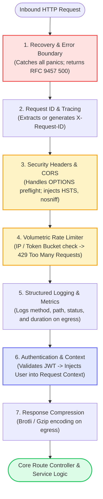
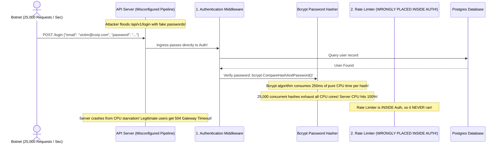
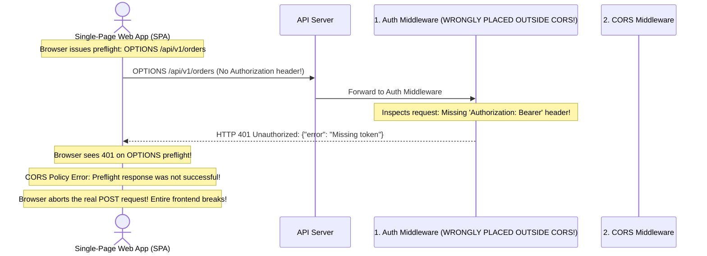

# Module 04: Common Middleware Patterns

## Why This Matters

Module 03 established the execution mechanism of the middleware onion. This module provides the **battle-tested production catalog**: the six core middlewares deployed in nearly every enterprise API, and—most critically—**their non-negotiable pipeline ordering**:
* **Security at the Perimeter:** Security headers (HSTS, CSP, Frame Options) and CORS must protect every outgoing byte.
* **Denial of Service Defense:** Rate limiting must drop volumetric brute-force attacks at the door before expensive database queries or bcrypt password hashes consume CPU cycles.
* **Observability & Traceability:** Correlation IDs must wrap the entire request lifecycle so every log line across microservices can be queried via a single trace ID.

> [!TIP]
> **The Golden Rule:** Always place **Rate Limiting** and **CORS** *before* **Authentication**. Placing Rate Limiting after Authentication allows attackers to mount massive DoS attacks against your database and bcrypt CPU resources without ever being throttled.

---

## The Mental Model: Production Pipeline Order Flow



---

## 1. Quick Reference: The 6 Common Middlewares & Their Order

| Order Index | Middleware Pattern | Key Header Managed | Short-Circuit Code | Production Objective |
| :---: | :--- | :--- | :---: | :--- |
| **1 (Outer)** | **Panic Recovery** | None | `500` | Catches unhandled panics/exceptions; ensures machine-readable error bodies. |
| **2** | **Correlation ID** | `X-Request-ID` | None | Binds a distributed trace UUID to the request and response headers. |
| **3** | **CORS & Preflight** | `Access-Control-Allow-*` | `204` | Answers browser preflight handshakes without invoking deeper app code. |
| **4** | **Rate Limiter** | `X-RateLimit-*`, `Retry-After`| `429` | Drops abusive traffic, botnets, and credential stuffing at the network perimeter. |
| **5** | **Structured Logger** | None | None | Emits structured JSON logs containing latency, status, and correlation ID. |
| **6 (Inner)** | **Authentication** | `Authorization`, `WWW-Authenticate` | `401` / `403` | Validates session tokens and injects the authenticated identity into Context. |

---

## 2. Production War Story: The Rate Limiter Behind Auth DoS Outage



### The Incident
During an automated brute-force attack against an identity platform, server CPU utilization spiked to 100% within 45 seconds. Legitimate customers could not log in or process payments, suffering an hour-long outage.

### The Root Cause
The developers registered their middleware pipeline in the following order:
```go
// VULNERABLE ORDER:
router.Use(LoggingMiddleware)
router.Use(AuthMiddleware)        // <-- Expensive bcrypt executed first!
router.Use(RateLimiterMiddleware) // <-- Rate limiter placed inside auth!
```
Because the Rate Limiter was registered *inside* the Authentication middleware, the application executed a full database lookup and an expensive cryptographic `bcrypt` verification on every single incoming request. The attacker easily overwhelmed the server's CPU cores before the rate limiter was ever reached.

### The Fix
Move IP-based and token-based rate limiting to the outer perimeter:
```go
// PRODUCTION CORRECT:
router.Use(RecoveryMiddleware)
router.Use(RequestIDMiddleware)
router.Use(RateLimiterMiddleware) // 1. Volumetric attack dropped at perimeter (429)!
router.Use(LoggingMiddleware)
router.Use(AuthMiddleware)        // 2. Only throttled, sanitized traffic reaches bcrypt
```

---

## 3. Production War Story 2: The CORS Preflight Auth Trap



### The Root Cause & The Fix
* **The Failure:** The browser's native CORS engine sends an `OPTIONS` preflight request **without** client credentials or Bearer tokens. When Auth middleware precedes CORS middleware, the Auth middleware rejects the preflight with `401 Unauthorized`, causing the browser to throw a CORS error and abort the request.
* **The Fix:** Place CORS middleware **before** Authentication. The CORS middleware detects `OPTIONS`, validates the `Origin` header against the allowlist, and returns `204 No Content` immediately.

---

## 4. Multi-Language Implementation: Production Middleware Suites

### Go (`chi` Production Middleware Pipeline)
```go
package main

import (
	"fmt"
	"net/http"
	"time"

	"github.com/go-chi/chi/v5"
	"github.com/go-chi/chi/v5/middleware"
	"github.com/go-chi/cors"
	"github.com/go-chi/httprate"
)

func main() {
	r := chi.NewRouter()

	// 1. Outermost: Crash Recovery
	r.Use(middleware.Recoverer)

	// 2. Correlation / Request ID Injection
	r.Use(middleware.RequestID)

	// 3. CORS Preflight & Security Headers
	r.Use(cors.Handler(cors.Options{
		AllowedOrigins:   []string{"https://app.example.com"},
		AllowedMethods:   []string{"GET", "POST", "PUT", "DELETE", "OPTIONS"},
		AllowedHeaders:   []string{"Accept", "Authorization", "Content-Type", "X-Request-ID"},
		AllowCredentials: true,
		MaxAge:           86400,
	}))

	// 4. Perimeter Rate Limiting (100 requests per minute per IP)
	r.Use(httprate.LimitByIP(100, 1*time.Minute))

	// 5. Structured Real-IP & Logging
	r.Use(middleware.RealIP)
	r.Use(middleware.Logger)

	// 6. Gzip Compression on Egress
	r.Use(middleware.Compress(5))

	// 7. Route Handlers
	r.Get("/api/health", func(w http.ResponseWriter, r *http.Request) {
		w.Header().Set("Content-Type", "application/json")
		w.Write([]byte(`{"status":"healthy"}`))
	})

	fmt.Println("Server running on :8080")
	http.ListenAndServe(":8080", r)
}
```

### Node.js / Express (The Production Security Stack)
```typescript
import express from 'express';
import helmet from 'helmet';
import cors from 'cors';
import rateLimit from 'express-rate-limit';
import compression from 'compression';

const app = express();

// 1. Security Headers (HSTS, CSP, X-Frame-Options, nosniff)
app.use(helmet());

// 2. CORS Preflight Handler
app.use(
  cors({
    origin: 'https://app.example.com',
    credentials: true,
    maxAge: 86400,
  })
);

// 3. Volumetric Rate Limiter (Perimeter Defense)
app.use(
  rateLimit({
    windowMs: 60 * 1000, // 1 minute
    max: 100,            // Limit each IP to 100 requests per window
    standardHeaders: true, // Return X-RateLimit-* headers
    legacyHeaders: false,
    message: { error: 'Too many requests, please try again later.' },
  })
);

// 4. Response Body Compression
app.use(compression());

// 5. Body Parsing
app.use(express.json({ limit: '100kb' }));

app.get('/api/data', (req, res) => {
  res.json({ message: 'Hardened production response' });
});

app.listen(3000);
```

### Python (FastAPI with Hardened Middleware Suite)
```python
from fastapi import FastAPI, Request
from fastapi.middleware.cors import CORSMiddleware
from fastapi.middleware.gzip import GZipMiddleware
from starlette.middleware.base import BaseHTTPMiddleware
import uuid

app = FastAPI()

# 1. Custom Security Headers & Correlation ID Middleware
class SecurityAndTraceMiddleware(BaseHTTPMiddleware):
    async def dispatch(self, request: Request, call_next):
        req_id = request.headers.get("x-request-id", f"req_{uuid.uuid4().hex[:8]}")
        response = await call_next(request)
        
        # Inject production defense headers
        response.headers["X-Request-ID"] = req_id
        response.headers["X-Content-Type-Options"] = "nosniff"
        response.headers["X-Frame-Options"] = "DENY"
        response.headers["Strict-Transport-Security"] = "max-age=63072000; includeSubDomains"
        return response

app.add_middleware(SecurityAndTraceMiddleware)

# 2. CORS Preflight Middleware
app.add_middleware(
    CORSMiddleware,
    allow_origins=["https://app.example.com"],
    allow_credentials=True,
    allow_methods=["GET", "POST", "PUT", "DELETE", "OPTIONS"],
    allow_headers=["Authorization", "Content-Type", "X-Request-ID"],
    max_age=86400,
)

# 3. Gzip Compression
app.add_middleware(GZipMiddleware, minimum_size=1000)

@app.get("/api/v1/health")
async def health():
    return {"status": "ok"}
```

---

## 5. Practical Hands-On Exercises

### Exercise 1: Verify All Security Headers via `curl`
Inspect your server's response headers to verify that the defense suite is active:

```bash
curl -s -I http://localhost:8000/api/v1/health | grep -iE "(x-request-id|x-content-type-options|x-frame-options|strict-transport-security)"
```
**Look for:**
* `X-Request-ID: req_...`
* `X-Content-Type-Options: nosniff`
* `X-Frame-Options: DENY`
* `Strict-Transport-Security: max-age=...`

### Exercise 2: Trigger Rate Limiting Threshold
Send rapid concurrent requests in a loop to verify rate limiter short-circuiting:

```bash
for i in {1..110}; do
  curl -s -o /dev/null -w "%{http_code}\n" http://localhost:3000/api/data
done | sort | uniq -c
```
**Expected Outcome:**
* ~100 requests return `200`
* Remaining requests return `429 Too Many Requests`

---

## 6. Operational Validation Checkpoint

<details>
<summary><strong>Question 1: The Burst Boundary Vulnerability in Fixed Window Limiting</strong></summary>

**Scenario:** A rate limiter allows `100 requests per minute` using a simple fixed 60-second window (e.g. from 12:00:00 to 12:01:00). 
An attacker sends 100 requests at 12:00:59, and another 100 requests at 12:01:01.

Why does fixed-window rate limiting allow a double-traffic burst, and how does **Sliding Window Log / Token Bucket** prevent it?

**Answer:**
**The Fixed-Window algorithm resets its counter at rigid boundary intervals.**

Between 12:00:59 and 12:01:01 (a 2-second interval), the attacker successfully submitted **200 requests** (twice the allowable limit) because the requests spanned two separate clock windows. 

**The Fix:** Use a **Sliding Window Counter** or **Token Bucket** algorithm. The sliding window continuously weights the previous minute's traffic against the current minute, strictly ensuring that no rolling 60-second slice of time can ever exceed the configured 100-request limit.
</details>

<details>
<summary><strong>Question 2: CSRF Defense: Cookies vs. Bearer Tokens</strong></summary>

**Scenario:** A security engineer states: *"Our microservice uses `Authorization: Bearer <JWT>` for all API calls. Therefore, we do not need CSRF protection middleware."*

Is the engineer correct, and why?

**Answer:**
**The engineer is correct.**

CSRF attacks exploit the browser's automatic credential attachment behavior: when a malicious site triggers a cross-origin form POST to your bank, the browser **automatically includes your session cookies**. 

In contrast, modern SPAs and mobile apps store Bearer tokens in JavaScript memory or local storage and explicitly inject them into the `Authorization: Bearer` header. Web browsers will **never** automatically attach custom `Authorization` headers on cross-origin form submissions. Therefore, APIs authenticated purely via Bearer tokens are immune to CSRF.
</details>

<details>
<summary><strong>Question 3: Compression Placement on the Onion</strong></summary>

**Scenario:** Should response compression middleware (Gzip/Brotli) be placed near the outer edge of the onion or near the inner core?

**Answer:**
**Near the inner core (executed last on egress).**

On the egress (outward) journey, the response body must be fully serialized, status codes decided, and headers set **before** the compression algorithm evaluates the payload. Compressing the payload as the final step before the outer network transport ensures that the `Content-Length` matches the compressed bytes and `Content-Encoding: gzip` is accurately stamped.
</details>

---

## Next Step

Now that you have mastered common middleware patterns and security ordering, proceed to **[05-request-context](../05-request-context/README.md)** to master request context propagation, deadline timeouts, thread-safety, and client cancellation handling.
