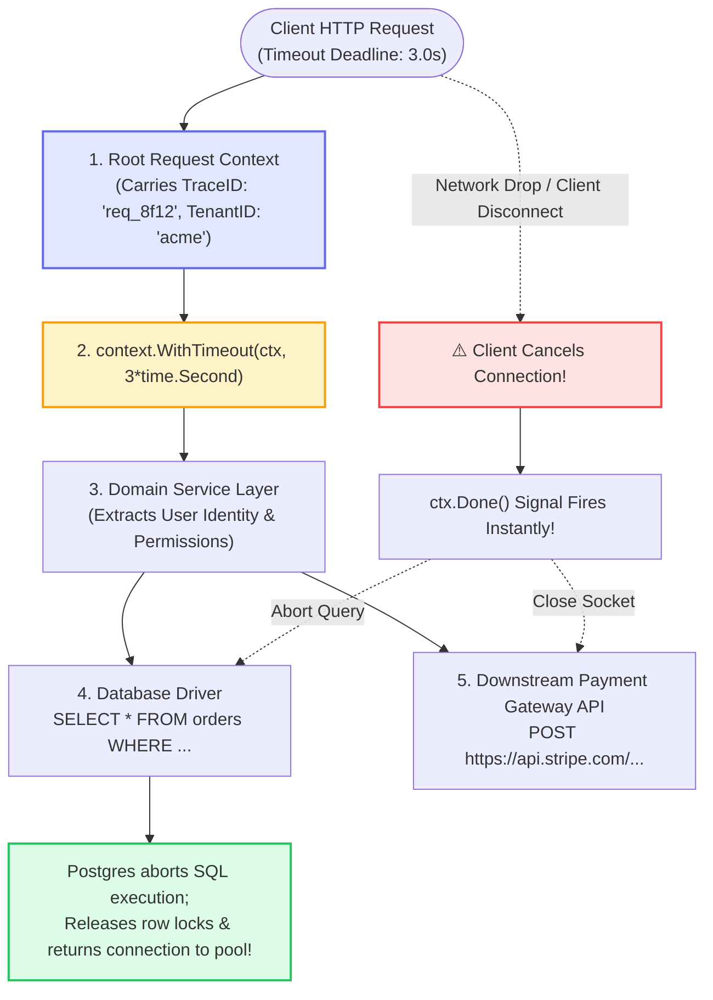
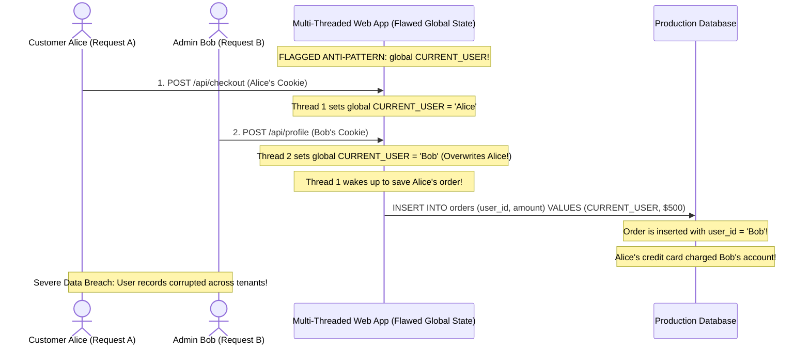
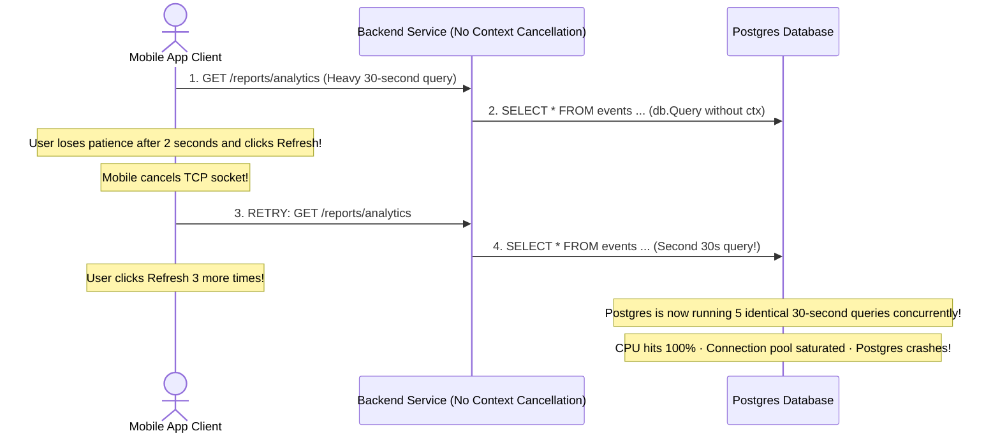

# Module 05: Request Context

## Why This Matters

Every incoming HTTP request represents an ephemeral, isolated world. It possesses **its own authenticated user**, **its own distributed trace ID**, **its own database transaction**, and **its own deadline timeout**. 

Managing this request-scoped state is one of the most critical concurrency concerns in backend engineering:
* **The Global State Trap:** Under concurrency, a web server processes hundreds of requests simultaneously across threads or coroutines. Storing `current_user` in a module-level global variable causes Request B to overwrite Request A, leaking private data across tenants.
* **Context Propagation:** Request state must be accessible to deep service layers, ORM repositories, and loggers without cluttering every function signature with 12 identical parameters.
* **Cancellation & Deadlines:** If a mobile client loses connection or times out after 2 seconds, the server must propagate a **cancellation signal** downward to terminate database queries, abort RPC calls, and free connection pool slots immediately.

> [!TIP]
> **The Golden Rule:** Never use global or module-level variables for per-request state. Scope request state strictly to `context.Context` (Go), `AsyncLocalStorage` (Node.js), or Dependency Injection (FastAPI), and always pass the request context into database operations (`db.QueryContext(ctx)`).

---

## The Mental Model: Context Hierarchy & Cancellation Lifecycle



---

## 1. Quick Reference: What Belongs in Context vs. What Does Not

| Data Category | Belongs in Request Context? | Justification & Production Rule |
| :--- | :---: | :--- |
| **Trace / Request ID** | **YES** | Essential for distributed tracing and correlating logs across microservice hops. |
| **Authenticated Identity** | **YES** | User ID, roles, and tenant ID extracted once by auth middleware. |
| **Request Deadline / Timeout** | **YES** | Hard time boundary; prevents runaway queries from hogging server threads. |
| **Scoped DB Transaction** | **YES** | Allows multiple service methods to participate in the same atomic SQL transaction. |
| **Global App Configuration** | **NO** | Database URLs and secrets belong in global application-level singletons, not context. |
| **Optional Function Arguments** | **NO** | Never use context as an untyped generic parameter bag; keep function signatures explicit. |

---

## 2. Production War Story: The Global Variable Cross-Account Leak



### The Incident
A FinTech startup launched a high-volume stock trading endpoint. During market opening hours, multiple users reported that trade confirmations appeared in other customers' accounts, and account balances were deducted from the wrong user profiles.

### The Root Cause
A developer attempted to avoid passing `user` through 6 layers of service calls by storing it in a module-level global variable:
```python
# CATASTROPHIC BUG:
CURRENT_USER = None

def auth_middleware(request):
    global CURRENT_USER
    CURRENT_USER = verify_jwt(request) # Overwritten by concurrent threads!
```
Under high concurrency, Thread 2 processed Bob's request and reassigned `CURRENT_USER` while Thread 1 (processing Alice's request) was awaiting an I/O database response. When Thread 1 resumed, it read `CURRENT_USER` (which was now Bob) and saved Alice's financial trade under Bob's account.

### The Fix
Never use global state for request data. Always store request data within a **scoped context** that is strictly tied to the request thread or async task lifecycle.

---

## 3. Production War Story 2: The Zombie Query Database Meltdown



### The Incident
A business analytics dashboard crashed every Monday morning. Database monitoring revealed that Postgres connection pools were saturated with dozens of identical slow queries, driving database CPU to 100% and taking down the entire platform.

### The Root Cause
When users encountered a slow report, they clicked "Refresh" multiple times. The browser dropped the original HTTP connection, but the backend Go/Node code used `db.Query()` instead of `db.QueryContext(ctx)`. 

Because the backend ignored client cancellation, the database continued executing the abandoned 30-second queries to completion. 50 user refreshes spawned 250 zombie queries that paralyzed the database.

### The Fix
Pass the request context directly into database drivers:
```go
// PRODUCTION CORRECT:
rows, err := db.QueryContext(r.Context(), "SELECT ...")
// If client disconnects, Postgres receives an immediate cancel command!
```

---

## 4. Multi-Language Implementation: Production Context & Cancellation

### Go (`context.Context` Propagation & Timeouts)
```go
package main

import (
	"context"
	"database/sql"
	"fmt"
	"log"
	"net/http"
	"time"
)

type contextKey string
const UserContextKey contextKey = "AuthenticatedUser"

type UserProfile struct {
	ID    int
	Email string
}

func ContextAuthMiddleware(next http.Handler) http.Handler {
	return http.HandlerFunc(func(w http.ResponseWriter, r *http.Request) {
		// 1. Resolve user identity
		user := UserProfile{ID: 42, Email: "ada@example.com"}

		// 2. Attach user to request-scoped context
		ctx := context.WithValue(r.Context(), UserContextKey, user)

		// 3. Enforce a strict 5-second deadline for the entire request
		ctxWithTimeout, cancel := context.WithTimeout(ctx, 5*time.Second)
		defer cancel() // Release context resources on egress

		next.ServeHTTP(w, r.WithContext(ctxWithTimeout))
	})
}

func reportHandler(db *sql.DB) http.HandlerFunc {
	return func(w http.ResponseWriter, r *http.Request) {
		ctx := r.Context()

		// Retrieve request-scoped user safely
		currentUser := ctx.Value(UserContextKey).(UserProfile)
		log.Printf("Processing report for user: %s", currentUser.Email)

		// Pass context to DB: If client disconnects or timeout expires, DB cancels!
		row := db.QueryRowContext(ctx, "SELECT pg_sleep(2), count(*) FROM transactions")
		
		var sleepResult any
		var count int
		if err := row.Scan(&sleepResult, &count); err != nil {
			if ctx.Err() == context.Canceled {
				log.Println("Client disconnected; query aborted cleanly.")
				return
			}
			http.Error(w, "Query failed or timed out", http.StatusGatewayTimeout)
			return
		}

		w.Header().Set("Content-Type", "application/json")
		fmt.Fprintf(w, `{"transactions": %d, "owner": "%s"}`, count, currentUser.Email)
	}
}
```

### Node.js (`AsyncLocalStorage` Transparent Context Propagation)
```typescript
import express, { Request, Response, NextFunction } from 'express';
import { AsyncLocalStorage } from 'node:async_hooks';

interface RequestContext {
  requestId: string;
  userId: string;
}

// Scoped container shared across all async functions in this execution chain
export const asyncLocalStorage = new AsyncLocalStorage<RequestContext>();

const app = express();

// Middleware: Establish isolated context per request
app.use((req: Request, res: Response, next: NextFunction) => {
  const context: RequestContext = {
    requestId: (req.headers['x-request-id'] as string) || 'req_auto_1',
    userId: 'user_9901', // Resolved from JWT
  };

  // Run downstream chain inside the isolated async scope
  asyncLocalStorage.run(context, () => {
    next();
  });
});

// Deep Domain Service: Reads context WITHOUT requiring function parameters!
async function executeOrderService() {
  const store = asyncLocalStorage.getStore();
  if (!store) throw new Error('No active request context!');
  
  // Safe from race conditions: 'store.userId' is unique to this specific request
  console.log(`[${store.requestId}] Executing order for User ${store.userId}`);
  return { orderId: 'ord_102', user: store.userId };
}

app.post('/api/orders', async (req, res) => {
  const result = await executeOrderService();
  res.json(result);
});

app.listen(3000);
```

### Python (FastAPI Scoped Dependency Injection with Teardown)
```python
from fastapi import FastAPI, Depends, HTTPException, Request, status
from typing import Generator
import asyncio

app = FastAPI()

class DatabaseSession:
    def __init__(self, trace_id: str):
        self.trace_id = trace_id
        print(f"[{self.trace_id}] DB Connection Opened.")

    def close(self):
        print(f"[{self.trace_id}] DB Connection Closed.")

# Dependency with teardown using yield
def get_db_session(request: Request) -> Generator[DatabaseSession, None, None]:
    trace_id = request.headers.get("x-request-id", "trace_1")
    session = DatabaseSession(trace_id)
    try:
        # 1. Setup Phase: Hand session to route handler
        yield session
    finally:
        # 2. Teardown Phase: Guaranteed to execute even if an exception occurs!
        session.close()

@app.get("/items")
async def list_items(db: DatabaseSession = Depends(get_db_session)):
    # Handler declares dependencies explicitly
    await asyncio.sleep(0.5)
    return {"status": "success", "trace": db.trace_id}
```

---

## 5. Practical Hands-On Exercises

### Exercise 1: Simulate Client Disconnect & Cancellation
Demonstrate that dropping an HTTP request terminates execution on the server:

```bash
# Issue an expensive request with a 1-second client timeout
curl -m 1 http://localhost:8000/slow-query
```
**Server Log Observation:** Look for `ctx.Err() == context.Canceled` or `Client disconnected; query aborted cleanly`.

---

## 6. Operational Validation Checkpoint

<details>
<summary><strong>Question 1: The `context.Background()` Antipattern</strong></summary>

**Scenario:** In a Go HTTP route handler, a developer writes:
```go
func handleSearch(w http.ResponseWriter, r *http.Request) {
    // BUG:
    results, err := db.QueryContext(context.Background(), "SELECT ...")
}
```
Why is passing `context.Background()` inside an HTTP handler an operational hazard?

**Answer:**
**It severs the connection between the request lifecycle and the database query.**

`context.Background()` creates an immortal root context that is never canceled and has no timeout. If the client disconnects or the request exceeds the gateway deadline, the database driver will **never be notified**. 

The query will continue running inside Postgres until completion, consuming CPU, memory, and database connection pool slots. You must always pass **`r.Context()`** so cancellations propagate downward.
</details>

<details>
<summary><strong>Question 2: Context Value Type Safety</strong></summary>

**Scenario:** In Go, why should context keys always be defined as custom unexported types (e.g. `type contextKey string`) rather than built-in strings (`"user"`)?

**Answer:**
**To prevent collisions across independent packages and libraries.**

If Package A stores a value under `"user"` and Package B (e.g. a third-party auth middleware) also stores a value under `"user"`, one package will silently overwrite the other. 

By defining an unexported type:
```go
type contextKey string
const UserKey contextKey = "user"
```
The Go runtime enforces that `context.Value(UserKey)` only matches keys created with that exact package type, guaranteeing cryptographic namespace isolation.
</details>

<details>
<summary><strong>Question 3: Teardown Guarantees in Scoped Dependencies</strong></summary>

**Scenario:** How does FastAPI's `yield` dependency pattern ensure database connection pool integrity when an unhandled exception occurs inside a route handler?

**Answer:**
**Via the Python context manager / generator `finally` guarantee.**

When a handler raises an uncaught exception, Python unwinds the execution stack through the generator. Code located after the `yield` statement (or inside a `finally:` block) is **guaranteed to execute**, ensuring that `db.close()` or `session.rollback()` is invoked even during fatal crashes, preventing database connection leaks.
</details>

---

## Free PDF Notes

Download the notes for each video on this page as a printable PDF, with every diagram and interview question: [SD-B-020: Network Timeouts](https://backendroadmap.com/notes/system-design/SD-B-020.pdf), [SD-C-019: API Timeouts & Deadline Propagation](https://backendroadmap.com/notes/system-design/SD-C-019.pdf). Each section in one file: [Phase 2, Networking (PDF)](https://backendroadmap.com/notes/system-design/Phase2_Networking_Notes.pdf) and [Phase 2, APIs (PDF)](https://backendroadmap.com/notes/system-design/Phase2_APIs_Notes.pdf).

---

## Next Step

Now that you have mastered request context, cancellation propagation, and scoped state, proceed to **[06-handlers-controllers-and-services](../06-handlers-controllers-and-services/README.md)** to master layered architecture, separating transport logic from domain business rules, and repository patterns.
