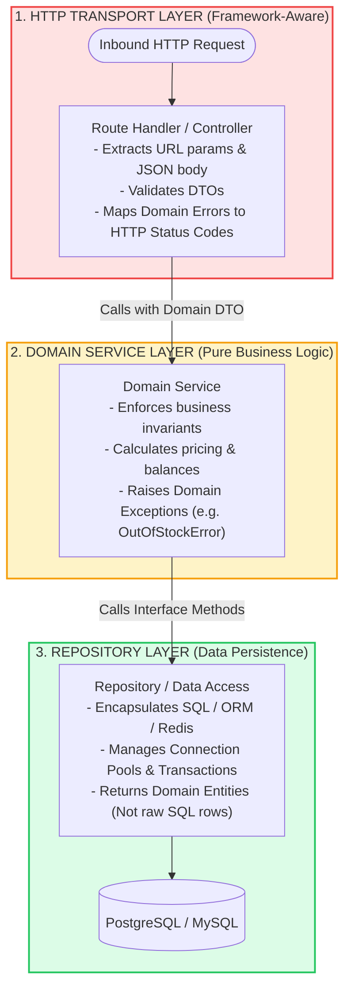
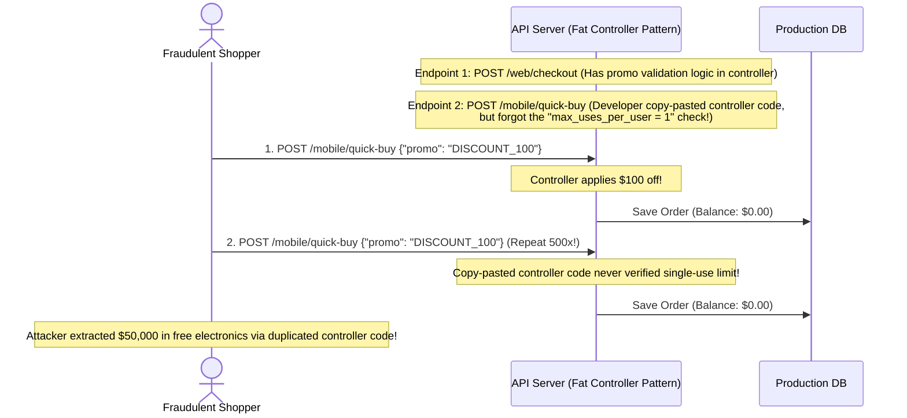
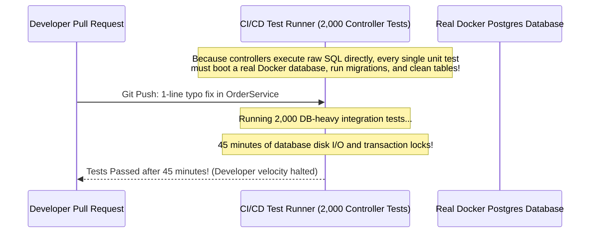

# Module 06: Handlers, Controllers, and Services

## Why This Matters

In naive codebases, route handlers do everything: parse the HTTP request, validate JSON, execute raw SQL queries, perform domain calculations, and format responses—all crammed into a single 300-line function.

This "Fat Controller" antipattern collapses under production scale:
* **Zero Reusability:** When a Kafka event consumer or a Celery background job needs to execute the same business logic ("cancel overdue subscription"), it cannot call your HTTP handler.
* **Untestable Domain Logic:** You cannot unit test pricing or discount rules without spinning up a live web server and an active test database.
* **Leaky Abstractions:** Modifying a database column breaks your HTTP API contracts; modifying an API response shape breaks your database queries.

**Layered Architecture** separates the concerns into three strictly decoupled tiers: **Handler (HTTP Transport)** $\rightarrow$ **Service (Business Invariants)** $\rightarrow$ **Repository (Data Persistence)**.

> [!TIP]
> **The Golden Rule:** The Service Layer must remain **100% HTTP-ignorant**. It must never import `Request`, `Response`, `HTTPException`, or HTTP status codes. It should accept domain primitives and raise domain exceptions (`InsufficientStockError`), allowing the API layer to map them centrally to HTTP status codes.

---

## The Mental Model: The Clean Separation of Concerns



---

## 1. Quick Reference: The Responsibility Matrix

| Architectural Layer | Permitted Knowledge & Imports | Strictly Forbidden | Primary Responsibility |
| :--- | :--- | :--- | :--- |
| **Handler / Controller** | `Request`, `Response`, `HTTPException`, HTTP Status Codes, Cookie/Header manipulation. | SQL queries, ORM models, direct DB connections, business calculations. | **HTTP Adapter:** Translates HTTP wire protocols into service calls and formats outgoing JSON DTOs. |
| **Service Layer** | Domain Entities, Business Invariants, Domain Exceptions, Repository Interfaces. | Framework imports (`FastAPI`, `Express`, `Gin`), `Request`, `Response`, raw SQL. | **Core Business Engine:** Executes business rules and orchestrates multi-step workflows. |
| **Repository Layer** | SQL drivers (`pgx`, `SQLAlchemy`, `Prisma`), Connection Pools, Transactions. | Business invariants, HTTP concepts, user session cookies. | **Persistence Gate:** Maps database rows into strongly-typed domain entities. |

---

## 2. Production War Story: The Copy-Pasted Checkout Discount Exploit



### The Incident
An e-commerce store added a "1-Click Quick Buy" endpoint for their new mobile application. Within days, fraud analytics flagged an anomaly: a single user placed 400 consecutive orders totaling \$50,000 of luxury electronics for \$0.00 using a one-time promotional discount code.

### The Root Cause
The legacy web application validated promotional codes inside the `checkout_controller` function. When developing the mobile `/quick-buy` endpoint, the developer copy-pasted the 200-line controller function but omitted the database check that verified whether the user had already redeemed the coupon. Because the business logic was welded to the HTTP controller rather than centralized in a `PricingService`, the invariant was violated.

### The Fix
Extract all pricing, tax, and discount validation into a single, authoritative `OrderService`:
```python
# Both Web and Mobile endpoints MUST delegate to the exact same service method:
order = order_service.place_order(user_id=user.id, items=items, promo_code=promo)
```

---

## 3. Production War Story: The 45-Minute CI/CD Test Pipeline



### The Solution: Interface-Driven Repositories & Mocking
By abstracting database access behind a `Repository` interface, developers can test 100% of their business logic and edge cases in milliseconds using in-memory mock repositories:
* **With Fat Controllers (Real DB):** 2,000 tests $\rightarrow$ **45 minutes**.
* **With Layered Services (Mock Repos):** 2,000 unit tests $\rightarrow$ **3.2 seconds**.

---

## 4. Multi-Language Implementation: Production 3-Tier Layering

### Go (Interface-Driven Clean Architecture)
```go
package main

import (
	"encoding/json"
	"errors"
	"net/http"
)

// --- 1. DOMAIN LAYER (Pure Types & Domain Errors) ---
var ErrInsufficientStock = errors.New("insufficient inventory stock")

type Order struct {
	ID    string  `json:"id"`
	SKU   string  `json:"sku"`
	Qty   int     `json:"qty"`
	Total float64 `json:"total"`
}

// --- 2. REPOSITORY INTERFACE ---
type OrderRepository interface {
	GetStock(sku string) (int, error)
	SaveOrder(order Order) error
}

// --- 3. DOMAIN SERVICE (100% HTTP-Ignorant) ---
type OrderService struct {
	repo OrderRepository
}

func NewOrderService(repo OrderRepository) *OrderService {
	return &OrderService{repo: repo}
}

func (s *OrderService) PlaceOrder(sku string, qty int) (*Order, error) {
	stock, err := s.repo.GetStock(sku)
	if err != nil {
		return nil, err
	}
	if stock < qty {
		return nil, ErrInsufficientStock // Domain error, not HTTP error
	}

	order := Order{ID: "ord_101", SKU: sku, Qty: qty, Total: float64(qty) * 29.99}
	if err := s.repo.SaveOrder(order); err != nil {
		return nil, err
	}
	return &order, nil
}

// --- 4. HTTP HANDLER (HTTP Adapter) ---
type OrderHandler struct {
	service *OrderService
}

func (h *OrderHandler) CreateOrder(w http.ResponseWriter, r *http.Request) {
	var body struct {
		SKU string `json:"sku"`
		Qty int    `json:"qty"`
	}
	if err := json.NewDecoder(r.Body).Decode(&body); err != nil {
		http.Error(w, `{"error":"Invalid JSON"}`, http.StatusBadRequest)
		return
	}

	order, err := h.service.PlaceOrder(body.SKU, body.Qty)
	if err != nil {
		if errors.Is(err, ErrInsufficientStock) {
			w.Header().Set("Content-Type", "application/problem+json")
			w.WriteHeader(http.StatusUnprocessableEntity) // 422
			w.Write([]byte(`{"type":"out_of_stock","title":"Insufficient Inventory"}`))
			return
		}
		http.Error(w, "Internal Server Error", http.StatusInternalServerError)
		return
	}

	w.Header().Set("Content-Type", "application/json")
	w.WriteHeader(http.StatusCreated) // 201
	json.NewEncoder(w).Encode(order)
}
```

### Node.js / TypeScript (Controller-Service-Repository Pattern)
```typescript
import express, { Request, Response } from 'express';

// 1. Domain Error
export class InsufficientStockError extends Error {
  constructor(public sku: string) {
    super(`Insufficient stock for SKU: ${sku}`);
  }
}

// 2. Repository Interface
export interface ProductRepository {
  getStock(sku: string): Promise<number>;
  deductStock(sku: string, qty: number): Promise<void>;
}

// 3. Service Layer (Framework-Agnostic)
export class OrderService {
  constructor(private repo: ProductRepository) {}

  async placeOrder(sku: string, quantity: number) {
    const stock = await this.repo.getStock(sku);
    if (stock < quantity) {
      throw new InsufficientStockError(sku);
    }
    await this.repo.deductStock(sku, quantity);
    return { orderId: 'ord_99', sku, quantity, status: 'confirmed' };
  }
}

// 4. Controller Layer (Express HTTP Adapter)
export class OrderController {
  constructor(private service: OrderService) {}

  async create(req: Request, res: Response) {
    try {
      const { sku, quantity } = req.body;
      const result = await this.service.placeOrder(sku, quantity);
      res.status(201).json(result);
    } catch (err) {
      if (err instanceof InsufficientStockError) {
        return res.status(422).json({
          type: 'https://api.example.com/errors/out-of-stock',
          title: 'Insufficient Inventory',
          detail: err.message,
        });
      }
      res.status(500).json({ error: 'Internal Server Error' });
    }
  }
}
```

### Python (FastAPI Service Layer with Dependency Injection)
```python
from fastapi import FastAPI, Depends, HTTPException, status
from pydantic import BaseModel

app = FastAPI()

# 1. Domain Exception
class InsufficientStockException(Exception):
    def __init__(self, sku: str):
        self.sku = sku

# 2. Service Layer (Pure Business Logic)
class InventoryService:
    def __init__(self):
        self.stock_db = {"GPU-4090": 2}

    def reserve_item(self, sku: str, quantity: int) -> dict:
        current_stock = self.stock_db.get(sku, 0)
        if current_stock < quantity:
            raise InsufficientStockException(sku) # Pure domain error
        self.stock_db[sku] -= quantity
        return {"sku": sku, "reserved": quantity}

# 3. Centralized Exception Mapper
@app.exception_handler(InsufficientStockException)
async def stock_exception_handler(request, exc: InsufficientStockException):
    return JSONResponse(
        status_code=status.HTTP_422_UNPROCESSABLE_ENTITY,
        content={"title": "Out of Stock", "detail": f"Item {exc.sku} is unavailable"}
    )

class OrderRequest(BaseModel):
    sku: str
    quantity: int

# 4. Thin Route Handler
@app.post("/orders", status_code=status.HTTP_201_CREATED)
def create_order(
    body: OrderRequest, 
    svc: InventoryService = Depends(InventoryService)
):
    return svc.reserve_item(body.sku, body.quantity)
```

---

## 5. Practical Hands-On Exercises

### Exercise 1: Run In-Memory Service Unit Tests (Zero HTTP Overhead)
Execute a unit test verifying business rules directly against the service layer without booting an HTTP server:

```python
# test_order_service.py
def test_insufficient_stock_raises_domain_error():
    mock_repo = MockRepository(stock={"LAPTOP": 0})
    service = OrderService(repo=mock_repo)
    
    with pytest.raises(InsufficientStockException):
        service.place_order(sku="LAPTOP", quantity=1)
```

---

## 6. Operational Validation Checkpoint

<details>
<summary><strong>Question 1: The Leaky Framework Exception Antipattern</strong></summary>

**Scenario:** A developer imports `from fastapi import HTTPException` inside `order_service.py` and writes:
```python
if stock < qty:
    raise HTTPException(status_code=422, detail="Out of stock")
```
Why is raising `HTTPException` inside a Service layer considered a major architectural violation?

**Answer:**
**It permanently couples the domain business logic to the HTTP transport protocol.**

If the company later introduces a Kafka message queue consumer, a scheduled background cron worker, or an internal gRPC service, those non-HTTP consumers cannot use `OrderService` without importing web framework exceptions and dealing with HTTP status codes. 

The Service Layer should raise **Domain Exceptions** (`InsufficientStockError`). The HTTP Handler (or a centralized exception handler) catches the domain error and maps it to HTTP status code `422`.
</details>

<details>
<summary><strong>Question 2: Transaction Boundary Ownership</strong></summary>

**Scenario:** Where should database transaction boundaries (`BEGIN` and `COMMIT`) be managed: the Handler, the Service, or the Repository?

**Answer:**
**The Service Layer.**

A business operation often involves mutating multiple repositories (e.g. `orderRepo.createOrder()` AND `inventoryRepo.decrementStock()` AND `paymentRepo.recordCharge()`). 

If the Repository managed transactions, each method would commit independently, making it impossible to roll back the order creation if the payment fails. 

The Service layer defines the **Unit of Work**, orchestrating the single atomic transaction across all repositories.
</details>

<details>
<summary><strong>Question 3: When is Layering Over-Engineering?</strong></summary>

**Scenario:** When is it appropriate to bypass the Service layer and have a Controller call a Repository directly?

**Answer:**
**For simple, read-only CRUD lookups that contain zero business logic or validation rules.**

If an endpoint merely queries a single database table by primary key (`GET /tags/{id}`) and returns the result with no authorization filtering, invariants, or transformations, introducing a passthrough Service layer that does nothing except call `repo.findById()` is redundant boilerplate ("an anemic service"). 

However, as soon as domain logic, multi-table coordination, or permission checks emerge, it must be promoted to a Service layer.
</details>

---

## Next Step

Now that you have mastered layered architecture and separation of concerns, proceed to **[07-crud-deep-dive](../07-crud-deep-dive/README.md)** to master production RESTful CRUD design, pagination, partial updates, and transaction boundaries.
