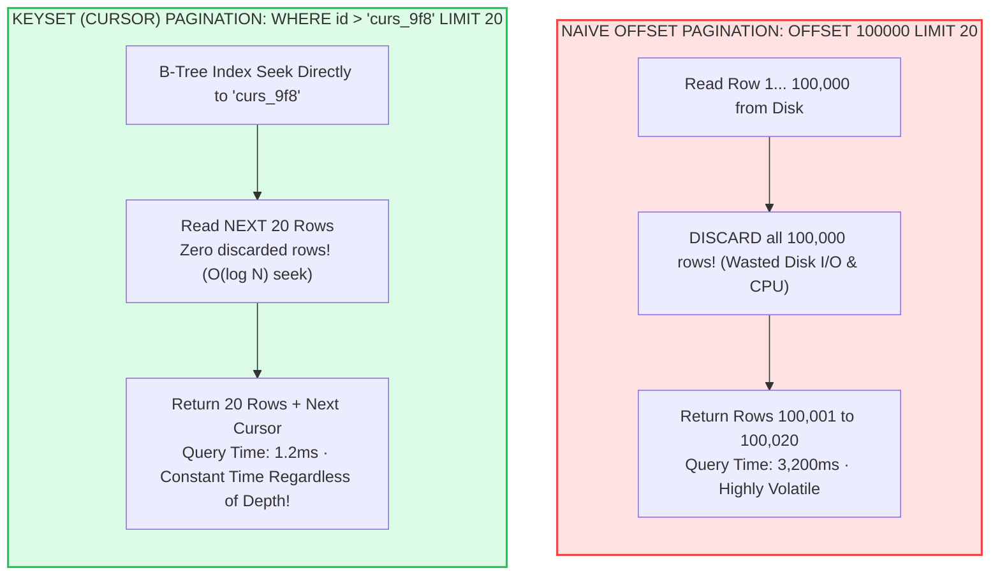
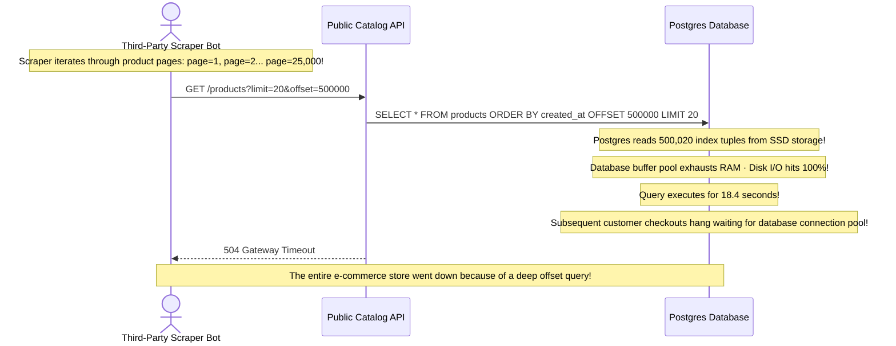
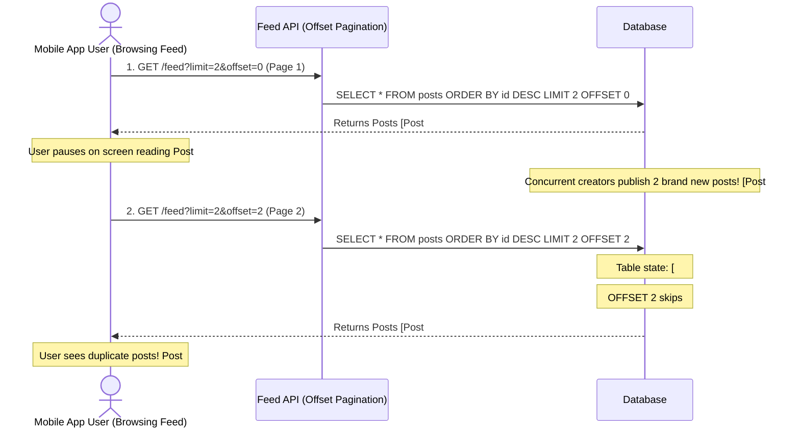

# Module 07: CRUD Deep Dive

## Why This Matters

CRUD (Create, Read, Update, Delete) forms the bedrock of modern backend development. While superficially simple, toy implementations cause severe operational failures under real traffic:
* **The Memory Bomb of Unbounded Queries:** A naive `GET /orders` without pagination will attempt to serialize 500,000 rows into memory, triggering an Out-Of-Memory (OOM) crash on your application pod.
* **The Offset Pagination Trap:** `OFFSET 100000 LIMIT 20` forces PostgreSQL to scan 100,020 B-Tree index entries and discard 100,000 of them, driving query latency from $2\text{ms}$ to $4,500\text{ms}$.
* **Page Drift Under Active Ingestion:** In fast-moving feeds, users paging via offsets miss new items and see duplicate records as new rows are inserted at the top of the table.
* **Semantic Fidelity:** Knowing when to return `201 Created` with a `Location` header vs. `204 No Content`, and why returning `404` for an empty collection is an API contract violation.

> [!TIP]
> **The Golden Rule:** Never expose unpaginated collection endpoints. Always enforce maximum limits (`limit <= 100`), adopt **Keyset (Cursor) Pagination** for datasets exceeding 10,000 rows, and use `exclude_unset=True` during `PATCH` operations to distinguish between omitted fields and explicit `null` updates.

---

## The Mental Model: Offset vs. Keyset (Cursor) Pagination



---

## 1. Quick Reference: The Production CRUD Specification Matrix

| Operation | HTTP Verb | Target URI | Request Body | Success Code | Empty Result | Key Headers |
| :--- | :---: | :--- | :---: | :---: | :---: | :--- |
| **Create** | `POST` | `/orders` | Required | **`201 Created`** | N/A | `Location: /orders/{id}` |
| **Read Single** | `GET` | `/orders/{id}` | None | **`200 OK`** | **`404 Not Found`** | `ETag`, `Cache-Control` |
| **Read Collection**| `GET` | `/orders?cursor=...` | None | **`200 OK`** | **`200 OK` `{"items":[]}`** | `Link: <...>; rel="next"` |
| **Full Replace** | `PUT` | `/orders/{id}` | Full Entity | **`200 OK`** / `204` | `404 Not Found` | `ETag` validation |
| **Partial Update** | `PATCH` | `/orders/{id}` | Delta Fields | **`200 OK`** | `404 Not Found` | `ETag` validation |
| **Delete** | `DELETE`| `/orders/{id}` | Rare | **`204 No Content`** | `204` or `404` | None |

---

## 2. Production War Story: The `OFFSET 500,000` Database Denial of Service



### The Incident
An e-commerce marketplace experienced complete database connection pool exhaustion. Customer checkout queries timed out, while database monitoring showed 100% disk I/O utilization.

### The Root Cause
A third-party price aggregation scraper was systematically crawling the entire catalog using offset pagination:
`GET /products?limit=50&offset=450000`
In SQL, `OFFSET N` does not jump directly to row $N$. The database engine must execute the query, sort the results, read $N + \text{limit}$ rows into memory, and discard the first $N$ rows. At an offset of 500,000, each page request took **18 seconds** of raw disk reading, choking database worker processes.

### The Fix
Transition the collection to **Keyset (Cursor) Pagination**:
```sql
-- FAST & CONSTANT TIME:
SELECT id, title, price, created_at 
FROM products 
WHERE (created_at, id) < ('2026-11-09T12:00:00Z', 'prod_998')
ORDER BY created_at DESC, id DESC 
LIMIT 20;
```
Using a composite index `(created_at, id)`, the database jumps directly to the cursor in $O(\log N)$ time, completing in **$1.5\text{ms}$** regardless of whether you are reading page 1 or page 50,000.

---

## 3. Production War Story 2: The Concurrent Insert Page Drift



### The Root Cause & The Fix
* **The Failure:** When using `OFFSET`, any rows inserted or deleted above the current viewing window alter row positions. The user experiences duplicate items on the next page and skips unseen records entirely.
* **The Fix:** Using an opaque cursor based on entity ID (`cursor=post_99`), the query is pinned to the exact item where the user left off, guaranteeing zero duplicates and zero skipped items even under heavy concurrent insertions.

---

## 4. Multi-Language Implementation: Production CRUD with Keyset Pagination

### Go (`net/http` & Keyset Cursor Pagination)
```go
package main

import (
	"encoding/base64"
	"encoding/json"
	"fmt"
	"net/http"
	"strconv"
)

type Task struct {
	ID        int    `json:"id"`
	Title     string `json:"title"`
	Completed bool   `json:"completed"`
}

type PaginatedTasksResponse struct {
	Items      []Task  `json:"items"`
	NextCursor *string `json:"next_cursor"`
}

// In-memory mock database sorted by ID ASC
var taskDB = []Task{
	{ID: 1, Title: "Design Schema", Completed: true},
	{ID: 2, Title: "Setup Middleware", Completed: true},
	{ID: 3, Title: "Deploy to Prod", Completed: false},
	{ID: 4, Title: "Monitor Latency", Completed: false},
}

func listTasksHandler(w http.ResponseWriter, r *http.Request) {
	limit := 2
	cursorStr := r.URL.Query().Get("cursor")
	lastID := 0

	// 1. Decode opaque base64 cursor
	if cursorStr != "" {
		decoded, err := base64.StdEncoding.DecodeString(cursorStr)
		if err == nil {
			lastID, _ = strconv.Atoi(string(decoded))
		}
	}

	// 2. Keyset Query: WHERE id > lastID LIMIT 2
	var results []Task
	for _, task := range taskDB {
		if task.ID > lastID {
			results = append(results, task)
			if len(results) == limit {
				break
			}
		}
	}

	// 3. Generate Next Cursor
	var nextCursor *string
	if len(results) == limit {
		lastResultID := strconv.Itoa(results[len(results)-1].ID)
		encoded := base64.StdEncoding.EncodeToString([]byte(lastResultID))
		nextCursor = &encoded
	}

	w.Header().Set("Content-Type", "application/json")
	json.NewEncoder(w).Encode(PaginatedTasksResponse{
		Items:      results,
		NextCursor: nextCursor,
	})
}
```

### Node.js / Express (PATCH with Explicit Null vs. Omission)
```typescript
import express, { Request, Response } from 'express';
import { z } from 'zod';

const app = express();
app.use(express.json());

const TaskUpdateSchema = z.object({
  title: z.string().min(1).optional(),
  completed: z.boolean().optional(),
  assignedTo: z.string().nullable().optional(), // Can be undefined (omitted) or null (cleared)
});

const tasks = new Map<number, any>([
  [1, { id: 1, title: 'Write Tests', completed: false, assignedTo: 'Ada' }],
]);

app.patch('/api/tasks/:id', (req: Request, res: Response) => {
  const taskId = parseInt(req.params.id, 10);
  const existing = tasks.get(taskId);
  if (!existing) {
    return res.status(404).json({ error: 'Task not found' });
  }

  const result = TaskUpdateSchema.safeParse(req.body);
  if (!result.success) {
    return res.status(422).json({ errors: result.error.errors });
  }

  // Only mutate fields explicitly provided in the payload:
  const updates = result.data;
  const updatedTask = {
    ...existing,
    ...(updates.title !== undefined && { title: updates.title }),
    ...(updates.completed !== undefined && { completed: updates.completed }),
    ...(updates.assignedTo !== undefined && { assignedTo: updates.assignedTo }),
  };

  tasks.set(taskId, updatedTask);
  res.status(200).json(updatedTask);
});
```

### Python (FastAPI with Pydantic `exclude_unset=True`)
```python
from fastapi import FastAPI, HTTPException, Response, status
from pydantic import BaseModel, Field
from typing import Optional, List

app = FastAPI()

class TaskCreate(BaseModel):
    title: str = Field(min_length=1)
    completed: bool = False

class TaskPatch(BaseModel):
    title: Optional[str] = None
    completed: Optional[bool] = None

class TaskOut(BaseModel):
    id: int
    title: str
    completed: bool

TASKS = {1: TaskOut(id=1, title="Review PR", completed=False)}

@app.post("/tasks", status_code=status.HTTP_201_CREATED, response_model=TaskOut)
def create_task(task: TaskCreate, response: Response):
    new_id = max(TASKS.keys(), default=0) + 1
    new_task = TaskOut(id=new_id, **task.model_dump())
    TASKS[new_id] = new_task
    response.headers["Location"] = f"/tasks/{new_id}"
    return new_task

@app.patch("/tasks/{task_id}", response_model=TaskOut)
def patch_task(task_id: int, updates: TaskPatch):
    if task_id not in TASKS:
        raise HTTPException(status_code=404, detail="Task not found")

    existing = TASKS[task_id].model_dump()
    # CRITICAL: exclude_unset=True ensures unmentioned fields are not overwritten!
    patch_data = updates.model_dump(exclude_unset=True)
    existing.update(patch_data)
    
    TASKS[task_id] = TaskOut(**existing)
    return TASKS[task_id]
```

---

## 5. Practical Hands-On Exercises

### Exercise 1: Verify `201 Created` and the `Location` Header
Create an entity via `curl` and verify standard REST creation headers:

```bash
curl -s -i -X POST http://localhost:8000/tasks \
  -H "Content-Type: application/json" \
  -d '{"title": "Implement Keyset Pagination"}' \
  | grep -E "(HTTP\/|Location:)"
```
**Look for:**
* Status `201 Created`
* `Location: /tasks/2`

### Exercise 2: Test Partial Updates with `PATCH`
Verify that updating only `completed: true` leaves the `title` unchanged:

```bash
curl -s -X PATCH http://localhost:8000/tasks/1 \
  -H "Content-Type: application/json" \
  -d '{"completed": true}' | jq .
```

---

## 6. Operational Validation Checkpoint

<details>
<summary><strong>Question 1: The Empty Collection Status Code Trap</strong></summary>

**Scenario:** A client requests `GET /orders?status=cancelled`. No orders currently match this filter. 
Should the server return `404 Not Found` or `200 OK` with an empty array `{"items": []}`?

**Answer:**
**The server MUST return `200 OK` with `{"items": []}`.**

* **`404 Not Found`** indicates that the **resource collection itself does not exist** (e.g. an invalid URL path like `/v1/ordrs`).
* **`200 OK` with an empty array** indicates that the endpoint executed successfully, queried the collection, and accurately determined that zero items currently match the filter criteria. 

Returning `404` for empty search/filter results breaks frontend pagination controls and confuses monitoring dashboards.
</details>

<details>
<summary><strong>Question 2: Opaque vs. Plaintext Cursor Tokens</strong></summary>

**Scenario:** Why do modern APIs encode pagination cursors as opaque Base64 tokens (`cursor=ZXlKa...`) rather than exposing raw database columns (`after_id=10284`)?

**Answer:**
1. **Decoupling Implementation Details:** An opaque token abstracts the underlying database structure. The backend can switch from sorting by `id` to a composite `(created_at, id)` or change column names without breaking client SDK contracts.
2. **Security & Information Disclosure:** Exposing sequential database IDs (`id=10284`) allows competitors to scrape catalog sizes and deduce internal database growth rates.
3. **Tamper Prevention:** Base64-encoded structured cursors can be cryptographically signed or encrypted to prevent clients from tampering with pagination state.
</details>

<details>
<summary><strong>Question 3: Soft Deletes vs. Hard Deletes</strong></summary>

**Scenario:** An application implements soft deletion (`deleted_at TIMESTAMP`). When a user sends `DELETE /users/42`, the server sets `deleted_at = NOW()`.
What status code should subsequent calls to `GET /users/42` return?

**Answer:**
**`404 Not Found` (or `410 Gone`).**

Even though the row still exists in the physical database table for compliance and audit purposes, **from the perspective of the public HTTP API interface, the resource has been deleted**. 

The API layer must filter out soft-deleted records and return `404 Not Found` so that clients receive predictable RESTful semantics.
</details>

---

## Free PDF Notes

Download the notes for each video on this page as a printable PDF, with every diagram and interview question: [SD-C-007: API Pagination](https://backendroadmap.com/notes/system-design/SD-C-007.pdf), [SD-C-008: API Filtering, Sorting & Field Selection Without Table Scans](https://backendroadmap.com/notes/system-design/SD-C-008.pdf). Each section in one file: [Phase 2, APIs (PDF)](https://backendroadmap.com/notes/system-design/Phase2_APIs_Notes.pdf).

---

## Next Step

Now that you have mastered production CRUD operations, keyset pagination, and partial updates, proceed to **[08-restful-architecture-and-best-practices](../08-restful-architecture-and-best-practices/README.md)** to master Richardson Maturity Model, HATEOAS, REST resource naming conventions, and sub-resource modeling.
