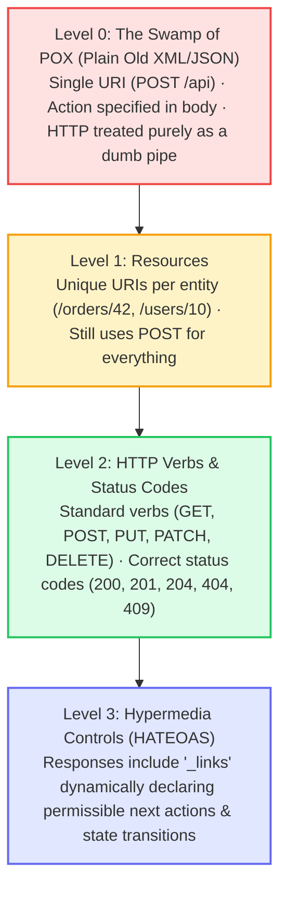
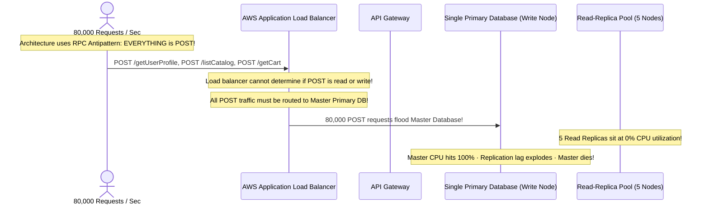
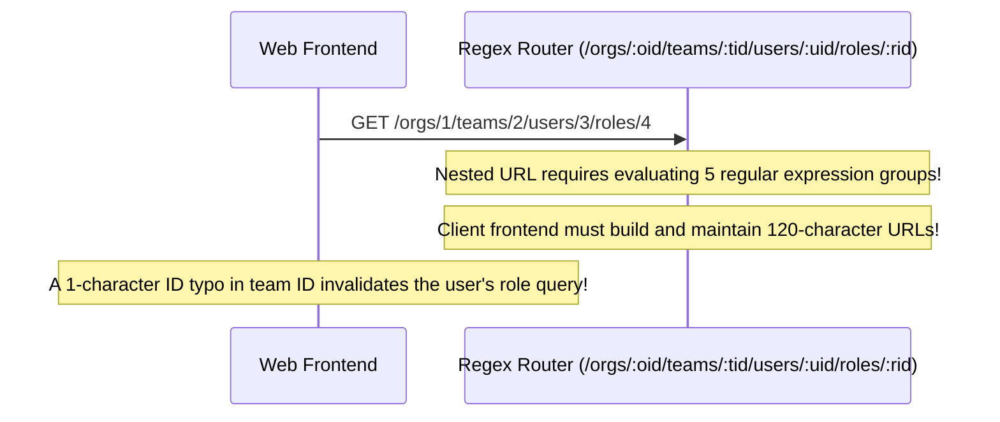

# Module 08: RESTful Architecture and Best Practices

## Why This Matters

REST (Representational State Transfer) is not a protocol, framework, or library—it is an **architectural style** established by Roy Fielding to maximize the scalability, predictability, and longevity of distributed web systems.

When an API is genuinely RESTful, a developer who has never read your documentation already knows:
* `GET /orders/42` fetches order 42.
* `DELETE /orders/42` removes it.
* `404 Not Found` means the entity does not exist.
* The operation is safe to retry automatically if it is idempotent.

Conversely, APIs that invent their own RPC-style URL actions (`POST /getOrderById`, `POST /doDelete`, `POST /cancelOrderNow`) discard standard HTTP semantics. Caches cannot cache them, reverse proxies cannot route read traffic to read-replicas, and every client SDK requires custom, bespoke integration logic.

> [!TIP]
> **The Golden Rule:** Model your API around **plural nouns (resources)**, use standard HTTP verbs (`GET`, `POST`, `PATCH`, `DELETE`) for actions, and model non-CRUD state transitions as sub-resources (e.g. `POST /orders/42/cancellations`) or controlled field patches (`PATCH /orders/42 {"status": "cancelled"}`).

---

## The Mental Model: The Richardson Maturity Model



---

## 1. Quick Reference: REST vs. RPC Anti-Pattern Comparison

| Operation Intent | RPC Antipattern (Verbs in URL) | RESTful Standard (Nouns + HTTP Verbs) |
| :--- | :--- | :--- |
| **Fetch User** | `POST /getUser?id=42` | `GET /v1/users/42` |
| **List Orders** | `GET /getAllOrders` | `GET /v1/orders` |
| **Create Task** | `POST /createTask` | `POST /v1/tasks` |
| **Partial Edit** | `POST /updateTaskStatus` | `PATCH /v1/tasks/42` |
| **Delete Entity** | `POST /deleteUser?id=42` | `DELETE /v1/users/42` |
| **Cancel Order** | `POST /orders/cancelOrder?id=42` | `POST /v1/orders/42/cancellations` *(Or `PATCH /orders/42`)* |
| **Transfer Money**| `POST /transferMoneyBetweenAccounts` | `POST /v1/transfers` |

### The Shallow Nesting Guideline
A common pitfall is nesting resources too deeply:
```
# DEEP NESTING ANTIPATTERN (Hard to maintain, brittle URLs):
/organizations/1/departments/4/teams/12/projects/99/tasks/102

# SHALLOW NESTING RESTFUL BEST PRACTICE (Max 1 level deep):
GET  /projects/99/tasks       # List tasks belonging to project 99
POST /projects/99/tasks       # Create task under project 99
GET  /tasks/102               # Direct access to task 102 once ID is known
```

---

## 2. Production War Story: The RPC "POST Soup" Database Outage



### The Incident
A fast-growing fintech platform began experiencing severe database bottlenecks during peak market hours. While the infrastructure team had provisioned five read-replicas, the primary read-write database was crashing under 100% CPU utilization.

### The Root Cause
The legacy codebase was structured as an RPC-style API where every single endpoint used `POST`:
* `POST /api/getUserData`
* `POST /api/getCatalogItems`
* `POST /api/checkBalance`
Because HTTP specifications dictate that `POST` requests are unsafe and mutate state, API gateways, load balancers, and connection poolers could not safely route traffic to read-replicas. 80,000 read queries per second flooded the primary master database.

### The Fix
Refactor the API to use standard RESTful semantics:
1. Converted all read operations to `GET /users/{id}`, `GET /catalog`, `GET /accounts/{id}/balance`.
2. The AWS Application Load Balancer and PgBouncer connection pooler automatically routed all `GET` requests to the read-replica pool.
3. Master database load dropped by **82%**, resolving the outage permanently without upgrading database hardware.

---

## 3. Production War Story 2: The Infinite URL Regex Recursion



### The Root Cause & The Fix
* **The Failure:** Teams modeled relational database foreign keys directly into the URL path, producing deeply nested routes like `/orgs/10/departments/4/teams/12/users/99/roles/2`. Deep nesting introduces brittle client routing, excessive URL parsing overhead, and breaks when an entity moves to a different department.
* **The Fix: The Shallow Nesting Rule:**
  * Use nesting **only** when scoping a collection to an owner: `GET /teams/12/users`.
  * For single-resource lookups, access the resource directly via its unique ID: `GET /users/99` and `GET /roles/2`.

---

## 4. Multi-Language Implementation: HATEOAS & Resource Controllers

### Go (`net/http` with HAL Hypermedia Links)
```go
package main

import (
	"encoding/json"
	"fmt"
	"net/http"
)

type Link struct {
	Href   string `json:"href"`
	Method string `json:"method"`
}

type OrderResponse struct {
	ID     string          `json:"id"`
	Status string          `json:"status"`
	Amount float64         `json:"amount"`
	Links  map[string]Link `json:"_links"` // Level 3 HATEOAS
}

func getOrderHandler(w http.ResponseWriter, r *http.Request) {
	orderID := "ord_4029"
	status := "pending_payment"

	// Dynamically declare permissible next actions based on current entity state
	links := map[string]Link{
		"self": {Href: fmt.Sprintf("/v1/orders/%s", orderID), Method: "GET"},
	}

	if status == "pending_payment" {
		links["payment"] = Link{Href: fmt.Sprintf("/v1/orders/%s/payments", orderID), Method: "POST"}
		links["cancel"] = Link{Href: fmt.Sprintf("/v1/orders/%s/cancellations", orderID), Method: "POST"}
	} else if status == "shipped" {
		links["tracking"] = Link{Href: fmt.Sprintf("/v1/orders/%s/tracking", orderID), Method: "GET"}
	}

	resp := OrderResponse{
		ID:     orderID,
		Status: status,
		Amount: 149.50,
		Links:  links,
	}

	w.Header().Set("Content-Type", "application/hal+json")
	w.WriteHeader(http.StatusOK)
	json.NewEncoder(w).Encode(resp)
}
```

### Node.js / Express (RESTful Resource Controllers)
```typescript
import express, { Request, Response } from 'express';

const app = express();
app.use(express.json());

// 1. Primary Resource Collection
app.get('/v1/orders', (req: Request, res: Response) => {
  res.json({ items: [{ id: 'ord_1', status: 'completed' }] });
});

// 2. Individual Resource Item
app.get('/v1/orders/:id', (req: Request, res: Response) => {
  res.json({
    id: req.params.id,
    status: 'pending',
    _links: {
      self: { href: `/v1/orders/${req.params.id}` },
      cancel: { href: `/v1/orders/${req.params.id}/cancellations`, method: 'POST' },
    },
  });
});

// 3. Non-CRUD Action Modeled as Sub-Resource Creation
app.post('/v1/orders/:id/cancellations', (req: Request, res: Response) => {
  res.status(201).json({
    orderId: req.params.id,
    cancellationId: 'cnl_882',
    cancelledAt: new Date().toISOString(),
  });
});

app.listen(3000);
```

### Python (FastAPI HATEOAS & Sub-Resource Architecture)
```python
from fastapi import FastAPI, status
from pydantic import BaseModel
from typing import Dict

app = FastAPI()

class Link(BaseModel):
    href: str
    method: str

class OrderHAL(BaseModel):
    id: str
    status: str
    amount: float
    links: Dict[str, Link]

@app.get("/v1/orders/{order_id}", response_model=OrderHAL)
def get_order(order_id: str):
    return OrderHAL(
        id=order_id,
        status="awaiting_shipment",
        amount=89.99,
        links={
            "self": Link(href=f"/v1/orders/{order_id}", method="GET"),
            "ship": Link(href=f"/v1/orders/{order_id}/shipments", method="POST"),
            "refund": Link(href=f"/v1/orders/{order_id}/refunds", method="POST")
        }
    )

# Non-CRUD action modeled RESTfully as sub-resource creation
@app.post("/v1/orders/{order_id}/refunds", status_code=status.HTTP_201_CREATED)
def refund_order(order_id: str):
    return {"order_id": order_id, "refund_id": "ref_9a8f", "status": "refunded"}
```

---

## 5. Practical Hands-On Exercises

### Exercise 1: Query a HATEOAS Endpoint & Follow Hypermedia Links
Query a RESTful order endpoint and observe the dynamic `_links` block:

```bash
curl -s http://localhost:8000/v1/orders/102 | jq .
```

**Expected Outcome:**
```json
{
  "id": "102",
  "status": "awaiting_shipment",
  "amount": 89.99,
  "links": {
    "self": { "href": "/v1/orders/102", "method": "GET" },
    "ship": { "href": "/v1/orders/102/shipments", "method": "POST" }
  }
}
```

---

## 6. Operational Validation Checkpoint

<details>
<summary><strong>Question 1: Modeling Non-CRUD State Transitions RESTfully</strong></summary>

**Scenario:** You need an API operation that allows a customer service representative to freeze a compromised credit card.
A developer proposes: `POST /api/freezeCreditCard?cardId=491`

How should this operation be redesigned to adhere strictly to RESTful resource modeling?

**Answer:**
There are two standardized RESTful approaches:

1. **Sub-Resource Creation (Recommended for auditability):**
   `POST /v1/cards/491/freezes`
   Returns `201 Created` with a new freeze record (`{"freeze_id": "frz_9a", "reason": "compromised", "timestamp": "..."}`).
2. **Controlled Field Patch:**
   `PATCH /v1/cards/491`
   Body: `{"status": "frozen"}`
   Returns `200 OK`.

Both approaches preserve nouns in the URL and use standard HTTP verbs rather than inventing custom action names.
</details>

<details>
<summary><strong>Question 2: Plural vs. Singular Collection Nouns</strong></summary>

**Scenario:** Why does the industry standardize on plural nouns for collections (e.g. `/v1/users`, `/v1/orders`) rather than singular nouns (`/v1/user`, `/v1/order`)?

**Answer:**
**Because `/users` naturally represents the entire collection of entities.**

* `GET /users`: Represents the set of all users.
* `POST /users`: Adds a new user to the collection of users.
* `GET /users/42`: Accesses user 42 within the collection of users.

Using singular nouns (`GET /user/42`) becomes confusing on collection endpoints (`GET /user` reads as asking for a single user rather than a list). Plural nouns provide consistent, unambiguous grammar across collections and single items.
</details>

<details>
<summary><strong>Question 3: HATEOAS in Machine-to-Machine Decoupling</strong></summary>

**Scenario:** What is the primary architectural benefit of Richardson Maturity Model Level 3 (HATEOAS) for frontend clients?

**Answer:**
**The client does not need to hardcode business state transitions or URL routing rules.**

Without HATEOAS, frontend code must contain duplicate business logic:
`if (order.status === 'pending' && user.isOwner) showCancelButton()`

With HATEOAS, the backend calculates permissions and permissible transitions dynamically and returns the valid action URLs in `_links`. The frontend simply checks:
`if (order._links.cancel) renderButton(order._links.cancel)`

If business rules change to allow cancellation under new conditions, the backend updates the link generation without requiring a new frontend release.
</details>

---

## Free PDF Notes

Download the notes for each video on this page as a printable PDF, with every diagram and interview question: [SD-C-001: REST Principles](https://backendroadmap.com/notes/system-design/SD-C-001.pdf), [SD-C-005: API Resource Modeling & URI Design](https://backendroadmap.com/notes/system-design/SD-C-005.pdf). Each section in one file: [Phase 2, APIs (PDF)](https://backendroadmap.com/notes/system-design/Phase2_APIs_Notes.pdf).

---

## Next Step

Now that you have mastered RESTful resource modeling and Richardson Maturity concepts, proceed to **[09-openapi-standards](../09-openapi-standards/README.md)** to master OpenAPI 3.1 contracts, contract-first design, Swagger UI, and automated client SDK generation.
