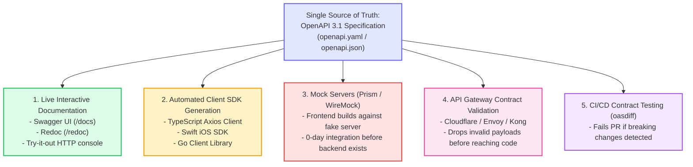
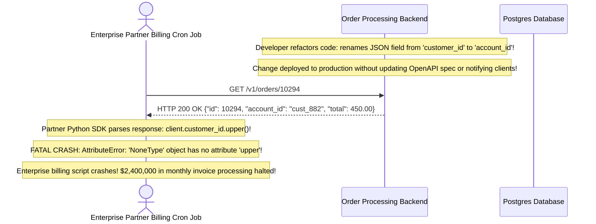
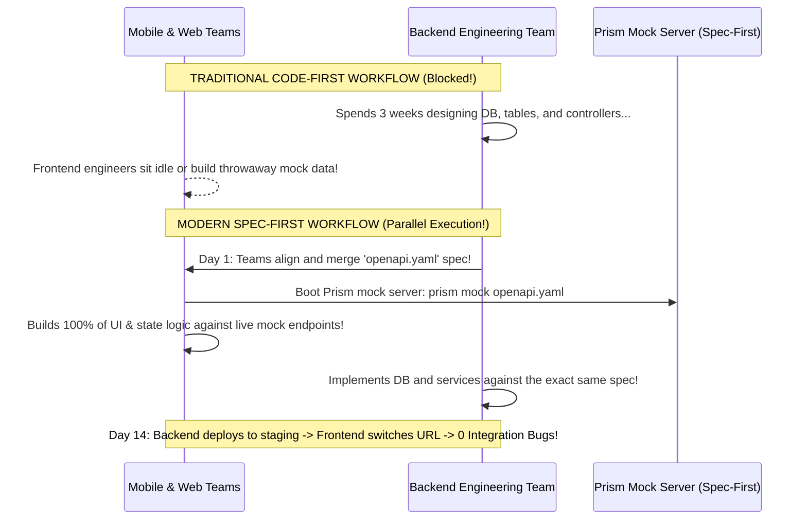

# Module 09: OpenAPI Standards

## Why This Matters

Every architectural decision from modules 00–08—path parameter constraints, request bodies, error schemas, status codes, and HTTP verbs—represents a **binding contract** between your backend service and downstream consumers.

Hand-written documentation (wikis, Notion pages, Google Docs) drifts out of date within weeks of deployment. The **OpenAPI Specification (OAS 3.1)** provides a formal, language-agnostic, machine-readable standard describing every facet of your API:
* **Zero Documentation Drift:** Interactive documentation (Swagger UI, Redoc) is compiled dynamically from code annotations or strict schema contracts.
* **Automated Client SDK Generation:** Frontend and mobile teams generate fully typed TypeScript, Swift, Kotlin, and Go SDKs in seconds using `openapi-generator-cli`, eliminating manual fetch calls and handwritten type interfaces.
* **Parallel Frontend/Backend Development:** By adopting a **Contract-First** workflow, engineering teams agree on the OpenAPI contract upfront. Frontend developers mock the API using tools like Prism while backend engineers implement the services concurrently.

> [!TIP]
> **The Golden Rule:** Treat your OpenAPI specification as code. Run automated **OpenAPI Diff checks in CI/CD** to detect and block unintentional breaking schema changes (e.g. removed fields or altered types) before code is merged to main.

---

## The Mental Model: The OpenAPI Ecosystem Lifecycle



---

## 1. Quick Reference: Core Anatomy of an OpenAPI 3.1 Document

```yaml
openapi: 3.1.0                    # Standard Specification Version
info:
  title: Production Order API
  version: 2.1.0                  # Your Application API Version
  description: High-throughput idempotent ordering and checkout service.
servers:
  - url: https://api.example.com/v1
    description: Production Cluster
paths:
  /orders/{id}:
    get:
      summary: Retrieve Order by ID
      parameters:
        - name: id
          in: path
          required: true
          schema:
            type: integer
      responses:
        "200":
          description: Order found successfully
          content:
            application/json:
              schema:
                $ref: '#/components/schemas/OrderResponse'
        "404":
          description: Order not found
components:
  schemas:
    OrderResponse:
      type: object
      required: [id, status, amount]
      properties:
        id:
          type: integer
        status:
          type: string
          enum: [pending, paid, cancelled]
        amount:
          type: number
  securitySchemes:
    bearerAuth:
      type: http
      scheme: bearer
      bearerFormat: JWT
security:
  - bearerAuth: []
```

### Key Upgrades in OpenAPI 3.1 (JSON Schema 2020-12 Alignment)
* **True Nullable Arrays:** Replaced the legacy `nullable: true` flag with standardized JSON Schema type arrays: `type: ["string", "null"]`.
* **Standardized Examples:** Replaced single `example` strings with robust `examples: [...]` arrays.
* **Mutual Exclusivity:** Supports `prefixItems` for tuple definitions and full JSON Schema validation keywords.

---

## 2. Production War Story: The Silent Schema Drift Breaking Enterprise Billing



### The Incident
At the end of the fiscal quarter, an enterprise B2B partner reported that their automated reconciliation pipeline crashed with null-pointer exceptions, failing to process \$2.4M in accounts-receivable invoices.

### The Root Cause
A backend engineer refactored an internal entity, renaming `customer_id` to `account_id` in the API output. Because the team used hand-written documentation and had no automated contract diffing in their GitHub Actions CI pipeline, the pull request was merged without warning. The partner's statically typed client SDK (compiled against the old OpenAPI contract) failed immediately upon encountering the missing field.

### The Fix
Implement automated **OpenAPI Breaking Change Detection** in CI/CD using `oasdiff`:
```bash
# In GitHub Actions:
oasdiff -base openapi-main.yaml -revision openapi-pr.yaml -fail-on-breaking
```
If a developer renames a field, deletes an enum value, or alters a status code, the CI pipeline fails automatically, preventing breaking changes from reaching staging or production.

---

## 3. Production War Story: The 3-Week Frontend Blocker



### The Solution: Contract-First Architecture
* **The Antipattern:** Writing backend code first, allowing the backend framework to auto-generate a spec after 3 weeks of work, while frontend teams wait.
* **The Production Fix:** Design the `openapi.yaml` contract on Day 1. Run **Prism** (`npx @stoplight/prism-cli mock openapi.yaml`) to instantly generate a local HTTP mock server that emits valid dummy data. Both teams code concurrently in parallel, cutting feature delivery cycles by **60%**.

---

## 4. Multi-Language Implementation: Contract Generation & Validation

### Go (`oapi-codegen` Type-Safe Handlers)
In Go, `oapi-codegen` generates strict interface contracts directly from the OpenAPI YAML file:

```go
package main

import (
	"encoding/json"
	"net/http"
)

// Auto-generated types from openapi.yaml
type OrderResponse struct {
	Id     int    `json:"id"`
	Status string `json:"status"`
	Amount float64 `json:"amount"`
}

// Auto-generated ServerInterface forces compile-time contract compliance
type ServerInterface interface {
	GetOrdersId(w http.ResponseWriter, r *http.Request, id int)
}

type Server struct{}

func (s *Server) GetOrdersId(w http.ResponseWriter, r *http.Request, id int) {
	resp := OrderResponse{
		Id:     id,
		Status: "paid",
		Amount: 99.50,
	}
	w.Header().Set("Content-Type", "application/json")
	json.NewEncoder(w).Encode(resp)
}
```

### Node.js / TypeScript (Generating OpenAPI 3.1 via Zod)
```typescript
import { z } from 'zod';
import { extendZodWithOpenApi, OpenAPIRegistry, OpenApiGeneratorV31 } from '@asteasolutions/zod-to-openapi';

extendZodWithOpenApi(z);
const registry = new OpenAPIRegistry();

// Define schema with Zod & OpenAPI metadata
const UserSchema = registry.register(
  'User',
  z.object({
    id: z.number().openapi({ example: 42 }),
    email: z.string().email().openapi({ example: 'ada@example.com' }),
    role: z.enum(['admin', 'member']).openapi({ example: 'member' }),
  })
);

// Register Path Contract
registry.registerPath({
  method: 'get',
  path: '/users/{id}',
  summary: 'Get user by ID',
  responses: {
    200: {
      description: 'User details',
      content: { 'application/json': { schema: UserSchema } },
    },
  },
});

// Generate OpenAPI 3.1 Document dynamically:
const generator = new OpenApiGeneratorV31(registry.definitions);
export const openApiDoc = generator.generateDocument({
  openapi: '3.1.0',
  info: { title: 'User Service', version: '1.0.0' },
});
```

### Python (FastAPI Metadata & OpenAPI Customization)
```python
from fastapi import FastAPI, Path, status
from pydantic import BaseModel, Field

app = FastAPI(
    title="Enterprise Order API",
    version="3.1.0",
    description="Mission-critical ordering service adhering to OpenAPI 3.1 specifications.",
    openapi_url="/api/v1/openapi.json", # Machine-readable spec
    docs_url="/docs",                   # Swagger UI
    redoc_url="/redoc",                 # Redoc Documentation
)

class OrderDTO(BaseModel):
    id: int = Field(..., example=101, description="Unique 64-bit Order ID")
    sku: str = Field(..., example="DESK-MAT-01")
    total: float = Field(..., gt=0, example=29.99)

@app.get(
    "/orders/{order_id}",
    response_model=OrderDTO,
    status_code=status.HTTP_200_OK,
    summary="Fetch an existing order",
    tags=["Orders"],
    responses={
        404: {"description": "The specified order ID was not found"},
        401: {"description": "Bearer token missing or expired"},
    }
)
async def get_order(
    order_id: int = Path(..., description="The integer ID of the target order", ge=1)
):
    return {"id": order_id, "sku": "DESK-MAT-01", "total": 29.99}
```

---

## 5. Practical Hands-On Exercises

### Exercise 1: Extract Machine-Readable OpenAPI Schema via `curl`
Fetch the complete JSON OpenAPI contract from any running FastAPI service:

```bash
curl -s http://localhost:8000/api/v1/openapi.json | jq .paths
```
**Look for:** Every path, method, schema definition, and validation boundary.

### Exercise 2: Generate a TypeScript Client in 5 Seconds
Run the official OpenAPI Generator CLI to produce a fully typed client library:

```bash
npx @openapitools/openapi-generator-cli generate \
  -i http://localhost:8000/api/v1/openapi.json \
  -g typescript-axios \
  -o ./client-sdk
```
**Outcome:** Generates typed TypeScript interfaces (`OrderDTO.ts`) and API methods (`OrdersApi.ts`) with zero manual coding.

---

## 6. Operational Validation Checkpoint

<details>
<summary><strong>Question 1: Spec-First vs. Code-First Selection</strong></summary>

**Scenario:** When should an engineering organization adopt a **Spec-First** approach (writing YAML contracts before code) versus a **Code-First** approach (writing Pydantic/Zod models and generating specs)?

**Answer:**
* **Adopt Spec-First when:**
  * Multiple independent teams (Frontend, iOS, Android, Backend) or external third-party partners need to coordinate on an API. Spec-First allows mock servers to run immediately, enabling teams to build in parallel.
  * Public-facing commercial APIs (e.g. Stripe, Twilio) where contracts must undergo legal and architectural reviews before coding begins.
* **Adopt Code-First when:**
  * Rapid prototyping in small, co-located teams using typed frameworks (FastAPI, NestJS). Code-First eliminates YAML synchronization overhead because the running code **is** the contract source of truth.
</details>

<details>
<summary><strong>Question 2: OpenAPI 3.0 vs 3.1 Nullable Standards</strong></summary>

**Scenario:** In OpenAPI 3.0, an optional string was defined as:
```yaml
type: string
nullable: true
```
How is this modeled in OpenAPI 3.1, and why was the change made?

**Answer:**
**In OpenAPI 3.1, it is defined using JSON Schema 2020-12 type arrays:**
```yaml
type: [string, "null"]
```
OpenAPI 3.0 diverged from the official JSON Schema standard by inventing custom keywords like `nullable: true`. This caused widespread incompatibility between JSON Schema validation engines and OpenAPI parsers. OpenAPI 3.1 fully embraced JSON Schema 2020-12, allowing complete interoperability between schema validators (like Pydantic and AJV) and the OpenAPI specification.
</details>

<details>
<summary><strong>Question 3: Automated Contract Drift Detection</strong></summary>

**Scenario:** How does automated contract testing in CI/CD prevent breaking changes from reaching production?

**Answer:**
**By running semantic schema comparisons against the previous release.**

During pull request builds, tools like `oasdiff` or `prism` compare the newly generated OpenAPI spec against the production spec (`main` branch). 

If the comparison engine detects a **breaking change** (such as removing a field, renaming an enum, making an optional field required, or removing an endpoint), the CI check fails with a non-zero exit code, physically blocking the pull request from being merged.
</details>

---

## Next Step

Now that you have mastered OpenAPI specifications, contract testing, and schema documentation, proceed to the **[10-capstone-project](../10-capstone-project/README.md)** to build and validate the complete Production API Layer and Request Handling engine synthesizing all 10 modules.
