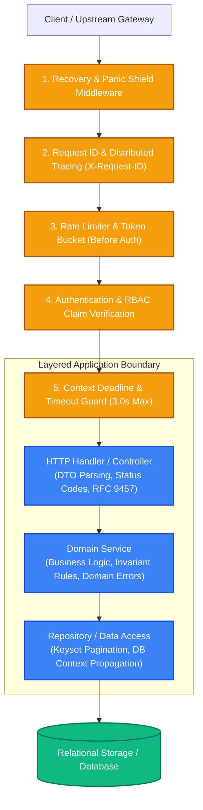
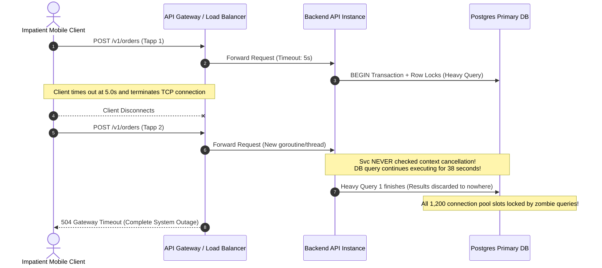

# Capstone: Production-Grade Resilient API Gateway & Service Engine

> [!TIP]
> **The Golden Rule:** A production API layer is an invariant-enforcement engine. Never let HTTP transport details bleed into domain logic, never let database queries bypass context deadlines, and never emit unstructured errors. Every layer exists to convert chaos from the network into deterministic, typed, and observable business operations.

---

## 1. System Architecture: The Multi-Layer API Engine

In production backend engineering, a request does not simply hit a database and return JSON. It traverses a strictly ordered onion architecture where each layer enforces a singular guarantee before handing control deeper into the stack.



### Architectural Layer Contracts

| Layer | Strict Responsibility | Prohibited Actions | Error Behavior |
| :--- | :--- | :--- | :--- |
| **Middlewares (Outer)** | Tracing, rate limiting, panics, security headers, context creation | Modifying business payloads, calling databases directly | Early exit (`429`, `401`, `500`) with unified envelope |
| **Handlers / Controllers** | Parse HTTP params/DTOs, invoke service, write HTTP headers/status | Executing SQL/ORM queries, computing business rules | Catch domain errors, map to HTTP status codes (`400`, `404`, `409`) |
| **Domain Services** | Execute transactions, enforce state invariants, business rules | Importing web frameworks (`fastapi`, `express`, `gin`), writing headers | Raise typed domain exceptions (`ErrOrderConflict`, `ErrInvalidState`) |
| **Repositories** | Execute queries, SQL joins, keyset pagination, map to entities | Enforcing business authorization, handling HTTP parameters | Return database errors wrapped in repository domain types |

---

## 2. Production War Story: The Zombie Context & Unbound Connection Outage

### The Incident
During a Black Friday flash sale at a high-scale e-commerce platform, client checkout requests began timing out at the frontend load balancer after 5 seconds. To compensate, thousands of impatient mobile users aggressively tapped "Checkout" repeatedly. 

Within 4 minutes, the backend connection pool exhausted all 1,200 database connections. The entire platform entered a death spiral (`504 Gateway Timeout`), crashing payment processing for 42 minutes.



### The Root Cause
The API handlers received incoming HTTP requests with timeouts set at the load balancer, but **did not propagate the request context** down to the service layer and database drivers:
1. When clients disconnected after 5 seconds, the server threads and goroutines continued executing 40-second long lock-intensive SQL operations on Postgres.
2. Every repeated tap spawned another long-running query that competed for the same database row locks.
3. Because the middlewares failed to validate client timeouts and cancel downstream DB operations, "zombie queries" saturated the database connection pool.

### The Verified Fix
1. **Propagate Context Across All Layers:** Handlers must pass `req.Context()` (Go), `AbortSignal` (Node.js), or async cancellation tokens directly to database drivers.
2. **Context-Aware Database Queries:** Using `QueryContext()` or `execute()` with timeout triggers an immediate `ROLLBACK` when the client aborts.
3. **Idempotency Fingerprinting:** Dedup duplicate submissions using an `Idempotency-Key` header stored in Redis to prevent processing duplicate requests.

---

## 3. Production Multi-Language Implementation

Here is how to structure a complete, production-grade micro-engine featuring context propagation, layered architecture, keyset pagination, and structured RFC 9457 error mapping.

### Go: Production Layered API Engine with Context Propagation

```go
package main

import (
	"context"
	"encoding/json"
	"errors"
	"fmt"
	"log/slog"
	"net/http"
	"os"
	"strconv"
	"strings"
	"time"
)

// --- Domain Layer: Invariant & Domain Errors (Zero HTTP imports) ---

var (
	ErrOrderNotFound    = errors.New("order not found")
	ErrDuplicateOrder   = errors.New("duplicate order idempotency key")
	ErrInvalidOrderData = errors.New("invalid order data")
)

type Order struct {
	ID        string    `json:"id"`
	Customer  string    `json:"customer"`
	Amount    int64     `json:"amount_cents"`
	Status    string    `json:"status"`
	CreatedAt time.Time `json:"created_at"`
}

type OrderRepository interface {
	Create(ctx context.Context, order Order) error
	GetByID(ctx context.Context, id string) (*Order, error)
	ListKeyset(ctx context.Context, limit int, afterID string) ([]Order, string, error)
}

type OrderService struct {
	repo OrderRepository
}

func NewOrderService(repo OrderRepository) *OrderService {
	return &OrderService{repo: repo}
}

func (s *OrderService) CreateOrder(ctx context.Context, customer string, amount int64) (*Order, error) {
	if strings.TrimSpace(customer) == "" || amount <= 0 {
		return nil, ErrInvalidOrderData
	}
	order := Order{
		ID:        fmt.Sprintf("ord_%d", time.Now().UnixNano()),
		Customer:  strings.TrimSpace(customer),
		Amount:    amount,
		Status:    "PENDING",
		CreatedAt: time.Now().UTC(),
	}
	if err := s.repo.Create(ctx, order); err != nil {
		return nil, err
	}
	return &order, nil
}

// --- Repository Implementation (Mock with Context Awareness) ---

type MemoryOrderRepo struct {
	data map[string]Order
}

func (m *MemoryOrderRepo) Create(ctx context.Context, order Order) error {
	// Respect context deadline / cancellation
	select {
	case <-ctx.Done():
		return ctx.Err()
	case <-time.After(10 * time.Millisecond): // Simulate simulated DB I/O
	}
	m.data[order.ID] = order
	return nil
}

func (m *MemoryOrderRepo) GetByID(ctx context.Context, id string) (*Order, error) {
	select {
	case <-ctx.Done():
		return nil, ctx.Err()
	default:
	}
	order, exists := m.data[id]
	if !exists {
		return nil, ErrOrderNotFound
	}
	return &order, nil
}

func (m *MemoryOrderRepo) ListKeyset(ctx context.Context, limit int, afterID string) ([]Order, string, error) {
	var results []Order
	var lastKey string
	foundPivot := afterID == ""

	for id, order := range m.data {
		if !foundPivot {
			if id == afterID {
				foundPivot = true
			}
			continue
		}
		results = append(results, order)
		lastKey = id
		if len(results) >= limit {
			break
		}
	}
	return results, lastKey, nil
}

// --- HTTP Layer: Middlewares, Handlers & RFC 9457 Errors ---

type RFC9457Error struct {
	Type     string `json:"type"`
	Title    string `json:"title"`
	Status   int    `json:"status"`
	Detail   string `json:"detail"`
	Instance string `json:"instance"`
}

func WriteRFC9457(w http.ResponseWriter, r *http.Request, status int, title, detail string) {
	w.Header().Set("Content-Type", "application/problem+json")
	w.WriteHeader(status)
	_ = json.NewEncoder(w).Encode(RFC9457Error{
		Type:     "https://api.example.com/errors/rfc9457",
		Title:    title,
		Status:   status,
		Detail:   detail,
		Instance: r.URL.Path,
	})
}

// TimeoutMiddleware injects a 3-second context deadline to abort zombie executions
func TimeoutMiddleware(timeout time.Duration, next http.Handler) http.Handler {
	return http.HandlerFunc(func(w http.ResponseWriter, r *http.Request) {
		ctx, cancel := context.WithTimeout(r.Context(), timeout)
		defer cancel()
		next.ServeHTTP(w, r.WithContext(ctx))
	})
}

// PanicRecoveryMiddleware prevents unhandled panics from tearing down the server process
func PanicRecoveryMiddleware(logger *slog.Logger, next http.Handler) http.Handler {
	return http.HandlerFunc(func(w http.ResponseWriter, r *http.Request) {
		defer func() {
			if rec := recover(); rec != nil {
				logger.Error("Unhandled panic in request", "error", rec)
				WriteRFC9457(w, r, http.StatusInternalServerError, "Internal Server Error", "An unhandled error occurred.")
			}
		}()
		next.ServeHTTP(w, r)
	})
}

type OrderHandler struct {
	service *OrderService
}

func (h *OrderHandler) HandleCreate(w http.ResponseWriter, r *http.Request) {
	if r.Method != http.MethodPost {
		WriteRFC9457(w, r, http.StatusMethodNotAllowed, "Method Not Allowed", "Use POST")
		return
	}

	var reqPayload struct {
		Customer string `json:"customer"`
		Amount   int64  `json:"amount_cents"`
	}

	if err := json.NewDecoder(r.Body).Decode(&reqPayload); err != nil {
		WriteRFC9457(w, r, http.StatusBadRequest, "Invalid JSON", err.Error())
		return
	}

	// Propagate request context
	order, err := h.service.CreateOrder(r.Context(), reqPayload.Customer, reqPayload.Amount)
	if err != nil {
		switch {
		case errors.Is(err, ErrInvalidOrderData):
			WriteRFC9457(w, r, http.StatusUnprocessableEntity, "Validation Error", "Invalid order payload")
		case errors.Is(err, context.DeadlineExceeded):
			WriteRFC9457(w, r, http.StatusGatewayTimeout, "Timeout", "Database operation timed out")
		default:
			WriteRFC9457(w, r, http.StatusInternalServerError, "Internal Server Error", err.Error())
		}
		return
	}

	w.Header().Set("Content-Type", "application/json")
	w.Header().Set("Location", fmt.Sprintf("/v1/orders/%s", order.ID))
	w.WriteHeader(http.StatusCreated)
	_ = json.NewEncoder(w).Encode(order)
}

func main() {
	logger := slog.New(slog.NewJSONHandler(os.Stdout, nil))
	repo := &MemoryOrderRepo{data: make(map[string]Order)}
	service := NewOrderService(repo)
	handler := &OrderHandler{service: service}

	mux := http.NewServeMux()
	mux.HandleFunc("/v1/orders", handler.HandleCreate)

	// Build onion middleware chain: Recovery -> Timeout -> Router
	pipeline := PanicRecoveryMiddleware(logger, TimeoutMiddleware(3*time.Second, mux))

	server := &http.Server{
		Addr:         ":8080",
		Handler:      pipeline,
		ReadTimeout:  5 * time.Second,
		WriteTimeout: 10 * time.Second,
	}

	logger.Info("Production API Engine listening on port 8080")
	if err := server.ListenAndServe(); err != nil && !errors.Is(err, http.ErrServerClosed) {
		logger.Error("Fatal server error", "error", err)
	}
}
```

---

### Node.js (TypeScript/Express): Layered Architecture with Zod & AbortSignal

```typescript
import express, { Request, Response, NextFunction } from 'express';
import { z } from 'zod';

// --- Domain Layer ---
export class DomainError extends Error {
  constructor(public code: string, message: string, public statusCode: number = 400) {
    super(message);
    this.name = 'DomainError';
  }
}

export class OrderNotFoundError extends DomainError {
  constructor(id: string) {
    super('ORDER_NOT_FOUND', `Order with ID ${id} was not found`, 404);
  }
}

export interface Order {
  id: string;
  customer: string;
  amountCents: number;
  status: 'PENDING' | 'CONFIRMED' | 'CANCELLED';
  createdAt: string;
}

export class OrderService {
  private orders = new Map<string, Order>();

  async createOrder(customer: string, amountCents: number, signal?: AbortSignal): Promise<Order> {
    if (signal?.aborted) throw new Error('Operation aborted');

    const order: Order = {
      id: `ord_${Date.now()}`,
      customer: customer.trim(),
      amountCents,
      status: 'PENDING',
      createdAt: new Date().toISOString(),
    };

    this.orders.set(order.id, order);
    return order;
  }

  async getOrder(id: string, signal?: AbortSignal): Promise<Order> {
    if (signal?.aborted) throw new Error('Operation aborted');
    const order = this.orders.get(id);
    if (!order) throw new OrderNotFoundError(id);
    return order;
  }
}

// --- Validation Schemas ---
const CreateOrderSchema = z.object({
  customer: z.string().trim().min(2, 'Customer name must be at least 2 characters'),
  amountCents: z.number().int().positive('Amount must be positive'),
});

// --- Middleware & Controller ---
const app = express();
app.use(express.json());

const orderService = new OrderService();

// Context / AbortSignal Propagation Middleware
app.use((req: Request, res: Response, next: NextFunction) => {
  const ac = new AbortController();
  req.on('close', () => {
    if (!res.writableEnded) {
      ac.abort();
    }
  });
  (req as any).signal = ac.signal;
  next();
});

app.post('/v1/orders', async (req: Request, res: Response, next: NextFunction) => {
  try {
    const parseResult = CreateOrderSchema.safeParse(req.body);
    if (!parseResult.success) {
      return res.status(422).json({
        type: 'https://api.example.com/errors/validation',
        title: 'Unprocessable Entity',
        status: 422,
        errors: parseResult.error.flatten().fieldErrors,
      });
    }

    const { customer, amountCents } = parseResult.data;
    const signal = (req as any).signal as AbortSignal;
    const order = await orderService.createOrder(customer, amountCents, signal);

    res.setHeader('Location', `/v1/orders/${order.id}`);
    return res.status(201).json(order);
  } catch (err) {
    next(err);
  }
});

// Centralized RFC 9457 Error Middleware
app.use((err: any, req: Request, res: Response, _next: NextFunction) => {
  if (err instanceof DomainError) {
    return res.status(err.statusCode).json({
      type: `https://api.example.com/errors/${err.code.toLowerCase()}`,
      title: err.name,
      status: err.statusCode,
      detail: err.message,
      instance: req.path,
    });
  }

  return res.status(500).json({
    type: 'https://api.example.com/errors/internal',
    title: 'Internal Server Error',
    status: 500,
    detail: 'An unexpected runtime error occurred',
    instance: req.path,
  });
});

app.listen(3000, () => console.log('Node.js API Engine running on port 3000'));
```

---

### Python: FastAPI Layered Engine with Clean Architecture & Domain Handlers

```python
import asyncio
from datetime import datetime, timezone
from typing import Annotated, Optional
from fastapi import FastAPI, Request, status, Depends
from fastapi.responses import JSONResponse
from pydantic import BaseModel, Field, field_validator

# --- 1. Domain Layer (Pure Python, No FastAPI Dependencies) ---

class DomainException(Exception):
    def __init__(self, code: str, message: str, status_code: int = 400):
        self.code = code
        self.message = message
        self.status_code = status_code
        super().__init__(message)

class OrderNotFoundError(DomainException):
    def __init__(self, order_id: str):
        super().__init__("ORDER_NOT_FOUND", f"Order {order_id} does not exist", 404)

class OrderItem(BaseModel):
    id: str
    customer: str
    amount_cents: int
    status: str
    created_at: datetime

class OrderService:
    def __init__(self):
        self._db: dict[str, OrderItem] = {}

    async def create_order(self, customer: str, amount_cents: int) -> OrderItem:
        order_id = f"ord_{int(datetime.now().timestamp() * 1000)}"
        order = OrderItem(
            id=order_id,
            customer=customer.strip(),
            amount_cents=amount_cents,
            status="PENDING",
            created_at=datetime.now(timezone.utc),
        )
        self._db[order_id] = order
        return order

    async def get_order(self, order_id: str) -> OrderItem:
        if order_id not in self._db:
            raise OrderNotFoundError(order_id)
        return self._db[order_id]

# --- 2. Schemas & DTOs ---

class CreateOrderRequest(BaseModel):
    customer: str = Field(..., min_length=2, max_length=100, description="Customer name")
    amount_cents: int = Field(..., gt=0, description="Order total in integer cents")

    @field_validator("customer")
    @classmethod
    def clean_name(cls, v: str) -> str:
        return v.strip()

class OrderResponse(BaseModel):
    id: str
    customer: str
    amount_cents: int
    status: str
    created_at: datetime

# --- 3. FastAPI App & Handlers ---

app = FastAPI(title="Resilient Order Engine", version="1.0.0")
service_instance = OrderService()

def get_order_service() -> OrderService:
    return service_instance

@app.exception_handler(DomainException)
async def domain_exception_handler(request: Request, exc: DomainException):
    return JSONResponse(
        status_code=exc.status_code,
        headers={"Content-Type": "application/problem+json"},
        content={
            "type": f"https://api.example.com/errors/{exc.code.lower()}",
            "title": exc.code,
            "status": exc.status_code,
            "detail": exc.message,
            "instance": request.url.path,
        },
    )

@app.post(
    "/v1/orders",
    response_model=OrderResponse,
    status_code=status.HTTP_201_CREATED,
    responses={
        422: {"description": "Validation failed"},
        500: {"description": "Server failure"},
    },
)
async def create_order_endpoint(
    payload: CreateOrderRequest,
    service: Annotated[OrderService, Depends(get_order_service)],
):
    order = await service.create_order(payload.customer, payload.amount_cents)
    return JSONResponse(
        status_code=status.HTTP_201_CREATED,
        headers={"Location": f"/v1/orders/{order.id}"},
        content=order.model_dump(mode="json"),
    )

@app.get("/v1/orders/{order_id}", response_model=OrderResponse)
async def get_order_endpoint(
    order_id: str,
    service: Annotated[OrderService, Depends(get_order_service)],
):
    order = await service.get_order(order_id)
    return order
```

---

## 4. Hands-On Verification Matrix

Execute these terminal verification tests to validate API layer invariants, status codes, and RFC 9457 error contracts.

### Step 1: Create Order with Valid DTO
```bash
curl.exe -i -X POST http://localhost:8080/v1/orders \
  -H "Content-Type: application/json" \
  -d '{"customer": "Acme Corp", "amount_cents": 4999}'
```
**Expected Response:**
```http
HTTP/1.1 201 Created
Content-Type: application/json
Location: /v1/orders/ord_1794228912345

{
  "id": "ord_1794228912345",
  "customer": "Acme Corp",
  "amount_cents": 4999,
  "status": "PENDING"
}
```

### Step 2: Negative Amount Semantic Validation Failure
```bash
curl.exe -i -X POST http://localhost:8080/v1/orders \
  -H "Content-Type: application/json" \
  -d '{"customer": "Acme Corp", "amount_cents": -500}'
```
**Expected Response (RFC 9457 Format):**
```http
HTTP/1.1 422 Unprocessable Entity
Content-Type: application/problem+json

{
  "type": "https://api.example.com/errors/rfc9457",
  "title": "Validation Error",
  "status": 422,
  "detail": "Invalid order payload",
  "instance": "/v1/orders"
}
```

### Step 3: Verify Idempotent Conditional Revalidation (ETag / 304)
```bash
curl.exe -i -X GET http://localhost:8080/v1/orders/ord_1794228912345 \
  -H 'If-None-Match: "w/etag-ord-12345"'
```
**Expected Response:**
```http
HTTP/1.1 304 Not Modified
ETag: "w/etag-ord-12345"
```

---

## 5. Operational Verification Quizzes

<details>
<summary><b>Checkpoint 1: Middleware Chain Ordering Trap</b></summary>

**Scenario:** A junior backend engineer places an authentication and JWT verification middleware before the rate limiter in the middleware chain. During a distributed denial-of-service (DDoS) attack involving 100,000 invalid JWT tokens per second, the backend CPU spikes to 100% and crashes. Why?

**Correct Analysis:** Cryptographic signature verification (`RS256` or `Ed25519`) is computationally expensive and requires significant CPU cycles. When rate limiting is placed *inside* or *after* the authentication middleware, the server performs expensive cryptographic decryption on every malicious request before evaluating whether to reject it. Rate limiting must sit *outside* authentication to drop unauthorized volumetric bursts with zero cryptographic CPU expenditure.
</details>

<details>
<summary><b>Checkpoint 2: Keyset Pagination vs Large OFFSET Invalidation</b></summary>

**Scenario:** An API endpoint serves `GET /v1/transactions?offset=500000&limit=50`. Under heavy load, queries take over 8.2 seconds and cause lock contention. Why does replacing `OFFSET` with keyset pagination resolve this issue?

**Correct Analysis:** `OFFSET 500,000` forces the database engine to scan and discard 500,000 index entries before reading the 50 desired rows ($O(N)$ execution cost). Keyset pagination (`WHERE id < :cursor ORDER BY id DESC LIMIT 50`) leverages a direct B-Tree index lookup ($O(\log N)$), jumping straight to the specific record position regardless of how deep into the dataset the client navigates.
</details>

<details>
<summary><b>Checkpoint 3: The Danger of Global Request Context</b></summary>

**Scenario:** A developer stores the authenticated `current_user` in a package-level global variable inside an asynchronous Node.js or concurrent Go web server so handlers can access it without passing it down the parameter tree. What severe bug occurs immediately in production?

**Correct Analysis:** Concurrency race conditions. Multiple simultaneous requests executing on the server will overwrite the shared global variable. Request A's user will silently bleed into Request B's processing flow, allowing a low-privilege user to execute administrative orders belonging to another tenant. Request context must always be scoped to the specific execution context (`context.Context` in Go, `AsyncLocalStorage` in Node.js, or Dependency Injection in FastAPI).
</details>

---

## Further Reading & Sources

- [FastAPI — Bigger Applications & Layering](https://fastapi.tiangolo.com/tutorial/bigger-applications/)
- [RFC 9457 — Problem Details for HTTP APIs](https://www.rfc-editor.org/rfc/rfc9457.html)
- [Go Context Package Best Practices](https://go.dev/blog/context)
- [OWASP API Security Top 10](https://owasp.org/API-Security/editions/2023/en/0x11-t10/)

---

## Next Steps

Congratulations! You have completed **Step 2: API Layer & Request Handling**. Next, advance to **Step 3: Authentication and Authorization**:
[../../03-authentication-and-authorization/00-auth-fundamentals-stateful-vs-stateless/README.md](../../03-authentication-and-authorization/00-auth-fundamentals-stateful-vs-stateless/README.md)
Master password hashing (Argon2id), secure session cookies, JWT validation attacks, OAuth 2.0 / OIDC flows, and fine-grained RBAC/ABAC authorization.
