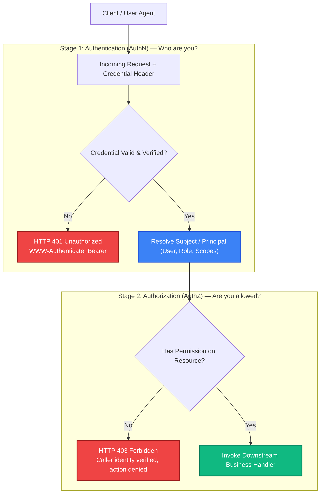
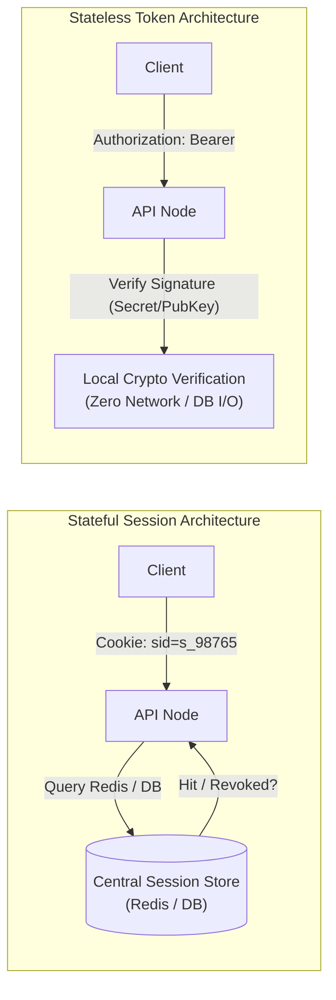
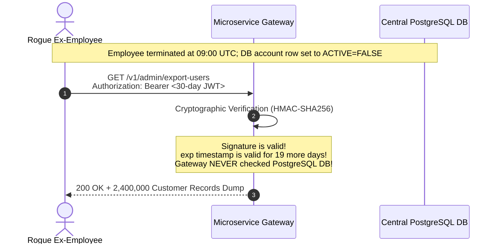

# Auth Fundamentals: Stateful vs Stateless Authentication

> [!TIP]
> **The Golden Rule:** Authentication (AuthN) proves *who* you are (`401 Unauthorized` on failure); Authorization (AuthZ) verifies *what* you may do (`403 Forbidden` on failure). Stateful auth stores identity on the server for instant revocation; stateless auth embeds signed claims inside tokens for horizontal zero-lookup speed. Never confuse 401 and 403, and never mistake token validity for permission.

---

## 1. Visual Mental Model: The Auth Pipeline & Architectural Fork

Every protected backend system enforces a strict two-stage security boundary. First, the transport credential is verified to resolve the caller's identity; second, that identity is evaluated against the target resource and operation.



### The Architectural Fork: Stateful Sessions vs Stateless Tokens



---

## 2. Technical Comparison & Tradeoff Matrix

| Dimension | Stateful Authentication (Sessions) | Stateless Authentication (Signed Tokens / JWT) |
| :--- | :--- | :--- |
| **Storage Location** | Server memory, Redis cluster, or SQL database | Client-side (in memory, encrypted cookies, or mobile keystore) |
| **Revocation Capability** | **Instantaneous:** Delete the session ID key from Redis | **Delayed / Complex:** Valid until expiration (`exp`), requires blacklists |
| **Database Load** | 1 storage roundtrip per incoming request | **Zero I/O:** Verified in-memory via public key / HMAC secret |
| **Payload Size** | Tiny opaque reference (`sid_32bytes`, ~40 bytes) | Larger self-describing payload (Header.Payload.Sig, ~500–2,000 bytes) |
| **Horizontal Scaling** | Requires shared central session cache (Redis / Memcached) | Shared secret or public key distribution across any number of nodes |
| **Typical Use Cases** | Traditional server-rendered web apps, admin consoles, high-security banking | Mobile apps, cross-service microservices, decentralized third-party APIs |

---

## 3. Production War Story: The Phantom Admin Token Breach

### The Incident
An engineering team at a SaaS analytics firm issued stateless JWT tokens with a 30-day expiration window (`exp = now + 30 days`). An employee in technical support was terminated immediately after suspicious data exfiltration was detected. IT immediately revoked their account in the centralized PostgreSQL database.

Despite account termination, the attacker used their active JWT to query internal admin APIs for 19 consecutive days. Over 2.4 million confidential customer records were downloaded before the breach was detected.



### The Root Cause
1. **Stateless Blind Spot:** The gateway relied strictly on cryptographic validity without any mechanism to revoke or check active subject status.
2. **Excessive Lifetime:** The token lived for 30 days without short-lived access rotation.
3. **Absence of Revocation Blacklist:** When an account was banned or revoked, no event or bloom filter notified edge gateways to invalidate the token's `jti` (JWT ID).

### The Verified Fix
- **Short-Lived Access Tokens + Refresh Tokens:** Reduce stateless access tokens to **10 minutes**. Issue stateful, revocable refresh tokens (stored in Redis/Postgres) with strict rotation.
- **Distributed Revocation Bloom Filter:** Publish revoked user IDs to a Redis key-value cache checked by edge gateways during privileged operations.
- **Strict Boundary Separation:** Return `401 Unauthorized` for invalid or missing tokens, and `403 Forbidden` if an authenticated user lacks required scopes.

---

## 4. Multi-Language Production Implementation

### Go: Production AuthN vs AuthZ Pipeline

```go
package main

import (
	"context"
	"encoding/json"
	"errors"
	"log/slog"
	"net/http"
	"os"
	"strings"
)

type UserContextKey struct{}

type Principal struct {
	ID    string   `json:"id"`
	Roles []string `json:"roles"`
}

var (
	ErrUnauthenticated = errors.New("missing or invalid authorization header")
	ErrForbidden       = errors.New("insufficient privileges for this resource")
)

// AuthenticateMiddleware performs AuthN (Stage 1)
func AuthenticateMiddleware(next http.Handler) http.Handler {
	return http.HandlerFunc(func(w http.ResponseWriter, r *http.Request) {
		authHeader := r.Header.Get("Authorization")
		if authHeader == "" || !strings.HasPrefix(authHeader, "Bearer ") {
			writeError(w, http.StatusUnauthorized, "Bearer token required")
			return
		}

		token := strings.TrimPrefix(authHeader, "Bearer ")
		
		// In production: verify JWT signature or lookup session in Redis
		principal, err := validateToken(token)
		if err != nil {
			writeError(w, http.StatusUnauthorized, "Invalid or expired token")
			return
		}

		// Inject principal into request context
		ctx := context.WithValue(r.Context(), UserContextKey{}, principal)
		next.ServeHTTP(w, r.WithContext(ctx))
	})
}

// RequireRole performs AuthZ (Stage 2)
func RequireRole(requiredRole string, next http.HandlerFunc) http.HandlerFunc {
	return func(w http.ResponseWriter, r *http.Request) {
		principal, ok := r.Context().Value(UserContextKey{}).(*Principal)
		if !ok || principal == nil {
			writeError(w, http.StatusUnauthorized, "Authentication required")
			return
		}

		hasRole := false
		for _, role := range principal.Roles {
			if role == requiredRole {
				hasRole = true
				break
			}
		}

		if !hasRole {
			writeError(w, http.StatusForbidden, "Access denied: missing "+requiredRole+" role")
			return
		}

		next(w, r)
	}
}

func validateToken(token string) (*Principal, error) {
	if token == "admin-token-xyz" {
		return &Principal{ID: "usr_admin_1", Roles: []string{"admin", "member"}}, nil
	}
	if token == "user-token-abc" {
		return &Principal{ID: "usr_regular_2", Roles: []string{"member"}}, nil
	}
	return nil, errors.New("unrecognized token")
}

func writeError(w http.ResponseWriter, status int, detail string) {
	w.Header().Set("Content-Type", "application/problem+json")
	if status == http.StatusUnauthorized {
		w.Header().Set("WWW-Authenticate", `Bearer error="invalid_token"`)
	}
	w.WriteHeader(status)
	_ = json.NewEncoder(w).Encode(map[string]any{
		"status": status,
		"detail": detail,
	})
}

func main() {
	mux := http.NewServeMux()

	adminHandler := http.HandlerFunc(func(w http.ResponseWriter, r *http.Request) {
		principal := r.Context().Value(UserContextKey{}).(*Principal)
		w.Header().Set("Content-Type", "application/json")
		_ = json.NewEncoder(w).Encode(map[string]any{
			"message": "Welcome to the admin console",
			"user_id": principal.ID,
		})
	})

	// Wrap with AuthN then AuthZ
	mux.Handle("/v1/admin/dashboard", AuthenticateMiddleware(RequireRole("admin", adminHandler)))

	slog.Info("Server listening on :8080")
	_ = http.ListenAndServe(":8080", mux)
}
```

---

### Node.js (TypeScript): Clean AuthN and AuthZ Middleware Separation

```typescript
import express, { Request, Response, NextFunction } from 'express';

export interface AuthenticatedUser {
  id: string;
  roles: string[];
}

declare global {
  namespace Express {
    interface Request {
      user?: AuthenticatedUser;
    }
  }
}

const app = express();
app.use(express.json());

// Stage 1: AuthN Middleware
export function authenticateToken(req: Request, res: Response, next: NextFunction) {
  const authHeader = req.headers['authorization'];
  if (!authHeader || !authHeader.startsWith('Bearer ')) {
    res.setHeader('WWW-Authenticate', 'Bearer realm="api"');
    return res.status(401).json({
      type: 'https://api.example.com/errors/unauthorized',
      title: 'Unauthorized',
      status: 401,
      detail: 'Missing or malformed Authorization header',
    });
  }

  const token = authHeader.substring(7);
  
  // Example token lookup
  if (token === 'admin-token-xyz') {
    req.user = { id: 'usr_admin_1', roles: ['admin', 'member'] };
    return next();
  } else if (token === 'user-token-abc') {
    req.user = { id: 'usr_regular_2', roles: ['member'] };
    return next();
  }

  res.setHeader('WWW-Authenticate', 'Bearer error="invalid_token"');
  return res.status(401).json({
    type: 'https://api.example.com/errors/unauthorized',
    title: 'Unauthorized',
    status: 401,
    detail: 'Token is invalid or expired',
  });
}

// Stage 2: AuthZ Middleware Factory
export function requireRole(requiredRole: string) {
  return (req: Request, res: Response, next: NextFunction) => {
    if (!req.user) {
      return res.status(401).json({ status: 401, detail: 'Authentication required' });
    }

    if (!req.user.roles.includes(requiredRole)) {
      return res.status(403).json({
        type: 'https://api.example.com/errors/forbidden',
        title: 'Forbidden',
        status: 403,
        detail: `User lacks required role: ${requiredRole}`,
      });
    }

    next();
  };
}

// Route Definition with Strict Stage Separation
app.get(
  '/v1/admin/reports',
  authenticateToken,
  requireRole('admin'),
  (req: Request, res: Response) => {
    res.json({
      message: 'Access granted to confidential reports',
      operator: req.user?.id,
    });
  }
);

app.listen(3000, () => console.log('Node.js Auth Engine running on port 3000'));
```

---

### Python: FastAPI Explicit AuthN and AuthZ Dependencies

```python
from typing import Annotated
from fastapi import FastAPI, Depends, HTTPException, status, Header
from fastapi.security import HTTPBearer, HTTPAuthorizationCredentials
from pydantic import BaseModel

app = FastAPI(title="Auth Fundamentals Engine")
security = HTTPBearer(auto_error=False)

class UserClaims(BaseModel):
    user_id: str
    roles: list[str]

# Stage 1: AuthN Dependency
async def get_current_user(
    credentials: Annotated[HTTPAuthorizationCredentials | None, Depends(security)]
) -> UserClaims:
    if not credentials or not credentials.credentials:
        raise HTTPException(
            status_code=status.HTTP_401_UNAUTHORIZED,
            detail="Missing authentication credentials",
            headers={"WWW-Authenticate": "Bearer"},
        )
    
    token = credentials.credentials
    if token == "admin-token-xyz":
        return UserClaims(user_id="usr_admin_1", roles=["admin", "member"])
    elif token == "user-token-abc":
        return UserClaims(user_id="usr_regular_2", roles=["member"])
    
    raise HTTPException(
        status_code=status.HTTP_401_UNAUTHORIZED,
        detail="Invalid or expired token",
        headers={"WWW-Authenticate": "Bearer error=\"invalid_token\""},
    )

# Stage 2: AuthZ Dependency Factory
def require_role(role_name: str):
    def role_checker(current_user: Annotated[UserClaims, Depends(get_current_user)]) -> UserClaims:
        if role_name not in current_user.roles:
            raise HTTPException(
                status_code=status.HTTP_403_FORBIDDEN,
                detail=f"Operation requires '{role_name}' permissions",
            )
        return current_user
    return role_checker

@app.get("/v1/admin/dashboard")
async def admin_dashboard(
    current_user: Annotated[UserClaims, Depends(require_role("admin"))]
):
    return {
        "status": "success",
        "message": "Authorized for administrator dashboard",
        "actor": current_user.user_id,
    }
```

---

## 5. Practical Hands-On Verification Matrix

Execute these terminal commands to verify AuthN (401) and AuthZ (403) behavioral contracts.

### Test 1: Unauthenticated Call (Missing Bearer Token)
```bash
curl.exe -i http://localhost:8080/v1/admin/dashboard
```
**Expected Response:**
```http
HTTP/1.1 401 Unauthorized
WWW-Authenticate: Bearer error="invalid_token"
Content-Type: application/problem+json

{
  "status": 401,
  "detail": "Bearer token required"
}
```

### Test 2: Authenticated but Forbidden (AuthZ Failure)
```bash
curl.exe -i http://localhost:8080/v1/admin/dashboard \
  -H "Authorization: Bearer user-token-abc"
```
**Expected Response:**
```http
HTTP/1.1 403 Forbidden
Content-Type: application/problem+json

{
  "status": 403,
  "detail": "Access denied: missing admin role"
}
```

### Test 3: Authenticated and Authorized (Success)
```bash
curl.exe -i http://localhost:8080/v1/admin/dashboard \
  -H "Authorization: Bearer admin-token-xyz"
```
**Expected Response:**
```http
HTTP/1.1 200 OK
Content-Type: application/json

{
  "message": "Welcome to the admin console",
  "user_id": "usr_admin_1"
}
```

---

## 6. Operational Verification Quizzes

<details>
<summary><b>Checkpoint 1: The 401 vs 403 Security Misconfiguration</b></summary>

**Scenario:** An API returns `401 Unauthorized` when an authenticated user attempts to access another tenant's billing records. Why is this confusing to client applications and load balancers?

**Correct Analysis:** A `401 Unauthorized` status signals to client applications (e.g. mobile apps, single-page apps) that their authentication credential is missing, expired, or invalid, typically triggering an automatic redirect to a login prompt or refresh token exchange. Returning `401` when the user *is* authenticated causes infinite login loops. The correct status is `403 Forbidden`, informing the client that identity was established, but permission is denied.
</details>

<details>
<summary><b>Checkpoint 2: Redis Session Stampede on User Spikes</b></summary>

**Scenario:** A stateful backend application scales to 150 instances behind an ALB. During a traffic surge, Redis CPU hits 100% processing session lookup queries on every single HTTP asset request (`GET /static/*`, `GET /api/*`), bringing the entire platform down. How do you mitigate this?

**Correct Analysis:** Static assets and public health checks should bypass session verification completely. For authenticated API routes, implement local in-process short-lived read caches (e.g., 5-second LRU cache) for validated sessions, or migrate to a hybrid approach: stateless signed tokens for request authentication combined with Redis-based session validity checks only during state-mutating requests (`POST`/`PUT`/`DELETE`).
</details>

<details>
<summary><b>Checkpoint 3: The Danger of Embedded Authorization Claims</b></summary>

**Scenario:** A microservices system embeds user permissions (`"roles": ["admin"]`) inside a 24-hour stateless JWT. When an admin is demoted to a regular user, they continue accessing admin endpoints until the token expires tomorrow. What is the production architecture solution?

**Correct Analysis:** Long-lived authorization claims inside stateless tokens create dangerous authorization lag. The solution is dual-fold: (1) Use very short-lived access tokens (e.g., 5 to 15 minutes) paired with stateful refresh tokens checked at authorization servers, and (2) Maintain a fast in-memory distributed cache (Redis or etcd) of user permission version numbers (`token_version` or `role_version`). If the token's embedded version doesn't match the current database version, reject the request immediately.
</details>

---

## Further Reading & Sources

- [RFC 9110 HTTP Semantics — Section 15.5: Client Errors (401 vs 403)](https://www.rfc-editor.org/rfc/rfc9110.html#section-15.5)
- [OWASP Authentication Cheat Sheet](https://cheatsheetseries.owasp.org/cheatsheets/Authentication_Cheat_Sheet.html)
- [NIST Special Publication 800-63B: Digital Identity Guidelines](https://pages.nist.gov/800-63-3/sp800-63b.html)

---

## Next Steps

Advance to the next module:
[../01-sessions-and-cookies/README.md](../01-sessions-and-cookies/README.md)
Explore cookie attributes (`HttpOnly`, `SameSite=Lax`, `Secure`), session fixation defenses, Redis session stores, and cryptographic session signing.
