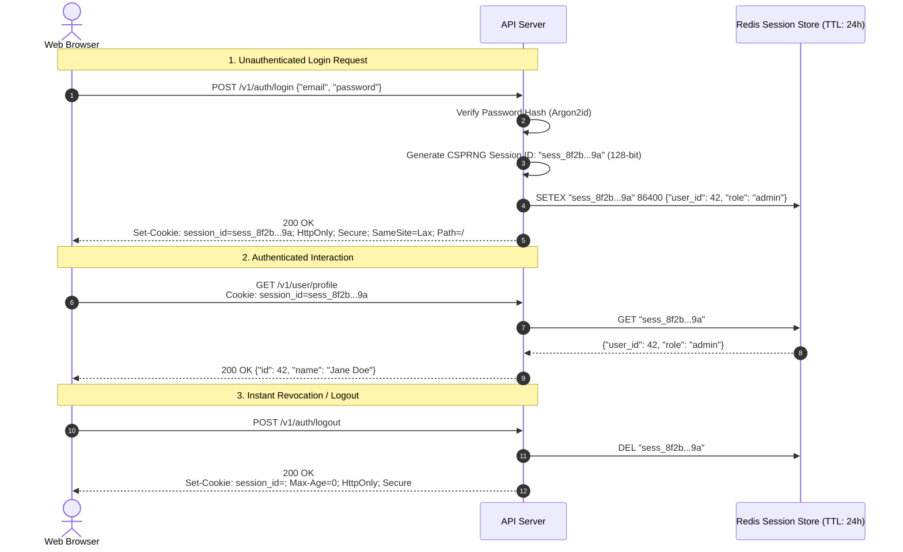
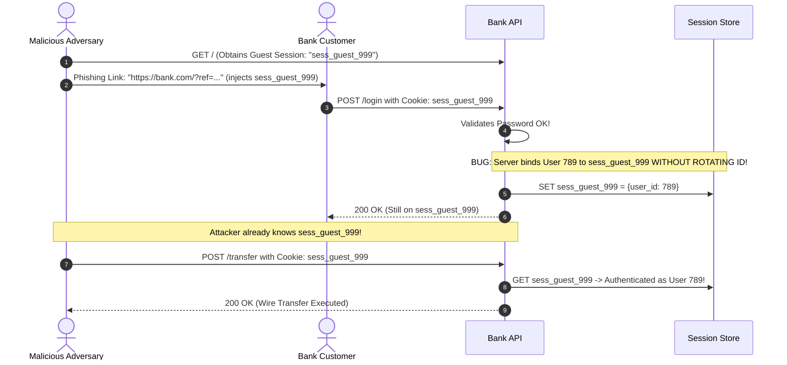

# Sessions and Cookies: High-Security Stateful Authentication

> [!TIP]
> **The Golden Rule:** A session cookie is an opaque pointer, never a data container. Always generate session identifiers using a cryptographically secure pseudorandom number generator (CSPRNG $\ge 128$ bits of entropy), always regenerate the session ID immediately upon authentication to eliminate **session fixation**, and always enforce `HttpOnly; Secure; SameSite=Lax`.

---

## 1. Visual Mental Model: The Production Session Lifecycle

A stateful session architecture pairs an opaque identifier on the client with a structured state record maintained in a centralized cache (such as Redis).



---

## 2. Cookie Security Attribute Taxonomy

Never emit a raw cookie without the four mandatory security directives:

| Attribute | Directive Example | Threat Mitigated | Consequence of Omission |
| :--- | :--- | :--- | :--- |
| **`HttpOnly`** | `HttpOnly` | Cross-Site Scripting (XSS) Token Theft | Malicious injected scripts (`document.cookie`) steal the session identifier |
| **`Secure`** | `Secure` | Man-In-The-Middle (MitM) Packet Sniffing | Cookie is transmitted over plaintext HTTP on untrusted public Wi-Fi networks |
| **`SameSite`** | `SameSite=Lax` / `Strict` | Cross-Site Request Forgery (CSRF) | Third-party malicious sites trick the browser into executing forged actions |
| **`Path` & `Domain`** | `Path=/; Domain=api.co.com` | Cookie Over-Scoping / Cross-Subdomain Leaks | Vulnerable staging subdomains can read or tamper with production cookies |
| **`Max-Age` / `Expires`** | `Max-Age=86400` | Stale Zombie Sessions | Session remains permanently resident on client disk without expiration |

```http
Set-Cookie: __Host-session_id=s_9f3a8b27c1d4e5f6; Path=/; Secure; HttpOnly; SameSite=Lax; Max-Age=86400
```
> [!NOTE]
> The `__Host-` cookie prefix enforces that the cookie is `Secure`, sent only from HTTPS origins, and cannot be modified or overridden by subdomains.

---

## 3. Production War Story: The Session Fixation Account Takeover

### The Incident
A European digital banking platform utilized pre-allocated guest session IDs for unauthenticated visitors browsing product interest calculators. When a visitor subsequently clicked "Log In" and entered their credentials, the application verified their password and updated the server-side database record associated with the *existing* guest session ID.

An attacker generated a guest session cookie, embedded it into a phishing link targeting high-net-worth customers, and waited. As soon as a victim clicked the link and logged in, the attacker used that same pre-set session cookie to access the victim's bank account, draining €340,000 across 14 fraudulent wire transfers.



### The Root Cause
The backend failed to enforce **Session Regeneration**:
1. The pre-authentication session ID remained valid after authentication occurred.
2. The attacker controlled the session ID beforehand, allowing them to ride along on the victim's elevated privileges without ever learning the victim's password.

### The Verified Fix
Whenever authentication state changes (login, privilege escalation, password change):
1. Immediately delete the existing pre-auth session record.
2. Generate an entirely new CSPRNG session ID.
3. Emit a new `Set-Cookie` header to overwrite the client's cookiejar.

---

## 4. Multi-Language Production Implementation

### Go: Secure Session Management with CSPRNG & Session Rotation

```go
package main

import (
	"crypto/rand"
	"encoding/base64"
	"encoding/json"
	"errors"
	"log/slog"
	"net/http"
	"sync"
	"time"
)

type SessionData struct {
	UserID    string    `json:"user_id"`
	Role      string    `json:"role"`
	CreatedAt time.Time `json:"created_at"`
}

type SessionStore struct {
	mu       sync.RWMutex
	sessions map[string]SessionData
}

func NewSessionStore() *SessionStore {
	return &SessionStore{sessions: make(map[string]SessionData)}
}

func (s *SessionStore) GenerateID() (string, error) {
	b := make([]byte, 32) // 256 bits of entropy
	if _, err := rand.Read(b); err != nil {
		return "", err
	}
	return base64.RawURLEncoding.EncodeToString(b), nil
}

func (s *SessionStore) Create(id string, data SessionData) {
	s.mu.Lock()
	defer s.mu.Unlock()
	s.sessions[id] = data
}

func (s *SessionStore) Get(id string) (SessionData, bool) {
	s.mu.RLock()
	defer s.mu.RUnlock()
	data, ok := s.sessions[id]
	return data, ok
}

func (s *SessionStore) Delete(id string) {
	s.mu.Lock()
	defer s.mu.Unlock()
	delete(s.sessions, id)
}

// Rotate destroys old session and returns a new session ID (Fixation Defense)
func (s *SessionStore) Rotate(oldID string, data SessionData) (string, error) {
	newID, err := s.GenerateID()
	if err != nil {
		return "", err
	}
	s.mu.Lock()
	defer s.mu.Unlock()
	if oldID != "" {
		delete(s.sessions, oldID)
	}
	s.sessions[newID] = data
	return newID, nil
}

type AppHandler struct {
	store *SessionStore
}

func (h *AppHandler) HandleLogin(w http.ResponseWriter, r *http.Request) {
	if r.Method != http.MethodPost {
		http.Error(w, "Method Not Allowed", http.StatusMethodNotAllowed)
		return
	}

	// Verify credentials (omitted for brevity)
	authenticatedUser := "usr_9981"

	// Fetch any existing session cookie
	var existingID string
	if c, err := r.Cookie("sid"); err == nil {
		existingID = c.Value
	}

	// 1. Mandatory Session Rotation upon Login
	newID, err := h.store.Rotate(existingID, SessionData{
		UserID:    authenticatedUser,
		Role:      "customer",
		CreatedAt: time.Now().UTC(),
	})
	if err != nil {
		http.Error(w, "Internal Error", http.StatusInternalServerError)
		return
	}

	// 2. Set Secure Cookie with Hardened Flags
	http.SetCookie(w, &http.Cookie{
		Name:     "sid",
		Value:    newID,
		Path:     "/",
		HttpOnly: true,
		Secure:   true, // Enforces HTTPS
		SameSite: http.SameSiteLaxMode,
		MaxAge:   86400, // 24 hours
	})

	w.Header().Set("Content-Type", "application/json")
	_ = json.NewEncoder(w).Encode(map[string]string{"status": "authenticated"})
}

func (h *AppHandler) HandleLogout(w http.ResponseWriter, r *http.Request) {
	if c, err := r.Cookie("sid"); err == nil {
		h.store.Delete(c.Value)
	}

	// Erase cookie on client
	http.SetCookie(w, &http.Cookie{
		Name:     "sid",
		Value:    "",
		Path:     "/",
		HttpOnly: true,
		Secure:   true,
		SameSite: http.SameSiteLaxMode,
		MaxAge:   -1,
	})

	w.WriteHeader(http.StatusOK)
	_, _ = w.Write([]byte(`{"status":"logged_out"}`))
}

func main() {
	store := NewSessionStore()
	handler := &AppHandler{store: store}

	mux := http.NewServeMux()
	mux.HandleFunc("/v1/auth/login", handler.HandleLogin)
	mux.HandleFunc("/v1/auth/logout", handler.HandleLogout)

	slog.Info("Session service running on :8080")
	_ = http.ListenAndServe(":8080", mux)
}
```

---

### Node.js (TypeScript): Hardened Session Controller & Rotation

```typescript
import express, { Request, Response } from 'express';
import crypto from 'crypto';

interface SessionRecord {
  userId: string;
  role: string;
  createdAt: number;
}

const sessions = new Map<string, SessionRecord>();

function generateSecureSessionId(): string {
  return crypto.randomBytes(32).toString('hex'); // 256 bits
}

const app = express();
app.use(express.json());

// Helper to set hardened session cookie
function setSessionCookie(res: Response, sessionId: string, maxAgeSeconds: number = 86400) {
  res.cookie('__Host-sid', sessionId, {
    httpOnly: true,
    secure: true,
    sameSite: 'lax',
    path: '/',
    maxAge: maxAgeSeconds * 1000,
  });
}

// Login with Fixation Defense
app.post('/v1/auth/login', (req: Request, res: Response) => {
  const { email, password } = req.body;
  // Assume password verification succeeded for user 101

  // Invalidate any incoming unauthenticated session cookie
  const incomingCookie = req.headers.cookie?.match(/__Host-sid=([^;]+)/)?.[1];
  if (incomingCookie) {
    sessions.delete(incomingCookie);
  }

  // Generate a fresh session ID
  const newSessionId = generateSecureSessionId();
  sessions.set(newSessionId, {
    userId: 'usr_101',
    role: 'customer',
    createdAt: Date.now(),
  });

  setSessionCookie(res, newSessionId);
  return res.json({ status: 'authenticated' });
});

// Authenticated Endpoint
app.get('/v1/account/me', (req: Request, res: Response) => {
  const incomingCookie = req.headers.cookie?.match(/__Host-sid=([^;]+)/)?.[1];
  if (!incomingCookie || !sessions.has(incomingCookie)) {
    return res.status(401).json({ error: 'Unauthenticated' });
  }

  const session = sessions.get(incomingCookie)!;
  return res.json({ user_id: session.userId, role: session.role });
});

// Logout
app.post('/v1/auth/logout', (req: Request, res: Response) => {
  const incomingCookie = req.headers.cookie?.match(/__Host-sid=([^;]+)/)?.[1];
  if (incomingCookie) {
    sessions.delete(incomingCookie);
  }

  // Clear cookie
  res.clearCookie('__Host-sid', { path: '/', secure: true, httpOnly: true, sameSite: 'lax' });
  return res.json({ status: 'logged_out' });
});

app.listen(3000, () => console.log('Node.js Session Server running on port 3000'));
```

---

### Python: FastAPI Stateful Session Manager with Anti-Fixation Rotation

```python
import secrets
from typing import Optional
from fastapi import FastAPI, Request, Response, HTTPException, status
from pydantic import BaseModel

app = FastAPI(title="Hardened Stateful Session API")

# Distributed session store mock (Redis in production)
session_store: dict[str, dict] = {}

def create_secure_session_id() -> str:
    # 256 bits of CSPRNG entropy
    return secrets.token_urlsafe(32)

@app.post("/v1/auth/login")
async def login(response: Response, request: Request):
    # Retrieve and clear existing pre-auth session if present (Anti-Fixation)
    old_sid = request.cookies.get("session_id")
    if old_sid and old_sid in session_store:
        del session_store[old_sid]

    # Generate new session ID
    new_sid = create_secure_session_id()
    session_store[new_sid] = {
        "user_id": "usr_42",
        "email": "alex@example.com",
        "role": "admin",
    }

    response.set_cookie(
        key="session_id",
        value=new_sid,
        httponly=True,
        secure=True,     # Requires HTTPS
        samesite="lax",  # CSRF defense
        max_age=86400,   # 24 hours
        path="/",
    )
    return {"status": "authenticated", "user_id": "usr_42"}

@app.get("/v1/user/profile")
async def get_profile(request: Request):
    sid = request.cookies.get("session_id")
    if not sid or sid not in session_store:
        raise HTTPException(
            status_code=status.HTTP_401_UNAUTHORIZED,
            detail="Valid session required",
        )
    return session_store[sid]

@app.post("/v1/auth/logout")
async def logout(response: Response, request: Request):
    sid = request.cookies.get("session_id")
    if sid and sid in session_store:
        del session_store[sid]

    response.delete_cookie(key="session_id", path="/", httponly=True, secure=True, samesite="lax")
    return {"status": "logged_out"}
```

---

## 5. Practical Hands-On Verification Matrix

Test complete session persistence, stateful authentication, and cookie destruction using standard terminal commands.

### Step 1: Perform Login and Capture Set-Cookie Header
```bash
curl.exe -i -c cookies.txt -X POST http://localhost:8080/v1/auth/login
```
**Expected Response:**
```http
HTTP/1.1 200 OK
Set-Cookie: sid=Sg7...P9w; Path=/; Max-Age=86400; HttpOnly; Secure; SameSite=Lax
Content-Type: application/json

{"status":"authenticated"}
```

### Step 2: Access Protected Resource Using Saved Cookie
```bash
curl.exe -i -b cookies.txt http://localhost:8080/v1/user/profile
```
**Expected Response:**
```http
HTTP/1.1 200 OK
Content-Type: application/json

{"user_id":"usr_42","email":"alex@example.com","role":"admin"}
```

### Step 3: Perform Logout & Invalidate Session
```bash
curl.exe -i -b cookies.txt -c cookies.txt -X POST http://localhost:8080/v1/auth/logout
```
**Expected Response:**
```http
HTTP/1.1 200 OK
Set-Cookie: sid=; Path=/; Max-Age=-1; HttpOnly; Secure; SameSite=Lax

{"status":"logged_out"}
```

### Step 4: Verify Revocation
```bash
curl.exe -i -b cookies.txt http://localhost:8080/v1/user/profile
```
**Expected Response:**
```http
HTTP/1.1 401 Unauthorized
```

---

## 6. Operational Verification Quizzes

<details>
<summary><b>Checkpoint 1: The SameSite=None + Secure Vulnerability</b></summary>

**Scenario:** A development team sets `SameSite=None; Secure` on their session cookies to allow an iframe widget to work on a partner website. Two weeks later, users report unauthorized financial transactions executed without their consent. What vulnerability caused this?

**Correct Analysis:** Setting `SameSite=None` instructs the browser to attach the session cookie to *all* cross-site requests, including hidden forms or JavaScript `fetch()` calls executed on attacker-controlled websites. This exposes the application directly to Cross-Site Request Forgery (CSRF). If `SameSite=None` is truly required, the application must implement strict Anti-CSRF Synchronizer Tokens or cryptographic double-submit cookies on all state-mutating requests.
</details>

<details>
<summary><b>Checkpoint 2: Redis Session Expiration vs Storage Exhaustion</b></summary>

**Scenario:** An application stores sessions in Redis as `SET session:<id> <json_data>`. After 6 months of steady traffic, Redis runs out of memory (OOM crash) and refuses new writes, taking the whole login system down. Why?

**Correct Analysis:** The application used `SET` instead of `SETEX` (or failed to specify `EX seconds`). Without an explicit Time-To-Live (TTL), keys persist in Redis forever. Over time, millions of abandoned guest sessions consume the entire available memory limit. All session keys must be written with a deterministic TTL and an eviction policy (e.g. `volatile-lru`).
</details>

<details>
<summary><b>Checkpoint 3: The Danger of Storing Sensitive User State in Cookies</b></summary>

**Scenario:** A developer attempts to reduce database load by serializing the user's role and account balance directly into an encrypted cookie payload. Why is this an anti-pattern compared to server-side session references?

**Correct Analysis:** First, encrypted client cookies cannot be revoked instantly from the server side. If a user is banned, their cookie remains valid until its internal timestamp expires. Second, if the user spends money in Tab A, the cookie in Tab B retains the stale higher balance unless synchronized. Third, it increases bandwidth overhead by transmitting full user metadata on every HTTP request. Cookies should remain opaque reference pointers.
</details>

---

## Further Reading & Sources

- [RFC 6265bis: Cookies — HTTP State Management Mechanism](https://datatracker.ietf.org/doc/html/draft-ietf-httpbis-rfc6265bis)
- [OWASP Session Management Cheat Sheet](https://cheatsheetseries.owasp.org/cheatsheets/Session_Management_Cheat_Sheet.html)
- [MDN Web Docs: Using HTTP Cookies Securely](https://developer.mozilla.org/en-US/docs/Web/HTTP/Cookies)

---

## Next Steps

Advance to the next module:
[../02-jwt-deep-dive/README.md](../02-jwt-deep-dive/README.md)
Deconstruct JSON Web Tokens: Jose header, claims payload, cryptographic signature verification (HMAC vs RSA/EdDSA), and token revocation strategies.
