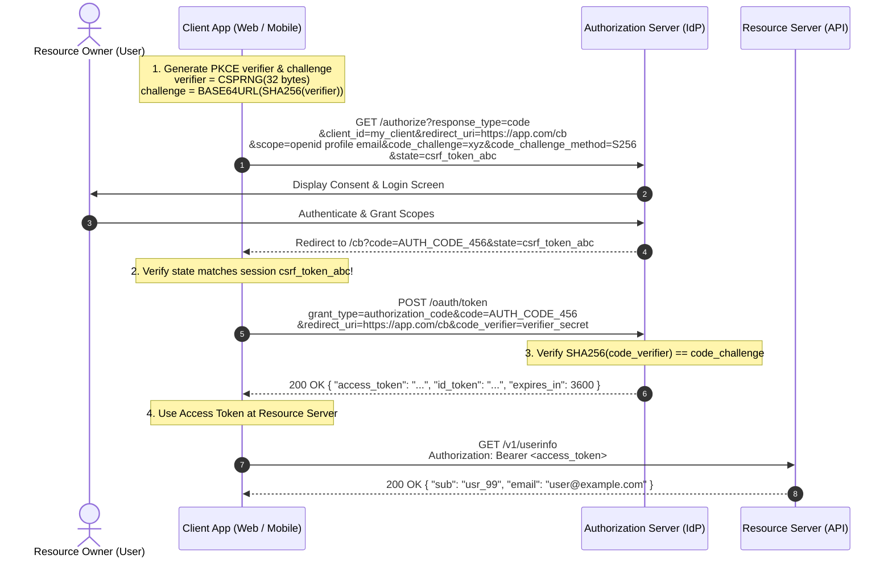
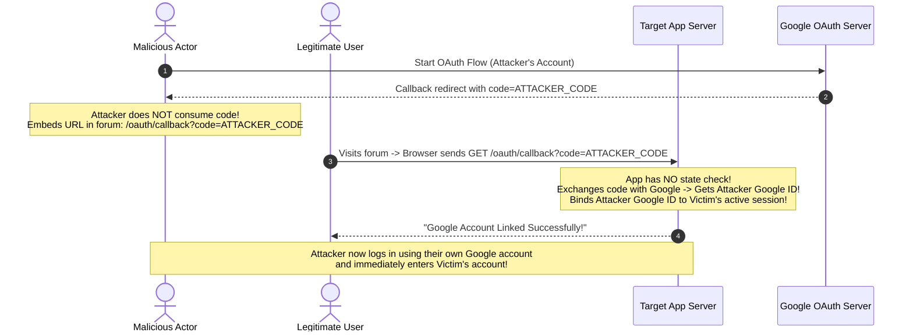

# OAuth 2.0 and OpenID Connect (OIDC): Delegated Auth & Identity Federation

> [!TIP]
> **The Golden Rule:** OAuth 2.0 is for **authorization** (delegated access to APIs); OpenID Connect (OIDC) is for **authentication** (proving who the user is). Never use an access token as proof of identity—use the OIDC `id_token`. Always enforce **PKCE (Proof Key for Code Exchange)** on authorization code flows, and always bind a cryptographically random `state` parameter to the user's session to eliminate Cross-Site Request Forgery (CSRF).

---

## 1. Visual Mental Model: The Authorization Code Flow with PKCE

The Authorization Code Grant with PKCE (RFC 7636) is the gold standard for web, single-page, and native applications. It prevents authorization code interception and injection attacks without requiring confidential client secrets in client environments.



---

## 2. OAuth 2.0 vs OIDC: Tokens & Roles Matrix

```
┌────────────────────────────────────────────────────────────────────────┐
│                        OAuth 2.0 vs OIDC                               │
├───────────────────────────────┬────────────────────────────────────────┤
│ OAuth 2.0 (Authorization)     │ OIDC (Authentication / Identity)       │
├───────────────────────────────┼────────────────────────────────────────┤
│ Issues Access Token           │ Issues ID Token (JWT)                  │
│ Audience: Resource Server API │ Audience: Client Application (App ID)  │
│ Purpose: "Open this door"     │ Purpose: "Here is who the user is"     │
│ Opaque or JWT                 │ Always a signed JWT                    │
└───────────────────────────────┴────────────────────────────────────────┘
```

| Grant Type | Best Suited For | Client Secret Required? | Security Requirements |
| :--- | :--- | :---: | :--- |
| **Auth Code + PKCE** | SPAs, Mobile Apps, Server-rendered Web Apps | Optional (Yes for confidential backends) | Mandatory `code_challenge`, `state`, strict redirect URI |
| **Client Credentials** | Machine-to-Machine (Daemon, Cron, Internal API) | Yes (Confidential) | Mutual TLS or secure KMS-backed client secrets |
| **Refresh Token** | Exchanging expired access tokens | Dependent on client type | Refresh Token Rotation, replay detection |
| **Implicit Grant** | **DEPRECATED & PROHIBITED** | No | Replaced by Auth Code + PKCE (RFC 8252) |
| **Password Grant** | **DEPRECATED & PROHIBITED** | Yes | Anti-pattern: forces app to handle raw user credentials |

---

## 3. Production War Story: The Missing State CSRF Account Hijack

### The Incident
A popular online project management platform allowed users to link their Google accounts for Single Sign-On (SSO). The engineering team implemented the standard OAuth 2.0 Authorization Code flow but left the optional `state` parameter blank.

An attacker initiated the "Link Google Account" flow using their own attacker Google account. When Google redirected to `https://app.com/oauth/callback?code=ATTACKER_CODE`, the attacker intercepted the network request and halted execution without consuming the code. 

The attacker then embedded that exact URL into an `` tag on an external hacker forum:
``

When authenticated users visited the forum, their browsers automatically fired the GET request. The application eagerly exchanged `ATTACKER_CODE` with Google and bound the attacker's Google identity to the victim's account. The attacker then clicked "Sign In with Google" and logged directly into the victim's private company dashboard.



### The Root Cause
1. **Omission of the `state` Parameter:** The application did not generate a random CSRF token tied to the user's session before redirecting to Google.
2. **Missing State Validation:** The callback endpoint assumed that any incoming authorization code belonged to the current user's session.

### The Verified Fix
- **Cryptographic State Parameter:** Always generate a random nonce (`secrets.token_urlsafe(32)`), store it in an encrypted `HttpOnly` cookie or session, and send it as the `state` parameter to the IdP.
- **Strict Verification:** In the callback handler, compare the returned `state` with the stored cookie. If they don't match, reject the request with `400 Bad Request` and invalidate the transaction.

---

## 4. Multi-Language Production Implementation

### Go: RFC 7636 PKCE Challenge Generation & Verification

```go
package main

import (
	"crypto/rand"
	"crypto/sha256"
	"encoding/base64"
	"errors"
	"fmt"
	"log/slog"
	"net/http"
	"net/url"
)

type PKCESession struct {
	Verifier  string
	Challenge string
	State     string
}

// GeneratePKCE creates a high-entropy verifier and its SHA-256 challenge
func GeneratePKCE() (*PKCESession, error) {
	// 1. Verifier: 32 random bytes (256 bits)
	verifierBytes := make([]byte, 32)
	if _, err := rand.Read(verifierBytes); err != nil {
		return nil, err
	}
	verifier := base64.RawURLEncoding.EncodeToString(verifierBytes)

	// 2. Challenge: BASE64URL-ENCODE(SHA256(verifier))
	hash := sha256.Sum256([]byte(verifier))
	challenge := base64.RawURLEncoding.EncodeToString(hash[:])

	// 3. Anti-CSRF State parameter
	stateBytes := make([]byte, 16)
	if _, err := rand.Read(stateBytes); err != nil {
		return nil, err
	}
	state := base64.RawURLEncoding.EncodeToString(stateBytes)

	return &PKCESession{
		Verifier:  verifier,
		Challenge: challenge,
		State:     state,
	}, nil
}

// BuildAuthorizationURL crafts the hardened OAuth2 redirect
func BuildAuthorizationURL(authEndpoint, clientID, redirectURI string, pkce *PKCESession) string {
	u, _ := url.Parse(authEndpoint)
	q := u.Query()
	q.Set("response_type", "code")
	q.Set("client_id", clientID)
	q.Set("redirect_uri", redirectURI)
	q.Set("scope", "openid profile email")
	q.Set("state", pkce.State)
	q.Set("code_challenge", pkce.Challenge)
	q.Set("code_challenge_method", "S256") // Enforce SHA-256 PKCE
	u.RawQuery = q.Encode()
	return u.String()
}

// VerifyPKCE validates that incoming verifier matches initial challenge
func VerifyPKCE(verifier, challenge string) bool {
	hash := sha256.Sum256([]byte(verifier))
	computedChallenge := base64.RawURLEncoding.EncodeToString(hash[:])
	return computedChallenge == challenge
}

func main() {
	pkce, err := GeneratePKCE()
	if err != nil {
		panic(err)
	}

	authURL := BuildAuthorizationURL(
		"https://accounts.google.com/o/oauth2/v2/auth",
		"my-client-id-123.apps.googleusercontent.com",
		"https://api.mycompany.com/v1/auth/callback",
		pkce,
	)

	fmt.Printf("Redirect user to: %s\n", authURL)
	fmt.Printf("Store verifier in session: %s\n", pkce.Verifier)
}
```

---

### Node.js (TypeScript): Secure OAuth2 Callback & Token Exchange

```typescript
import express, { Request, Response } from 'express';
import crypto from 'crypto';

const app = express();
app.use(express.json());

const CLIENT_ID = process.env.OAUTH_CLIENT_ID || 'client-app-id';
const CLIENT_SECRET = process.env.OAUTH_CLIENT_SECRET || 'client-secret-xyz';
const REDIRECT_URI = 'https://api.mycompany.com/v1/auth/callback';
const TOKEN_ENDPOINT = 'https://oauth2.googleapis.com/token';

// In production: Store sessions in Redis
interface SessionAuthFlow {
  state: string;
  codeVerifier: string;
}
const authFlows = new Map<string, SessionAuthFlow>();

// 1. Initiate OAuth Redirect
app.get('/v1/auth/login', (req: Request, res: Response) => {
  const codeVerifier = crypto.randomBytes(32).toString('base64url');
  const codeChallenge = crypto
    .createHash('sha256')
    .update(codeVerifier)
    .digest('base64url');
  
  const state = crypto.randomBytes(16).toString('base64url');

  // Store verifier and state keyed by session/cookie ID
  authFlows.set(state, { state, codeVerifier });

  const authUrl = new URL('https://accounts.google.com/o/oauth2/v2/auth');
  authUrl.searchParams.set('response_type', 'code');
  authUrl.searchParams.set('client_id', CLIENT_ID);
  authUrl.searchParams.set('redirect_uri', REDIRECT_URI);
  authUrl.searchParams.set('scope', 'openid profile email');
  authUrl.searchParams.set('state', state);
  authUrl.searchParams.set('code_challenge', codeChallenge);
  authUrl.searchParams.set('code_challenge_method', 'S256');

  res.redirect(authUrl.toString());
});

// 2. Hardened Callback Handler
app.get('/v1/auth/callback', async (req: Request, res: Response) => {
  const { code, state, error } = req.query;

  if (error) {
    return res.status(400).json({ error: `IdP error: ${error}` });
  }

  if (!state || typeof state !== 'string' || !authFlows.has(state)) {
    // CSRF mismatch or expired flow
    return res.status(400).json({ error: 'CSRF_STATE_MISMATCH: Request rejected' });
  }

  const flow = authFlows.get(state)!;
  authFlows.delete(state); // Single-use state

  try {
    // Exchange Authorization Code + PKCE code_verifier for Tokens
    const tokenResponse = await fetch(TOKEN_ENDPOINT, {
      method: 'POST',
      headers: { 'Content-Type': 'application/x-www-form-urlencoded' },
      body: new URLSearchParams({
        grant_type: 'authorization_code',
        client_id: CLIENT_ID,
        client_secret: CLIENT_SECRET,
        code: code as string,
        redirect_uri: REDIRECT_URI,
        code_verifier: flow.codeVerifier, // Proves code ownership
      }),
    });

    if (!tokenResponse.ok) {
      const errBody = await tokenResponse.text();
      return res.status(502).json({ error: 'Token exchange failed', details: errBody });
    }

    const tokens = await tokenResponse.json();
    // tokens contains: access_token, id_token, expires_in, token_type
    return res.json({
      status: 'authenticated',
      access_token: tokens.access_token,
      id_token: tokens.id_token,
    });
  } catch (err) {
    return res.status(500).json({ error: 'Internal OAuth exchange error' });
  }
});
```

---

### Python: FastAPI Machine-to-Machine Client Credentials Grant Flow

```python
import httpx
from datetime import datetime, timezone, timedelta
from fastapi import FastAPI, HTTPException, status
from pydantic import BaseModel

app = FastAPI(title="M2M Client Credentials Engine")

IDP_TOKEN_URL = "https://auth.company.com/oauth/token"
CLIENT_ID = "service_worker_billing"
CLIENT_SECRET = "super-secret-m2m-key-9988"

class CachedToken:
    access_token: str = ""
    expires_at: datetime = datetime.min.replace(tzinfo=timezone.utc)

token_cache = CachedToken()

async def get_machine_token() -> str:
    """Retrieve token from cache or fetch a new one via Client Credentials Grant."""
    now = datetime.now(timezone.utc)
    if token_cache.access_token and token_cache.expires_at > now + timedelta(seconds=60):
        return token_cache.access_token

    async with httpx.AsyncClient() as client:
        response = await client.post(
            IDP_TOKEN_URL,
            data={
                "grant_type": "client_credentials",
                "client_id": CLIENT_ID,
                "client_secret": CLIENT_SECRET,
                "scope": "orders:write payments:read",
            },
            headers={"Content-Type": "application/x-www-form-urlencoded"},
            timeout=5.0,
        )

        if response.status_code != 200:
            raise HTTPException(
                status_code=status.HTTP_502_BAD_GATEWAY,
                detail=f"IdP token minting failed: {response.text}",
            )

        data = response.json()
        token_cache.access_token = data["access_token"]
        expires_in = data.get("expires_in", 3600)
        token_cache.expires_at = now + timedelta(seconds=expires_in)

        return token_cache.access_token

@app.post("/v1/jobs/sync-payments")
async def trigger_sync():
    token = await get_machine_token()
    # Call downstream protected billing microservice using M2M token
    return {"status": "job_dispatched", "bearer_used": f"{token[:10]}..."}
```

---

## 5. Practical Hands-On Verification Matrix

Test standard OAuth 2.0 flows and parameter exchanges directly via terminal commands.

### Step 1: Simulate Client Credentials Token Exchange
```bash
curl.exe -i -X POST https://auth.company.com/oauth/token \
  -H "Content-Type: application/x-www-form-urlencoded" \
  -d "grant_type=client_credentials&client_id=service_worker_billing&client_secret=super-secret-m2m-key-9988&scope=orders:write"
```
**Expected Response:**
```http
HTTP/1.1 200 OK
Content-Type: application/json
Cache-Control: no-store
Pragma: no-cache

{
  "access_token": "eyJhbGciOiJSUzI1NiIsIn...",
  "token_type": "Bearer",
  "expires_in": 3600,
  "scope": "orders:write"
}
```

### Step 2: Validate State CSRF Rejection on Callback
```bash
# Querying callback with unseeded or forged state
curl.exe -i "http://localhost:3000/v1/auth/callback?code=mock_code_123&state=unrecognized_state"
```
**Expected Response:**
```http
HTTP/1.1 400 Bad Request
Content-Type: application/json

{"error":"CSRF_STATE_MISMATCH: Request rejected"}
```

---

## 6. Operational Verification Quizzes

<details>
<summary><b>Checkpoint 1: Access Token vs ID Token Verification Misuse</b></summary>

**Scenario:** A mobile application receives both an `id_token` and an `access_token` from Google. The mobile app sends the `access_token` to its backend API as proof of identity. The backend reads the subject ID directly from the unverified access token. What attack is this backend vulnerable to?

**Correct Analysis:** Access tokens minted by third-party IdPs are opaque or audience-targeted for the IdP's own APIs (e.g. `aud: "https://googleapis.com"`). An attacker can obtain a valid access token for their *own* app from the same IdP and replay it against your backend. Because your backend is not the intended audience (`aud`), it will accept the foreign access token. The client must present the `id_token` (signed JWT), and your backend must strictly verify that the `aud` claim matches *your* registered `client_id`.
</details>

<details>
<summary><b>Checkpoint 2: Why PKCE is Mandatory Even on Confidential Clients</b></summary>

**Scenario:** An engineering team argues that PKCE (RFC 7636) is only necessary for public mobile clients, and omits it from their server-rendered web application that stores a client secret in environment variables. What attack remains possible?

**Correct Analysis:** Authorization Code Injection. Even on confidential web applications, an attacker who intercepts an authorization code (via open redirectors or browser history) can inject that code into a victim's ongoing session. PKCE binds the initial browser redirect request directly to the server's token exchange step via the dynamic `code_verifier`. Without PKCE, the client secret only authenticates the application, not the specific user agent transaction.
</details>

<details>
<summary><b>Checkpoint 3: The Danger of Open Redirectors in OAuth Callback Configurations</b></summary>

**Scenario:** An identity provider configuration sets the allowed redirect URI to a broad regex pattern: `https://*.company.com/*`. What critical exploit does this permit?

**Correct Analysis:** Token / Code Exfiltration. If an attacker discovers an open redirector or an arbitrary file upload vulnerability on any staging or legacy subdomain (e.g., `https://dev-wiki.company.com/redirect?to=attacker.com`), they can set `redirect_uri` to that subdomain. The IdP redirects the user's authorization code to the vulnerable subdomain, which immediately bounces the code to the attacker's server. Redirect URIs must be exact, strict string matches (e.g., `https://app.company.com/v1/auth/callback`).
</details>

---

## Further Reading & Sources

- [RFC 6749: The OAuth 2.0 Authorization Framework](https://datatracker.ietf.org/doc/html/rfc6749)
- [RFC 7636: Proof Key for Code Exchange (PKCE)](https://datatracker.ietf.org/doc/html/rfc7636)
- [OpenID Connect Core 1.0 Specification](https://openid.net/specs/openid-connect-core-1_0.html)
- [OAuth 2.0 Security Best Current Practice](https://datatracker.ietf.org/doc/html/draft-ietf-oauth-security-topics)

---

## Next Steps

Advance to the next module:
[../04-api-keys-and-service-to-service-auth/README.md](../04-api-keys-and-service-to-service-auth/README.md)
Explore machine-to-machine authentication: high-entropy API key prefixes, salted hashing, mTLS (Mutual TLS), and AWS SigV4 request signing.
