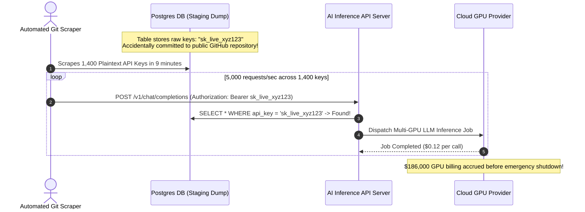

# API Keys & Service-to-Service Authentication: M2M Security

> [!TIP]
> **The Golden Rule:** Treat API keys like passwords: **never store plaintext keys in your database**. Structure keys with a human-readable prefix and high-entropy secret (`sk_live_...`), store only a salted cryptographic hash (`SHA-256`), verify incoming keys using **constant-time comparison** (`crypto.timingSafeEqual`), and always restrict keys with granular scopes and per-key rate limits.

---

## 1. Visual Mental Model: Prefixed API Key Lifecycle & Verification

Modern developer platforms (Stripe, GitHub, OpenAI) use structured, prefixed API keys. The prefix enables secret scanners (e.g. GitHub Secret Scanning) to detect leaked credentials immediately, while the hash prevents exposure if the database is dumped.

```mermaid
flowchart TD
    subgraph Minting ["Key Generation (Show Once)"]
        Gen["Generate: prefix + '_' + CSPRNG(32 bytes)\nExample: sk_live_8f3a...c1"] --> HashGen["Compute SHA-256 Hash:\nhash = SHA256(raw_key)"]
        HashGen --> StoreDB[("Store in DB:\n{ id, key_hash, prefix, last4, scopes, tenant_id }")]
        Gen --> ShowUser["Display Raw Key to User ONCE\n(Never logged, never recoverable)"]
    end

    subgraph Verification ["Request Authentication (Runtime)"]
        Req["Incoming Request: Authorization: Bearer sk_live_..."] --> Extract["Extract Key & Hash with SHA-256"]
        Extract --> DBLookup[("Lookup DB by SHA-256 Hash\nor Key Prefix Pivot")]
        DBLookup --> Found{"Key Exists & Active?"}
        Found -- No --> Err401["401 Unauthorized: Invalid API Key"]
        Found -- Yes --> TimeComp{"Constant-Time Hash Comparison\nsubtle.ConstantTimeCompare()"}
        TimeComp -- Mismatch --> Err401
        TimeComp -- Match --> ScopeCheck{"Has Required Scope & Rate Limit?"}
        ScopeCheck -- No --> Err403["403 Forbidden: Insufficient Key Scope"]
        ScopeCheck -- Yes --> InjectContext["Inject Machine Identity -> Context"]
    end

    classDef proc fill:#3b82f6,stroke:#1d4ed8,stroke-width:2px,color:#fff;
    classDef check fill:#f59e0b,stroke:#b45309,stroke-width:2px,color:#fff;
    classDef reject fill:#ef4444,stroke:#991b1b,stroke-width:2px,color:#fff;
    classDef success fill:#10b981,stroke:#047857,stroke-width:2px,color:#fff;

    class Gen,HashGen,ShowUser,Extract proc;
    class Found,TimeComp,ScopeCheck check;
    class Err401,Err403 reject;
    class InjectContext success;
```



---

## 2. Machine-to-Machine (M2M) Authentication Architecture Comparison

| Architecture | Best For | Transport Mechanism | Revocation & Scaling | Cryptographic Overhead |
| :--- | :--- | :--- | :--- | :--- |
| **Prefixed API Keys** | Public developer APIs, third-party webhooks | `Authorization: Bearer <key>` | Instant (delete DB row or Redis cache) | Minimal (SHA-256 hash lookup) |
| **OAuth 2.0 Client Credentials** | Complex enterprise integrations, federated services | Bearer JWT via `/oauth/token` | Dependent on token TTL or revocation lists | Moderate (Public/Private key signature verification) |
| **Mutual TLS (mTLS)** | Zero-Trust internal microservices, VPC-to-VPC | X.509 client certificate in TLS handshake | Certificate Revocation Lists (CRL) / OCSP | High (Bi-directional cryptographic handshake) |
| **HMAC Request Signatures** | Webhook delivery (Stripe/GitHub), AWS SigV4 | Header `X-Signature: sha256=...` | Secret rotation on account level | Moderate (HMAC computed over request body + timestamp) |

---

## 3. Production War Story: The Plaintext Key Leak & Cloud Resource Hijacking

### The Incident
An AI startups backend stored all customer API keys in plaintext in a PostgreSQL table named `api_credentials`. A junior engineer accidentally pushed a staging database dump to a public GitHub repository. 

Within 9 minutes, automated threat crawlers scraped the repository, extracted 1,400 active customer keys, and used them to call high-cost GPU inference endpoints continuously for 14 hours. The startup received a \$186,000 cloud bill before the accounts were frozen.



### The Root Cause
1. **Plaintext Storage:** Keys were stored as raw text, meaning a database leak directly compromised all customer access.
2. **Missing Rate Limits per Key:** The API layer lacked per-key velocity limiting and anomaly detection.
3. **Missing Secret Scanners Prefix:** Keys lacked recognizable prefixes like `sk_live_`, preventing GitHub from automatically catching and alerting on the leaked credentials.

### The Verified Fix
- **Prefix + Cryptographic Hash:** Structure all keys as `prefix_entropy` (e.g. `sk_live_2894...`). Compute `SHA-256(key)` and store only the hash.
- **Constant-Time Verification:** Query the database using the hash, never comparing raw strings.
- **Automated Revocation on Exposure:** Register the key format with GitHub Secret Scanning Partner Program so compromised keys are revoked the moment they appear in a commit.

---

## 4. Multi-Language Production Implementation

### Go: Prefixed API Key Minting & Constant-Time Hashing

```go
package main

import (
	"crypto/rand"
	"crypto/sha256"
	"crypto/subtle"
	"encoding/hex"
	"errors"
	"fmt"
	"log/slog"
	"net/http"
	"strings"
	"sync"
	"time"
)

type APIKeyMetadata struct {
	ID        string    `json:"id"`
	TenantID  string    `json:"tenant_id"`
	KeyHash   string    `json:"key_hash"`   // SHA-256 hex string
	Prefix    string    `json:"prefix"`     // e.g. "sk_live"
	Last4     string    `json:"last4"`      // e.g. "9a2f"
	Scopes    []string  `json:"scopes"`
	CreatedAt time.Time `json:"created_at"`
}

type APIKeyStore struct {
	mu   sync.RWMutex
	keys map[string]APIKeyMetadata // hash -> metadata
}

func NewAPIKeyStore() *APIKeyStore {
	return &APIKeyStore{keys: make(map[string]APIKeyMetadata)}
}

// GenerateAPIKey creates a structured key: prefix_entropy
func (s *APIKeyStore) GenerateAPIKey(prefix, tenantID string, scopes []string) (string, *APIKeyMetadata, error) {
	entropy := make([]byte, 24) // 192 bits of entropy
	if _, err := rand.Read(entropy); err != nil {
		return "", nil, err
	}
	rawSecret := hex.EncodeToString(entropy)
	rawKey := fmt.Sprintf("%s_%s", prefix, rawSecret)

	// Compute SHA-256 hash for secure storage
	hash := sha256.Sum256([]byte(rawKey))
	hashHex := hex.EncodeToString(hash[:])

	meta := APIKeyMetadata{
		ID:        fmt.Sprintf("key_%d", time.Now().UnixNano()),
		TenantID:  tenantID,
		KeyHash:   hashHex,
		Prefix:    prefix,
		Last4:     rawKey[len(rawKey)-4:],
		Scopes:    scopes,
		CreatedAt: time.Now().UTC(),
	}

	s.mu.Lock()
	s.keys[hashHex] = meta
	s.mu.Unlock()

	return rawKey, &meta, nil
}

// Authenticate verifies the raw key against the stored SHA-256 hash in constant time
func (s *APIKeyStore) Authenticate(rawKey string) (*APIKeyMetadata, error) {
	computedHash := sha256.Sum256([]byte(rawKey))
	computedHashHex := hex.EncodeToString(computedHash[:])

	s.mu.RLock()
	meta, exists := s.keys[computedHashHex]
	s.mu.RUnlock()

	if !exists {
		return nil, errors.New("invalid api key")
	}

	// Constant-time comparison prevents timing side-channel attacks
	if subtle.ConstantTimeCompare([]byte(meta.KeyHash), []byte(computedHashHex)) != 1 {
		return nil, errors.New("cryptographic mismatch")
	}

	return &meta, nil
}

func APIKeyMiddleware(store *APIKeyStore, next http.HandlerFunc) http.HandlerFunc {
	return func(w http.ResponseWriter, r *http.Request) {
		authHeader := r.Header.Get("Authorization")
		if authHeader == "" || !strings.HasPrefix(authHeader, "Bearer ") {
			w.Header().Set("WWW-Authenticate", `Bearer realm="api_key"`)
			http.Error(w, `{"error":"missing_api_key"}`, http.StatusUnauthorized)
			return
		}

		rawKey := strings.TrimPrefix(authHeader, "Bearer ")
		meta, err := store.Authenticate(rawKey)
		if err != nil {
			slog.Warn("API key rejected", "error", err)
			http.Error(w, `{"error":"unauthorized"}`, http.StatusUnauthorized)
			return
		}

		slog.Info("M2M Request authorized", "tenant_id", meta.TenantID, "key_id", meta.ID)
		next(w, r)
	}
}
```

---

### Node.js (TypeScript): High-Security API Key Verifier with Constant-Time Check

```typescript
import express, { Request, Response, NextFunction } from 'express';
import crypto from 'crypto';

interface APIKeyRecord {
  id: string;
  tenantId: string;
  keyHash: string; // SHA-256 hex
  scopes: string[];
}

const keyDatabase = new Map<string, APIKeyRecord>(); // keyHash -> Record

export function generateStructuredApiKey(prefix: 'sk_live' | 'sk_test', tenantId: string, scopes: string[]) {
  const secretBytes = crypto.randomBytes(24).toString('hex'); // 192 bits
  const rawKey = `${prefix}_${secretBytes}`;
  
  const keyHash = crypto.createHash('sha256').update(rawKey).digest('hex');
  
  const record: APIKeyRecord = {
    id: `key_${Date.now()}`,
    tenantId,
    keyHash,
    scopes,
  };

  keyDatabase.set(keyHash, record);
  return { rawKey, id: record.id, prefix, last4: rawKey.slice(-4) };
}

export function apiKeyAuthMiddleware(req: Request, res: Response, next: NextFunction) {
  const authHeader = req.headers['authorization'];
  if (!authHeader || !authHeader.startsWith('Bearer ')) {
    res.setHeader('WWW-Authenticate', 'Bearer error="invalid_token"');
    return res.status(401).json({ error: 'Missing or malformed API key' });
  }

  const rawKey = authHeader.substring(7);
  const presentedHash = crypto.createHash('sha256').update(rawKey).digest('hex');

  const record = keyDatabase.get(presentedHash);
  if (!record) {
    return res.status(401).json({ error: 'Invalid API key' });
  }

  // Constant-time buffer comparison eliminates timing attacks
  const bufA = Buffer.from(record.keyHash, 'hex');
  const bufB = Buffer.from(presentedHash, 'hex');
  if (bufA.length !== bufB.length || !crypto.timingSafeEqual(bufA, bufB)) {
    return res.status(401).json({ error: 'Authentication failed' });
  }

  (req as any).tenant = { id: record.tenantId, scopes: record.scopes };
  next();
}
```

---

### Python: FastAPI API Key Verification with Hashing & Scope Checking

```python
import hashlib
import hmac
import secrets
from typing import Annotated
from fastapi import FastAPI, Depends, HTTPException, Security, status
from fastapi.security import APIKeyHeader
from pydantic import BaseModel

app = FastAPI(title="M2M API Key Service")
api_key_header = APIKeyHeader(name="X-API-Key", auto_error=False)

# Mock hashed database: hash -> record
db_keys: dict[str, dict] = {}

def mint_api_key(tenant_id: str, scopes: list[str]) -> tuple[str, dict]:
    raw_secret = secrets.token_hex(24)
    raw_key = f"sk_live_{raw_secret}"
    key_hash = hashlib.sha256(raw_key.encode()).hexdigest()
    
    record = {
        "tenant_id": tenant_id,
        "key_hash": key_hash,
        "scopes": scopes,
        "last4": raw_key[-4:],
    }
    db_keys[key_hash] = record
    return raw_key, record

# Pre-populate a test key
test_key, _ = mint_api_key("tenant_acme_corp", ["orders:write", "analytics:read"])
print(f"Generated test key: {test_key}")

async def verify_api_key(
    key: Annotated[str | None, Security(api_key_header)]
) -> dict:
    if not key:
        raise HTTPException(
            status_code=status.HTTP_401_UNAUTHORIZED,
            detail="Missing X-API-Key header",
        )

    presented_hash = hashlib.sha256(key.encode()).hexdigest()
    record = db_keys.get(presented_hash)
    if not record:
        raise HTTPException(
            status_code=status.HTTP_401_UNAUTHORIZED,
            detail="Invalid API key",
        )

    # Constant time comparison using hmac.compare_digest
    if not hmac.compare_digest(record["key_hash"], presented_hash):
        raise HTTPException(
            status_code=status.HTTP_401_UNAUTHORIZED,
            detail="Authentication failed",
        )

    return record

@app.post("/v1/orders")
async def create_order(client: Annotated[dict, Depends(verify_api_key)]):
    if "orders:write" not in client["scopes"]:
        raise HTTPException(
            status_code=status.HTTP_403_FORBIDDEN,
            detail="API key lacks 'orders:write' scope",
        )
    return {"status": "created", "tenant": client["tenant_id"]}
```

---

## 5. Practical Hands-On Verification Matrix

Test API key authentication, timing safety, and scope enforcement via terminal commands.

### Step 1: Valid Authenticated Request with Header
```bash
curl.exe -i -X POST http://localhost:8000/v1/orders \
  -H "X-API-Key: sk_live_your_generated_secret_here" \
  -H "Content-Type: application/json" \
  -d '{"item": "book", "qty": 1}'
```
**Expected Response:**
```http
HTTP/1.1 200 OK
Content-Type: application/json

{"status":"created","tenant":"tenant_acme_corp"}
```

### Step 2: Unauthenticated Request (Missing Header)
```bash
curl.exe -i -X POST http://localhost:8000/v1/orders \
  -H "Content-Type: application/json" \
  -d '{"item": "book", "qty": 1}'
```
**Expected Response:**
```http
HTTP/1.1 401 Unauthorized
Content-Type: application/json

{"detail":"Missing X-API-Key header"}
```

### Step 3: Forged or Corrupted API Key
```bash
curl.exe -i -X POST http://localhost:8000/v1/orders \
  -H "X-API-Key: sk_live_invalid_corrupted_key"
```
**Expected Response:**
```http
HTTP/1.1 401 Unauthorized
Content-Type: application/json

{"detail":"Invalid API key"}
```

---

## 6. Operational Verification Quizzes

<details>
<summary><b>Checkpoint 1: Why SHA-256 is Acceptable for API Keys but Forbidden for Passwords</b></summary>

**Scenario:** A security auditor notes that an API service hashes API keys using fast `SHA-256`, but demands that user passwords use slow algorithms like `Argon2id` or `bcrypt`. Why is fast SHA-256 secure for API keys but insecure for human passwords?

**Correct Analysis:** Entropy differences. Human passwords have low entropy (typically 20–40 bits) and follow predictable grammatical patterns; an attacker with a GPU cluster can compute billions of SHA-256 hashes per second to brute-force or dictionary-attack human passwords. A machine-generated API key has $\ge 192$ bits of pure cryptographic entropy ($2^{192}$ possibilities). Brute-forcing a 192-bit key is mathematically impossible even with unlimited GPU hashing power, so slow memory-hard stretching is unnecessary.
</details>

<details>
<summary><b>Checkpoint 2: The Timing Attack Vulnerability in String Comparisons</b></summary>

**Scenario:** A developer verifies an API key using standard equality: `if presented_key == stored_key`. How can an external attacker determine the valid key character-by-character over a network?

**Correct Analysis:** Standard string equality operators (`==`) compare bytes sequentially and terminate at the first non-matching byte ($O(K)$ early exit). An attacker sending thousands of requests can measure microsecond differences in server response latency. A request whose first character matches takes a fraction of a nanosecond longer than one whose first character fails. Over millions of samples, an attacker can reconstruct the entire secret. Always use `subtle.ConstantTimeCompare` or `hmac.compare_digest`.
</details>

<details>
<summary><b>Checkpoint 3: Query Parameter Key Leakage</b></summary>

**Scenario:** A third-party client asks to pass their API key in the URL query string (`GET /v1/data?api_key=sk_live_123`) to simplify webhook integration. Why must you reject this request?

**Correct Analysis:** Full URLs including query strings are routinely written to web server access logs, load balancer access logs (AWS CloudWatch, Nginx), CDN proxies, and browser history. Furthermore, if the client navigates to an external link, the entire URL is passed in the `Referer` HTTP request header to untrusted third-party servers. API keys must always travel in HTTP request headers (`Authorization` or `X-API-Key`).
</details>

---

## Download Printable Reference & Diagrams

Download these notes as a printable PDF, with every diagram and interview questions: [SD-C-015: API Authentication](https://backendroadmap.com/notes/system-design/SD-C-015.pdf). Each section in one file: [Phase 2, APIs (PDF)](https://backendroadmap.com/notes/system-design/Phase2_APIs_Notes.pdf).

---

## Further Reading & Sources

- [GitHub Secret Scanning Partner Program](https://docs.github.com/en/code-security/secret-scanning/secret-scanning-partner-program)
- [Stripe: How We Built API Keys](https://stripe.com/blog/api-keys)
- [OWASP REST Security Cheat Sheet](https://cheatsheetseries.owasp.org/cheatsheets/REST_Security_Cheat_Sheet.html)

---

## Next Steps

Advance to the next module:
[../05-mfa-and-password-security/README.md](../05-mfa-and-password-security/README.md)
Explore password hashing standards (Argon2id, bcrypt, scrypt), salt generation, and Multi-Factor Authentication (TOTP RFC 6238 and WebAuthn / FIDO2).
