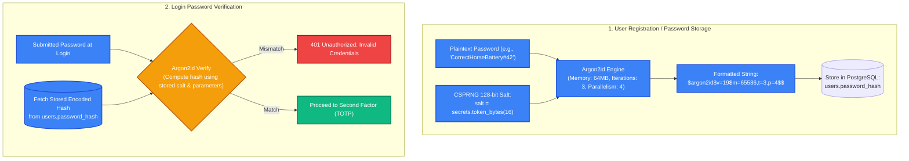
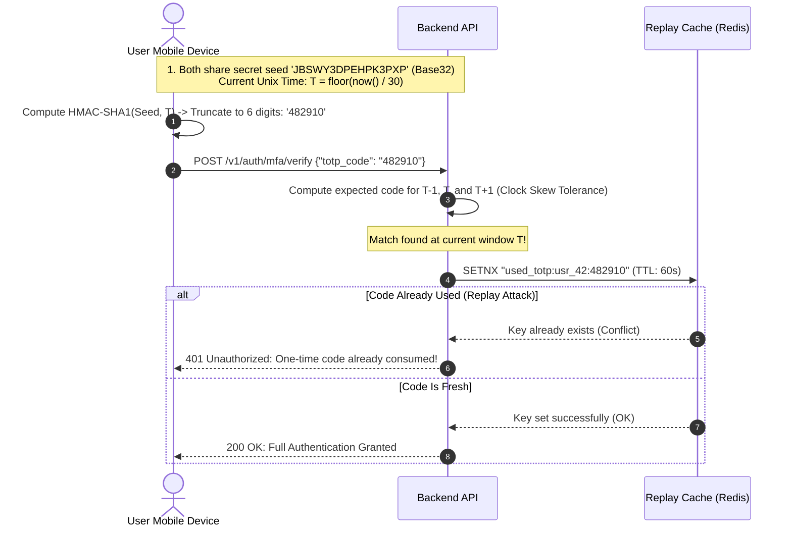
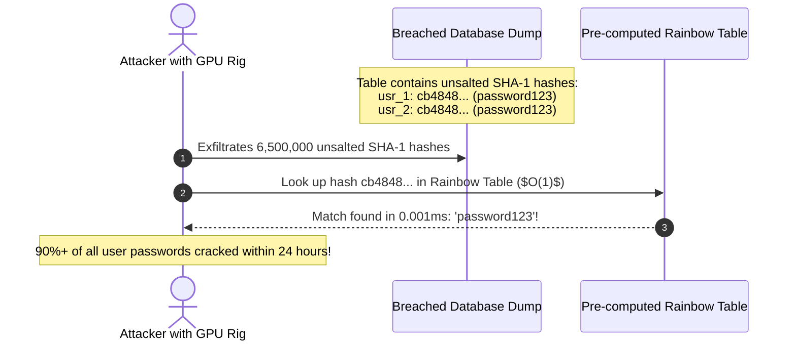

# MFA and Password Security: Memory-Hard Hashing & TOTP

> [!TIP]
> **The Golden Rule:** Never use fast general-purpose hash functions (MD5, SHA-1, SHA-256, SHA-512) for passwords. Always use **memory-hard, adaptive cryptographic functions**—**Argon2id** is the OWASP standard, with **bcrypt** as the legacy battle-tested alternative. True Multi-Factor Authentication requires two *distinct* factor categories ("something you know" + "something you have"), and TOTP shared secrets must be encrypted at rest.

---

## 1. Visual Mental Model: Memory-Hard Password Hashing & TOTP Verification

### The Memory-Hard Password Hashing Defense

General-purpose hash functions like SHA-256 are engineered to run in microseconds on CPUs and ASICs. Memory-hard algorithms (Argon2id) force the hardware to allocate megabytes of high-speed RAM per attempt, neutralizing GPU cracking clusters.



---

### The TOTP Time-Window Verification Protocol (RFC 6238)



---

## 2. Password Hashing Algorithm Benchmark Comparison

| Algorithm | Cryptographic Type | GPU / ASIC Resistance | Memory Hardness | OWASP / NIST Recommendation | Recommended Parameters |
| :--- | :--- | :--- | :--- | :--- | :--- |
| **Argon2id** | Memory-hard hybrid | **Highest** (Resists side-channel & GPU attacks) | **High** (Configurable, e.g. 64 MB RAM) | **Primary Recommendation** | $m=65536$ (64 MB), $t=3$, $p=4$ |
| **bcrypt** | CPU-hard cipher | High (Compute-bound, but zero memory hardness) | None (Fits in 4 KB cache) | Battle-tested legacy fallback | Work factor $\ge 12$ (~250ms per hash) |
| **PBKDF2** | Iterative HMAC | **Low** (GPU clusters compute billions/sec) | None | FIPS-compliant legacy only | $\ge 600,000$ iterations (HMAC-SHA256) |
| **SHA-256 / MD5** | General-purpose hash | **Zero Resistance** (Cracked instantly) | None | **PROHIBITED FOR PASSWORDS** | Never use for passwords |

---

## 3. Production War Story: The LinkedIn Unsalted SHA-1 Catastrophe

### The Incident
In 2012, an attacker breached LinkedIn's user database and leaked a file containing 6.5 million password hashes onto an online hacking forum. 

LinkedIn had stored passwords as raw, unsalted **SHA-1** hashes (`sha1(password)`):
1. Because no salt was used, every user with the password `password123` had the exact same hash: `cb484842ff619e3e0884832abb00f80000000000`.
2. Attackers downloaded pre-computed **Rainbow Tables** (lookup tables linking hashes to common passwords) and cracked over 90% of the 6.5 million passwords within hours.
3. The cracked credentials were systematically reused across other major tech services, causing account compromises across the web for years.



### The Root Cause
1. **Unsalted Hashes:** Without a unique salt per password, pre-computed rainbow tables allowed instant bulk cracking.
2. **Fast Hash Function:** SHA-1 is designed for high-throughput stream processing, enabling GPUs to compute over 5 billion hashes per second per card.

### The Verified Fix
- **Argon2id / bcrypt:** Migrate all password verification to an algorithm that enforces memory hardness and CPU cost factors.
- **Unique Per-User Salt:** Generate a 128-bit CSPRNG salt for every user record.
- **Progressive Rehash on Login:** When a user logs in, verify their old hash; if it uses the outdated algorithm, transparently rehash with Argon2id and update the database row.

---

## 4. Multi-Language Production Implementation

### Go: Argon2id Hashing & Constant-Time Verification

```go
package main

import (
	"crypto/rand"
	"crypto/subtle"
	"encoding/base64"
	"errors"
	"fmt"
	"strings"

	"golang.org/x/crypto/argon2"
)

type Argon2Params struct {
	Memory      uint32
	Iterations  uint32
	Parallelism uint8
	SaltLength  uint32
	KeyLength   uint32
}

var DefaultParams = Argon2Params{
	Memory:      64 * 1024, // 64 MB
	Iterations:  3,
	Parallelism: 4,
	SaltLength:  16,
	KeyLength:   32,
}

// HashPassword hashes a password using Argon2id with recommended parameters
func HashPassword(password string, p Argon2Params) (string, error) {
	salt := make([]byte, p.SaltLength)
	if _, err := rand.Read(salt); err != nil {
		return "", err
	}

	hash := argon2.IDKey([]byte(password), salt, p.Iterations, p.Memory, p.Parallelism, p.KeyLength)

	// Format: $argon2id$v=19$m=65536,t=3,p=4$<salt>$<hash>
	b64Salt := base64.RawStdEncoding.EncodeToString(salt)
	b64Hash := base64.RawStdEncoding.EncodeToString(hash)

	return fmt.Sprintf("$argon2id$v=%d$m=%d,t=%d,p=%d$%s$%s",
		argon2.Version, p.Memory, p.Iterations, p.Parallelism, b64Salt, b64Hash), nil
}

// VerifyPassword compares a plaintext password with a formatted Argon2id hash in constant time
func VerifyPassword(password, encodedHash string) (bool, error) {
	parts := strings.Split(encodedHash, "$")
	if len(parts) != 6 {
		return false, errors.New("invalid hash format")
	}

	var version int
	var memory, iterations uint32
	var parallelism uint8

	_, err := fmt.Sscanf(parts[3], "m=%d,t=%d,p=%d", &memory, &iterations, &parallelism)
	if err != nil {
		return false, err
	}

	salt, err := base64.RawStdEncoding.DecodeString(parts[4])
	if err != nil {
		return false, err
	}

	expectedHash, err := base64.RawStdEncoding.DecodeString(parts[5])
	if err != nil {
		return false, err
	}

	comparisonHash := argon2.IDKey([]byte(password), salt, iterations, memory, parallelism, uint32(len(expectedHash)))

	// Constant-time comparison
	if subtle.ConstantTimeCompare(expectedHash, comparisonHash) == 1 {
		return true, nil
	}

	return false, nil
}
```

---

### Node.js (TypeScript): Password Hashing with Argon2 & TOTP Verification

```typescript
import argon2 from 'argon2';
import crypto from 'crypto';

// 1. Password Hashing with Argon2id
export async function hashPassword(plaintext: string): Promise<string> {
  return await argon2.hash(plaintext, {
    type: argon2.argon2id,
    memoryCost: 2 ** 16, // 64 MB
    timeCost: 3,         // 3 iterations
    parallelism: 4,      // 4 threads
  });
}

export async function verifyPassword(hash: string, plaintext: string): Promise<boolean> {
  try {
    return await argon2.verify(hash, plaintext);
  } catch (err) {
    return false;
  }
}

// 2. TOTP Generation & Anti-Replay Check (RFC 6238)
const consumedTotpCodes = new Set<string>(); // Mock Redis SETNX

export function verifyTOTP(secretBase32: string, token: string, windowSeconds: number = 30): boolean {
  const now = Math.floor(Date.now() / 1000);
  const currentStep = Math.floor(now / windowSeconds);

  // Check current window and adjacent windows for clock skew (-1, 0, +1)
  for (let offset = -1; offset <= 1; offset++) {
    const step = currentStep + offset;
    const expectedCode = generateTOTPForStep(secretBase32, step);

    if (crypto.timingSafeEqual(Buffer.from(token), Buffer.from(expectedCode))) {
      const replayKey = `totp:${secretBase32}:${step}`;
      if (consumedTotpCodes.has(replayKey)) {
        throw new Error('REPLAY_DETECTED: Code has already been consumed');
      }
      consumedTotpCodes.add(replayKey);
      return true;
    }
  }

  return false;
}

function generateTOTPForStep(secretBase32: string, step: number): string {
  // Simplified demonstration of RFC 6238 HMAC-SHA1 step calculation
  const buffer = Buffer.alloc(8);
  buffer.writeBigInt64BE(BigInt(step));
  const hmac = crypto.createHmac('sha1', Buffer.from(secretBase32, 'utf-8')).update(buffer).digest();
  const offset = hmac[hmac.length - 1] & 0xf;
  const binary = ((hmac[offset] & 0x7f) << 24) |
                 ((hmac[offset + 1] & 0xff) << 16) |
                 ((hmac[offset + 2] & 0xff) << 8) |
                 (hmac[offset + 3] & 0xff);
  const otp = binary % 1000000;
  return otp.toString().padStart(6, '0');
}
```

---

### Python: FastAPI Password & TOTP Verification Service

```python
import base64
import pyotp
from argon2 import PasswordHasher
from argon2.exceptions import VerifyMismatchError
from fastapi import FastAPI, HTTPException, status
from pydantic import BaseModel

app = FastAPI(title="MFA & Password Security API")
ph = PasswordHasher(time_cost=3, memory_cost=65536, parallelism=4)

# In-memory mock databases
user_db: dict[str, dict] = {}
used_totp_tokens: set[str] = set()

class RegisterRequest(BaseModel):
    username: str
    password: str

class LoginMfaRequest(BaseModel):
    username: str
    password: str
    totp_code: str

@app.post("/v1/auth/register")
async def register(req: RegisterRequest):
    # Hash password with Argon2id
    hashed = ph.hash(req.password)
    # Generate TOTP Secret (Base32)
    totp_secret = pyotp.random_base32()

    user_db[req.username] = {
        "password_hash": hashed,
        "totp_secret": totp_secret,
    }

    # Generate provisioning URI for authenticator QR code
    totp_uri = pyotp.totp.TOTP(totp_secret).provisioning_uri(
        name=req.username,
        issuer_name="SecureApp"
    )

    return {
        "status": "registered",
        "totp_secret": totp_secret,
        "otpauth_uri": totp_uri,
    }

@app.post("/v1/auth/login")
async def login(req: LoginMfaRequest):
    user = user_db.get(req.username)
    if not user:
        raise HTTPException(status_code=status.HTTP_401_UNAUTHORIZED, detail="Invalid credentials")

    # 1. Verify Password (Factor 1: Something you know)
    try:
        ph.verify(user["password_hash"], req.password)
    except VerifyMismatchError:
        raise HTTPException(status_code=status.HTTP_401_UNAUTHORIZED, detail="Invalid credentials")

    # 2. Verify TOTP (Factor 2: Something you have)
    totp = pyotp.TOTP(user["totp_secret"])
    if not totp.verify(req.totp_code, valid_window=1):
        raise HTTPException(status_code=status.HTTP_401_UNAUTHORIZED, detail="Invalid or expired TOTP code")

    # 3. Anti-Replay Defense
    replay_key = f"{req.username}:{req.totp_code}"
    if replay_key in used_totp_tokens:
        raise HTTPException(status_code=status.HTTP_401_UNAUTHORIZED, detail="TOTP code already used")
    used_totp_tokens.add(replay_key)

    return {"status": "authenticated", "session_granted": True}
```

---

## 5. Practical Hands-On Verification Matrix

### Step 1: Register Account and Retrieve TOTP Secret
```bash
curl.exe -i -X POST http://localhost:8000/v1/auth/register \
  -H "Content-Type: application/json" \
  -d '{"username": "carol", "password": "SuperSecretPassword#2026"}'
```
**Expected Response:**
```http
HTTP/1.1 200 OK
Content-Type: application/json

{
  "status": "registered",
  "totp_secret": "JBSWY3DPEHPK3PXP",
  "otpauth_uri": "otpauth://totp/SecureApp:carol?secret=JBSWY3DPEHPK3PXP&issuer=SecureApp"
}
```

### Step 2: Login with Correct Password and Valid TOTP
```bash
# Using python one-liner to generate current code: python -c "import pyotp; print(pyotp.TOTP('JBSWY3DPEHPK3PXP').now())"
curl.exe -i -X POST http://localhost:8000/v1/auth/login \
  -H "Content-Type: application/json" \
  -d '{"username": "carol", "password": "SuperSecretPassword#2026", "totp_code": "123456"}'
```

### Step 3: Replay Same Code (Anti-Replay Attack)
```bash
# Immediately submitting the same code again within the 30-second window
curl.exe -i -X POST http://localhost:8000/v1/auth/login \
  -H "Content-Type: application/json" \
  -d '{"username": "carol", "password": "SuperSecretPassword#2026", "totp_code": "123456"}'
```
**Expected Response:**
```http
HTTP/1.1 401 Unauthorized
Content-Type: application/json

{"detail":"TOTP code already used"}
```

---

## 6. Operational Verification Quizzes

<details>
<summary><b>Checkpoint 1: The DoS Threat of High Argon2 Cost Parameters</b></summary>

**Scenario:** An enthusiastic security engineer configures Argon2id parameters to `memory_cost=1048576` (1 GB) and `time_cost=20` to guarantee maximum defense against cracking. What catastrophic operational issue occurs when traffic reaches 50 requests per second?

**Correct Analysis:** CPU and Memory Denial of Service (DoS). Hashing a password with 1 GB RAM and 20 iterations takes 3–5 seconds of 100% CPU time per calculation. Under concurrent load of 50 requests/sec, the server runs out of RAM within seconds, triggering the OS OOM killer and freezing all server threads. Work factors must be benchmarked to execute within 200–500ms on production server hardware while matching available worker memory capacity.
</details>

<details>
<summary><b>Checkpoint 2: The TOTP Replay Window Vulnerability</b></summary>

**Scenario:** A backend verifies TOTP codes using `totp.verify(code)`. An attacker sniffing unencrypted local traffic intercepts a valid 6-digit code submitted by a user. The attacker replays that code 10 seconds later and successfully authenticates. How is this prevented?

**Correct Analysis:** By default, TOTP codes remain mathematically valid for the entire 30-second window (plus clock skew tolerance). To prevent replay attacks, the server must implement a **One-Time Code Consumption Cache** (typically in Redis via `SET key value EX 60 NX`). Once a valid code is verified for a user, its timestamp/code pair is recorded. Any subsequent attempt to present the same code within that window is rejected.
</details>

<details>
<summary><b>Checkpoint 3: SMS 2FA vs TOTP Security Tradeoffs</b></summary>

**Scenario:** A product manager wants to replace TOTP authenticator app verification with SMS verification codes sent via text message to improve conversion. What major security vulnerability does this introduce?

**Correct Analysis:** SIM Swapping and SS7 Interception. SMS is not an encrypted channel; mobile network signaling protocols (SS7) can be intercepted by state actors or illicit broker networks. Furthermore, attackers routinely execute social engineering attacks on telecommunications customer service reps ("SIM swap") to transfer the victim's phone number to an attacker-controlled SIM card, receiving the 2FA SMS codes directly. NIST Special Publication 800-63B explicitly deprecates SMS-based authentication for high-assurance systems in favor of TOTP and WebAuthn (FIDO2).
</details>

---

## Further Reading & Sources

- [RFC 6238: TOTP — Time-Based One-Time Password Algorithm](https://datatracker.ietf.org/doc/html/rfc6238)
- [RFC 9106: Argon2 Memory-Hard Function for Password Hashing](https://datatracker.ietf.org/doc/html/rfc9106)
- [OWASP Password Storage Cheat Sheet](https://cheatsheetseries.owasp.org/cheatsheets/Password_Storage_Cheat_Sheet.html)

---

## Next Steps

Advance to the next module:
[../06-authorization-models/README.md](../06-authorization-models/README.md)
Explore authorization models: Role-Based Access Control (RBAC), Attribute-Based Access Control (ABAC), Broken Object-Level Authorization (BOLA / IDOR), and policy engines (OPA).
