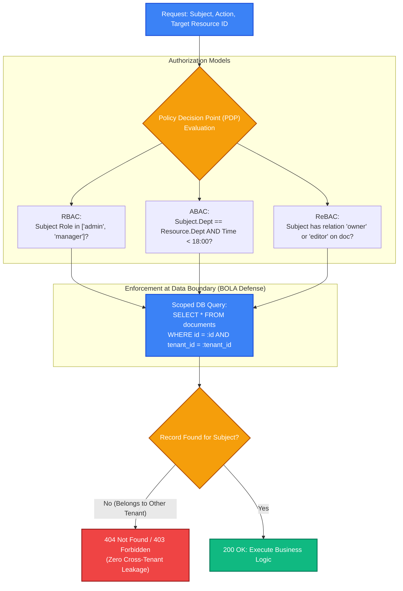
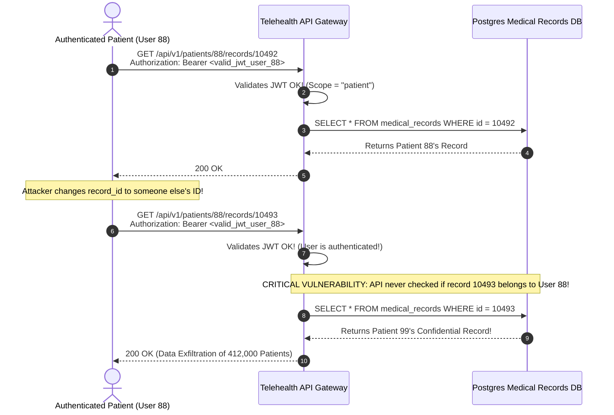

# Authorization Models: RBAC, ABAC, ReBAC & BOLA/IDOR Defense

> [!TIP]
> **The Golden Rule:** Authentication confirms identity; Authorization verifies permission. **Deny by default.** Never rely solely on high-level role checks (`is_admin`) when accessing specific data rows: always enforce **Object-Level Authorization** (`WHERE id = :id AND tenant_id = :tenant_id`) to permanently eliminate Broken Object-Level Authorization (BOLA / IDOR)—the #1 threat on the OWASP API Security Top 10.

---

## 1. Visual Mental Model: The Authorization Decision Function

Every authorization system implements a pure decision function:
$$\text{Decision} = f(\text{Subject}, \text{Action}, \text{Resource}, \text{Environment}) \longrightarrow \{\text{ALLOW}, \text{DENY}\}$$



---

## 2. Authorization Models Architectural Matrix

| Model | Decision Basis | Typical Rules | Scalability / Complexity | Best Use Case |
| :--- | :--- | :--- | :--- | :--- |
| **RBAC** (Role-Based) | User's static assigned role (`admin`, `member`, `guest`) | `if user.has_role('finance_admin')` | Simple, fast, but suffers from "role explosion" | Internal tools, SaaS admin panels, standard CRUD |
| **ABAC** (Attribute-Based) | Attributes of Subject, Resource, Action, & Environment | `if user.clearance >= doc.classification AND ip_in_vpn` | Highly expressive, complex policy engine (OPA / Rego) | Banking, healthcare, zero-trust enterprise compliance |
| **ReBAC** (Relationship-Based) | Graph of relationships between subjects and objects | `if user is member_of(org) which owns(folder) which contains(doc)` | Graph traversals, Zanzibar / OpenFGA architecture | Google Docs, GitHub permissions, Notion-style workspaces |

---

## 3. Production War Story: The BOLA / IDOR Medical Record Exfiltration

### The Incident
A telehealth portal provided an endpoint for patients to download their lab results and prescription histories:
`GET /api/v1/patients/{patient_id}/records/{record_id}`

The backend implemented strict JWT authentication. When a user logged in, the handler verified that the JWT was valid and had the scope `"patient"`. However, the handler executed the following raw SQL query:
`SELECT * FROM medical_records WHERE id = record_id;`

A patient noticed that their `record_id` was an auto-incrementing integer (`record_id=10492`). By writing a 5-line bash loop incrementing the integer from `1` to `500000`, the patient downloaded the confidential medical records, diagnoses, and Social Security numbers of **412,000 other patients** across the entire hospital system.



### The Root Cause
1. **Broken Object-Level Authorization (BOLA):** The endpoint verified that the user was *logged in*, but never verified that the logged-in user had permission to read the *specific requested object*.
2. **Unscoped Database Queries:** The database query omitted tenant and user ownership constraints.

### The Verified Fix
- **Enforce Scoped Ownership in Data Layer:** Never fetch an object by primary key alone. Always filter by the authenticated user's ID or tenant ID:
  `SELECT * FROM medical_records WHERE id = :record_id AND patient_id = :authenticated_user_id;`
- **Return 404 on Missing or Unauthorized Records:** If the query returns 0 rows, emit `404 Not Found` rather than `403 Forbidden` to prevent object existence enumeration.

---

## 4. Multi-Language Production Implementation

### Go: Context-Driven Ownership Scoping & RBAC Middleware

```go
package main

import (
	"context"
	"database/sql"
	"encoding/json"
	"errors"
	"log/slog"
	"net/http"
	"strings"
)

type UserContextKey struct{}

type AuthUser struct {
	ID       string `json:"id"`
	TenantID string `json:"tenant_id"`
	Role     string `json:"role"`
}

type Document struct {
	ID       string `json:"id"`
	TenantID string `json:"tenant_id"`
	OwnerID  string `json:"owner_id"`
	Content  string `json:"content"`
}

var ErrForbidden = errors.New("insufficient permissions")
var ErrNotFound = errors.New("resource not found")

type DocumentRepository struct {
	db *sql.DB
}

// GetScopedDocument strictly prevents BOLA by scoping queries to tenant and ownership
func (r *DocumentRepository) GetScopedDocument(ctx context.Context, docID string, user AuthUser) (*Document, error) {
	var query string
	var args []any

	if user.Role == "admin" {
		// Admin can access any document within their tenant
		query = "SELECT id, tenant_id, owner_id, content FROM documents WHERE id = $1 AND tenant_id = $2"
		args = []any{docID, user.TenantID}
	} else {
		// Regular user can ONLY access documents they personally own
		query = "SELECT id, tenant_id, owner_id, content FROM documents WHERE id = $1 AND tenant_id = $2 AND owner_id = $3"
		args = []any{docID, user.TenantID, user.ID}
	}

	row := r.db.QueryRowContext(ctx, query, args...)
	var doc Document
	err := row.Scan(&doc.ID, &doc.TenantID, &doc.OwnerID, &doc.Content)
	if errors.Is(err, sql.ErrNoRows) {
		// Return 404 to avoid leaking existence
		return nil, ErrNotFound
	}
	if err != nil {
		return nil, err
	}

	return &doc, nil
}

func DocumentHandler(repo *DocumentRepository) http.HandlerFunc {
	return func(w http.ResponseWriter, r *http.Request) {
		user, ok := r.Context().Value(UserContextKey{}).(AuthUser)
		if !ok {
			http.Error(w, `{"error":"unauthenticated"}`, http.StatusUnauthorized)
			return
		}

		docID := strings.TrimPrefix(r.URL.Path, "/v1/documents/")
		doc, err := repo.GetScopedDocument(r.Context(), docID, user)
		if errors.Is(err, ErrNotFound) {
			http.Error(w, `{"error":"not_found"}`, http.StatusNotFound)
			return
		}
		if err != nil {
			http.Error(w, `{"error":"server_error"}`, http.StatusInternalServerError)
			return
		}

		w.Header().Set("Content-Type", "application/json")
		_ = json.NewEncoder(w).Encode(doc)
	}
}
```

---

### Node.js (TypeScript): Attribute-Based Access Control (ABAC) & BOLA Defense

```typescript
import express, { Request, Response, NextFunction } from 'express';

export interface UserPrincipal {
  id: string;
  tenantId: string;
  department: string;
  clearanceLevel: number;
}

export interface MedicalRecord {
  id: string;
  tenantId: string;
  patientId: string;
  classificationLevel: number;
  data: string;
}

const mockDatabase = new Map<string, MedicalRecord>([
  ['rec_1', { id: 'rec_1', tenantId: 'tenant_nyc', patientId: 'usr_pat_1', classificationLevel: 2, data: 'Blood test normal' }],
  ['rec_2', { id: 'rec_2', tenantId: 'tenant_sfo', patientId: 'usr_pat_2', classificationLevel: 4, data: 'Confidential genetics' }],
]);

const app = express();
app.use(express.json());

// ABAC Policy Evaluator
function evaluatePolicy(user: UserPrincipal, record: MedicalRecord, action: 'read' | 'write'): boolean {
  // Rule 1: Multi-tenant boundary
  if (user.tenantId !== record.tenantId) return false;

  // Rule 2: Object ownership or high clearance
  const isOwner = user.id === record.patientId;
  const hasClearance = user.clearanceLevel >= record.classificationLevel;

  if (action === 'read') {
    return isOwner || hasClearance;
  }
  return isOwner; // Only owner can modify
}

app.get('/v1/records/:recordId', (req: Request, res: Response) => {
  // Simulated authenticated user
  const user: UserPrincipal = {
    id: 'usr_pat_1',
    tenantId: 'tenant_nyc',
    department: 'patients',
    clearanceLevel: 1,
  };

  const recordId = req.params.recordId;
  const record = mockDatabase.get(recordId);

  // Enforce BOLA defense: Return 404 if record doesn't exist OR policy fails
  if (!record || !evaluatePolicy(user, record, 'read')) {
    return res.status(404).json({
      type: 'https://api.example.com/errors/not_found',
      title: 'Not Found',
      status: 404,
      detail: 'The requested record does not exist',
    });
  }

  return res.json(record);
});

app.listen(3000, () => console.log('ABAC Service listening on port 3000'));
```

---

### Python: FastAPI Dependency-Based Object Scoping & Policy Checking

```python
from typing import Annotated
from fastapi import FastAPI, Depends, HTTPException, status
from pydantic import BaseModel

app = FastAPI(title="BOLA-Proof Authorization Engine")

class AuthPrincipal(BaseModel):
    user_id: str
    tenant_id: str
    role: str

class OrderEntity(BaseModel):
    id: str
    tenant_id: str
    owner_id: str
    amount_cents: int

# Simulated DB
orders_db: dict[str, OrderEntity] = {
    "ord_101": OrderEntity(id="ord_101", tenant_id="tenant_alpha", owner_id="usr_alice", amount_cents=5000),
    "ord_102": OrderEntity(id="ord_102", tenant_id="tenant_beta", owner_id="usr_bob", amount_cents=12000),
}

# Simulated AuthN
def get_current_user() -> AuthPrincipal:
    return AuthPrincipal(user_id="usr_alice", tenant_id="tenant_alpha", role="member")

# Scoped Object Loader: Enforces BOLA defense before handler execution
def get_authorized_order(
    order_id: str,
    user: Annotated[AuthPrincipal, Depends(get_current_user)],
) -> OrderEntity:
    order = orders_db.get(order_id)
    
    # Check 1: Record existence
    if not order:
        raise HTTPException(status_code=status.HTTP_404_NOT_FOUND, detail="Order not found")

    # Check 2: Tenant isolation
    if order.tenant_id != user.tenant_id:
        # Return 404 to prevent resource existence enumeration!
        raise HTTPException(status_code=status.HTTP_404_NOT_FOUND, detail="Order not found")

    # Check 3: Object-level permission
    if user.role != "admin" and order.owner_id != user.user_id:
        raise HTTPException(status_code=status.HTTP_403_FORBIDDEN, detail="Access to order denied")

    return order

@app.get("/v1/orders/{order_id}")
async def get_order(
    order: Annotated[OrderEntity, Depends(get_authorized_order)]
):
    return order
```

---

## 5. Practical Hands-On Verification Matrix

### Step 1: Query Owned Object (Successful Access)
```bash
curl.exe -i http://localhost:8000/v1/orders/ord_101
```
**Expected Response:**
```http
HTTP/1.1 200 OK
Content-Type: application/json

{
  "id": "ord_101",
  "tenant_id": "tenant_alpha",
  "owner_id": "usr_alice",
  "amount_cents": 5000
}
```

### Step 2: Attempt Cross-Tenant IDOR / BOLA Access
```bash
curl.exe -i http://localhost:8000/v1/orders/ord_102
```
**Expected Response (Constant 404 Defense):**
```http
HTTP/1.1 404 Not Found
Content-Type: application/json

{"detail":"Order not found"}
```

---

## 6. Operational Verification Quizzes

<details>
<summary><b>Checkpoint 1: 403 Forbidden vs 404 Not Found in BOLA Defense</b></summary>

**Scenario:** When User A requests `/v1/documents/doc_999` (which belongs to User B), the API responds with `403 Forbidden: You do not own this document`. Why is this considered an information disclosure vulnerability?

**Correct Analysis:** Returning `403 Forbidden` confirms to an attacker that document `doc_999` exists in the database. By sequentially iterating through ID ranges, an attacker can enumerate active customer IDs, invoice numbers, or private user handles. To prevent resource enumeration, the API must return `404 Not Found` whenever a requested resource does not belong to the authenticated caller's tenant.
</details>

<details>
<summary><b>Checkpoint 2: Role Explosion in RBAC Architectures</b></summary>

**Scenario:** A company starts with 3 roles: `admin`, `editor`, and `viewer`. Over two years, customers request custom permissions: "Viewers who can export CSVs", "Editors who cannot delete", "Admins restricted to EMEA region". The system grows to 87 distinct roles and authorization code becomes unmaintainable. What model solves this?

**Correct Analysis:** **Attribute-Based Access Control (ABAC)** or fine-grained permission sets. Instead of hardcoding 87 static role permutations, decouple roles from permissions. Users are assigned granular permissions (`documents:read`, `csv:export`) paired with environmental attributes (region, department, tenant). Policy engines like Open Policy Agent (OPA) evaluate rules dynamically without requiring hundreds of custom roles.
</details>

<details>
<summary><b>Checkpoint 3: Zanzibar and Relationship-Based Access Control (ReBAC)</b></summary>

**Scenario:** In an enterprise document editor, Folder A contains Document B. User Alice is granted "Viewer" permission on Folder A. Why is standard relational RBAC inefficient at resolving whether Alice can view Document B at high scale?

**Correct Analysis:** Deep hierarchical inheritance. In nested folders, finding if Alice has access requires recursive relational SQL joins or repeated table scans across nested parent hierarchies ($O(D)$ tree traversal depth). Systems like Google Zanzibar / OpenFGA model authorization as a directed graph of tuples: `(folder:A#viewer@user:alice)` and `(doc:B#parent@folder:A)`. Authorization decisions use memoized graph reachability algorithms, scaling to trillions of relations with sub-millisecond latencies.
</details>

---

## Download Printable Reference & Diagrams

Download these notes as a printable PDF, with every diagram and interview questions: [SD-C-016: API Authorization & BOLA](https://backendroadmap.com/notes/system-design/SD-C-016.pdf). Each section in one file: [Phase 2, APIs (PDF)](https://backendroadmap.com/notes/system-design/Phase2_APIs_Notes.pdf).

---

## Further Reading & Sources

- [OWASP API Security Top 10 — API1: Broken Object Level Authorization](https://owasp.org/API-Security/editions/2023/en/0xa1-broken-object-level-authorization/)
- [Google Zanzibar: A Global Distributed Authorization System](https://research.google/pubs/pub48190/)
- [Open Policy Agent (OPA) Architecture Documentation](https://www.openpolicyagent.org/docs/latest/)

---

## Next Steps

Advance to the next module:
[../07-securing-auth-in-practice/README.md](../07-securing-auth-in-practice/README.md)
Explore operational security defenses: Timing attacks, Brute-force protection with Redis rate-limiting, Account lockouts, and Credential stuffing mitigations.
