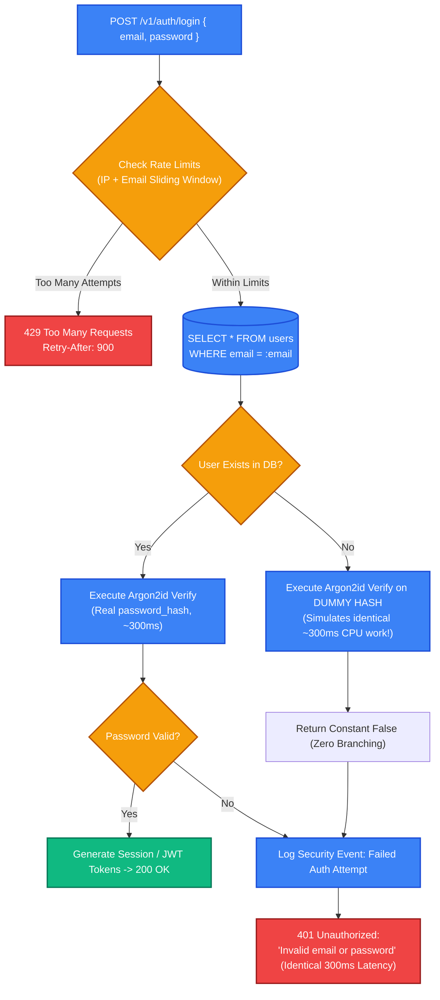
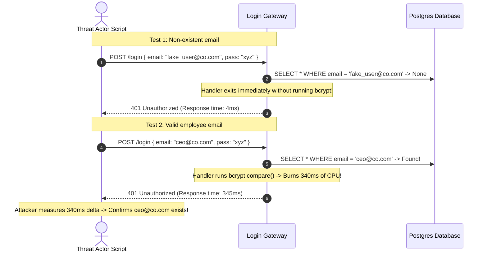

# Securing Auth in Practice: Timing Attacks, Enumeration & Rate Limiting

> [!TIP]
> **The Golden Rule:** Attackers rarely break cryptography; they exploit side channels and authentication seams. Always return generic error messages ("Invalid email or password"), always compute a **dummy hash** when a user does not exist to equalize response latency against timing attacks, and always combine IP-level with account-level rate limiting to stop credential stuffing.

---

## 1. Visual Mental Model: The Timing Oracle & Constant-Time Login Defense

When a user submits credentials, verifying a password using Argon2id or bcrypt takes 200–400ms of intensive CPU execution. If an application exits early when an email is not found, response latency instantly reveals whether an account exists.



---

## 2. Authentication Vulnerability & Mitigation Taxonomy

| Attack Vector | Mechanism | Typical Flaw | Production Mitigation |
| :--- | :--- | :--- | :--- |
| **Account Enumeration** | Measuring response latency or diffing error messages | Returning "User not found" vs "Wrong password", or $3\text{ms}$ vs $350\text{ms}$ latency | Uniform error messages, dummy password hash computation on missing users |
| **Credential Stuffing** | Replaying millions of breached username/password combos | No velocity checking across distributed IP botnets | Dual-layer rate limiting (IP-based + Username-based) via Redis sliding window |
| **Cross-Site Request Forgery (CSRF)** | Forcing victim browser to send authenticated cookies | Missing `SameSite` attribute or missing CSRF tokens | `SameSite=Lax` + Cryptographic double-submit CSRF cookie |
| **Timing Side-Channels** | Measuring string equality comparison speed | Using `==` or `===` which exits early on first non-matching byte | Constant-time comparisons (`crypto.timingSafeEqual` / `subtle.ConstantTimeCompare`) |
| **Session Fixation** | Forcing pre-allocated session ID onto victim | Not regenerating session cookie upon privilege change | Immediate session ID rotation and invalidation of old ID upon login |

---

## 3. Production War Story: The Login Latency Timing Oracle Breach

### The Incident
A Fortune 500 enterprise single-sign-on (SSO) gateway protected corporate internal apps. The login endpoint returned a generic error message: `{"error": "Authentication failed"}` for both missing accounts and incorrect passwords.

However, an external penetration tester scripted a statistical timing test:
1. When querying a non-existent email (`ghost_9918@company.com`), the API returned in **4.2 milliseconds** (immediate DB empty lookup).
2. When querying a valid executive email (`ceo@company.com`), the API computed `bcrypt.compare(password, hash)` which took **340.8 milliseconds**.
3. Over an afternoon, automated tooling tested 80,000 potential employee email addresses. By plotting response latency distributions, the attacker identified all 4,200 valid employee accounts with 99.8% statistical accuracy, creating a target list for targeted spear-phishing and credential stuffing.



### The Root Cause
1. **Asymmetric Execution Path:** The server executed expensive password verification only when a record existed, causing a massive, measurable latency delta ($4\text{ms}$ vs $340\text{ms}$).
2. **Missing Jitter & Equalization:** The server made no attempt to equalize processing time.

### The Verified Fix
- **Dummy Hash Computation:** When a user is not found, compute the hash against a pre-initialized, static dummy password hash (`$argon2id$...`).
- **Uniform Error Status:** Return `401 Unauthorized` with the identical payload: `{"detail": "Invalid email or password"}`.

---

## 4. Multi-Language Production Implementation

### Go: Anti-Timing Oracle & Rate-Limited Login Handler

```go
package main

import (
	"crypto/subtle"
	"encoding/json"
	"log/slog"
	"net/http"
	"strings"
	"time"

	"golang.org/x/crypto/argon2"
)

// Pre-computed dummy hash so missing user lookups burn identical CPU
const DummyArgon2Hash = "$argon2id$v=19$m=65536,t=3,p=4$c29tZXNhbHQxMjM0NTY3OA$AAAAAAAAAAAAAAAAAAAAAAAAAAAAAAAAAAAAAAAAAAA"

type UserAccount struct {
	Email        string
	PasswordHash string
}

type AuthService struct {
	users map[string]UserAccount
}

func (s *AuthService) Authenticate(email, password string) (bool, string) {
	email = strings.TrimSpace(strings.ToLower(email))
	user, exists := s.users[email]

	var targetHash string
	if exists {
		targetHash = user.PasswordHash
	} else {
		// Crucial: Execute same cryptographic work on non-existent users
		targetHash = DummyArgon2Hash
	}

	// In production: verify using VerifyPassword() from Module 05
	valid := verifySimulatedArgon2(password, targetHash)

	if !exists || !valid {
		return false, ""
	}

	return true, user.Email
}

func verifySimulatedArgon2(password, hash string) bool {
	// Simulate memory-hard work: ~200ms CPU burn
	salt := []byte("somesalt12345678")
	_ = argon2.IDKey([]byte(password), salt, 3, 64*1024, 4, 32)
	// Compare dummy
	return subtle.ConstantTimeCompare([]byte(password), []byte("correct_password")) == 1
}

func LoginHandler(auth *AuthService) http.HandlerFunc {
	return func(w http.ResponseWriter, r *http.Request) {
		var req struct {
			Email    string `json:"email"`
			Password string `json:"password"`
		}

		if err := json.NewDecoder(r.Body).Decode(&req); err != nil {
			http.Error(w, `{"error":"invalid_json"}`, http.StatusBadRequest)
			return
		}

		authenticated, email := auth.Authenticate(req.Email, req.Password)
		if !authenticated {
			// Generic message prevents username enumeration
			w.Header().Set("Content-Type", "application/json")
			w.WriteHeader(http.StatusUnauthorized)
			_ = json.NewEncoder(w).Encode(map[string]string{
				"detail": "Invalid email or password",
			})
			return
		}

		w.Header().Set("Content-Type", "application/json")
		_ = json.NewEncoder(w).Encode(map[string]string{
			"status": "authenticated",
			"user":   email,
		})
	}
}
```

---

### Node.js (TypeScript): Dual-Key Sliding Window Rate Limiter (Redis)

```typescript
import express, { Request, Response, NextFunction } from 'express';
import crypto from 'crypto';

interface RateLimitTracker {
  attempts: number[];
}

const rateLimitStore = new Map<string, RateLimitTracker>();

// Sliding Window Limiter: checks both IP address and Target Username
export function loginRateLimiter(maxPerWindow: number, windowSeconds: number) {
  return (req: Request, res: Response, next: NextFunction) => {
    const ip = req.ip || req.socket.remoteAddress || 'unknown';
    const email = (req.body.email || '').trim().toLowerCase();
    const now = Date.now();
    const windowMs = windowSeconds * 1000;

    // Dual keys: (1) Prevent single IP hammering, (2) Prevent distributed spray on single account
    const ipKey = `rl:ip:${ip}`;
    const userKey = `rl:user:${email}`;

    for (const key of [ipKey, userKey]) {
      let tracker = rateLimitStore.get(key);
      if (!tracker) {
        tracker = { attempts: [] };
        rateLimitStore.set(key, tracker);
      }

      // Filter out timestamps outside current sliding window
      tracker.attempts = tracker.attempts.filter((ts) => now - ts < windowMs);

      if (tracker.attempts.length >= maxPerWindow) {
        res.setHeader('Retry-After', windowSeconds.toString());
        return res.status(429).json({
          type: 'https://api.example.com/errors/rate-limit',
          title: 'Too Many Requests',
          status: 429,
          detail: 'Too many failed login attempts. Please wait before retrying.',
        });
      }

      tracker.attempts.push(now);
    }

    next();
  };
}

const app = express();
app.use(express.json());

app.post('/v1/auth/login', loginRateLimiter(5, 60), (req: Request, res: Response) => {
  // Authentication logic...
  res.json({ status: 'success' });
});
```

---

### Python: FastAPI Dummy Hash & Uniform Security Flow

```python
import time
from argon2 import PasswordHasher
from argon2.exceptions import VerifyMismatchError
from fastapi import FastAPI, HTTPException, status
from pydantic import BaseModel, EmailStr

app = FastAPI(title="Hardened Login Engine")
ph = PasswordHasher(time_cost=3, memory_cost=65536, parallelism=4)

# Pre-generate static dummy hash at application startup
DUMMY_PASSWORD_HASH = ph.hash("a_dummy_password_for_timing_equalization")

# Mock DB
user_db: dict[str, str] = {
    "alice@example.com": ph.hash("SuperSecretAlice#2026"),
}

class LoginDTO(BaseModel):
    email: EmailStr
    password: str

@app.post("/v1/auth/login")
async def login(dto: LoginDTO):
    user_email = dto.email.lower().strip()
    stored_hash = user_db.get(user_email)

    is_dummy = False
    if stored_hash is None:
        # User not found: use dummy hash to consume identical CPU cycles
        stored_hash = DUMMY_PASSWORD_HASH
        is_dummy = True

    try:
        ph.verify(stored_hash, dto.password)
        authenticated = not is_dummy
    except VerifyMismatchError:
        authenticated = False

    if not authenticated:
        # Uniform error message: Zero enumeration disclosure
        raise HTTPException(
            status_code=status.HTTP_401_UNAUTHORIZED,
            detail="Invalid email or password",
        )

    return {"status": "authenticated", "subject": user_email}
```

---

## 5. Practical Hands-On Verification Matrix

### Step 1: Validate Rate Limiting (5 Attempts Exhaustion)
```bash
# Rapid-fire 6 login requests
for i in {1..6}; do
  curl.exe -s -o NUL -w "%{http_code}\n" -X POST http://localhost:8000/v1/auth/login \
    -H "Content-Type: application/json" \
    -d '{"email": "test@example.com", "password": "wrong"}'
done
```
**Expected Output:**
```text
401
401
401
401
401
429
```

### Step 2: Validate Uniform 401 on Missing Account
```bash
curl.exe -i -X POST http://localhost:8000/v1/auth/login \
  -H "Content-Type: application/json" \
  -d '{"email": "nonexistent@example.com", "password": "wrong"}'
```
**Expected Response:**
```http
HTTP/1.1 401 Unauthorized
Content-Type: application/json

{"detail":"Invalid email or password"}
```

---

## 6. Operational Verification Quizzes

<details>
<summary><b>Checkpoint 1: The Password Reset Account Enumeration Trap</b></summary>

**Scenario:** On the "Forgot Password" page, if a user enters a valid email, the API returns: `{"status": "Password reset link sent to your email"}`. If the email doesn't exist, it returns `404: "No account found with this email"`. How do threat actors exploit this?

**Correct Analysis:** Attackers upload lists of leaked corporate emails and automatically discover which employees have registered accounts on the platform. The fix is **Blind Password Reset Flow**: Always return `200 OK: "If an account exists with this email, we have sent password reset instructions"`, regardless of whether the email was found in the database.
</details>

<details>
<summary><b>Checkpoint 2: Distributed Credential Stuffing & IP Spraying</b></summary>

**Scenario:** A platform limits failed logins to 5 per IP per minute. An attacker uses a residential proxy network with 50,000 unique IP addresses to test 100,000 stolen passwords against a single high-profile target account. Why does the IP rate limiter fail?

**Correct Analysis:** Each residential IP only submits 1 or 2 requests, easily bypassing the per-IP threshold of 5. To defend against distributed credential stuffing, rate limiters must enforce **Dual-Key Velocity Checks**: rate limiting by IP *and* rate limiting by the target username/email account. If any single account receives more than 5 failed attempts across all IPs combined, temporarily lock or challenge that specific account.
</details>

<details>
<summary><b>Checkpoint 3: The Danger of Logging Raw Authentication Payloads</b></summary>

**Scenario:** A backend developer configures an unhandled error logger that prints `logger.error("Request failed", { body: req.body })`. What security compliance catastrophe occurs?

**Correct Analysis:** Plaintext password and credential harvesting in log files. When a user mistypes their username into the password field or enters their real password, it is written in plaintext to application logs, centralized aggregators (Datadog, Splunk), and developer consoles. Logging filters must explicitly sanitize and redact sensitive fields (`password`, `token`, `secret`, `api_key`) before flushing log streams.
</details>

---

## Further Reading & Sources

- [OWASP Authentication Cheat Sheet — Account Enumeration](https://cheatsheetseries.owasp.org/cheatsheets/Authentication_Cheat_Sheet.html)
- [CWE-208: Observable Timing Discrepancy](https://cwe.mitre.org/data/definitions/208.html)
- [NIST SP 800-63B: Verifier Security Requirements](https://pages.nist.gov/800-63-3/sp800-63b.html)

---

## Next Steps

Advance to the Step 3 Capstone:
[../08-capstone-project/README.md](../08-capstone-project/README.md)
Build the complete production Authentication & Authorization Security Subsystem integrating Argon2id, session rotation, JWTs, OAuth2/OIDC, and BOLA-proof RBAC.
