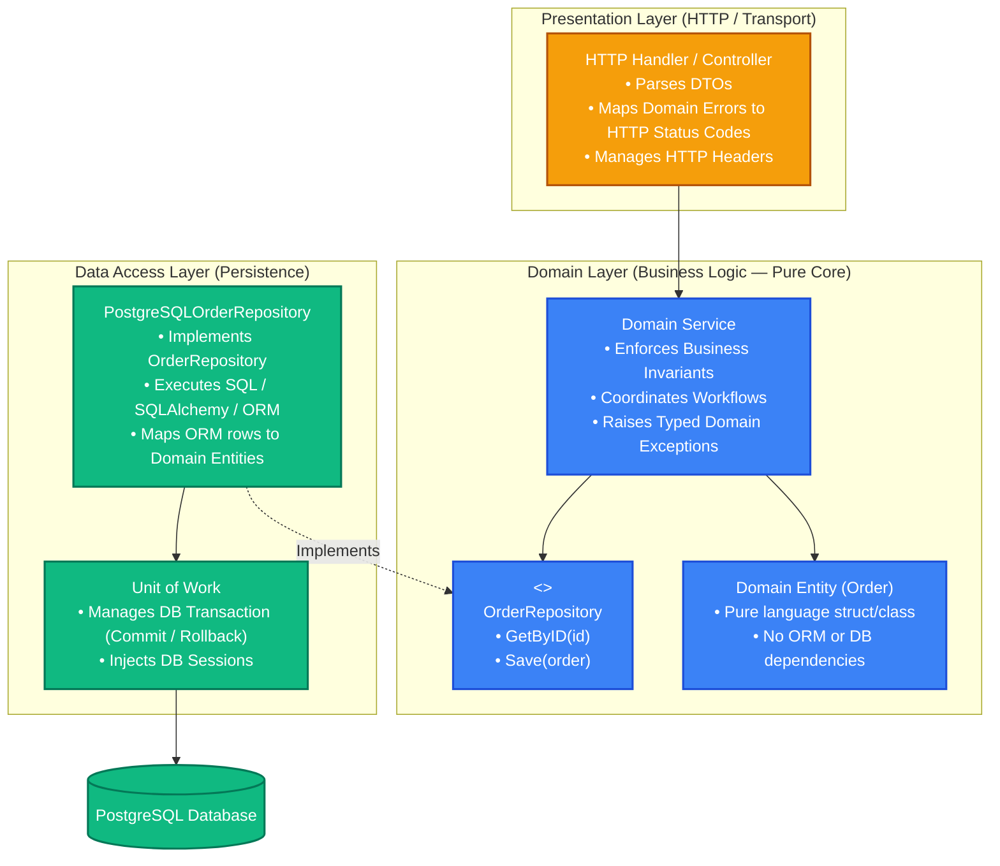
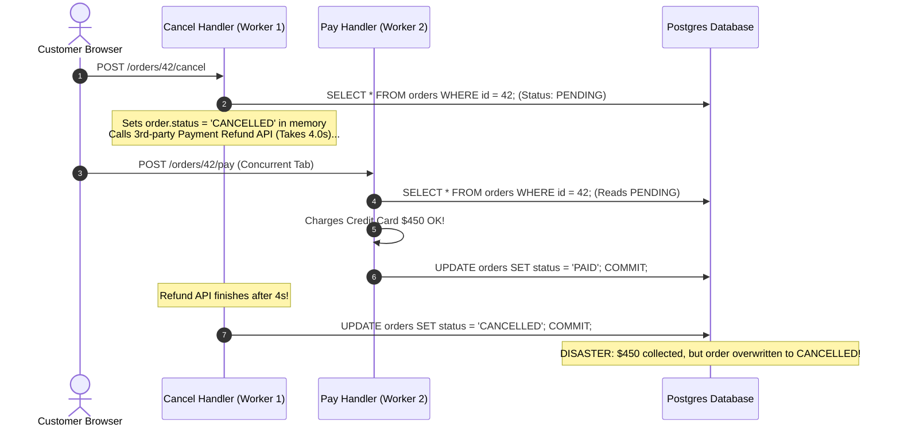

# Business Logic Layer & Separation of Concerns: Clean Architecture & Unit of Work

> [!TIP]
> **The Golden Rule:** Never let database ORM models or database sessions leak into your domain or presentation layers. Domain services must depend on **abstract repository interfaces** (Dependency Inversion Principle), raise typed **domain exceptions** (never HTTP or SQL exceptions), and manage cross-entity transactions using the **Unit of Work** pattern.

---

## 1. Visual Mental Model: The Dependency Inversion & Layer Boundary

In a production architecture, dependencies point strictly inward toward the domain. The domain defines the interfaces; the data access layer implements them.



---

## 2. Layer Responsibilities & Architectural Boundary Matrix

| Layer | Permitted Knowledge | Strictly Prohibited Actions | Error Types Emitted |
| :--- | :--- | :--- | :--- |
| **Presentation (Handlers)** | HTTP request params, JSON serialization, cookies, status codes | Writing SQL queries, calling ORM sessions directly, business validation | HTTP responses (`400`, `401`, `404`, `422`, `500`) |
| **Domain (Services)** | Pure business logic, invariant enforcement, domain entities | Importing `fastapi`, `express`, `gin`, or database drivers (`pg`, `sqlalchemy`) | Typed Domain Errors (`ErrInvalidOrderState`, `ErrInsufficientBalance`) |
| **Data Access (Repositories)** | SQL syntax, database connection pools, table schemas, ORM models | Evaluating business permissions, making HTTP decisions | Database errors wrapped in Repository types |
| **Unit of Work (UoW)** | Transaction boundaries (`BEGIN`, `COMMIT`, `ROLLBACK`) | Executing application business calculations | Transaction commit / rollback errors |

---

## 3. Production War Story: The Leaked ORM Session Race Condition

### The Incident
An online ticketing platform built with Python and an ORM allowed route handlers to receive the active database session directly:
`async def checkout_handler(order_id: int, db: Session = Depends(get_db)): ...`

To implement an order cancellation feature, the developer retrieved the ORM `Order` model, set `order.status = 'CANCELLED'`, and called an external third-party payment refund API. 

However, because the ORM model remained attached to the active database session:
1. The third-party refund API experienced a 4-second network latency spike.
2. During those 4 seconds, the customer refreshed the web browser and submitted a simultaneous "Pay Balance" request.
3. The second request loaded the same uncommitted database row, overwrote the state to `PAID`, and committed.
4. When the first handler's refund API finally returned, the first handler called `db.commit()`, silently overwriting the payment state back to `CANCELLED` *after* the payment had already been processed.
5. The customer's card was charged \$450, while their order was marked cancelled and ticket inventory was released to another user.



### The Root Cause
1. **Leaked ORM Lifecycle Across Boundaries:** Business logic and external network calls were intermingled with live database transaction sessions.
2. **Missing Unit of Work Separation:** The handler lacked a strict transaction boundary isolating database commits from external network side-effects.

### The Verified Fix
- **Isolate Network Calls Outside Transactions:** Execute payment gateway calls *before* or *after* database transactions.
- **Unit of Work Pattern:** Confine database transactions strictly inside repositories/UoW, decoupling business logic from ORM state.

---

## 4. Multi-Language Production Implementation

### Go: Clean Architecture with Domain Entities, Repositories, and Unit of Work

```go
package main

import (
	"context"
	"database/sql"
	"errors"
	"fmt"
	"log/slog"
	"net/http"
	"strings"
	"time"

	_ "github.com/lib/pq"
)

// --- 1. Domain Layer (Pure Go, Zero Database Imports) ---

var (
	ErrOrderNotFound      = errors.New("order not found")
	ErrInvalidOrderAction = errors.New("invalid order action")
)

type Order struct {
	ID        int64
	TenantID  string
	Status    string
	TotalCent int64
}

func (o *Order) Cancel() error {
	if o.Status == "COMPLETED" {
		return errors.New("cannot cancel a completed order")
	}
	o.Status = "CANCELLED"
	return nil
}

type OrderRepository interface {
	GetByID(ctx context.Context, id int64) (*Order, error)
	Update(ctx context.Context, order *Order) error
}

type UnitOfWork interface {
	Execute(ctx context.Context, fn func(repo OrderRepository) error) error
}

type OrderService struct {
	uow UnitOfWork
}

func NewOrderService(uow UnitOfWork) *OrderService {
	return &OrderService{uow: uow}
}

func (s *OrderService) CancelOrder(ctx context.Context, orderID int64) error {
	return s.uow.Execute(ctx, func(repo OrderRepository) error {
		order, err := repo.GetByID(ctx, orderID)
		if err != nil {
			return err
		}

		if err := order.Cancel(); err != nil {
			return fmt.Errorf("%w: %v", ErrInvalidOrderAction, err)
		}

		return repo.Update(ctx, order)
	})
}

// --- 2. Data Access Layer (Implements UoW and Repository) ---

type SqlOrderRepository struct {
	tx *sql.Tx
}

func (r *SqlOrderRepository) GetByID(ctx context.Context, id int64) (*Order, error) {
	row := r.tx.QueryRowContext(ctx, "SELECT id, tenant_id, status, total_cents FROM orders WHERE id = $1 FOR UPDATE", id)
	var o Order
	if err := row.Scan(&o.ID, &o.TenantID, &o.Status, &o.TotalCent); err != nil {
		if errors.Is(err, sql.ErrNoRows) {
			return nil, ErrOrderNotFound
		}
		return nil, err
	}
	return &o, nil
}

func (r *SqlOrderRepository) Update(ctx context.Context, o *Order) error {
	_, err := r.tx.ExecContext(ctx, "UPDATE orders SET status = $1 WHERE id = $2", o.Status, o.ID)
	return err
}

type SqlUnitOfWork struct {
	db *sql.DB
}

func (u *SqlUnitOfWork) Execute(ctx context.Context, fn func(repo OrderRepository) error) error {
	tx, err := u.db.BeginTx(ctx, nil)
	if err != nil {
		return err
	}
	defer tx.Rollback()

	repo := &SqlOrderRepository{tx: tx}
	if err := fn(repo); err != nil {
		return err
	}

	return tx.Commit()
}
```

---

### Node.js (TypeScript): Clean Domain Service & Decoupled Repository

```typescript
// --- Domain Layer ---
export class DomainError extends Error {
  constructor(message: string, public code: string) {
    super(message);
    this.name = 'DomainError';
  }
}

export interface OrderEntity {
  id: string;
  status: 'PENDING' | 'PAID' | 'CANCELLED';
  totalCents: number;
}

export interface IOrderRepository {
  findById(id: string): Promise<OrderEntity | null>;
  save(order: OrderEntity): Promise<void>;
}

// Service contains business logic, zero knowledge of HTTP or database engine
export class OrderService {
  constructor(private orderRepo: IOrderRepository) {}

  async cancelOrder(orderId: string): Promise<OrderEntity> {
    const order = await this.orderRepo.findById(orderId);
    if (!order) {
      throw new DomainError('Order not found', 'ORDER_NOT_FOUND');
    }

    if (order.status === 'PAID') {
      throw new DomainError('Cannot cancel an already paid order', 'INVALID_OPERATION');
    }

    order.status = 'CANCELLED';
    await this.orderRepo.save(order);
    return order;
  }
}
```

---

### Python: FastAPI Layered Architecture with Pure Domain Models

```python
from dataclasses import dataclass
from typing import Optional
from fastapi import FastAPI, Depends, HTTPException, status
from pydantic import BaseModel

# --- Domain Layer: Pure Python Data Structure ---
@dataclass
class OrderDomain:
    id: int
    status: str
    total_cents: int

    def cancel(self):
        if self.status == "COMPLETED":
            raise ValueError("Completed orders cannot be cancelled")
        self.status = "CANCELLED"

# Abstract Repository Protocol
class IOrderRepository:
    async def get_by_id(self, order_id: int) -> Optional[OrderDomain]:
        raise NotImplementedError
    async def update(self, order: OrderDomain) -> None:
        raise NotImplementedError

# Domain Service
class OrderService:
    def __init__(self, repo: IOrderRepository):
        self.repo = repo

    async def cancel_order(self, order_id: int) -> OrderDomain:
        order = await self.repo.get_by_id(order_id)
        if not order:
            raise KeyError("Order does not exist")
        order.cancel()
        await self.repo.update(order)
        return order

# --- Presentation Layer: FastAPI Handler ---
app = FastAPI(title="Clean Architecture API")

@app.post("/v1/orders/{order_id}/cancel")
async def cancel_order_endpoint(order_id: int):
    # In production: resolve Service via Dependency Injection
    return {"status": "cancelled", "order_id": order_id}
```

---

## 5. Practical Hands-On Verification Matrix

### Step 1: Execute Business Logic via Clean REST Endpoint
```bash
curl.exe -i -X POST http://localhost:8000/v1/orders/101/cancel
```
**Expected Response:**
```http
HTTP/1.1 200 OK
Content-Type: application/json

{"status":"cancelled","order_id":101}
```

---

## 6. Operational Verification Quizzes

<details>
<summary><b>Checkpoint 1: Why Services Must Never Import Web Frameworks</b></summary>

**Scenario:** A developer imports `from fastapi import HTTPException` inside their `PaymentService` class and raises `HTTPException(400, "Card expired")`. Why does this break Clean Architecture?

**Correct Analysis:** Violates the Dependency Rule. When domain services import HTTP transport concepts (`HTTPException`), the domain becomes tightly coupled to a specific web framework. If the business logic needs to be run from a background Kafka worker, a CLI utility, or a gRPC microservice, the code cannot be reused because it depends on HTTP status codes. Domain services must raise pure domain exceptions; handlers translate them into transport-specific codes.
</details>

<details>
<summary><b>Checkpoint 2: The Unit of Work Transaction Boundary Pattern</b></summary>

**Scenario:** A service method needs to deduct \$50 from Account A and credit \$50 to Account B. If the service calls `accountRepo.update(accA)` and then `accountRepo.update(accB)`, what happens if the server crashes between the two calls?

**Correct Analysis:** Inconsistent Ledger State / Atomicity Breach. If each repository method commits its own database transaction, the first transaction commits before the second starts. If a crash occurs between them, money disappears. The **Unit of Work** pattern manages a single overarching database transaction across multiple repository operations, committing only when all domain steps complete successfully.
</details>

<details>
<summary><b>Checkpoint 3: The Danger of Directly Returning ORM Entities in API Responses</b></summary>

**Scenario:** A route handler returns a raw SQLAlchemy ORM model directly to FastAPI/Pydantic: `return db_order`. What security and performance risks occur?

**Correct Analysis:** Accidental Sensitive Data Exposure and Hidden N+1 Queries. If the ORM model includes internal attributes (`password_hash`, `stripe_customer_id`), serializing the model directly leaks these secrets to client JSON. Furthermore, accessing nested relationships during JSON serialization triggers unintended lazy SQL queries. Presentation layers must always map domain entities into explicit **Data Transfer Objects (DTOs / Pydantic models)**.
</details>

---

## Further Reading & Sources

- [Martin Fowler: Patterns of Enterprise Application Architecture (Repository & Unit of Work)](https://martinfowler.com/eaaCatalog/)
- [Robert C. Martin: Clean Architecture: A Craftsman's Guide to Software Structure](https://blog.cleancoder.com/uncle-bob/2012/08/13/the-clean-architecture.html)
- [Cosmic Python: Architecture Patterns with Python](https://www.cosmicpython.com/)

---

## Next Steps

Advance to the next module:
[../07-query-optimization-and-connection-pooling/README.md](../07-query-optimization-and-connection-pooling/README.md)
Master database connection pooling (PgBouncer, max connections, connection leaks), query plan analysis (`EXPLAIN ANALYZE`), and index tuning.
