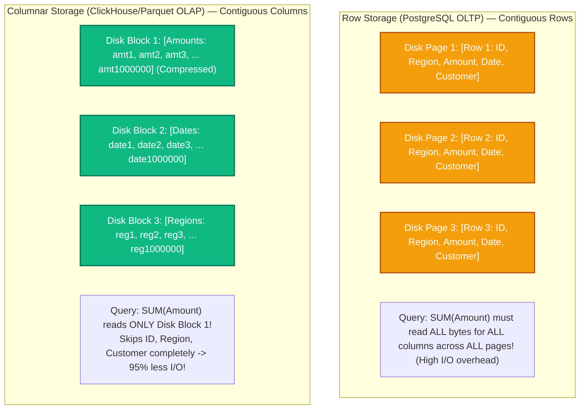
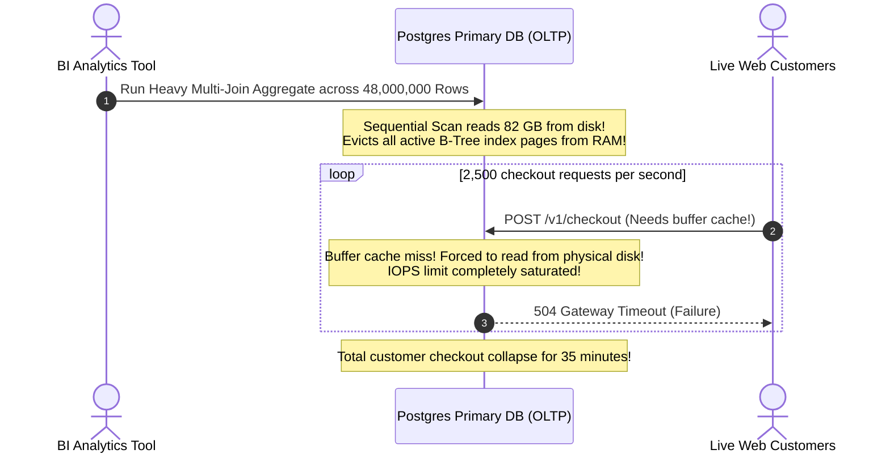

# OLAP & Data Warehousing: Columnar Storage, Vectorization & CDC

> [!TIP]
> **The Golden Rule:** Never run large-scale analytical aggregation queries against your transactional (OLTP) primary database. Use row-oriented engines (PostgreSQL) for point lookups and ACID updates; stream real-time events to column-oriented analytical engines (ClickHouse, BigQuery, Snowflake, DuckDB) via **Change Data Capture (CDC)** to achieve $100\times$ faster scans with zero operational impact on production traffic.

---

## 1. Visual Mental Model: Row-Oriented vs Column-Oriented Storage

The fundamental difference between OLTP and OLAP lies in how data pages are serialized to non-volatile disk blocks:



---

## 2. OLTP vs OLAP Architecture Comparison

| Dimension | OLTP (Transactional) | OLAP (Analytical) |
| :--- | :--- | :--- |
| **Typical Query** | `SELECT * FROM orders WHERE id = 1042;` | `SELECT region, SUM(amount) FROM orders GROUP BY region;` |
| **Rows Touched** | 1 to 50 rows | 1,000,000 to 1,000,000,000 rows |
| **Columns Touched** | All columns in the table | 2 to 4 columns out of 50 |
| **Write Pattern** | High-concurrency random `INSERT`, `UPDATE`, `DELETE` | Batch bulk appends (`INSERT INTO ... SELECT`), immutable |
| **Data Structure** | B-Trees, 8 KB physical pages with WAL | Compressed column vectors, Parquet, dictionary/run-length encoding |
| **Primary Engines** | PostgreSQL, MySQL, Spanner | ClickHouse, Snowflake, BigQuery, DuckDB |
| **Hardware Bottleneck**| Disk IOPS & Lock Contention | Memory Bandwidth & SIMD Vectorized CPU execution |

---

## 3. Production War Story: The BI Dashboard Primary Database Meltdown

### The Incident
A fast-growing SaaS platform stored all transaction data in an Amazon RDS PostgreSQL primary instance. A data analyst connected a Business Intelligence visualization tool (Metabase/Tableau) directly to the production primary database to build an executive reporting dashboard.

At 10:00 AM on Monday, the executive dashboard automatically refreshed, executing a query that computed rolling 90-day churn and customer lifetime value (LTV):
```sql
SELECT 
    c.country, 
    DATE_TRUNC('month', o.created_at), 
    SUM(o.amount_cents), 
    COUNT(DISTINCT c.id)
FROM orders o
JOIN customers c ON o.customer_id = c.id
JOIN line_items li ON li.order_id = o.id
WHERE o.created_at >= NOW() - INTERVAL '90 days'
GROUP BY 1, 2;
```

1. The query performed a sequential scan across 48,000,000 rows, reading 82 GB of raw heap pages into memory.
2. The massive scan completely evicted the database buffer pool cache, dumping hot active customer rows and B-Tree index pages out of RAM.
3. Every subsequent operational API request (`POST /checkout`, `GET /user`) had to read from physical NVMe disk instead of RAM cache, causing disk read IOPS to hit the 10,000 IOPS burst limit.
4. Database CPU jumped to 100%, query latency increased from 8ms to 24 seconds, and customer checkouts timed out worldwide for 35 minutes until the reporting query was forcibly killed.



### The Root Cause
1. **Workload Interference:** Running heavy analytical table scans on an OLTP primary database starved the operational connection pool and destroyed buffer pool cache locality.
2. **Missing Architectural Separation:** Transactional data was not decoupled from analytical queries.

### The Verified Fix
- **Change Data Capture (CDC) Pipeline:** Deployed **Debezium** to tail the PostgreSQL Write-Ahead Log (WAL) stream asynchronously and emit row mutations into an Apache Kafka topic with zero database query overhead.
- **Dedicated Analytical Warehouse:** Streamed events from Kafka into **ClickHouse** (or DuckDB/BigQuery). Analytical queries execute in 40ms over columnar storage without touching PostgreSQL.

---

## 4. Multi-Language Production Implementation: Fast Analytical Aggregations

### Python: In-Process High-Speed OLAP with DuckDB & Parquet

```python
import duckdb
import time

def run_columnar_benchmark():
    con = duckdb.connect(database=':memory:')

    # 1. Generate 5,000,000 rows of synthetic e-commerce sales data directly in memory
    con.execute("""
        CREATE TABLE sales AS 
        SELECT 
            range AS order_id,
            (range % 1000)::INT AS customer_id,
            (range % 10)::TEXT AS region,
            (random() * 1000)::DECIMAL(10, 2) AS amount,
            TIMESTAMP '2026-01-01' + INTERVAL (range % 365) DAY AS order_date
        FROM range(5000000);
    """)

    # 2. Execute Columnar Aggregation (Vectorized SIMD processing)
    start = time.perf_counter()
    query = """
        SELECT 
            region, 
            COUNT(*) AS total_orders, 
            SUM(amount) AS total_revenue,
            AVG(amount) AS average_order_value
        FROM sales
        WHERE order_date >= '2026-06-01'
        GROUP BY region
        ORDER BY total_revenue DESC;
    """
    res = con.execute(query).fetchall()
    duration = (time.perf_counter() - start) * 1000

    print(f"Aggregated 5,000,000 rows in: {duration:.2f} ms")
    for row in res[:3]:
        print(f"Region {row[0]}: {row[1]:,} orders, ${row[2]:,.2f} revenue")

if __name__ == '__main__':
    run_columnar_benchmark()
```

---

### Go: Change Data Capture (CDC) WAL Event Stream Consumer

```go
package main

import (
	"context"
	"encoding/json"
	"log/slog"
	"time"
)

// CDCEvent represents a Debezium WAL row mutation event
type CDCEvent struct {
	Op        string    `json:"op"` // "c" = create, "u" = update, "d" = delete
	Timestamp int64     `json:"ts_ms"`
	Before    *OrderRow `json:"before"`
	After     *OrderRow `json:"after"`
}

type OrderRow struct {
	ID        int64   `json:"id"`
	Region    string  `json:"region"`
	Amount    float64 `json:"amount"`
	CreatedAt string  `json:"created_at"`
}

// IngestToOLAP demonstrates streaming CDC events directly into ClickHouse
func IngestToOLAP(ctx context.Context, batch []CDCEvent) error {
	slog.Info("Ingesting CDC batch into Columnar Warehouse", "count", len(batch))

	for _, event := range batch {
		if event.Op == "c" || event.Op == "u" {
			// Append row to columnar batch buffer (ClickHouse / Parquet buffer)
			_ = event.After
		}
	}

	return nil
}
```

---

### Node.js (TypeScript): Columnar Parquet Querying

```typescript
import duckdb from 'duckdb';

const db = new duckdb.Database(':memory:');

export async function aggregateParquetMetrics(parquetFilePath: string): Promise<any[]> {
  return new Promise((resolve, reject) => {
    // Queries Parquet file directly from disk without loading into RAM
    const query = `
      SELECT 
        region, 
        SUM(amount) AS total_revenue 
      FROM read_parquet('${parquetFilePath}')
      GROUP BY region 
      ORDER BY total_revenue DESC;
    `;

    db.all(query, (err, rows) => {
      if (err) return reject(err);
      resolve(rows);
    });
  });
}
```

---

## 5. Practical Hands-On Verification Matrix

### Step 1: Run DuckDB Analytical Aggregation Benchmark
```bash
python.exe -c "import duckdb; con = duckdb.connect(); print(con.execute('SELECT 42 AS test').fetchall())"
```
**Expected Response:**
```text
[(42,)]
```

---

## 6. Operational Verification Quizzes

<details>
<summary><b>Checkpoint 1: Why Columnar Compression Ratios Exceed Row Storage by 10x</b></summary>

**Scenario:** A 1 TB PostgreSQL database is migrated to ClickHouse/Parquet. The resulting columnar dataset consumes only 95 GB of disk space (a 10x compression ratio). Why does columnar storage compress vastly better than row storage?

**Correct Analysis:** Data Type Homogeneity. In row-oriented storage, an integer is followed by a timestamp, a text string, and a boolean. Adjacent bytes have high entropy and cannot be compressed effectively. In columnar storage, millions of values of the *exact same type and domain* sit contiguously on disk. Identical strings compress trivially with dictionary encoding; timestamps compress with delta encoding; repeating values compress with Run-Length Encoding (RLE).
</details>

<details>
<summary><b>Checkpoint 2: The Danger of Single-Row INSERTs in Columnar Engines</b></summary>

**Scenario:** A developer connects an API directly to ClickHouse and executes `INSERT INTO events VALUES (...)` on every single incoming HTTP request (1,000 single-row inserts per second). ClickHouse CPU spikes and query performance collapses. Why?

**Correct Analysis:** Small Parts Fragmentation. Columnar engines organize data into immutable compressed chunks ("parts") on disk. Every `INSERT` statement creates a new part. Executing 1,000 single-row inserts creates 1,000 disk parts per second, overwhelming the background merge tree thread (`Too many parts` error). Columnar engines require **Batch Ingestion** (buffering writes into batches of 10,000+ rows or streaming via Kafka).
</details>

<details>
<summary><b>Checkpoint 3: Change Data Capture (CDC) vs Periodic Batch ETL</b></summary>

**Scenario:** A company runs an hourly ETL cron job: `SELECT * FROM orders WHERE updated_at >= NOW() - INTERVAL '1 hour'`. What failure modes make this fragile compared to WAL-based CDC?

**Correct Analysis:** Missed Deletes and Polling Latency. First, `SELECT WHERE updated_at` cannot detect deleted records (`DELETE FROM orders` leaves no row behind to query). Second, if an update takes 5 seconds to commit, it may be missed by the time boundary window. Third, continuous polling wastes database CPU. Change Data Capture (CDC via Debezium) tails the database's internal transaction log (WAL), capturing all inserts, updates, and deletes with sub-second latency and zero query overhead.
</details>

---

## Download Printable Reference & Diagrams

Download the notes for each video on this page as a printable PDF, with every diagram and interview questions: [SD-E-030: OLTP vs OLAP](https://backendroadmap.com/notes/system-design/SD-E-030.pdf), [SD-E-031: Change Data Capture](https://backendroadmap.com/notes/system-design/SD-E-031.pdf). Each section in one file: [Phase 2, Databases (PDF)](https://backendroadmap.com/notes/system-design/Phase2_Databases_Notes.pdf).

---

## Further Reading & Sources

- [DuckDB Official Documentation: Why DuckDB?](https://duckdb.org/why_duckdb)
- [ClickHouse Architecture: Column-Oriented DBMS Principles](https://clickhouse.com/docs/en/development/architecture)
- [Debezium: Reliable Change Data Capture Documentation](https://debezium.io/documentation/)

---

## Next Steps

Advance to the next module:
[../10-multi-tenancy-patterns/README.md](../10-multi-tenancy-patterns/README.md)
Master multi-tenant SaaS data isolation: Database-per-tenant, Schema-per-tenant, Shared table with Row-Level Security (Postgres RLS), and noisy-neighbor mitigations.
