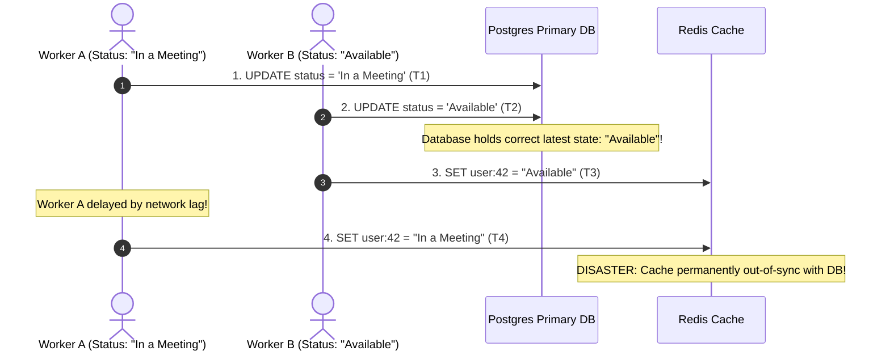

# Caching Strategies: Cache-Aside, Write-Through & Write-Behind

> [!TIP]
> **The Golden Rule:** On data updates, **always invalidate (delete) the cache key rather than updating it** (`db.commit() -> redis.del(key)`). Updating cache values directly under concurrent load causes race conditions where stale data overwrites fresh data. Use **Cache-Aside** as the default; use **Write-Through** when reads must never see cold misses; use **Write-Behind** only when write throughput is prioritized over absolute durability.

---

## 1. Visual Mental Model: The Four Caching Strategies

Every caching architecture is defined by how reads and writes coordinate between the application, the cache, and the database:

```mermaid
flowchart TD
    subgraph CacheAside ["1. Cache-Aside (Lazy Loading) — Standard Default"]
        CA_App["Application"] -->|1. Check Cache| CA_Redis[("Cache")]
        CA_App -->|2. On Miss: Read DB| CA_DB[("Database")]
        CA_App -->|3. Populate Cache| CA_Redis
        CA_App -->|Write: Commit DB -> Delete Key| CA_DB
    end

    subgraph WriteThrough ["2. Write-Through — Synchronous Consistency"]
        WT_App["Application"] -->|Write Payload| WT_Cache[("Cache Provider")]
        WT_Cache -->|Synchronous Write| WT_DB[("Database")]
        WT_Cache -- Confirms both written --> WT_App
    end

    subgraph WriteBehind ["3. Write-Behind (Write-Back) — Async High Write Throughput"]
        WB_App["Application"] -->|Write Fast (<1ms)| WB_Cache[("In-Memory Queue/Cache")]
        WB_Cache -.->|Asynchronous Batch Worker| WB_DB[("Database")]
        NoteWB["Risk: Unsynced writes lost if Cache node crashes!"]
    end

    classDef std fill:#10b981,stroke:#047857,stroke-width:2px,color:#fff;
    classDef sync fill:#3b82f6,stroke:#1d4ed8,stroke-width:2px,color:#fff;
    classDef async fill:#f59e0b,stroke:#b45309,stroke-width:2px,color:#fff;

    class CA_App,CA_Redis,CA_DB std;
    class WT_App,WT_Cache,WT_DB sync;
    class WB_App,WB_Cache,WB_DB,NoteWB async;
```

---

## 2. Architectural Comparison Matrix

| Strategy | Read Path | Write Path | Data Freshness | Data Loss Risk on Crash | Best Use Case |
| :--- | :--- | :--- | :--- | :--- | :--- |
| **Cache-Aside** (Lazy) | Check cache $\rightarrow$ on miss read DB $\rightarrow$ write cache | Write to DB $\rightarrow$ `DEL` cache key | High (Eventual consistency) | **Zero:** Authoritative data is in DB | **Default for 95% of web apps** |
| **Read-Through** | Client talks *only* to cache; cache reads DB on miss | N/A (Paired with write-through) | High | Zero | Managed caching services |
| **Write-Through** | Read from cache (always warm) | Write to Cache $\rightarrow$ Cache synchronously writes DB | Strong Consistency | Zero | Read-heavy, low-write frequency |
| **Write-Behind** (Write-Back) | Read from cache | Write to Cache $\rightarrow$ Cache acknowledges $\rightarrow$ async flush to DB | Highest read/write speed | **High:** Crash before flush loses writes | Metrics, gaming leaderboards, analytics ingestion |
| **Write-Around** | Read misses load from DB to cache | Write directly to DB, bypass cache | Cache only holds read data | Zero | Data written once, rarely read immediately |

---

## 3. Production War Story: The Concurrent Cache Update Race Condition

### The Incident
A social networking platform cached user profile records in Redis. When a user updated their profile, the application executed an "Update Cache" strategy:
1. `UPDATE users SET status = 'online' WHERE id = 42;`
2. `redis.set("user:42", updated_profile_json);`

Two rapid asynchronous background events fired simultaneously:
- **Event A (User updates status to "In a Meeting"):** Starts at $T_0$.
- **Event B (User updates status to "Available"):** Starts at $T_1$.

Due to network jitter:
1. Event A updated the PostgreSQL database to `"In a Meeting"` at $T_2$.
2. Event B updated the PostgreSQL database to `"Available"` at $T_3$.
3. Event B updated Redis with `"Available"` at $T_4$.
4. Event A experienced a delayed retry and updated Redis with `"In a Meeting"` at $T_5$!

The database held the correct state (`"Available"`), while Redis was permanently poisoned with the stale state (`"In a Meeting"`). The user's status remained stuck on "In a Meeting" for weeks until an engineer flushed the cache.



### The Root Cause
**Setting Values Directly in Cache on Write:** Because concurrent writes can execute and arrive out of order, writing computed values to cache creates a race condition between the database commit and the cache update.

### The Verified Fix
- **Invalidate (Delete) on Write:** Never update the cache directly. Execute `DEL user:42` immediately after committing the database transaction.
- **Why Invalidation is Safe:** The next incoming read is forced to fetch the true serialized state from the database and populate the cache cleanly.

---

## 4. Multi-Language Production Implementation

### Go: Cache-Aside with Invalidate-on-Write Pattern

```go
package main

import (
	"context"
	"database/sql"
	"encoding/json"
	"errors"
	"fmt"
	"log/slog"
	"time"

	"github.com/redis/go-redis/v9"
	_ "github.com/lib/pq"
)

type Account struct {
	ID        int64  `json:"id"`
	Email     string `json:"email"`
	Status    string `json:"status"`
}

type AccountManager struct {
	db    *sql.DB
	cache *redis.Client
}

func (m *AccountManager) GetAccount(ctx context.Context, id int64) (*Account, error) {
	cacheKey := fmt.Sprintf("account:%d", id)

	// 1. Read Path: Check Cache First
	val, err := m.cache.Get(ctx, cacheKey).Result()
	if err == nil {
		var acc Account
		if json.Unmarshal([]byte(val), &acc) == nil {
			return &acc, nil
		}
	}

	// 2. Read Path: Database Fallback on Miss
	query := `SELECT id, email, status FROM accounts WHERE id = $1`
	var acc Account
	err = m.db.QueryRowContext(ctx, query, id).Scan(&acc.ID, &acc.Email, &acc.Status)
	if err != nil {
		return nil, err
	}

	// 3. Populate Cache with TTL
	if data, marshalErr := json.Marshal(acc); marshalErr == nil {
		_ = m.cache.Set(ctx, cacheKey, data, 30*time.Minute).Err()
	}

	return &acc, nil
}

func (m *AccountManager) UpdateStatus(ctx context.Context, id int64, newStatus string) error {
	cacheKey := fmt.Sprintf("account:%d", id)

	// 1. Write Path: Update Database FIRST
	query := `UPDATE accounts SET status = $1 WHERE id = $2`
	if _, err := m.db.ExecContext(ctx, query, newStatus, id); err != nil {
		return err
	}

	// 2. Write Path: Mandatory INVALIDATE (Delete), Never Set!
	// Eliminates out-of-order race conditions permanently
	if err := m.cache.Del(ctx, cacheKey).Err(); err != nil {
		slog.Warn("Failed to invalidate cache key", "key", cacheKey, "error", err)
	}

	return nil
}
```

---

### Node.js (TypeScript): Write-Through Store Implementation

```typescript
import { Pool } from 'pg';
import { createClient } from 'redis';

export class WriteThroughUserStore {
  constructor(private pool: Pool, private redis: ReturnType<typeof createClient>) {}

  // Write-Through: Synchronously updates DB and Cache together
  async updateEmail(userId: number, email: string): Promise<void> {
    const key = `user:${userId}`;

    // 1. Commit to Primary Database
    await this.pool.query('UPDATE users SET email = $1 WHERE id = $2', [email, userId]);

    // 2. Synchronously write-through to cache or invalidate
    // For absolute consistency, delete key so next read loads authoritative DB snapshot
    await this.redis.del(key);
  }

  // Read-Through simulation
  async getUser(userId: number): Promise<any> {
    const key = `user:${userId}`;
    const cached = await this.redis.get(key);
    if (cached) return JSON.parse(cached);

    const res = await this.pool.query('SELECT id, email FROM users WHERE id = $1', [userId]);
    if (res.rows.length === 0) return null;

    const user = res.rows[0];
    await this.redis.setEx(key, 1800, JSON.stringify(user));
    return user;
  }
}
```

---

### Python: FastAPI Async Write-Behind Batch Queue (Redis Streams)

```python
import json
from fastapi import FastAPI
from pydantic import BaseModel
import redis.asyncio as aioredis

app = FastAPI(title="Write-Behind Ingestion Engine")
redis_client: aioredis.Redis = None

@app.on_event("startup")
async def startup():
    global redis_client
    redis_client = aioredis.from_url("redis://localhost:6379", decode_responses=True)

class MetricPayload(BaseModel):
    sensor_id: str
    temperature: float

@app.post("/v1/metrics/ingest")
async def ingest_metric(payload: MetricPayload):
    # Write-Behind Pattern:
    # 1. Update in-memory cache instantly (<0.2ms)
    await redis_client.set(f"latest_sensor:{payload.sensor_id}", payload.temperature)
    
    # 2. Append to Redis Stream / Queue for asynchronous batch flushing to PostgreSQL
    await redis_client.xadd(
        "stream:sensor_metrics",
        {"sensor_id": payload.sensor_id, "temperature": str(payload.temperature)}
    )

    return {"status": "accepted"}
```

---

## 5. Practical Hands-On Verification Matrix

### Step 1: Ingest Metric via Write-Behind Queue
```bash
curl.exe -i -X POST http://localhost:8000/v1/metrics/ingest \
  -H "Content-Type: application/json" \
  -d '{"sensor_id": "sensor_99", "temperature": 23.4}'
```
**Expected Response (<1ms Latency):**
```http
HTTP/1.1 200 OK
Content-Type: application/json

{"status":"accepted"}
```

---

## 6. Operational Verification Quizzes

<details>
<summary><b>Checkpoint 1: Why Invalidate-on-Write Beats Update-on-Write</b></summary>

**Scenario:** A developer argues: "Instead of deleting the key `DEL user:42` on update and forcing the next read to miss, we should compute the updated JSON and run `SET user:42 <new_json>` so the cache is never cold." Why is this dangerous in production?

**Correct Analysis:** Concurrency Race Conditions and Wasted Compute. Under concurrent writes, Worker 1 and Worker 2 can update the database in order $(W_1 \rightarrow W_2)$ but arrive at Redis in opposite order $(W_2 \rightarrow W_1)$, permanently leaving stale data in the cache. Furthermore, if a user updates their profile 5 times in a minute but no one reads it, updating the cache 5 times wastes CPU and network bandwidth. Invalidation is fast, safe, and lazy.
</details>

<details>
<summary><b>Checkpoint 2: The Failure Mode of Write-Behind (Write-Back)</b></summary>

**Scenario:** An architect uses Write-Behind caching for a financial wallet: all balances are updated in Redis and an asynchronous background worker flushes changes to PostgreSQL every 30 seconds. A physical power outage shuts down the Redis server. What is the business impact?

**Correct Analysis:** Irreversible Financial Data Loss. Any updates accepted by Redis during the 30-second window before the background worker flushed to PostgreSQL are permanently lost. In high-concurrency financial systems where balances cannot be lost, Write-Behind is prohibited unless backed by a durable, append-only distributed log (like Apache Kafka).
</details>

<details>
<summary><b>Checkpoint 3: The Write-Around Pattern for Write-Heavy, Read-Rare Data</b></summary>

**Scenario:** A system logs 50,000 document upload events per minute. The developer uses Write-Through caching, writing each log event to both Redis and the database. Redis memory usage explodes within hours. How should this be designed?

**Correct Analysis:** Use the **Write-Around** Strategy. Document audit logs are write-heavy and read-rarely (typically queried only during compliance audits). Writing every event into fast RAM cache pollutes memory with cold entries that will likely never be read before eviction. Under Write-Around, writes go directly to PostgreSQL (or cold storage), bypassing Redis completely. The cache is reserved strictly for hot, frequently-read keys.
</details>

---

## Further Reading & Sources

- [AWS Architecture: Caching Strategies and Best Practices](https://aws.amazon.com/caching/best-practices/)
- [Martin Fowler: Patterns of Distributed Systems — Write-Through vs Write-Behind](https://martinfowler.com/)
- [Redis Official Documentation: Redis as an LRU Cache](https://redis.io/docs/manual/eviction/)

---

## Next Steps

Advance to the next module:
[../02-cache-eviction-and-invalidation/README.md](../02-cache-eviction-and-invalidation/README.md)
Master cache eviction algorithms: LRU, LFU, FIFO, Redis memory eviction policies (`allkeys-lru`, `volatile-lru`), and cryptographic invalidation tagging.
