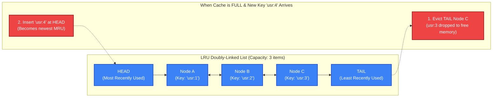
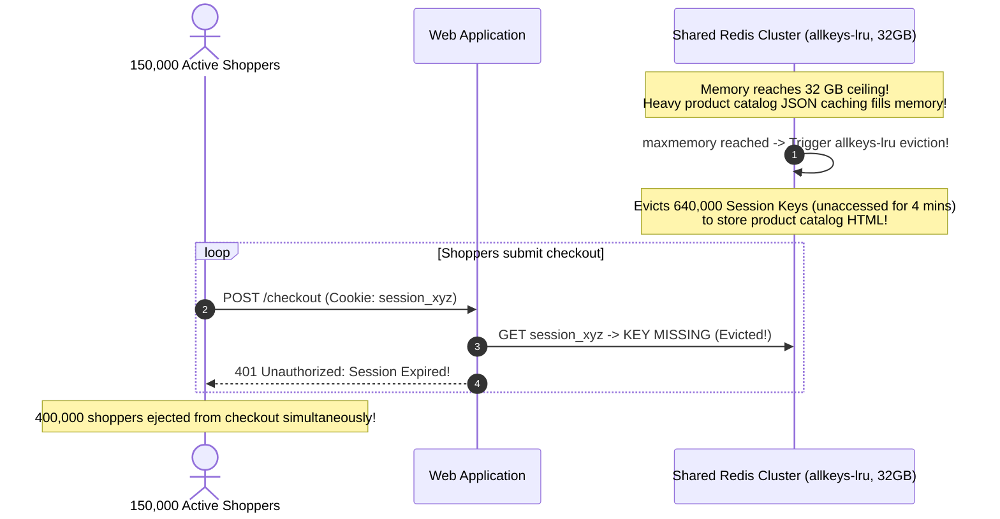

# Cache Eviction and Invalidation: LRU, LFU & Tagged Invalidation

> [!TIP]
> **The Golden Rule:** **Eviction** is a *capacity* decision (cache is full: drop least-valuable keys to free RAM); **Invalidation** is a *freshness* decision (data has changed: delete stale entries to preserve correctness). Never mix volatile query caches and persistent stateful sessions in the same Redis instance under `allkeys-lru`—memory pressure will silently evict active user sessions, logging out your entire user base.

---

## 1. Visual Mental Model: Eviction vs Invalidation & The LRU Doubly-Linked List

A classic in-memory LRU (Least Recently Used) cache pairs a **Hash Map** ($O(1)$ key lookup) with a **Doubly-Linked List** ($O(1)$ node relocation):



---

## 2. Redis `maxmemory-policy` Configuration Taxonomy

When Redis hits its configured `maxmemory` limit, its behavior is determined by the eviction directive:

| Redis Eviction Policy | Key Selection Scope | Eviction Criterion | Recommended Use Case |
| :--- | :--- | :--- | :--- |
| **`noeviction`** | None | Returns an error on write commands (`OOM command not allowed`) | When Redis is used as a primary database (Celery queues, state stores) |
| **`allkeys-lru`** | All keys in Redis | Approximated Least Recently Used (recency) | **Default choice for general-purpose application caches** |
| **`allkeys-lfu`** | All keys in Redis | Approximated Least Frequently Used (frequency) | When access frequency matters more than recency |
| **`volatile-lru`** | Keys with an explicit TTL | Least Recently Used among expiring keys | Shared instances holding both sessions (no TTL) and cache (with TTL) |
| **`volatile-ttl`** | Keys with an explicit TTL | Shortest remaining Time-To-Live (TTL) | Prioritizes dropping keys closest to their natural death |

---

## 3. Production War Story: The `allkeys-lru` Shared Redis Session Log-Out Outage

### The Incident
A fast-growing e-commerce platform operated a single large Redis cluster configured with:
```text
maxmemory 32gb
maxmemory-policy allkeys-lru
```

The engineering team stored two distinct workloads in this cluster:
1. **User Authentication Sessions:** `session:<id> = { user_id, auth_token }` (Set without TTL, expected to persist permanently until logout).
2. **Product Catalog Page Caches:** `cache:product:<id> = { ...large json... }` (Set with a 2-hour TTL).

During a Black Friday marketing broadcast, 150,000 shoppers flooded product pages. The application cached thousands of rich product descriptions, images, and reviews, causing Redis memory usage to hit the 32 GB ceiling.

Because the policy was set to **`allkeys-lru`**, Redis began evicting keys across the *entire* keyspace:
1. Active user session keys that hadn't sent an HTTP request in the last 4 minutes were identified as "Least Recently Used".
2. Redis silently evicted 640,000 active customer session keys to free RAM for product catalog JSON strings.
3. Over 400,000 shoppers who were mid-checkout suddenly received `401 Unauthorized` and were kicked to the login screen.
4. When users tried to log back in, the new login writes triggered further evictions of other user sessions, creating an infinite session-eviction storm.



### The Root Cause
1. **Workload Co-Location:** Mixing stateful, durable data (sessions) with volatile, expendable data (product HTML caches) in the same physical Redis instance.
2. **Aggressive Eviction Policy:** Using `allkeys-lru` allowed volatile cache growth to murder persistent user authentication tokens.

### The Verified Fix
- **Physical Instance Separation:** Run two separate Redis clusters:
  - **Cluster 1 (Sessions):** `maxmemory-policy noeviction` (Never evict sessions; alert on memory pressure).
  - **Cluster 2 (Query Cache):** `maxmemory-policy allkeys-lru` (Evict query caches freely under load).
- **Fallback Rule:** If running a shared instance, all cache keys must carry a TTL and use `volatile-lru`.

---

## 4. Multi-Language Production Implementation

### Go: In-Memory LRU Cache with $O(1)$ Hash Map & Doubly-Linked List

```go
package main

import (
	"container/list"
	"fmt"
	"sync"
)

type LRUItem struct {
	key   string
	value any
}

type LRUCache struct {
	capacity int
	mu       sync.Mutex
	items    map[string]*list.Element
	evictList *list.List
}

func NewLRUCache(capacity int) *LRUCache {
	return &LRUCache{
		capacity:  capacity,
		items:     make(map[string]*list.Element),
		evictList: list.New(),
	}
}

func (c *LRUCache) Get(key string) (any, bool) {
	c.mu.Lock()
	defer c.mu.Unlock()

	if elem, found := c.items[key]; found {
		// Move accessed node to FRONT (Most Recently Used)
		c.evictList.MoveToFront(elem)
		return elem.Value.(*LRUItem).value, true
	}
	return nil, false
}

func (c *LRUCache) Put(key string, value any) {
	c.mu.Lock()
	defer c.mu.Unlock()

	// 1. Update existing key
	if elem, found := c.items[key]; found {
		c.evictList.MoveToFront(elem)
		elem.Value.(*LRUItem).value = value
		return
	}

	// 2. Evict Least Recently Used (from BACK of list) if at capacity
	if c.evictList.Len() >= c.capacity {
		tailElem := c.evictList.Back()
		if tailElem != nil {
			c.evictList.Remove(tailElem)
			delete(c.items, tailElem.Value.(*LRUItem).key)
		}
	}

	// 3. Insert new node at FRONT
	item := &LRUItem{key: key, value: value}
	newElem := c.evictList.PushFront(item)
	c.items[key] = newElem
}
```

---

### Node.js (TypeScript): Tag-Based Cache Invalidation (Surrogate Keys)

```typescript
import { createClient } from 'redis';

export class TaggedCacheManager {
  constructor(private redis: ReturnType<typeof createClient>) {}

  // Store value and bind it to multiple cache tags (e.g. ['product:101', 'category:electronics'])
  async setWithTags(key: string, value: any, tags: string[], ttlSeconds: number = 3600): Promise<void> {
    const payload = JSON.stringify(value);
    await this.redis.setEx(key, ttlSeconds, payload);

    // Add key to each tag's Redis Set
    for (const tag of tags) {
      await this.redis.sAdd(`tag:${tag}`, key);
      await this.redis.expire(`tag:${tag}`, ttlSeconds * 2);
    }
  }

  // Invalidate ALL keys associated with a specific tag in ONE operation
  async invalidateTag(tag: string): Promise<number> {
    const tagKey = `tag:${tag}`;
    const keysToInvalidate = await this.redis.sMembers(tagKey);

    if (keysToInvalidate.length === 0) return 0;

    // Delete all linked cache entries and the tag set itself
    await this.redis.del([...keysToInvalidate, tagKey]);
    return keysToInvalidate.length;
  }
}
```

---

### Python: FastAPI Event-Driven Cache Invalidation via Redis Pub/Sub

```python
import json
from fastapi import FastAPI, BackgroundTasks
from pydantic import BaseModel
import redis.asyncio as aioredis

app = FastAPI(title="Event Invalidation API")
redis_client: aioredis.Redis = None

@app.on_event("startup")
async def startup():
    global redis_client
    redis_client = aioredis.from_url("redis://localhost:6379", decode_responses=True)

class ProductUpdateDTO(BaseModel):
    product_id: int
    name: str
    price_cents: int

@app.put("/v1/products/{product_id}")
async def update_product(product_id: int, dto: ProductUpdateDTO, bg: BackgroundTasks):
    # 1. Update Database (Simulated)
    # db.update_product(product_id, dto)

    # 2. Invalidate Primary Cache Entry
    cache_key = f"prod:{product_id}"
    await redis_client.delete(cache_key)

    # 3. Publish Invalidation Event to all server pods for local L1 cache purging
    invalidation_msg = json.dumps({"action": "purge", "key": cache_key, "product_id": product_id})
    await redis_client.publish("cache:invalidation:channel", invalidation_msg)

    return {"status": "updated", "invalidated_key": cache_key}
```

---

## 5. Practical Hands-On Verification Matrix

### Step 1: Update Product and Verify Invalidation Broadcast
```bash
curl.exe -i -X PUT http://localhost:8000/v1/products/101 \
  -H "Content-Type: application/json" \
  -d '{"product_id": 101, "name": "Mechanical Keyboard Pro", "price_cents": 16900}'
```
**Expected Response:**
```http
HTTP/1.1 200 OK
Content-Type: application/json

{"status":"updated","invalidated_key":"prod:101"}
```

---

## 6. Operational Verification Quizzes

<details>
<summary><b>Checkpoint 1: LRU vs LFU Under One-Off Large Scans</b></summary>

**Scenario:** A company uses an LRU cache for 100,000 frequently-read user profiles. At 02:00, a nightly compliance audit script executes a full table scan that loads all 10,000,000 user profiles into the cache once. The next morning, production API latency spikes by 500%. Why?

**Correct Analysis:** LRU Cache Pollution (Scan Resistance Failure). Because LRU prioritizes *recency* over *frequency*, the massive one-off batch scan displaced all 100,000 genuine "hot" customer profiles from memory to make room for cold compliance records that will never be read again. In contrast, **LFU (Least Frequently Used)** tracks access counts and refuses to evict hot, frequently-accessed entries for cold one-off reads.
</details>

<details>
<summary><b>Checkpoint 2: Tag-Based Invalidation for Complex Multi-Entity Collections</b></summary>

**Scenario:** A catalog endpoint serves `GET /v1/products?category=shoes`. If Product #42 is updated, how does the application know which category and filter collections need to be invalidated?

**Correct Analysis:** Tag-Based Invalidation / Surrogate Keys. When storing the collection `/v1/products?category=shoes`, tag the cache entry with `tags: ['cat:shoes', 'prod:42', 'prod:88']`. When Product #42 changes, the application invalidates `tag:prod:42`. The caching layer automatically deletes every search result, category list, and homepage banner that carries that tag without requiring complex regex key matching.
</details>

<details>
<summary><b>Checkpoint 3: The Danger of Redis KEYS Command for Invalidation</b></summary>

**Scenario:** A developer attempts to invalidate all tenant cache keys using: `redis.keys("tenant_12:*")` followed by `redis.del()`. In production with 20,000,000 keys, the entire backend freezes for 6 seconds. Why?

**Correct Analysis:** Redis Single-Threaded Event Loop Blocking. The `KEYS` command performs a blocking $O(N)$ scan of the entire internal dictionary. Because Redis is single-threaded, running `KEYS` on millions of entries blocks all other incoming GET, SET, and authentication commands across all servers for seconds. In production, never use `KEYS`; use **`SCAN`** (cursor-based non-blocking traversal) or Tag-Based Sets.
</details>

---

## Further Reading & Sources

- [Redis Documentation: Key Eviction (Maxmemory Policies)](https://redis.io/docs/management/eviction/)
- [Cloudflare: Surrogate-Key / Cache-Tag Purging Architecture](https://developers.cloudflare.com/cache/how-to/purge-cache/)
- [Use The Index, Luke: Cache Invalidation Mechanics](https://use-the-index-luke.com/)

---

## Next Steps

Advance to the next module:
[../03-multi-level-caching/README.md](../03-multi-level-caching/README.md)
Explore hierarchical architectures: L1 in-process memory caches, L2 Redis clusters, CDN edge caches, and distributed cache coherence protocols.
