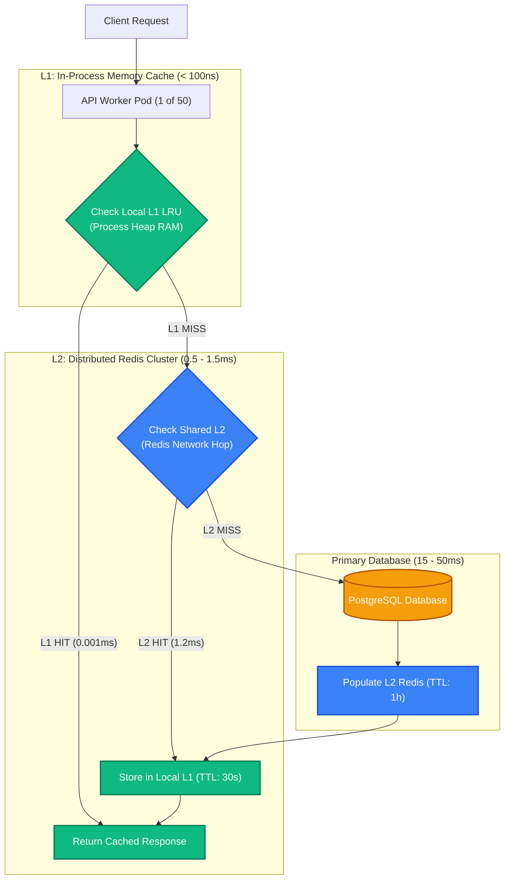
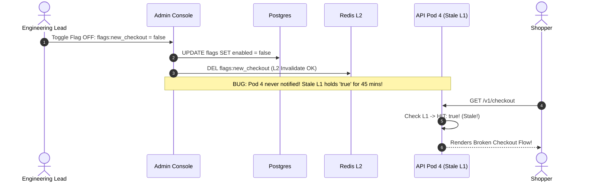

# Multi-Level Caching: L1 In-Process, L2 Redis & Coherence Protocols

> [!TIP]
> **The Golden Rule:** Multi-level caching (L1 In-Process + L2 Redis) delivers sub-microsecond reads, but introduces the distributed cache coherence problem. When mutating data, never update L2 alone: you must broadcast an invalidation message across all application instances using **Redis Pub/Sub** or **Redis Client-Side Caching (RESP3 Tracking)** to purge stale local L1 caches simultaneously.

---

## 1. Visual Mental Model: The Hierarchical Multi-Level Architecture

Stacking an in-process L1 cache in front of a shared L2 Redis cluster eliminates network overhead for your hottest keys while maintaining centralized scale:



---

## 2. Multi-Level Cache Invalidation & Coherence Protocol

When Pod A handles a write, Pod B's local in-memory L1 cache does not know the data has changed unless notified via a pub/sub invalidation bus:

```mermaid
sequenceDiagram
    autonumber
    actor User as Client
    participant PodA as API Pod A (Mutator)
    participant DB as Postgres Database
    participant Redis as Redis L2 & Pub/Sub Bus
    participant PodB as API Pod B (Reader)

    User->>PodA: 1. POST /v1/config/banner {"active": false}
    PodA->>DB: 2. UPDATE banner SET active = false; COMMIT;
    PodA->>Redis: 3. DEL config:banner (L2 Invalidation)
    PodA->>Redis: 4. PUBLISH "cache:invalidate" "config:banner"
    
    Note over PodA,PodB: Redis broadcasts invalidation event to all active pods!
    Redis-->>PodB: Invalidation Message: "config:banner"
    Note over PodB: Pod B purges "config:banner" from its local L1 RAM!
    
    User->>PodB: 5. GET /v1/config/banner
    PodB->>PodB: Check L1 -> MISS (Purged!)
    PodB->>Redis: Check L2 -> MISS (Deleted!)
    PodB->>DB: Reads fresh false state from Postgres!
```

---

## 3. Production War Story: The Phantom Pod Feature Flag Desynchronization

### The Incident
A SaaS platform rolled out a new enterprise checkout flow behind a feature flag: `flags:new_checkout`. To optimize performance, developers implemented an in-memory L1 cache using an in-process dictionary (`cachetools.LRUCache`) with a 1-hour expiration.

During deployment, a critical payment calculation bug was discovered. An engineer opened the administrative console and toggled `flags:new_checkout = false`. The admin tool updated PostgreSQL and deleted the key in Redis (L2).

However:
1. The 20 backend Kubernetes pods had already loaded `flags:new_checkout = true` into their local L1 process memory.
2. The admin tool did not implement a Pub/Sub broadcast to notify active pods.
3. For the next 45 minutes, whenever a customer's request was routed by the load balancer to Pod 4 or Pod 12, their local L1 cache returned `true`, redirecting users to the broken payment flow.
4. When the user refreshed the page, the request hit Pod 7 (which had restarted or evicted the key), returning `false`.
5. 1,800 customers were caught in an erratic A/B oscillation loop where payments failed unpredictably.



### The Root Cause
**L1 Cache Isolation without Coherence Protocol:** In-process L1 memory cannot be purged by external database or Redis mutations unless an active inter-process signaling mechanism (Pub/Sub or Redis Client-Side Tracking) is implemented.

### The Verified Fix
- **Redis Pub/Sub Invalidation Channel:** When any worker invalidates a key, publish a message to a broadcast channel. All pods subscribe on startup and immediately evict the key from their local L1.
- **Short L1 TTLs:** Cap in-process L1 TTL to **5–15 seconds** as a safety bound against missed messages.

---

## 4. Multi-Language Production Implementation

### Go: Two-Tier Cache (GoCache L1 + Redis L2) with Pub/Sub Coherence

```go
package main

import (
	"context"
	"encoding/json"
	"fmt"
	"log/slog"
	"sync"
	"time"

	"github.com/redis/go-redis/v9"
)

type TwoTierCache struct {
	redisClient *redis.Client
	mu          sync.RWMutex
	l1          map[string]cacheEntry
}

type cacheEntry struct {
	value     string
	expiresAt time.Time
}

func NewTwoTierCache(rdb *redis.Client) *TwoTierCache {
	c := &TwoTierCache{
		redisClient: rdb,
		l1:          make(map[string]cacheEntry),
	}
	// Start background subscriber for distributed invalidation
	go c.listenForInvalidations()
	return c
}

func (c *TwoTierCache) Get(ctx context.Context, key string) (string, bool) {
	// 1. Check L1 In-Process RAM (<100ns)
	c.mu.RLock()
	entry, found := c.l1[key]
	c.mu.RUnlock()

	if found && time.Now().Before(entry.expiresAt) {
		return entry.value, true // L1 Hit!
	}

	// 2. Check L2 Redis (<1ms)
	val, err := c.redisClient.Get(ctx, key).Result()
	if err == nil {
		// Populate L1 with short safety TTL (15s)
		c.mu.Lock()
		c.l1[key] = cacheEntry{value: val, expiresAt: time.Now().Add(15 * time.Second)}
		c.mu.Unlock()
		return val, true // L2 Hit!
	}

	return "", false // Full Miss
}

func (c *TwoTierCache) Invalidate(ctx context.Context, key string) error {
	// 1. Delete L2 Redis
	_ = c.redisClient.Del(ctx, key).Err()

	// 2. Broadcast Invalidation to all active pods
	return c.redisClient.Publish(ctx, "cache:invalidation:bus", key).Err()
}

func (c *TwoTierCache) listenForInvalidations() {
	pubsub := c.redisClient.Subscribe(context.Background(), "cache:invalidation:bus")
	defer pubsub.Close()

	ch := pubsub.Channel()
	for msg := range ch {
		// Purge local L1 memory immediately
		c.mu.Lock()
		delete(c.l1, msg.Payload)
		c.mu.Unlock()
		slog.Info("L1 local cache purged via pub/sub", "key", msg.Payload)
	}
}
```

---

### Node.js (TypeScript): L1 LRU + Redis L2 with Pub/Sub Invalidation

```typescript
import { createClient } from 'redis';
import { LRUCache } from 'lru-cache';

export class MultiTierCache {
  private l1: LRUCache<string, string>;
  private subClient: ReturnType<typeof createClient>;

  constructor(private redis: ReturnType<typeof createClient>) {
    // L1: In-process LRU (Max 5,000 items, TTL: 10s)
    this.l1 = new LRUCache({ max: 5000, ttl: 10000 });

    this.subClient = redis.duplicate();
    this.initPubSub();
  }

  private async initPubSub() {
    await this.subClient.connect();
    await this.subClient.subscribe('cache:invalidation', (key) => {
      this.l1.delete(key); // Evict from local L1
    });
  }

  async get(key: string): Promise<string | null> {
    // 1. L1 Check
    const localVal = this.l1.get(key);
    if (localVal !== undefined) return localVal;

    // 2. L2 Redis Check
    const redisVal = await this.redis.get(key);
    if (redisVal !== null) {
      this.l1.set(key, redisVal);
      return redisVal;
    }

    return null;
  }

  async invalidate(key: string): Promise<void> {
    await this.redis.del(key);
    await this.redis.publish('cache:invalidation', key);
    this.l1.delete(key);
  }
}
```

---

### Python: FastAPI Multi-Tier Caching with Redis Tracking

```python
import time
from typing import Optional
from fastapi import FastAPI
from pydantic import BaseModel
import redis.asyncio as aioredis

app = FastAPI(title="Multi-Level Caching API")
redis_client: aioredis.Redis = None

# Local in-process L1 dictionary
l1_cache: dict[str, tuple[str, float]] = {}

@app.on_event("startup")
async def startup():
    global redis_client
    redis_client = aioredis.from_url("redis://localhost:6379", decode_responses=True)

@app.get("/v1/config/{key}")
async def get_config(key: str):
    now = time.time()
    # 1. L1 Memory Check (<100ns)
    if key in l1_cache:
        val, exp = l1_cache[key]
        if now < exp:
            return {"source": "L1_RAM", "value": val}

    # 2. L2 Redis Check (<1ms)
    val = await redis_client.get(key)
    if val:
        l1_cache[key] = (val, now + 15.0) # 15s L1 TTL
        return {"source": "L2_REDIS", "value": val}

    return {"source": "MISS", "value": None}
```

---

## 5. Practical Hands-On Verification Matrix

### Step 1: Read Key (L2 Hit -> Populates L1)
```bash
curl.exe -i http://localhost:8000/v1/config/theme
```
**Expected Response:**
```http
HTTP/1.1 200 OK
Content-Type: application/json

{"source":"L2_REDIS","value":"dark_mode"}
```

### Step 2: Immediate Re-Read (Sub-Microsecond L1 RAM Hit)
```bash
curl.exe -i http://localhost:8000/v1/config/theme
```
**Expected Response:**
```http
HTTP/1.1 200 OK
Content-Type: application/json

{"source":"L1_RAM","value":"dark_mode"}
```

---

## 6. Operational Verification Quizzes

<details>
<summary><b>Checkpoint 1: Calculating Cumulative Hit Ratios Across Multi-Level Caches</b></summary>

**Scenario:** An application implements an L1 cache with an 80% hit ratio ($H_{L1} = 0.80$) and an L2 Redis cache with a 90% hit ratio on remaining traffic ($H_{L2} = 0.90$). What percentage of overall requests hit the database?

**Correct Analysis:** 2% Database Traffic.
$$\text{L1 Misses} = 1 - 0.80 = 20\%$$
$$\text{L2 Misses (Full Misses)} = 20\% \times (1 - 0.90) = 2\%$$
The cumulative hit ratio is:
$$\text{Total Hit Ratio} = 80\% + (20\% \times 90\%) = 98\%$$
Only 2 out of every 100 requests ever reach PostgreSQL.
</details>

<details>
<summary><b>Checkpoint 2: The Silent Memory Leak of Unbounded L1 Dictionaries</b></summary>

**Scenario:** A developer implements L1 caching by adding an unconstrained global dictionary in Python: `cache = {}`. Under production traffic, memory consumption grows steadily until the OS kernel triggers an OOM kill. Why?

**Correct Analysis:** Lack of Maximum Capacity Bounding and Eviction. Unlike Redis which has a hard `maxmemory` ceiling, a standard language hash map / dictionary grows infinitely as new keys arrive. Without an explicit eviction algorithm (such as an LRU cache with `max_size=5000`), abandoned customer keys remain in memory permanently, leaking RAM until the process crashes.
</details>

<details>
<summary><b>Checkpoint 3: Network Partitions and Pub/Sub Invalidation Failure</b></summary>

**Scenario:** In a multi-tier cache using Redis Pub/Sub for invalidation, Pod 3 experiences a temporary 1-second network disconnect during which an invalidation message is broadcast. Does Pod 3 receive the message when it reconnects?

**Correct Analysis:** No. Redis Pub/Sub is fire-and-forget; it does not buffer messages for disconnected subscribers. Pod 3 misses the invalidation and will continue serving stale data from its local L1 cache until the key's local TTL expires. This is why **all L1 in-process caches must enforce a short maximum TTL (e.g. 5–15 seconds)** to act as an automatic upper bound on staleness.
</details>

---

## Further Reading & Sources

- [Redis 6: Client-Side Caching Protocol (RESP3 Tracking)](https://redis.io/docs/manual/client-side-caching/)
- [High Scalability: Multi-Tier Caching Architecture Patterns](http://highscalability.com/)
- [Martin Kleppmann: Designing Data-Intensive Applications (Caching Layers)](https://dataintensive.net/)

---

## Next Steps

Advance to the next module:
[../04-caching-for-web-apps-and-databases/README.md](../04-caching-for-web-apps-and-databases/README.md)
Explore specialized caching applications: Session stores, full-page HTML caching, Redis sorted sets for leaderboards, and rate-limiting token buckets.
