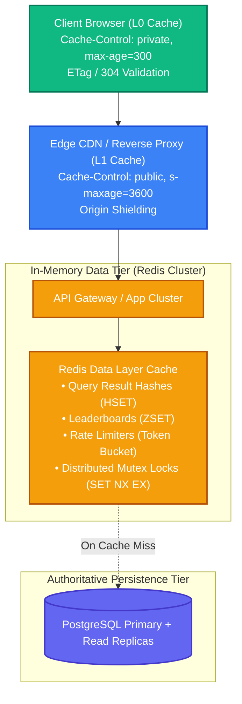
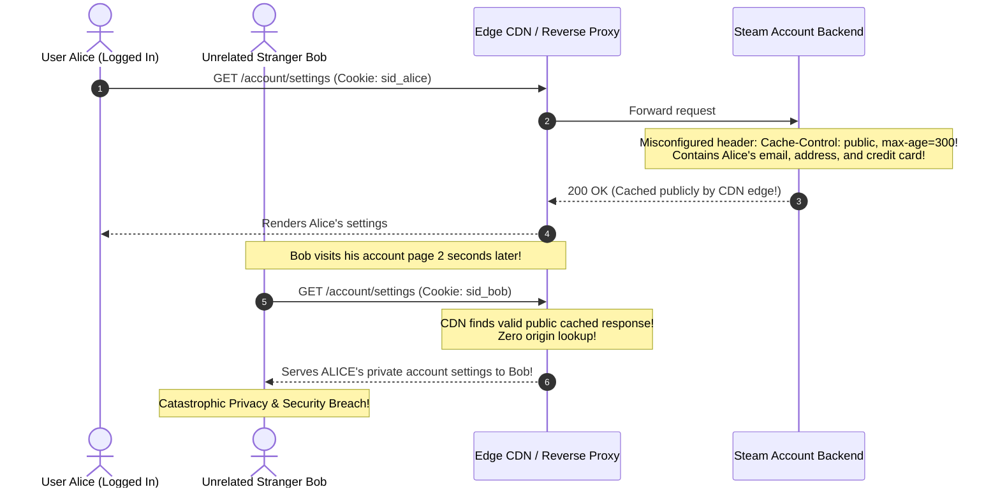

# Caching for Web Apps and Databases: HTTP Caching, Stampedes & Redis Data Structures

> [!TIP]
> **The Golden Rule:** Never mark authenticated or personalized responses as `public` in `Cache-Control`. Personal responses must be marked **`Cache-Control: private, no-cache`** to prevent shared CDN proxies from leaking sensitive customer profiles. At the data layer, defend hot keys against **Cache Stampedes** using **Distributed Mutex Locking (`SET key token NX EX 5`)** or **Probabilistic Early Recomputation (XFetch)**.

---

## 1. Visual Mental Model: End-to-End Web & Database Caching Topology

A production web application coordinates caching across three distinct physical tiers:



---

## 2. Redis Data Structures for Backend Applications

Selecting the correct Redis data structure dramatically reduces RAM consumption and eliminates CPU overhead:

| Data Structure | Underlying Engine | Time Complexity | Production Use Case |
| :--- | :--- | :--- | :--- |
| **String** | Dynamic raw bytes / SDS | $O(1)$ | Simple serialized JSON payloads, Distributed Locks (`SET NX EX`) |
| **Hash (`HSET` / `HGET`)** | ZipList / Hash Table | $O(1)$ field | Storing entity objects (user attributes, session properties without re-serializing) |
| **Sorted Set (`ZSET`)** | SkipList + Hash Table | $O(\log N)$ | Real-time gaming leaderboards, sliding-window rate limiters |
| **Set (`SADD` / `SISMEMBER`)** | IntSet / Hash Table | $O(1)$ | Cache invalidation tags, unique visitor tracking, permission roles |
| **HyperLogLog (`PFADD`)** | Probabilistic Cardinality | $O(1)$, fixed 12 KB | Counting billions of unique daily active users (DAUs) with 0.81% error |

---

## 3. Production War Story: The Steam Christmas CDN Private Profile Leak

### The Incident
During the 2015 Christmas Winter Sale, Valve's digital game distribution platform (Steam) experienced a catastrophic caching misconfiguration. To mitigate overwhelming holiday traffic, an operational configuration script updated reverse proxy rules in front of the Steam store and user account portal.

A caching rule mistakenly marked all account settings and shopping cart responses with:
`Cache-Control: public, max-age=300`

As a result:
1. When User A clicked "Account Details" to view their credit card and purchase history, the reverse proxy cached User A's HTML response as a shared public edge object.
2. For the next 300 seconds, the CDN served User A's cached HTML page to **thousands of other random players** worldwide who loaded the account portal.
3. Over 34,000 users had their private email addresses, home billing addresses, order histories, and masked credit card numbers exposed to strangers.
4. Valve was forced to take the entire Steam Store and Community platform completely offline on Christmas Day to purge CDN caches and remediate the configuration.



### The Root Cause
1. **Public Directives on Private Payloads:** The origin server emitted `Cache-Control: public` on responses containing authenticated, personalized user data.
2. **Missing `Vary` Header:** The reverse proxy failed to vary on `Cookie` or `Authorization`.

### The Verified Fix
- **Strict Headers for Personalized Data:**
  `Cache-Control: private, no-cache, no-store, must-revalidate`
- **Vary by Authorization/Cookie:** Never allow shared proxies to cache responses that lack explicit `Vary: Cookie` or `Vary: Authorization`.

---

## 4. Multi-Language Production Implementation

### Go: Distributed Mutex Locking (Stampede Defense) with Redis `SET NX EX`

```go
package main

import (
	"context"
	"crypto/rand"
	"encoding/hex"
	"errors"
	"fmt"
	"time"

	"github.com/redis/go-redis/v9"
)

type StampedeShield struct {
	rdb *redis.Client
}

// FetchWithLock guarantees only ONE worker queries the database on a cache miss
func (s *StampedeShield) FetchWithLock(ctx context.Context, key string, ttl time.Duration, computeFn func() (string, error)) (string, error) {
	// 1. Try reading existing cache value
	val, err := s.rdb.Get(ctx, key).Result()
	if err == nil {
		return val, nil // Cache Hit!
	}

	lockKey := fmt.Sprintf("lock:%s", key)
	lockToken := generateRandomToken()

	// 2. Attempt to acquire distributed lock (SET NX EX)
	// Only 1 thread wins this lock; others will wait
	acquired, err := s.rdb.SetNX(ctx, lockKey, lockToken, 5*time.Second).Result()
	if err != nil {
		return "", err
	}

	if acquired {
		// Winner: Execute expensive DB computation
		defer s.releaseLock(ctx, lockKey, lockToken)

		computedVal, err := computeFn()
		if err != nil {
			return "", err
		}

		// Store computed value with TTL
		_ = s.rdb.Set(ctx, key, computedVal, ttl).Err()
		return computedVal, nil
	}

	// Losers: Sleep and poll cache (Max 5 attempts)
	for i := 0; i < 10; i++ {
		time.Sleep(50 * time.Millisecond)
		val, err := s.rdb.Get(ctx, key).Result()
		if err == nil {
			return val, nil // Lock winner finished computing!
		}
	}

	return "", errors.New("timeout waiting for cache computation")
}

func (s *StampedeShield) releaseLock(ctx context.Context, lockKey, lockToken string) {
	// Atomic Lua script: only release lock if token matches (avoids releasing another worker's lock)
	luaScript := `
		if redis.call("get", KEYS[1]) == ARGV[1] then
			return redis.call("del", KEYS[1])
		else
			return 0
		end
	`
	_ = s.rdb.Eval(ctx, luaScript, []string{lockKey}, lockToken).Err()
}

func generateRandomToken() string {
	b := make([]byte, 16)
	_, _ = rand.Read(b)
	return hex.EncodeToString(b)
}
```

---

### Node.js (TypeScript): Redis Sorted Sets for Real-Time Leaderboards & Rate Limiting

```typescript
import { createClient } from 'redis';

export class GamingLeaderboardService {
  constructor(private redis: ReturnType<typeof createClient>) {}

  // Update player score in real-time ($O(\log N)$)
  async recordScore(leaderboardId: string, playerId: string, points: number): Promise<void> {
    const key = `lb:${leaderboardId}`;
    // ZINCRBY increments score atomically
    await this.redis.zIncrBy(key, points, playerId);
  }

  // Retrieve Top 10 players ($O(\log N + M)$)
  async getTopPlayers(leaderboardId: string): Promise<{ playerId: string; score: number; rank: number }[]> {
    const key = `lb:${leaderboardId}`;
    // ZREVRANGEBYSCORE with WITHSCORES
    const results = await this.redis.zRangeWithScores(key, 0, 9, { REV: true });

    return results.map((entry, index) => ({
      playerId: entry.value,
      score: entry.score,
      rank: index + 1,
    }));
  }
}
```

---

### Python: FastAPI HTTP Caching Directives & ETag Middleware

```python
import hashlib
from fastapi import FastAPI, Request, Response
from pydantic import BaseModel

app = FastAPI(title="HTTP Caching Gateway")

class UserSettings(BaseModel):
    user_id: str
    theme: str
    notifications: bool

@app.get("/v1/users/{user_id}/settings")
async def get_settings(user_id: str, request: Request, response: Response):
    # Simulated settings retrieval
    settings_data = '{"user_id":"usr_42","theme":"dark","notifications":true}'
    
    # Compute strong ETag
    etag = f'"{hashlib.sha256(settings_data.encode()).hexdigest()[:16]}"'

    # Check client's If-None-Match header
    client_etag = request.headers.get("if-none-match")
    if client_etag == etag:
        # Return 304 Not Modified: Saves bandwidth, zero body
        return Response(status_code=304, headers={"ETag": etag, "Cache-Control": "private, no-cache"})

    # Send response with strict security headers (Prevents CDN leakage!)
    response.headers["ETag"] = etag
    response.headers["Cache-Control"] = "private, no-cache, must-revalidate"
    return UserSettings(user_id=user_id, theme="dark", notifications=True)
```

---

## 5. Practical Hands-On Verification Matrix

### Step 1: Fetch Settings with ETag
```bash
curl.exe -i http://localhost:8000/v1/users/usr_42/settings
```
**Expected Response:**
```http
HTTP/1.1 200 OK
ETag: "w/9f2a8b..."
Cache-Control: private, no-cache, must-revalidate
Content-Type: application/json

{"user_id":"usr_42","theme":"dark","notifications":true}
```

### Step 2: Conditional Revalidation (304 Not Modified)
```bash
curl.exe -i http://localhost:8000/v1/users/usr_42/settings \
  -H 'If-None-Match: "w/9f2a8b..."'
```
**Expected Response:**
```http
HTTP/1.1 304 Not Modified
ETag: "w/9f2a8b..."
Cache-Control: private, no-cache
```

---

## 6. Operational Verification Quizzes

<details>
<summary><b>Checkpoint 1: The Danger of Caching Set-Cookie Responses on CDNs</b></summary>

**Scenario:** An edge CDN rule caches `GET /login` with `Cache-Control: public, s-maxage=3600`. The origin server attaches `Set-Cookie: session_id=xyz`. What happens to the next 10,000 visitors who load the login page?

**Correct Analysis:** Session Hijacking / Cookie Overwriting. The CDN caches the entire HTTP response headers including the `Set-Cookie` header. Every subsequent visitor who requests the login page receives the exact same cached `Set-Cookie: session_id=xyz`. All 10,000 visitors are forced into the same session ID. Reverse proxies must be configured to strip `Set-Cookie` headers from cacheable responses or forbid caching on any response containing cookies.
</details>

<details>
<summary><b>Checkpoint 2: The Probabilistic Early Expiration (XFetch) Algorithm</b></summary>

**Scenario:** A cache key takes 8 seconds of heavy CPU calculation to regenerate. If we wait until the key completely expires at $TTL=0$, a cache stampede occurs. How does XFetch eliminate stampedes without mutex locks?

**Correct Analysis:** Early Probabilistic Recomputation. Under the XFetch algorithm, worker threads reading the cache evaluate a mathematical probability function based on remaining TTL and computation time $\delta$:
$$-\beta \times \delta \times \ln(\text{rand}()) > \text{expiry} - \text{now}$$
As the key approaches its expiration, the probability that an incoming read initiates a background recomputation approaches 100%. One lucky request recomputes and extends the TTL *before* it hits zero, so regular traffic experiences 100% continuous cache hits with zero stampede.
</details>

<details>
<summary><b>Checkpoint 3: The Danger of Redis Key Expiration Sweeps on Large Datasets</b></summary>

**Scenario:** 10,000,000 keys expire at the exact same minute. The Redis server CPU jumps to 100% and latency spikes to 500ms, even though read traffic is low. Why?

**Correct Analysis:** Active Key Expiration Blocking. Redis uses two mechanisms to evict expired keys: passive (when accessed) and active (background periodic sweep). When millions of keys expire simultaneously, the active expiration loop samples keys and refuses to yield the main thread until the percentage of expired keys in the sample falls below 25%. This starves the single-threaded event loop, blocking all other client operations. Always add random jitter to TTLs.
</details>

---

## Further Reading & Sources

- [RFC 9111: HTTP Caching Standards](https://www.rfc-editor.org/rfc/rfc9111.html)
- [Optimal Probabilistic Cache Stampede Prevention (Vattani et al., VLDB 2015)](https://www.vldb.org/pvldb/vol8/p886-vattani.pdf)
- [Redis Official Documentation: Data Types Tutorial](https://redis.io/docs/data-types/)

---

## Next Steps

Advance to the next module:
[../05-performance-bottlenecks-and-identifying-them/README.md](../05-performance-bottlenecks-and-identifying-them/README.md)
Explore system performance diagnostic methodologies: Amdahl's Law, the USE method (Utilization, Saturation, Errors), the RED method, and Linux tracing tools.
