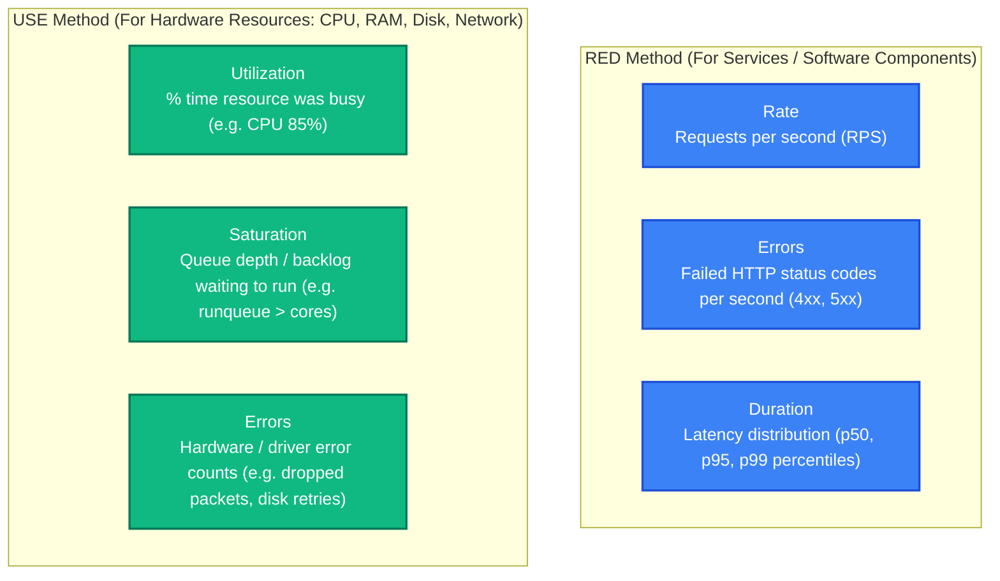
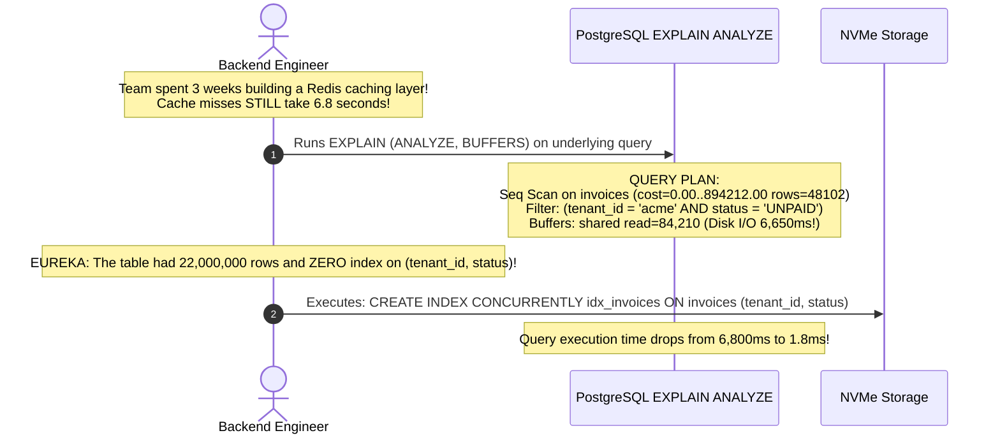

# Performance Bottlenecks: Tail Latency, Amdahl's Law & The USE/RED Methods

> [!TIP]
> **The Golden Rule:** Never optimize based on averages or intuition—averages hide tail latency disasters. Report response times strictly as percentiles (**p50, p95, p99, p99.9**). Identify bottlenecks systematically using the **USE Method (Utilization, Saturation, Errors)** for hardware resources and the **RED Method (Rate, Errors, Duration)** for services, and always remember **Amdahl's Law**: optimizing a component that accounts for 5% of execution time can never yield more than a 5% system speedup.

---

## 1. Visual Mental Model: Tail Latency at Scale & The USE / RED Framework

In modern distributed microservices, a single user request fans out into dozens of parallel sub-requests. The slowest dependency dictates the user's perceived response time:

```
┌────────────────────────────────────────────────────────────────────────┐
│               The "Tail at Scale" Probability Effect                   │
├───────────────────────┬────────────────────────────────────────────────┤
│ Sub-requests Fan-out  │ Probability of hitting 99th percentile latency │
├───────────────────────┼────────────────────────────────────────────────┤
│ 1 request             │ 1.0%                                           │
│ 10 requests           │ 9.6%                                           │
│ 50 requests           │ 39.5%                                          │
│ 100 requests          │ 63.4% (Over 6 in 10 users hit the p99 tail!)   │
└───────────────────────┴────────────────────────────────────────────────┘
```



---

## 2. Amdahl's Law: The Mathematical Limit of Optimization

Amdahl's Law defines the theoretical maximum speedup achievable by optimizing any single subsystem:

$$S_{\text{latency}}(s) = \frac{1}{(1 - p) + \frac{p}{s}}$$

Where:
- $p$ is the proportion of total execution time spent in the subsystem being optimized ($0 \le p \le 1$).
- $s$ is the speedup factor of that subsystem.

> [!NOTE]
> If a database query accounts for 80% of an endpoint's latency ($p = 0.80$), making that query $10\times$ faster ($s = 10$) gives an overall system speedup of:
> $$\frac{1}{(1 - 0.8) + \frac{0.8}{10}} = \frac{1}{0.2 + 0.08} = 3.57\times \text{ faster}$$
> But if an engineer spends two weeks rewriting JSON serialization that only accounts for 5% of execution time ($p = 0.05$), even an infinite speedup ($s = \infty$) can never make the endpoint more than **$1.05\times$ faster** ($5\%$ total gain).

---

## 3. Production War Story: The Premature Redis Cache & The Missing Index

### The Incident
A SaaS analytics dashboard displayed customer billing summaries: `GET /v1/billing/summary`. Under load, average latency was 1.2 seconds, and p99 latency was **6.8 seconds**.

An engineering team assumed: *"The database is too slow; we need to cache the results in Redis."*
1. Over three sprints, they built a complex cache-aside layer, complete with cache invalidation webhooks and Kafka synchronization.
2. In production, average response time dropped for warm requests.
3. However, whenever a customer performed an update or a new tenant logged in (cache miss), the endpoint still took **6.8 seconds**.
4. Even worse, the complex caching layer introduced distributed race conditions that showed stale balances to finance directors.



### The Root Cause
1. **Premature Optimization without Profiling:** The team attempted to patch an un-profiled database bottleneck by adding architectural complexity (Redis).
2. **Missing Composite Index:** The root cause was a sequential scan across 22,000,000 rows. A single composite B-Tree index reduced query time by **$3,700\times$** ($6,800\text{ms} \rightarrow 1.8\text{ms}$).

### The Verified Fix
- **Profile First:** Run `EXPLAIN (ANALYZE, BUFFERS)` and application CPU profilers before writing a single line of caching code.
- **Rule of Thumb:** Fix underlying $O(N)$ database scans and algorithm inefficiencies before papering over them with caches.

---

## 4. Multi-Language Production Implementation: RED Metrics Middleware

### Go: RED Metrics & Histogram Percentile Collector

```go
package main

import (
	"log/slog"
	"net/http"
	"sort"
	"sync"
	"time"
)

type REDCollector struct {
	mu         sync.Mutex
	latencies  []float64 // Recorded in milliseconds
	errorCount int64
	totalCount int64
}

func NewREDCollector() *REDCollector {
	return &REDCollector{latencies: make([]float64, 0, 10000)}
}

func (c *REDCollector) Record(duration time.Duration, isError bool) {
	c.mu.Lock()
	defer c.mu.Unlock()

	c.totalCount++
	if isError {
		c.errorCount++
	}
	c.latencies = append(c.latencies, float64(duration.Microseconds())/1000.0)
}

func (c *REDCollector) GetPercentiles() (p50, p95, p99 float64) {
	c.mu.Lock()
	defer c.mu.Unlock()

	if len(c.latencies) == 0 {
		return 0, 0, 0
	}

	sorted := make([]float64, len(c.latencies))
	copy(sorted, c.latencies)
	sort.Float64s(sorted)

	n := len(sorted)
	p50 = sorted[int(float64(n)*0.50)]
	p95 = sorted[int(float64(n)*0.95)]
	p99 = sorted[int(float64(n)*0.99)]
	return
}

func REDMiddleware(collector *REDCollector, next http.Handler) http.Handler {
	return http.HandlerFunc(func(w http.ResponseWriter, r *http.Request) {
		start := time.Now()
		
		// Wrap ResponseWriter to capture HTTP status code
		rw := &statusCapturingResponseWriter{ResponseWriter: w, statusCode: 200}
		next.ServeHTTP(rw, r)

		elapsed := time.Since(start)
		isError := rw.statusCode >= 500
		collector.Record(elapsed, isError)

		slog.Info("Request handled", "path", r.URL.Path, "duration_ms", elapsed.Milliseconds(), "status", rw.statusCode)
	})
}

type statusCapturingResponseWriter struct {
	http.ResponseWriter
	statusCode int
}

func (rw *statusCapturingResponseWriter) WriteHeader(code int) {
	rw.statusCode = code
	rw.ResponseWriter.WriteHeader(code)
}
```

---

### Node.js (TypeScript): High-Precision Latency Histogram Tracking

```typescript
import { Request, Response, NextFunction } from 'express';

export class ServiceMetricsTracker {
  private latenciesMs: number[] = [];
  private totalErrors = 0;
  private totalRequests = 0;

  record(durationMs: number, isError: boolean) {
    this.totalRequests++;
    if (isError) this.totalErrors++;
    this.latenciesMs.push(durationMs);

    // Keep rolling window of last 10,000 samples
    if (this.latenciesMs.length > 10000) {
      this.latenciesMs.shift();
    }
  }

  getMetrics() {
    if (this.latenciesMs.length === 0) return { p50: 0, p95: 0, p99: 0, errorRate: 0 };

    const sorted = [...this.latenciesMs].sort((a, b) => a - b);
    const n = sorted.length;

    return {
      p50: sorted[Math.floor(n * 0.5)],
      p95: sorted[Math.floor(n * 0.95)],
      p99: sorted[Math.floor(n * 0.99)],
      errorRate: (this.totalErrors / this.totalRequests) * 100,
      totalRequests: this.totalRequests,
    };
  }
}

const tracker = new ServiceMetricsTracker();

export function redMetricsMiddleware(req: Request, res: Response, next: NextFunction) {
  const start = process.hrtime.bigint();

  res.on('finish', () => {
    const end = process.hrtime.bigint();
    const durationMs = Number(end - start) / 1_000_000;
    const isError = res.statusCode >= 500;
    tracker.record(durationMs, isError);
  });

  next();
}
```

---

### Python: FastAPI High-Resolution Timing Middleware

```python
import time
from fastapi import FastAPI, Request
from pydantic import BaseModel

app = FastAPI(title="Bottleneck Diagnostic API")

latencies: list[float] = []

@app.middleware("http")
async def measure_latency_middleware(request: Request, call_next):
    start = time.perf_counter()
    response = await call_next(request)
    duration_ms = (time.perf_counter() - start) * 1000.0
    
    latencies.append(duration_ms)
    if len(latencies) > 5000:
        latencies.pop(0)

    response.headers["X-Response-Time-Ms"] = f"{duration_ms:.2f}"
    return response

@app.get("/v1/metrics/percentiles")
async def get_percentiles():
    if not latencies:
        return {"p50": 0, "p95": 0, "p99": 0}
    
    s = sorted(latencies)
    n = len(s)
    return {
        "sample_count": n,
        "p50_ms": round(s[int(n * 0.50)], 2),
        "p95_ms": round(s[int(n * 0.95)], 2),
        "p99_ms": round(s[int(n * 0.99)], 2),
    }
```

---

## 5. Practical Hands-On Verification Matrix

### Step 1: Check High-Resolution Response Time Header
```bash
curl.exe -i http://localhost:8000/v1/metrics/percentiles
```
**Expected Response:**
```http
HTTP/1.1 200 OK
Content-Type: application/json
X-Response-Time-Ms: 0.84

{
  "sample_count": 240,
  "p50_ms": 0.65,
  "p95_ms": 2.14,
  "p99_ms": 4.82
}
```

---

## 6. Operational Verification Quizzes

<details>
<summary><b>Checkpoint 1: Why Averages Hide High-Value Customer Churn</b></summary>

**Scenario:** An e-commerce company's APM tool reports an average latency of 45ms. Executive management is thrilled. However, high-net-worth enterprise customers report that checkout frequently hangs for 4 seconds. Why did the average mislead the engineering team?

**Correct Analysis:** The Flaw of Averages. 95% of users visit simple static pages (taking 5ms), while 5% of users with complex shopping carts and multiple items trigger un-indexed inventory scans (taking 4,000ms). The arithmetic mean across all requests is:
$$\text{Average} = (0.95 \times 5\text{ms}) + (0.05 \times 4000\text{ms}) = 4.75 + 200 = 204.75\text{ms}$$
Averages conceal the catastrophic 4-second experience suffered by 1 in every 20 customers. Percentiles (**p95 and p99**) directly expose the slow tail experienced by paying customers.
</details>

<details>
<summary><b>Checkpoint 2: The Queue Saturation Cliff</b></summary>

**Scenario:** A web service operates at 70% CPU utilization with an average latency of 15ms. Traffic increases by 25%, pushing CPU to 92%. Instead of rising slightly, p99 latency skyrockets by 1,400% to 220ms. Why?

**Correct Analysis:** Kingman's Formula for Queuing Delay. In queuing theory, as resource utilization ($U$) approaches 100%, the average waiting time in the queue increases asymptotically towards infinity:
$$\text{Wait Time} \propto \frac{U}{1 - U}$$
At $U = 70\%$, queue wait is proportional to $\frac{0.7}{0.3} \approx 2.33$. At $U = 92\%$, queue wait becomes $\frac{0.92}{0.08} = 11.5$ ($5\times$ higher backlog). Work requests spend almost their entire lifecycle queued up waiting for an available CPU core or database socket rather than executing.
</details>

<details>
<summary><b>Checkpoint 3: The Linux Load Average Metric</b></summary>

**Scenario:** An engineer types `uptime` on a Linux server with 4 CPU cores and sees: `load average: 14.5, 12.1, 8.4`. What does this indicate?

**Correct Analysis:** Severe CPU or Disk Saturation. On Linux, load average measures the average number of processes in the `R` (running or runnable on CPU) and `D` (uninterruptible sleep, typically waiting on disk I/O) states. On a 4-core machine, a load of 4.0 means 100% capacity. A load of 14.5 means there are 4 processes actively executing and **10.5 processes continuously waiting in line** for CPU cores or blocked on slow disk I/O.
</details>

---

## Download Printable Reference & Diagrams

Download these notes as a printable PDF, with every diagram and interview questions: [SD-D-013: Identifying Bottlenecks](https://backendroadmap.com/notes/system-design/SD-D-013.pdf). Each section in one file: [Phase 2, Estimation (PDF)](https://backendroadmap.com/notes/system-design/Phase2_Estimation_Notes.pdf).

---

## Further Reading & Sources

- [Brendan Gregg: The USE Method (Utilization, Saturation, and Errors)](http://www.brendangregg.com/usemethod.html)
- [Tom Wilkie: The RED Method for Monitoring Microservices](https://grafana.com/blog/2018/08/02/the-red-method-how-to-instrument-your-services/)
- [Jeffrey Dean & Luiz André Barroso: The Tail at Scale (CACM)](https://cacm.acm.org/magazines/2013/2/160173-the-tail-at-scale/fulltext)

---

## Next Steps

Advance to the next module:
[../06-scaling-strategies-and-batch-processing/README.md](../06-scaling-strategies-and-batch-processing/README.md)
Explore vertical vs horizontal scaling, stateless server design, chunked batch processing, and backpressure in high-throughput pipelines.
