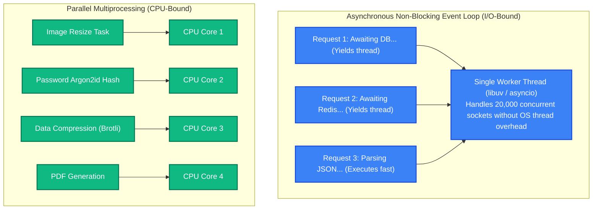
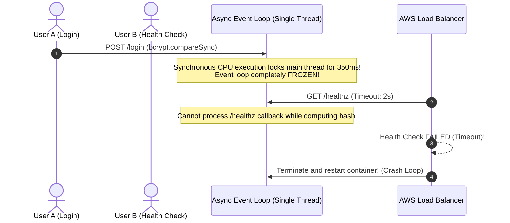

# Concurrency and Parallelism: Event Loops, Goroutines & Thread Safety

> [!TIP]
> **The Golden Rule:** **Concurrency** is about *structure* (dealing with multiple I/O waits simultaneously on one or more cores); **Parallelism** is about *execution* (doing multiple CPU computations simultaneously on multiple hardware cores). Never run CPU-heavy operations (cryptography, image processing) directly inside an asynchronous event loop—it will block the main thread and freeze thousands of concurrent I/O connections.

---

## 1. Visual Mental Model: Concurrency vs Parallelism

Understanding the mechanical distinction between interleaving I/O waits and simultaneous hardware execution:

```
┌────────────────────────────────────────────────────────────────────────┐
│                   Concurrency vs. Parallelism                          │
├───────────────────────────────────┬────────────────────────────────────┤
│ Concurrency (Structure)           │ Parallelism (Execution)            │
├───────────────────────────────────┼────────────────────────────────────┤
│ 1 Cook juggling 4 dishes          │ 4 Cooks cooking 4 dishes at once   │
│ Interleaves tasks while water boil│ Simultaneous instructions on CPUs  │
│ Solves I/O-Bound bottlenecks      │ Solves CPU-Bound bottlenecks       │
│ e.g., async/await, epoll, Node.js │ e.g., multiprocessing, multi-core  │
└───────────────────────────────────┴────────────────────────────────────┘
```



---

## 2. Runtimes Concurrency Architecture Comparison

| Runtime | Concurrency Primitive | Scheduling Model | CPU-Bound Strategy | I/O-Bound Strategy |
| :--- | :--- | :--- | :--- | :--- |
| **Go** | Goroutines (`go func()`) | $M:N$ Green Thread Scheduler across OS threads | Distribute work across goroutines (`GOMAXPROCS`) | Non-blocking channels & network poller |
| **Node.js** | Event Loop (libuv) | Single-threaded asynchronous cooperative loop | Offload to `Worker Threads` or external process | Asynchronous promises & non-blocking I/O |
| **Python** | `asyncio` Event Loop | Single-threaded cooperative loop with **GIL** | `ProcessPoolExecutor` (bypasses GIL) | `async def` with `await` on non-blocking drivers |

---

## 3. Production War Story: The CPU-Bound Hash Event Loop Freeze

### The Incident
A fast-growing fintech platform processed user authentication requests on a Node.js / FastAPI asynchronous backend. An engineer added password hashing during user login:

```javascript
// The Flaw: Calling synchronous CPU-bound hashing inside an async handler
app.post('/v1/auth/login', async (req, res) => {
  const { password, hash } = req.body;
  // Synchronous bcrypt takes 350ms of pure 100% CPU time!
  const valid = bcrypt.compareSync(password, hash); // BLOCKS THE ENTIRE EVENT LOOP!
  res.json({ valid });
});
```

During a marketing event, 500 users attempted to log in within a 5-second window:
1. Each login request held the single event-loop thread for **350 milliseconds** of continuous CPU execution.
2. During those 350ms, the main thread was completely frozen: it could not accept new TCP connections, process active database callbacks, or respond to health checks.
3. 500 sequential logins blocked the event loop for $500 \times 350\text{ms} = \mathbf{175 \text{ seconds}}$!
4. AWS load balancers marked the containers as unhealthy because `/healthz` probes timed out.
5. All application pods were terminated and restarted in an endless death loop, crashing the entire service for 40 minutes.



### The Root Cause
**Synchronous CPU-Bound Execution on an Asynchronous Event Loop:** Calling compute-heavy algorithms synchronously blocks the event loop thread from interleaving concurrent I/O tasks.

### The Verified Fix
- **Offload CPU Work to Worker Pools / Threads:**
  In Node.js: Use asynchronous `bcrypt.compare` (which runs on libuv's background thread pool) or `worker_threads`.
  In Python: Use `await asyncio.to_thread(ph.verify, ...)` or a `ProcessPoolExecutor`.

---

## 4. Multi-Language Production Implementation

### Go: Fan-Out / Fan-In Worker Pool with Sync WaitGroup & Channels

```go
package main

import (
	"context"
	"fmt"
	"sync"
	"time"
)

type Job struct {
	ID    int
	Data  string
}

type Result struct {
	JobID  int
	Output string
	Err    error
}

// WorkerPool demonstrates parallel multi-core execution in Go
func WorkerPool(numWorkers int, jobs []Job) []Result {
	jobsChan := make(chan Job, len(jobs))
	resultsChan := make(chan Result, len(jobs))

	var wg sync.WaitGroup

	// 1. Spawn worker goroutines
	for w := 1; w <= numWorkers; w++ {
		wg.Add(1)
		go func(workerID int) {
			defer wg.Done()
			for job := range jobsChan {
				// Process job
				out := fmt.Sprintf("Worker %d processed job %d (%s)", workerID, job.ID, job.Data)
				resultsChan <- Result{JobID: job.ID, Output: out}
			}
		}(w)
	}

	// 2. Feed jobs to channel
	for _, job := range jobs {
		jobsChan <- job
	}
	close(jobsChan)

	// 3. Wait for all workers to finish in background
	wg.Wait()
	close(resultsChan)

	// 4. Collect results (Fan-In)
	var results []Result
	for res := range resultsChan {
		results = append(results, res)
	}

	return results
}
```

---

### Node.js (TypeScript): Offloading CPU-Bound Tasks to Worker Threads

```typescript
import { Worker, isMainThread, parentPort, workerData } from 'worker_threads';
import express, { Request, Response } from 'express';

if (!isMainThread) {
  // Worker Thread: Computes heavy CPU work without blocking main event loop
  const { iterations } = workerData;
  let count = 0;
  for (let i = 0; i < iterations; i++) {
    count += i;
  }
  parentPort?.postMessage({ result: count });
} else {
  // Main Thread: Serves HTTP API
  const app = express();

  function runCpuTask(iterations: number): Promise<number> {
    return new Promise((resolve, reject) => {
      const worker = new Worker(__filename, { workerData: { iterations } });
      worker.on('message', (data) => resolve(data.result));
      worker.on('error', reject);
    });
  }

  app.get('/v1/heavy-compute', async (req: Request, res: Response) => {
    // Non-blocking: Offloaded to worker thread!
    const result = await runCpuTask(100_000_000);
    res.json({ result });
  });

  app.get('/healthz', (req: Request, res: Response) => {
    // Stays 100% responsive (<1ms) even while heavy compute runs!
    res.send('OK');
  });

  app.listen(3000, () => console.log('Server running on port 3000'));
}
```

---

### Python: FastAPI Asyncio with `to_thread` for CPU-Bound Offloading

```python
import asyncio
import time
from fastapi import FastAPI
from pydantic import BaseModel

app = FastAPI(title="Non-Blocking Concurrency API")

def cpu_intensive_password_hash(secret: str) -> str:
    # Heavy CPU calculation: 200ms CPU burn
    time.sleep(0.2)
    return f"hashed_{secret}"

@app.post("/v1/auth/hash")
async def compute_hash(secret: str):
    # CRITICAL: asyncio.to_thread runs CPU work on a background worker thread!
    # Event loop remains 100% free to serve other concurrent HTTP requests
    hashed_result = await asyncio.to_thread(cpu_intensive_password_hash, secret)
    return {"status": "computed", "result": hashed_result}

@app.get("/healthz")
async def health():
    # Instant response: never blocked by hashing operations!
    return {"status": "healthy"}
```

---

## 5. Practical Hands-On Verification Matrix

### Step 1: Query Health Check Under Simulated Load
```bash
curl.exe -i http://localhost:8000/healthz
```
**Expected Response (<1ms Latency):**
```http
HTTP/1.1 200 OK
Content-Type: application/json

{"status":"healthy"}
```

---

## 6. Operational Verification Quizzes

<details>
<summary><b>Checkpoint 1: The Danger of Race Conditions with Shared Variables</b></summary>

**Scenario:** In a multi-threaded Go or Node.js worker, two threads simultaneously execute: `counter++` where `counter = 0`. What is the value of `counter` after both complete?

**Correct Analysis:** 1 or 2. `counter++` is not an atomic operation; it consists of three separate CPU assembly instructions: (1) Read memory into CPU register, (2) Increment register value, (3) Write register back to memory. If Thread A and Thread B read `0` simultaneously, both increment to `1` and both write `1` back, losing one of the updates. Shared state must be protected using a **Mutex (`sync.Mutex`)** or atomic instructions (**`atomic.AddInt64`**).
</details>

<details>
<summary><b>Checkpoint 2: The Python Global Interpreter Lock (GIL) Limitation</b></summary>

**Scenario:** A developer uses Python's `threading.Thread` to spawn 8 threads on an 8-core CPU to crunch matrix mathematical calculations. CPU utilization peaks at only 12.5% (exactly 1 core). Why?

**Correct Analysis:** The Global Interpreter Lock (GIL). In standard CPython, the GIL is a mutex that prevents multiple native OS threads from executing Python bytecode simultaneously. While threads can achieve concurrency on I/O waits (network/disk), CPU-bound Python operations are strictly serialized onto a single CPU core. True multi-core CPU parallelism in Python requires the **`multiprocessing`** module or `ProcessPoolExecutor`, which spawns independent OS processes with their own memory spaces and GILs.
</details>

<details>
<summary><b>Checkpoint 3: Goroutine Leaks in Go Applications</b></summary>

**Scenario:** A Go handler launches a goroutine: `go func() { ch <- compute() }()`. If the caller times out or abandons the unbuffered channel `ch`, what happens to that goroutine?

**Correct Analysis:** A Goroutine Leak. Because `ch` is unbuffered and has no active receiver, the goroutine blocks forever trying to write to `ch`. The goroutine's 2 KB stack and associated heap objects remain permanently allocated in memory. Over millions of requests, leaked goroutines consume gigabytes of RAM until the server crashes. Goroutines must always be passed a `context.Context` to handle cancellation and avoid unbuffered channel blocks.
</details>

---

## Further Reading & Sources

- [Rob Pike: Concurrency is not Parallelism](https://go.dev/blog/waza-talk)
- [Node.js Documentation: The Node.js Event Loop, Timers, and process.nextTick()](https://nodejs.org/en/docs/guides/event-loop-timers-and-nexttick/)
- [Python Documentation: asyncio — Asynchronous I/O](https://docs.python.org/3/library/asyncio.html)

---

## Next Steps

Advance to the next module:
[../08-profiling-and-performance-testing/README.md](../08-profiling-and-performance-testing/README.md)
Master profiling tools (pprof, flamegraphs, memory allocation analysis) and load testing frameworks (k6, Locust) to detect latency degradation before deploying to production.
