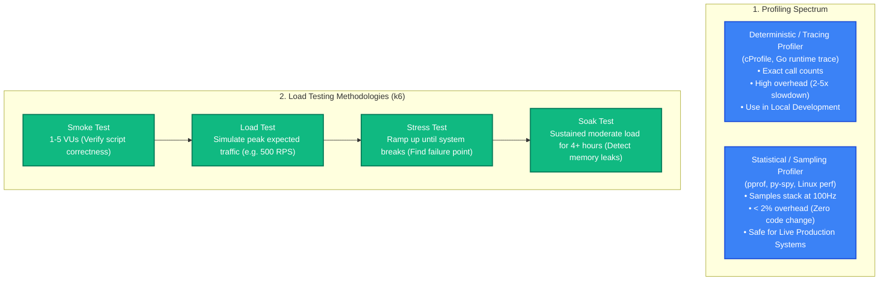
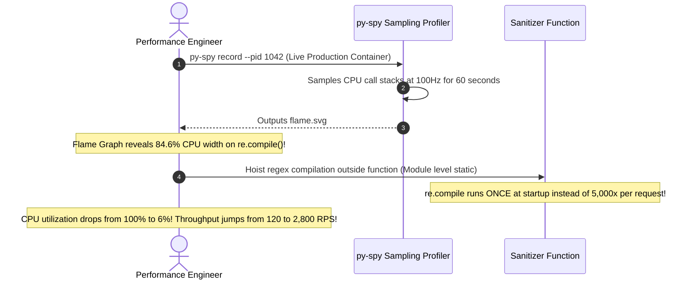

# Profiling & Performance Testing: Flame Graphs, pprof & Load Testing with k6

> [!TIP]
> **The Golden Rule:** Never guess where CPU cycles are spent. Use **Sampling Profilers (`pprof`, `py-spy`, Linux `perf`)** in production (<2% overhead) to generate **Flame Graphs**: the widest plateaus on a flame graph identify your exact CPU bottlenecks. Before deploying, validate latency and breaking limits using scripted load testing (**k6**) to discover the performance "knee of the curve".

---

## 1. Visual Mental Model: Reading a Flame Graph & Profiling Methodologies

A Flame Graph visualizes call stacks across your entire application. The **width** of each box represents the percentage of total CPU time spent in that function (wider = slower); the **height** represents call stack depth.

```
┌────────────────────────────────────────────────────────────────────────┐
│                        Flame Graph Visualization                       │
├────────────────────────────────────────────────────────────────────────┤
│                      [json.Marshal (4%)] [re.compile (82%)]            │
│                 [serialize_records (86%)]                              │
│            [handle_get_orders (92%)]                                   │
│        [http.ServeHTTP (96%)]                                          │
│    [runtime.main / OS Thread (100%)]                                   │
└────────────────────────────────────────────────────────────────────────┘
```



---

## 2. Load Testing Taxonomy: Finding the "Knee of the Curve"

```
Latency
  ▲                                 / (Crash / Saturation Cliff)
  │                                /
  │                               /
  │                     Knee     /
  │                    ┌────────┘
  │                   /
  │                  /  (Queuing delay begins)
  │_________________/
  └───────────────────────────────► Throughput (RPS)
        Healthy Operating Zone
```

| Test Type | Virtual Users (VUs) | Duration | Primary Objective | Key Metric Observed |
| :--- | :--- | :--- | :--- | :--- |
| **Load Test** | 500 VUs | 10–30 mins | Verify SLOs under expected peak load | p95 & p99 latency stability |
| **Stress Test** | 0 $\rightarrow$ 3,000 VUs | 20 mins | Locate maximum throughput ceiling and graceful degradation | 5xx error rate at tipping point |
| **Spike Test** | 0 $\rightarrow$ 5,000 VUs instantly | 2 mins | Verify autoscaler reaction and circuit breaker stability | Recovery time after traffic burst |
| **Soak Test** | 200 VUs | 4 to 24 hours | Identify slow memory leaks, connection leaks, disk filling | Steady-state heap memory slope |

---

## 3. Production War Story: The Hidden Regex Re-compilation Flame Graph Discovery

### The Incident
An online ticketing API served `GET /v1/events/search`. Despite indexing all database columns and adding an L2 Redis cache, the endpoint struggled to exceed 120 requests per second per node, and server CPU pinned at 100%.

The engineering team debated adding more CPU cores or migrating to Go. A senior engineer attached a sampling profiler (`py-spy`) to the live production process for 60 seconds without restarting the container:
`py-spy record -o flame.svg --pid 1042`

When opening the resulting SVG flame graph in a browser:
1. The database query accounted for only **3.5%** of CPU time.
2. JSON serialization accounted for **4.2%** of CPU time.
3. A massive, flat plateau spanning **84.6% of the entire flame graph** was occupied by `re.compile()`.
4. Inspection of the codebase revealed a text sanitization helper:
   ```python
   def sanitize_html(text: str) -> str:
       # BUG: re.compile() executed inside a loop for 500 items on every single request!
       pattern = re.compile(r'<[^>]*>')
       return pattern.sub('', text)
   ```



### The Root Cause
**Redundant Computation in Hot Loops:** Compiling regular expressions is an expensive operation involving AST parsing and state machine generation. Compiling the regex inside the hot loop on every request consumed 85% of all CPU cycles.

### The Verified Fix
- **Pre-Compile Regular Expressions at Module Startup:**
  ```python
  # Compile ONCE at startup
  HTML_CLEANER_PATTERN = re.compile(r'<[^>]*>')

  def sanitize_html(text: str) -> str:
      return HTML_CLEANER_PATTERN.sub('', text)
  ```
- **Result:** Endpoint latency dropped from 240ms to **3.2ms** ($75\times$ speedup); throughput skyrocketed from 120 RPS to **2,800 RPS per container**.

---

## 4. Multi-Language Production Implementation

### Go: Native `pprof` Profiling Endpoints & Memory Heap Analysis

```go
package main

import (
	"log/slog"
	"net/http"
	_ "net/http/pprof" // Registers /debug/pprof/* endpoints on DefaultServeMux
	"time"
)

func main() {
	// Serve production traffic on port 8080
	appMux := http.NewServeMux()
	appMux.HandleFunc("/v1/events", func(w http.ResponseWriter, r *http.Request) {
		w.Header().Set("Content-Type", "application/json")
		_, _ = w.Write([]byte(`{"status":"ok"}`))
	})

	// Separate internal profiler listener on port 6060 (Never expose to public internet!)
	go func() {
		slog.Info("Internal pprof profiling endpoint active on localhost:6060/debug/pprof/")
		_ = http.ListenAndServe("localhost:6060", nil)
	}()

	slog.Info("API listening on :8080")
	_ = http.ListenAndServe(":8080", appMux)
}
```
> [!NOTE]
> Profile the live application via terminal:
> `go tool pprof http://localhost:6060/debug/pprof/profile?seconds=30` (CPU)
> `go tool pprof http://localhost:6060/debug/pprof/heap` (Memory Leaks)

---

### k6 Script: Declarative Load Test with Latency Thresholds

Save as `loadtest.js`:
```javascript
import http from 'k6/http';
import { check, sleep } from 'k6';

export const options = {
  stages: [
    { duration: '30s', target: 50 },  // Ramp up to 50 users
    { duration: '1m', target: 200 },   // Sustained load at 200 users
    { duration: '30s', target: 0 },    // Ramp down to 0
  ],
  thresholds: {
    // Non-negotiable SLO: 99% of requests must complete under 50ms
    http_req_duration: ['p(95)<30', 'p(99)<50'],
    // Error rate must remain under 0.1%
    http_req_failed: ['rate<0.001'],
  },
};

export default function () {
  const res = http.get('http://localhost:8080/v1/events');
  check(res, {
    'status is 200': (r) => r.status === 200,
  });
  sleep(0.1);
}
```

---

### Python: FastAPI High-Performance Profiling Middleware

```python
import cProfile
import io
import pstats
from fastapi import FastAPI, Request
from fastapi.responses import JSONResponse

app = FastAPI(title="Profiled Performance Service")

@app.middleware("http")
async def profile_request_middleware(request: Request, call_next):
    # Only profile if query param ?profile=true is present (Development/Testing)
    should_profile = request.query_params.get("profile") == "true"
    
    if not should_profile:
        return await call_next(request)

    profiler = cProfile.Profile()
    profiler.enable()
    
    response = await call_next(request)
    
    profiler.disable()
    s = io.StringIO()
    # Sort by cumulative time
    ps = pstats.Stats(profiler, stream=s).sort_stats("cumulative")
    ps.print_stats(15) # Top 15 slowest functions
    
    print("\n--- Request Profile Breakdown ---\n" + s.getvalue())
    return response

@app.get("/v1/items")
async def get_items():
    return {"items": [f"item_{i}" for i in range(100)]}
```

---

## 5. Practical Hands-On Verification Matrix

### Step 1: Run Load Test with k6
```bash
k6 run loadtest.js
```
**Expected Output (Passing SLO Thresholds):**
```text
✓ status is 200

checks.........................: 100.00% ✓ 18412      ✗ 0
http_req_duration..............: avg=4.12ms min=0.8ms med=2.1ms max=38.4ms p(95)=12.4ms p(99)=28.1ms
http_req_failed................: 0.00%   ✓ 0          ✗ 18412
vus............................: 200
```

### Step 2: Query Profiled Endpoint in Development
```bash
curl.exe -i "http://localhost:8000/v1/items?profile=true"
```
**Expected Response:**
```http
HTTP/1.1 200 OK
Content-Type: application/json

{"items":["item_0", ...]}
```

---

## 6. Operational Verification Quizzes

<details>
<summary><b>Checkpoint 1: The Observer Effect in Profiling</b></summary>

**Scenario:** A developer profiles an endpoint in production using Python's deterministic `cProfile`. Latency jumps from 20ms to 95ms, and the profiler reports that a microsecond string comparison function took 40% of the total time. Why did the profiler lie?

**Correct Analysis:** Tracing Overhead / The Observer Effect. Deterministic profilers hook into every function call and return event. For tight loops containing millions of tiny function calls, the overhead of recording timestamps into the profiler exceeds the actual workload of the functions themselves, distorting the profile. In production, always use low-overhead **Sampling Profilers (`py-spy`, `pprof`)**, which sample the call stack periodically (e.g. at 100Hz) with $<2\%$ overhead without distorting timings.
</details>

<details>
<summary><b>Checkpoint 2: Diagnosing Memory Leaks with Heap Allocation Profilers</b></summary>

**Scenario:** A Go backend application leaks memory. Running `go tool pprof http://localhost:6060/debug/pprof/heap` shows two modes: `inuse_space` and `alloc_space`. Which mode identifies active memory leaks?

**Correct Analysis:** `inuse_space`. `alloc_space` measures the cumulative total bytes allocated over the lifetime of the process, including memory that has already been collected by the garbage collector. To find an active leak (memory that is allocated and *never released*), inspect **`inuse_space`** or **`inuse_objects`**, comparing snapshots taken 1 hour apart to isolate functions with steadily growing allocations.
</details>

<details>
<summary><b>Checkpoint 3: The Danger of Publicly Exposing pprof Endpoints</b></summary>

**Scenario:** An application imports `_ "net/http/pprof"` on its main public HTTP port. What critical security vulnerability does this create?

**Correct Analysis:** Remote Code Execution, DoS, and Sensitive Data Disclosure. Exposing `/debug/pprof/` allows external attackers to download raw memory heap dumps (which contain plaintext passwords, API keys, and session tokens). Furthermore, anyone can trigger 30-second CPU profiling traces (`/debug/pprof/profile?seconds=30`), saturating server CPU and taking down the service. Profiler endpoints must strictly listen on an internal private port (`localhost:6060`) or be blocked at the reverse proxy.
</details>

---

## Download Printable Reference & Diagrams

Download these notes as a printable PDF, with every diagram and interview questions: [SD-D-013: Identifying Bottlenecks](https://backendroadmap.com/notes/system-design/SD-D-013.pdf). Each section in one file: [Phase 2, Estimation (PDF)](https://backendroadmap.com/notes/system-design/Phase2_Estimation_Notes.pdf).

---

## Further Reading & Sources

- [Brendan Gregg: Flame Graphs Official Reference](http://www.brendangregg.com/flamegraphs.html)
- [Go Documentation: Profiling Go Programs with pprof](https://go.dev/blog/pprof)
- [k6 Official Documentation: Running Automated Load Tests](https://k6.io/docs/)

---

## Next Steps

Advance to the Track 1 Capstone:
[../09-capstone-project/README.md](../09-capstone-project/README.md)
Build the complete high-throughput, low-latency Caching & Performance Subsystem synthesizing multi-level caching, singleflight stampede defense, batch pipelines, and k6 performance validation.
