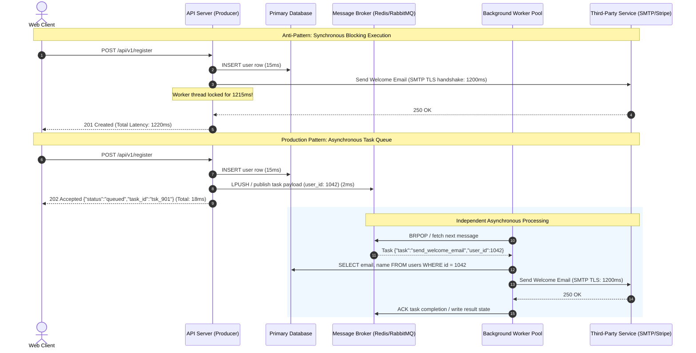
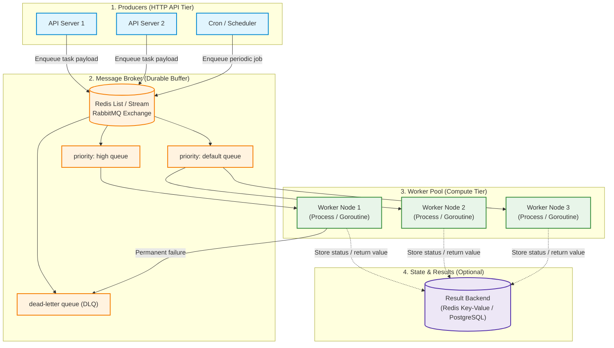
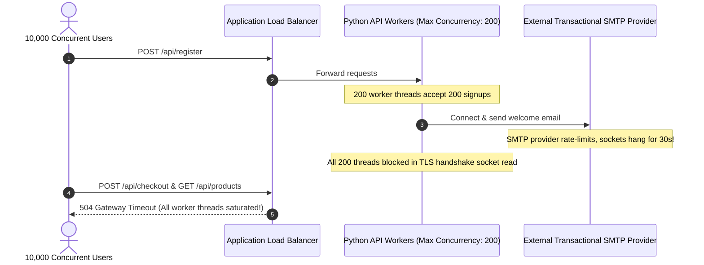

# Module 00: Task Queues Fundamentals

Every millisecond your API spends inside a request handler executing slow, non-critical I/O is time your user spends staring at a spinner—and a server thread unavailable to accept other incoming traffic. A single synchronous third-party SMTP handshake, PDF render, or payment webhook can tie up an HTTP worker thread for 5 to 30 seconds. When downstream latency spikes, worker pools saturate instantaneously, accept queues overflow, and your entire API collapses under cascading `504 Gateway Timeout` errors.

> [!TIP]
> **The Golden Rule:** Never execute slow, I/O-intensive, or unreliable operations inside the synchronous request-response lifecycle. Enqueue an immutable, primitive identifier with `202 Accepted` and let decoupled background workers process the job asynchronously and idempotently.

---

## 1. Visual Mental Models

### Synchronous Blocking vs. Asynchronous Decoupled Task Queue

Synchronous APIs couple client latency directly to third-party availability. Asynchronous task queues decouple the ingestion endpoint from execution through a durable intermediary message broker.



### The Four Pillars of Task Queue Architecture

Task queues divide responsibility across four decoupled architectural layers:



---

## 2. Structured Reference Grids

### Component Roles & Reliability Matrix

| Component | Responsibility | Failure Mode | Resilience / Mitigation Strategy |
| :--- | :--- | :--- | :--- |
| **Producer** | Validates payload, enqueues task ID & primitive parameters, returns `202 Accepted` | Broker connection refused / timeouts | Local fallback buffer, transactional outbox pattern, circuit breaker |
| **Broker** | Stores serialised task messages reliably in memory or on disk until claimed | Node crash, out-of-memory (OOM) eviction | AOF persistence, Redis Cluster/Sentinel, disk quotas, bounded TTLs |
| **Worker** | Consumes messages, executes idempotent handler code, acknowledges (ACK) | Process crash, SIGKILL, memory exhaustion | Visibility timeouts, at-least-once delivery, retry with exponential backoff |
| **Result Backend** | Persists execution state (`PENDING`, `SUCCESS`, `FAILURE`) and return values | Unbounded growth, high write contention | Set aggressive key expiration (TTL 1–24h), disable results for fire-and-forget jobs |

### Task Envelope Wire Format (JSON)

Never pass live memory references, active database connections, or large binary objects across the broker. The wire message must consist exclusively of primitives and trace metadata:

```json
{
  "task_id": "f81d4fae-7dec-11d0-a765-00a0c91e6bf6",
  "task_name": "notifications.send_welcome_email",
  "args": [1042],
  "kwargs": {
    "template_version": "v2026.1"
  },
  "retries": 0,
  "max_retries": 3,
  "eta": "2026-11-09T15:30:00Z",
  "expires": "2026-11-09T16:30:00Z",
  "headers": {
    "traceparent": "00-4bf92f3577b34da6a3ce929d0e0e4736-00f067aa0ba902b7-01",
    "enqueued_by": "api-pod-89a1"
  }
}
```

---

## 3. Production War Story

### The Black Friday Welcome Email Cascade

#### The Incident
During a major Black Friday product launch, an e-commerce platform experienced an 8x surge in signups. Within 90 seconds, the frontend API's median response latency exploded from `42ms` to `28,500ms`. Cloud load balancers marked all upstream web containers unhealthy, yielding widespread `502 Bad Gateway` and `504 Gateway Timeout` pages across the entire checkout funnel.



#### The Root Cause
The legacy user registration handler called `mailer.send_welcome_email(user)` synchronously before returning the HTTP response. The third-party SMTP provider throttled traffic and initiated socket read timeouts of 30 seconds. Because each web container had a pool of only 20 worker threads, 20 concurrent signups blocked the entire container from processing any other route—including checkout and product catalog queries.

#### The Verified Production Fix
1. Extracted email delivery into a background task queue using Redis.
2. The registration handler writes to PostgreSQL, enqueues the `user_id` to Redis, and immediately returns `202 Accepted` in `< 15ms`.
3. Dedicated worker pods consume the queue asynchronously. When SMTP throttles, the queue depth increases safely without affecting user-facing web latency.

---

## 4. Multi-Language Production Implementations

### Go (`hibiken/asynq` + Redis)

```go
package main

import (
	"context"
	"encoding/json"
	"fmt"
	"log"
	"time"

	"github.com/hibiken/asynq"
)

const (
	TypeEmailWelcome = "email:welcome"
	RedisAddr        = "127.0.0.1:6379"
)

type WelcomeEmailPayload struct {
	UserID int64  `json:"user_id"`
	Email  string `json:"email"`
}

// Producer handles task enqueueing
type JobProducer struct {
	client *asynq.Client
}

func NewJobProducer() *JobProducer {
	return &JobProducer{
		client: asynq.NewClient(asynq.RedisClientOpt{Addr: RedisAddr}),
	}
}

func (p *JobProducer) EnqueueWelcomeEmail(userID int64, email string) (*asynq.TaskInfo, error) {
	payload, err := json.Marshal(WelcomeEmailPayload{UserID: userID, Email: email})
	if err != nil {
		return nil, fmt.Errorf("serialize payload: %w", err)
	}

	task := asynq.NewTask(TypeEmailWelcome, payload,
		asynq.MaxRetry(3),
		asynq.Timeout(30*time.Second),
		asynq.Retention(24*time.Hour),
	)

	return p.client.Enqueue(task)
}

// Consumer handles asynchronous execution
func RunWorker() {
	srv := asynq.NewServer(
		asynq.RedisClientOpt{Addr: RedisAddr},
		asynq.Config{
			Concurrency: 10,
			Queues: map[string]int{
				"critical": 6,
				"default":  3,
				"low":      1,
			},
		},
	)

	mux := asynq.NewServeMux()
	mux.HandleFunc(TypeEmailWelcome, func(ctx context.Context, t *asynq.Task) error {
		var p WelcomeEmailPayload
		if err := json.Unmarshal(t.Payload(), &p); err != nil {
			return fmt.Errorf("json unmarshal failed: %w", asynq.SkipRetry)
		}

		log.Printf("[Worker] Processing welcome email for UserID: %d (%s)", p.UserID, p.Email)
		// Simulate network I/O
		select {
		case <-time.After(200 * time.Millisecond):
			log.Printf("[Worker] Successfully sent email to %s", p.Email)
			return nil
		case <-ctx.Done():
			return ctx.Err()
		}
	})

	if err := srv.Run(mux); err != nil {
		log.Fatalf("could not run worker server: %v", err)
	}
}
```

---

### Node.js / TypeScript (`BullMQ` + Redis)

```typescript
import { Queue, Worker, Job } from 'bullmq';
import IORedis from 'ioredis';

const connection = new IORedis({
  host: '127.0.0.1',
  port: 6379,
  maxRetriesPerRequest: null,
});

export interface WelcomeJobData {
  userId: number;
  email: string;
}

// 1. Producer Queue Setup
export const emailQueue = new Queue<WelcomeJobData>('email-delivery', {
  connection,
  defaultJobOptions: {
    attempts: 3,
    backoff: {
      type: 'exponential',
      delay: 2000, // 2s, 4s, 8s
    },
    removeOnComplete: 1000,
    removeOnFail: 5000,
  },
});

export async function enqueueWelcomeEmail(userId: number, email: string): Promise<string> {
  const job = await emailQueue.add('send_welcome', { userId, email });
  return job.id!;
}

// 2. Asynchronous Consumer Worker Setup
export const emailWorker = new Worker<WelcomeJobData>(
  'email-delivery',
  async (job: Job<WelcomeJobData>) => {
    const { userId, email } = job.data;
    console.log(`[Worker] Processing Job ${job.id} for user ${userId} (${email})`);

    // Simulate third-party SMTP API call
    await new Promise((resolve) => setTimeout(resolve, 300));

    console.log(`[Worker] Email delivered for Job ${job.id}`);
    return { deliveredAt: new Date().toISOString() };
  },
  {
    connection,
    concurrency: 8,
  }
);

emailWorker.on('failed', (job, err) => {
  console.error(`[Worker Alert] Job ${job?.id} failed with error: ${err.message}`);
});
```

---

### Python (`Celery` + Redis)

```python
import time
from celery import Celery
from celery.utils.log import get_task_logger

logger = get_task_logger(__name__)

# Configure Celery with Redis broker and result backend
app = Celery(
    'tasks',
    broker='redis://127.0.0.1:6379/0',
    backend='redis://127.0.0.1:6379/1',
)

app.conf.update(
    task_serializer='json',
    accept_content=['json'],
    result_serializer='json',
    timezone='UTC',
    enable_utc=True,
    task_acks_late=True,                 # Re-queue task if worker crashes mid-execution
    task_reject_on_worker_lost=True,
    result_expires=3600,                 # Expire result keys after 1 hour
)

@app.task(bind=True, max_retries=3, default_retry_delay=5)
def send_welcome_email(self, user_id: int):
    """
    Background task to send welcome email.
    Pass only primitive IDs, never live DB connection objects.
    """
    logger.info(f"[Task {self.request.id}] Sending email to User {user_id} (Attempt {self.request.retries + 1})")
    try:
        # Simulate SMTP network latency
        time.sleep(0.5)
        logger.info(f"[Task {self.request.id}] Email successfully delivered to User {user_id}")
        return {"status": "DELIVERED", "user_id": user_id}
    except Exception as exc:
        logger.warning(f"[Task {self.request.id}] Transient error: {exc}. Retrying...")
        raise self.retry(exc=exc, countdown=2 ** self.request.retries)
```

---

## 5. Practical Hands-On Verification

### 1. Enqueue Task via HTTP API

Submit the long-running job. The API validates the payload, pushes to Redis, and returns `202 Accepted` instantly:

```bash
curl.exe -i -X POST http://localhost:8000/api/v1/jobs \
  -H "Content-Type: application/json" \
  -d '{"user_id": 1042, "email": "engineer@example.com"}'
```

**Output:**
```http
HTTP/1.1 202 Accepted
Content-Type: application/json
Date: Mon, 09 Nov 2026 15:35:00 GMT
Content-Length: 104

{
  "status": "queued",
  "task_id": "c1f728be-d38a-4d23-9580-04be745b5c92",
  "poll_url": "/api/v1/jobs/c1f728be-d38a-4d23-9580-04be745b5c92"
}
```

### 2. Poll Task Execution Status

```bash
curl.exe -i -X GET http://localhost:8000/api/v1/jobs/c1f728be-d38a-4d23-9580-04be745b5c92
```

**Output:**
```http
HTTP/1.1 200 OK
Content-Type: application/json
Date: Mon, 09 Nov 2026 15:35:02 GMT
Content-Length: 128

{
  "task_id": "c1f728be-d38a-4d23-9580-04be745b5c92",
  "status": "SUCCESS",
  "result": {
    "status": "DELIVERED",
    "user_id": 1042
  }
}
```

### 3. Inspect Redis Queue Wire Payload

Connect via Redis CLI to observe raw task envelopes in memory:

```bash
redis-cli LRANGE celery 0 -1
```

**Output:**
```text
1) "{\"body\": \"WzEwNDJd\", \"headers\": {}, \"content-type\": \"application/json\", \"properties\": {\"correlation_id\": \"c1f728be-d38a-4d23-9580-04be745b5c92\", \"reply_to\": \"c1f728be-d38a-4d23-9580-04be745b5c92\", \"delivery_mode\": 2, \"delivery_info\": {\"exchange\": \"\", \"routing_key\": \"celery\"}}, \"content-encoding\": \"utf-8\"}"
```

---

## 6. Operational Validation Checkpoints

<details>
<summary><strong>Checkpoint 1: The Database Commit Race Condition</strong></summary>

**Scenario:** An API handler begins an uncommitted database transaction to create an order:
```python
db.session.add(order)
send_order_confirmation.delay(order.id) # Enqueue immediately
db.session.commit()
```
When traffic spikes, the worker logs `OrderNotFoundError: Order 9042 does not exist` on 5% of executions, but running the query manually seconds later reveals the row exists. What caused this, and what is the production-grade fix?

*Explanation:*
The task was enqueued to the broker before the local database transaction committed. Because Redis is faster than disk I/O, the background worker pulled the message and executed before PostgreSQL finished writing the transaction log.
**The Fix:** Use an **After-Commit Hook** (`transaction.on_commit(lambda: send_order_confirmation.delay(order.id))`) or the **Transactional Outbox Pattern** to ensure tasks are only visible after data is durably committed to the database.
</details>

<details>
<summary><strong>Checkpoint 2: Passing Full Payloads vs. Primitive Identifiers</strong></summary>

**Scenario:** A junior engineer passes the full user object including profile picture base64 data directly into the task arguments: `process_avatar.delay(user_dict)`. Why is this an anti-pattern in high-scale distributed systems?

*Explanation:*
1. **Broker Memory Bloat:** Storing large payloads inside Redis/RabbitMQ queues degrades broker throughput and risks eviction or Out-Of-Memory (OOM) crashes.
2. **Data Staleness & Concurrency Hazards:** If another request updates the user's details between enqueue and execution, the worker operates on stale snapshot data.
3. **Serialization Fragility:** Complex objects may fail to deserialize across different worker versions.
**The Rule:** Always pass immutable primary keys (`user_id`) as primitive values. Store large binary assets in Object Storage (S3/GCS) and fetch fresh state from the database inside the worker.
</details>

<details>
<summary><strong>Checkpoint 3: At-Least-Once Delivery & Worker Crash Recovery</strong></summary>

**Scenario:** A background worker pulling from a task queue begins processing a financial disbursement task. Mid-execution, the host kernel triggers an OOM kill on the worker process. How do production task brokers handle this without losing the message, and what requirement does this impose on your code?

*Explanation:*
Task systems use **Visibility Timeouts** and **Late Acknowledgments (`acks_late=True`)**. The broker retains the task in a pending state until the worker explicitly sends an `ACK` upon successful completion. If the worker crashes or the visibility timeout expires, the broker re-delivers the task to another worker.
**The Requirement:** Because tasks can be delivered more than once (**At-Least-Once Delivery**), all task execution functions **must be strictly idempotent** (e.g., verifying a unique idempotency key or idempotency token in the database before debiting accounts).
</details>

---

## Free PDF notes

Download these notes as a printable PDF, with every diagram and interview questions: [SD-C-021: Async APIs for Long Jobs](https://backendroadmap.com/notes/system-design/SD-C-021.pdf). Each section in one file: [Phase 2, APIs (PDF)](https://backendroadmap.com/notes/system-design/Phase2_APIs_Notes.pdf).

## Next

[01-task-dependencies-and-groups](../01-task-dependencies-and-groups/README.md)
— a single task is rarely the whole story. Next you'll chain tasks so one feeds the next, fan work out across many tasks and wait for all of them, and model a real multi-step order-processing pipeline as a graph of tasks.
