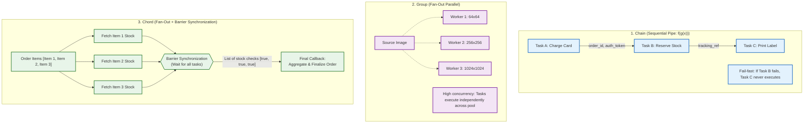
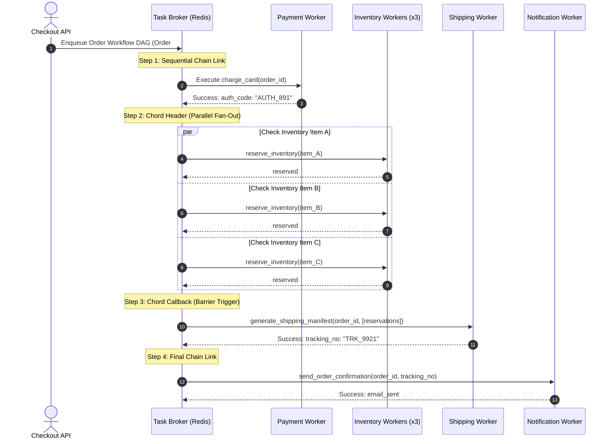
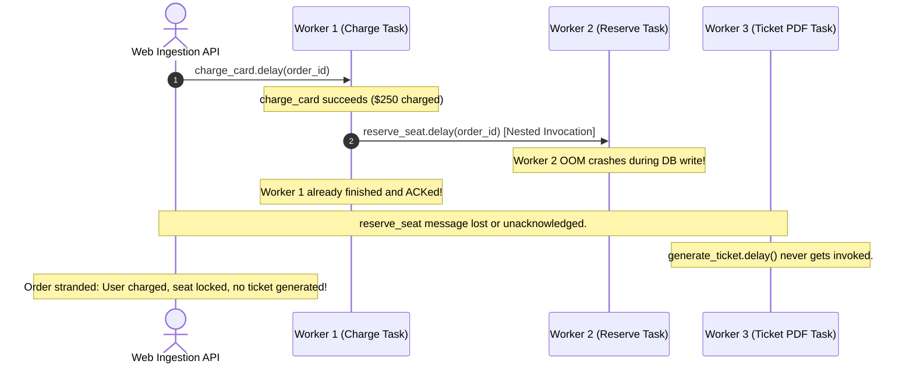

# Module 01: Task Dependencies and Groups

Real-world background workflows rarely consist of a solitary, independent task. Fulfilling an order demands charging the customer's card, verifying and reserving warehouse inventory, generating a compliant shipping label, and dispatching a confirmation receipt. Each step depends strictly on the successful completion and output of the preceding step—you cannot print a tracking number that has not yet been generated. Conversely, transcoding an uploaded video into five discrete bitrates or rendering six thumbnail dimensions are embarrassingly parallel operations that should fan out simultaneously and aggregate before signaling completion.

> [!TIP]
> **The Golden Rule:** Model multi-step background workflows as explicit Directed Acyclic Graphs (DAGs)—using Chains, Groups, and Chords—declared at enqueue time. Never trigger uncoordinated nested task invocations from inside running workers.

---

## 1. Visual Mental Models

### Workflow Topologies: Chains, Groups, and Chords

Background task engines provide three foundational primitives to orchestrate complex execution graphs without blocking worker threads:



### Complete Order Fulfillment Pipeline DAG

An industrial workflow combining Chains, Groups, and Chords into a cohesive orchestration graph:



---

## 2. Structured Reference Grids

### Workflow Coordination Primitives Comparison

| Pattern | Execution Order | Concurrency | Result Propagation | Fault Tolerance Behavior |
| :--- | :--- | :--- | :--- | :--- |
| **Chain** (`A \| B \| C`) | Strict Sequential | Serial (1 worker at a time) | Output of task $N$ is prepended as first parameter to task $N+1$ | If step $N$ fails, all downstream steps ($N+1 \dots$) are aborted immediately |
| **Group** (`group([A, B, C])`) | Concurrent / Unordered | Parallel (Bounded only by worker pool) | Collects results into an ordered array matching the task input order | Individual task failures do not abort sibling tasks |
| **Chord** (`chord([A, B, C])(D)`) | Parallel Fan-out + Barrier Sync | Parallel Header, Serial Callback | Returns a list of all header results to callback task $D$ as its argument | If any header task fails, the callback $D$ is cancelled and never executed |

### Signature Mutability Reference

| Signature Type | Syntax | Behavior in Chains | Use Case |
| :--- | :--- | :--- | :--- |
| **Mutable Signature** | `task.s(arg1, arg2)` | Prepends previous step's output: `task(previous_result, arg1, arg2)` | Piping transformations (e.g., `download -> convert -> upload`) |
| **Immutable Signature** | `task.si(arg1, arg2)` | Ignores previous output entirely; executes strictly with `task(arg1, arg2)` | Side-effects and signaling (e.g., `refresh_cache.si(user_id)`) |

---

## 3. Production War Story

### The Phantom Inventory Leak & The Nested `.delay()` Anti-Pattern

#### The Incident
An online ticketing platform launched sales for a high-demand festival. Thirty minutes in, monitoring detected that 1,200 payment authorizations succeeded, but 480 customers received error screens. More critically, the database indicated that all 1,200 tickets had been reserved, locking out remaining seats while leaving 480 transactions stranded in limbo.



#### The Root Cause
The original engineering team implemented workflow dependencies by having running tasks trigger subsequent tasks manually:
```python
@app.task
def charge_card(order_id):
    result = stripe.charge(...)
    reserve_seat.delay(order_id, result.id) # Anti-pattern: Nested manual invocation
    return result.id
```
When `Worker 2` crashed due to an out-of-memory error while processing `reserve_seat`, `charge_card` had already acknowledged its own completion. Because there was no orchestrator tracking the pipeline as a unified DAG, no error callback was triggered, no refund compensation executed, and the system had no handle to retry the failed step.

#### The Verified Production Fix
1. Refactored the nested invocation into an explicit Celery **Chain** with an attached error errback (`link_error`):
   ```python
   workflow = (
       charge_card.s(order_id) |
       reserve_seat.s(order_id) |
       generate_ticket.s(order_id)
   ).on_error(handle_pipeline_failure.s(order_id))
   ```
2. If `reserve_seat` fails, `handle_pipeline_failure` executes automatically, issuing a refund and releasing the inventory hold safely.

---

## 4. Multi-Language Production Implementations

### Go (Fan-Out / Fan-In with Worker Pool & ErrGroup)

```go
package main

import (
	"context"
	"fmt"
	"log"
	"sync"
	"time"

	"golang.org/x/sync/errgroup"
)

type ProcessedItem struct {
	ItemID int64
	Status string
}

// OrderWorkflow coordinates sequential and fan-out background tasks
type OrderWorkflow struct {
	OrderID int64
	Items   []int64
}

func (w *OrderWorkflow) Execute(ctx context.Context) error {
	log.Printf("[Workflow %d] Starting payment authorization...", w.OrderID)
	if err := w.chargeCard(ctx); err != nil {
		return fmt.Errorf("payment failed: %w", err)
	}

	log.Printf("[Workflow %d] Fanning out inventory reservations (Chord Header)...", w.OrderID)
	reservations, err := w.reserveInventoryParallel(ctx)
	if err != nil {
		w.compensatePayment(ctx) // Rollback on failure
		return fmt.Errorf("inventory reservation failed: %w", err)
	}

	log.Printf("[Workflow %d] Executing Chord Barrier Callback with %d items...", w.OrderID, len(reservations))
	if err := w.generateShipment(ctx, reservations); err != nil {
		return fmt.Errorf("shipping generation failed: %w", err)
	}

	log.Printf("[Workflow %d] Pipeline completed successfully.", w.OrderID)
	return nil
}

func (w *OrderWorkflow) chargeCard(ctx context.Context) error {
	time.Sleep(100 * time.Millisecond)
	return nil
}

func (w *OrderWorkflow) reserveInventoryParallel(ctx context.Context) ([]ProcessedItem, error) {
	g, ctx := errgroup.WithContext(ctx)
	results := make([]ProcessedItem, len(w.Items))

	for i, itemID := range w.Items {
		idx := i
		id := itemID
		g.Go(func() error {
			// Simulate inventory reservation service call
			time.Sleep(80 * time.Millisecond)
			results[idx] = ProcessedItem{ItemID: id, Status: "RESERVED"}
			return nil
		})
	}

	if err := g.Wait(); err != nil {
		return nil, err
	}
	return results, nil
}

func (w *OrderWorkflow) generateShipment(ctx context.Context, items []ProcessedItem) error {
	time.Sleep(120 * time.Millisecond)
	return nil
}

func (w *OrderWorkflow) compensatePayment(ctx context.Context) {
	log.Printf("[Workflow %d] COMPENSATION: Issuing refund for failed order.", w.OrderID)
}
```

---

### Node.js / TypeScript (`BullMQ` FlowProducer Parent-Child DAGs)

```typescript
import { FlowProducer, Worker, Job } from 'bullmq';
import IORedis from 'ioredis';

const connection = new IORedis('redis://127.0.0.1:6379', { maxRetriesPerRequest: null });
const flowProducer = new FlowProducer({ connection });

export async function createOrderProcessingFlow(orderId: number, items: number[]) {
  // BullMQ executes bottom-up: Children (parallel tasks) run first,
  // then the parent (barrier callback) executes with children results.
  const flow = await flowProducer.add({
    name: 'generate-shipping-manifest',
    queueName: 'shipping-queue',
    data: { orderId },
    children: items.map((itemId) => ({
      name: 'reserve-inventory-item',
      queueName: 'inventory-queue',
      data: { orderId, itemId },
      opts: { attempts: 3, backoff: { type: 'exponential', delay: 1000 } },
    })),
  });

  return flow.job.id;
}

// 1. Worker for Children (Fan-out parallel tasks)
export const inventoryWorker = new Worker(
  'inventory-queue',
  async (job: Job) => {
    const { orderId, itemId } = job.data;
    console.log(`[Inventory] Reserving item ${itemId} for order ${orderId}`);
    return { itemId, status: 'RESERVED' };
  },
  { connection, concurrency: 5 }
);

// 2. Worker for Parent (Chord Callback Barrier)
export const shippingWorker = new Worker(
  'shipping-queue',
  async (job: Job) => {
    const childrenValues = await job.getChildrenValues();
    console.log(`[Shipping] All items reserved:`, childrenValues);
    console.log(`[Shipping] Generating label for order ${job.data.orderId}`);
    return { trackingNumber: `TRK-${job.data.orderId}-XYZ` };
  },
  { connection }
);
```

---

### Python (`Celery` Canvas: Chains, Groups, and Chords)

```python
from celery import Celery, chain, group, chord

app = Celery(
    'workflow_app',
    broker='redis://127.0.0.1:6379/0',
    backend='redis://127.0.0.1:6379/1',
)

@app.task
def charge_payment(order_id: int, amount: float) -> dict:
    print(f"[Payment] Charging ${amount} for order {order_id}")
    return {"order_id": order_id, "auth_code": "AUTH_90124", "amount": amount}

@app.task
def reserve_item(item_id: int, order_id: int) -> dict:
    print(f"[Inventory] Reserved item {item_id} for order {order_id}")
    return {"item_id": item_id, "reserved": True}

@app.task
def generate_shipping_label(inventory_results: list, order_id: int) -> str:
    print(f"[Shipping] Aggregating {len(inventory_results)} inventory items for order {order_id}")
    return f"TRK_USPS_{order_id}_99218"

@app.task
def notify_customer(tracking_number: str, order_id: int) -> bool:
    print(f"[Notification] Dispatched email for order {order_id} with tracking {tracking_number}")
    return True

@app.task
def handle_workflow_failure(request, exc, traceback, order_id: int):
    print(f"[Alert] Order {order_id} failed with error: {exc}. Triggering refund compensation.")

def dispatch_order_pipeline(order_id: int, amount: float, items: list[int]):
    """
    Constructs an industrial DAG:
    1. Sequential step: charge_payment
    2. Parallel chord header: reserve_item for each SKU
    3. Chord barrier callback: generate_shipping_label
    4. Sequential step: notify_customer
    """
    inventory_group = group(reserve_item.s(item_id, order_id) for item_id in items)
    
    # Chord: Run inventory_group in parallel, pass aggregated list to generate_shipping_label
    shipping_chord = chord(inventory_group, generate_shipping_label.s(order_id))

    # Pipeline: Charge -> Chord(Inventory -> Shipping) -> Notify
    pipeline = chain(
        charge_payment.s(order_id, amount),
        # Using immutable signature or passing parameters through
        shipping_chord,
        notify_customer.s(order_id)
    ).on_error(handle_workflow_failure.s(order_id))

    return pipeline.apply_async()
```

---

## 5. Practical Hands-On Verification

### 1. Trigger the Multi-Step Workflow via HTTP

```bash
curl.exe -i -X POST http://localhost:8000/api/v1/orders/8042/process \
  -H "Content-Type: application/json" \
  -d '{"amount": 199.50, "items": [101, 102, 103]}'
```

**Output:**
```http
HTTP/1.1 202 Accepted
Content-Type: application/json
Date: Mon, 09 Nov 2026 15:40:10 GMT
Content-Length: 132

{
  "workflow_id": "flow_8042_d9a1f2",
  "status": "PROCESSING",
  "topology": "Chain(Charge -> Chord(Inventory[3] -> Shipping) -> Notify)"
}
```

### 2. Inspect Active Pipeline State via Celery CLI

Verify running tasks and chord barrier state:

```bash
celery -A workflow_app inspect active
```

**Output:**
```json
{
  "celery@worker-node-1": [
    {
      "id": "c71a3964-b03a-4e56-b0c4-9842f2b38042",
      "name": "reserve_item",
      "args": [101, 8042],
      "kwargs": {}
    }
  ],
  "celery@worker-node-2": [
    {
      "id": "e81b4912-c14b-5f67-c1d5-0953a3c49153",
      "name": "reserve_item",
      "args": [102, 8042],
      "kwargs": {}
    }
  ]
}
```

---

## 6. Operational Validation Checkpoints

<details>
<summary><strong>Checkpoint 1: The Accidental Argument Prepend Bug (`.s()` vs `.si()`)</strong></summary>

**Scenario:** A developer builds a chain to update an order after processing:
```python
workflow = charge_card.s(order_id) | send_receipt.s(customer_email)
```
`charge_card` returns a string transaction ID `"TX_8921"`. When the worker executes `send_receipt`, it crashes with `TypeError: send_receipt() takes 1 positional argument but 2 were given`. What happened, and how do you resolve it?

*Explanation:*
By default, signatures in a Celery chain are **mutable (`.s()`)**. The return value of `charge_card` (`"TX_8921"`) was automatically prepended as the first argument, causing Python to call `send_receipt("TX_8921", customer_email)`.
**The Fix:** Use an **immutable signature (`.si()`)** when a task does not need or accept the upstream task's output:
```python
workflow = charge_card.s(order_id) | send_receipt.si(customer_email)
```
</details>

<details>
<summary><strong>Checkpoint 2: Chord Deadlocks with Missing Result Backends</strong></summary>

**Scenario:** A backend service switches from Redis to an in-memory or disabled result backend (`task_ignore_result = True`) to save memory. Simple single tasks continue working, but all `chord(...)` workflows hang indefinitely and never trigger their callback tasks. Why?

*Explanation:*
A **Chord** relies directly on the result backend to implement its barrier synchronization counter. As each task in the chord header finishes, it atomically updates a counter in the backend. When the counter reaches zero, the broker enqueues the callback. If the result backend is disabled or misconfigured, completion events are discarded, the barrier never clears, and the callback deadlocks indefinitely.
</details>

<details>
<summary><strong>Checkpoint 3: Sibling Failure in Chords vs. Independent Groups</strong></summary>

**Scenario:** You fan out a chord with 10 tasks to validate documents. 9 tasks complete successfully, but 1 task raises an unhandled validation exception. Does the chord callback execute with the 9 successful results?

*Explanation:*
No. In a standard Chord, if any header task raises an unhandled exception, the entire chord is considered failed; the barrier will **not** trigger the callback body task. To collect partial results, header tasks must handle their exceptions internally and return a structured failure result (e.g., `{"status": "ERROR", "reason": "invalid_format"}`) rather than raising, or you must inspect the individual group results directly.
</details>

---

## Next

[02-retries-prioritization-and-rate-limiting-in-queues](../02-retries-prioritization-and-rate-limiting-in-queues/README.md)
— pipelines fail on flaky networks and downstream hiccups. Next you'll make tasks retry with backoff, design them to be idempotent so retries are safe, prioritize payment work ahead of notification emails, and rate-limit outbound calls so you don't hammer a third-party API from inside a task.
