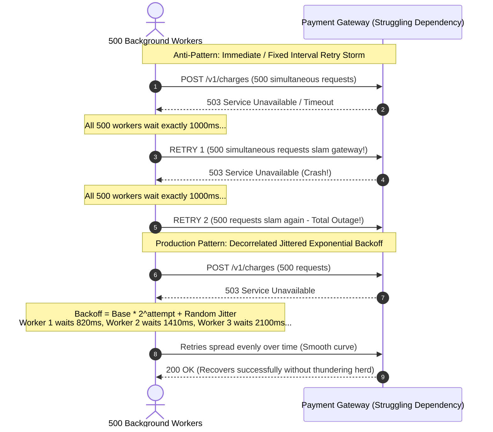
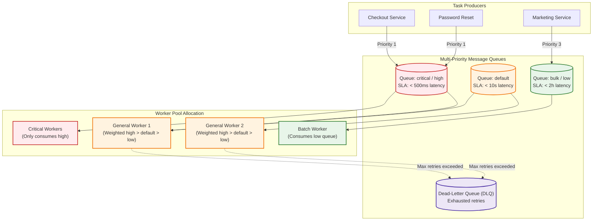
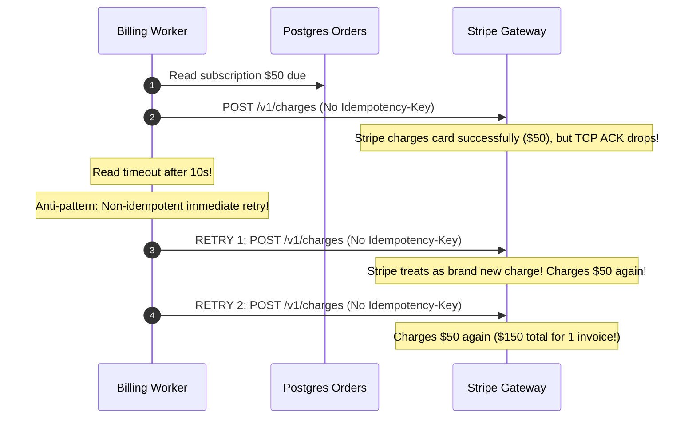

# Module 02: Retries, Prioritization, and Rate Limiting in Queues

Background workers interact with real-world infrastructure that experiences latency spikes, temporary packet drops, third-party maintenance windows, and rate limits. In a synchronous request-response cycle, downstream failure immediately converts to an HTTP error returned to the client. In a background task queue, the worker must manage recovery autonomously. Naive strategies—either immediately crashing and abandoning the job, or retrying in an unthrottled tight loop—destroy backend reliability. The former causes silent, irrecoverable data loss; the latter unleashes self-inflicted Distributed Denial of Service (DDoS) retry storms that permanently collapse recovering dependencies.

> [!TIP]
> **The Golden Rule:** Every background task MUST be strictly idempotent, retry exclusively on transient errors using Jittered Exponential Backoff, route through separated priority queues, and terminate into an observable Dead-Letter Queue (DLQ).

---

## 1. Visual Mental Models

### Thundering Herd Retry Storm vs. Jittered Exponential Backoff

When a downstream database or payment gateway suffers a 2-second blip, unjittered retries synchronize thousands of workers, slamming the dependency on the exact same second:



### Multi-Priority Queue Draining Architecture

Avoid mixing latency-critical transactions (e.g., checkout card charges) with high-volume, latency-tolerant batch work (e.g., promotional newsletters). Route them to dedicated queues with weighted worker allocation:



---

## 2. Structured Reference Grids

### Failure Classification & Retry Decision Matrix

| Failure Type | Examples | HTTP Codes | Action | Policy |
| :--- | :--- | :--- | :--- | :--- |
| **Transient Network** | Connect timeout, TCP reset, DNS blip | N/A, `504` | **Retry** | Exponential backoff + full jitter, max 5 attempts |
| **Downstream Overload** | Rate limit exceeded, service unavailable | `429`, `503` | **Retry** | Respect `Retry-After` header if present; backoff with jitter |
| **Permanent Semantic** | Invalid payload, schema validation error | `400`, `422` | **Do Not Retry** | Send directly to Dead-Letter Queue / Alert telemetry |
| **Authentication / Authz** | Expired API key, invalid secret | `401`, `403` | **Do Not Retry** | Escalate alert; retries will not resolve configuration error |
| **Missing Resource** | Entity deleted, target ID not found | `404` | **Do Not Retry** | Mark job as terminal failure; drop or archive |

### Backoff & Jitter Formulas

| Jitter Algorithm | Formula | Characteristics |
| :--- | :--- | :--- |
| **No Jitter (Dangerous)** | $t = \min(\text{cap}, \text{base} \cdot 2^{\text{attempt}})$ | High collision probability; produces severe periodic thundering herds |
| **Full Jitter (Recommended)** | $t = \text{random}(0, \min(\text{cap}, \text{base} \cdot 2^{\text{attempt}}))$ | Maximizes delay spread; drastically reduces downstream contention |
| **Decorrelated Jitter** | $t = \min(\text{cap}, \text{random}(\text{base}, t_{\text{prev}} \cdot 3))$ | Excellent queue draining balance; avoids extreme spikes or stalls |

---

## 3. Production War Story

### The $420,000 Double-Billing Storm

#### The Incident
At 09:15 AM on a Monday, an e-commerce subscription engine triggered renewal billings for 80,000 users. The upstream payment gateway experienced a 30-second degradation where connection read sockets hung. The task queue worker pool, configured with eager automatic retries without backoff or idempotency protections, retried every failed call up to 4 times. By 09:45 AM, 14,000 customers had been charged between 2 and 4 times, deducting over $420,000 in duplicate charges and incurring catastrophic merchant chargeback penalties.



#### The Root Cause
1. **Lack of Idempotency Keys:** The worker submitted raw payment requests without attaching an immutable `Idempotency-Key: sub_<id>_<billing_cycle>`.
2. **Read Timeout Misinterpretation:** A network timeout means the request *might* have reached the server and executed. Treating timeouts as "not executed" without verification is fatal in financial workflows.
3. **No Backoff or Rate Limiting:** The worker pool retried immediately, overwhelming both the database and payment provider.

#### The Verified Production Fix
1. Every payment task derives a deterministic idempotency key and persists it before network dispatch:
   ```python
   idempotency_key = f"charge_{subscription_id}_{billing_period}"
   stripe.Charge.create(..., idempotency_key=idempotency_key)
   ```
2. Re-runs with the same key return the original charge result rather than creating a duplicate.
3. Configured exponential backoff with full jitter and capped maximum retries to 3 before dispatching to an incident dead-letter table.

---

## 4. Multi-Language Production Implementations

### Go (`hibiken/asynq` Weighted Priority + Custom Backoff)

```go
package main

import (
	"context"
	"crypto/rand"
	"fmt"
	"log"
	"math/big"
	"time"

	"github.com/hibiken/asynq"
)

const (
	QueueCritical = "critical"
	QueueDefault  = "default"
	QueueLow      = "low"
)

// Custom Jittered Exponential Backoff
func CustomRetryDelay(n int, e error, t *asynq.Task) time.Duration {
	base := 1 * time.Second
	capDelay := 60 * time.Second
	maxDelay := base * (1 << uint(n)) // 1s, 2s, 4s, 8s...
	if maxDelay > capDelay {
		maxDelay = capDelay
	}

	// Full Jitter: random between 0 and maxDelay
	nBig, _ := rand.Int(rand.Reader, big.NewInt(maxDelay.Nanoseconds()))
	return time.Duration(nBig.Int64())
}

func RunPriorityWorker() {
	srv := asynq.NewServer(
		asynq.RedisClientOpt{Addr: "127.0.0.1:6379"},
		asynq.Config{
			Concurrency: 20,
			// Weighted round-robin queue consumption
			Queues: map[string]int{
				QueueCritical: 6, // 60% compute
				QueueDefault:  3, // 30% compute
				QueueLow:      1, // 10% compute
			},
			RetryDelayFunc: CustomRetryDelay,
		},
	)

	mux := asynq.NewServeMux()
	mux.HandleFunc("payment:charge", func(ctx context.Context, t *asynq.Task) error {
		idempotencyKey := t.ResultWriter().TaskID()
		log.Printf("[Worker] Processing charge with IdempotencyKey: %s", idempotencyKey)

		// Simulate transient downstream 503
		if time.Now().Unix()%2 == 0 {
			return fmt.Errorf("transient downstream timeout: retryable")
		}

		log.Printf("[Worker] Charge succeeded safely.")
		return nil
	})

	if err := srv.Run(mux); err != nil {
		log.Fatalf("asynq server error: %v", err)
	}
}
```

---

### Node.js / TypeScript (`BullMQ` Priority + Custom Jitter Backoff)

```typescript
import { Queue, Worker, Job } from 'bullmq';
import IORedis from 'ioredis';

const connection = new IORedis('redis://127.0.0.1:6379', { maxRetriesPerRequest: null });

export const paymentQueue = new Queue('payment-processing', {
  connection,
  defaultJobOptions: {
    attempts: 4,
    backoff: {
      type: 'customJitter',
    },
    removeOnFail: false, // Retain failed jobs for DLQ inspection
  },
});

export const paymentWorker = new Worker(
  'payment-processing',
  async (job: Job) => {
    const { orderId, amount, idempotencyKey } = job.data;
    console.log(`[Worker] Attempt ${job.attemptsMade + 1} for Order ${orderId}`);

    // Call payment gateway with idempotency key
    if (job.attemptsMade < 2) {
      throw new Error('E_GATEWAY_TIMEOUT: Transient HTTP 504 from payment gateway');
    }

    console.log(`[Worker] Payment captured for Order ${orderId} (${idempotencyKey})`);
    return { status: 'SETTLED', orderId };
  },
  {
    connection,
    concurrency: 10,
    settings: {
      backoffStrategies: {
        // Full Jitter exponential backoff: random(0, min(cap, base * 2^attempts))
        customJitter(attemptsMade: number) {
          const base = 1000; // 1s
          const maxDelay = Math.min(30000, base * Math.pow(2, attemptsMade));
          return Math.floor(Math.random() * maxDelay);
        },
      },
    },
  }
);

paymentWorker.on('failed', (job, err) => {
  if (job && job.attemptsMade >= (job.opts.attempts || 1)) {
    console.error(`[DLQ ALERT] Job ${job.id} exhausted all retries! Reason: ${err.message}`);
    // Push metadata to dead-letter storage
  }
});
```

---

### Python (`Celery` Autoretry + Priority Routing + Jitter)

```python
import random
from celery import Celery
from celery.exceptions import MaxRetriesExceededError
import requests

app = Celery(
    'resilient_tasks',
    broker='redis://127.0.0.1:6379/0',
    backend='redis://127.0.0.1:6379/1',
)

app.conf.update(
    task_routes={
        'tasks.process_payment': {'queue': 'high_priority'},
        'tasks.send_newsletter': {'queue': 'low_priority'},
    },
    task_acks_late=True,
    task_reject_on_worker_lost=True,
)

@app.task(
    bind=True,
    name='tasks.process_payment',
    autoretry_for=(requests.exceptions.RequestException, TimeoutError),
    retry_kwargs={'max_retries': 4},
    retry_backoff=True,          # Celery implements exponential backoff
    retry_backoff_max=30,        # Max delay cap in seconds
    retry_jitter=True,           # Adds full jitter to defeat thundering herds
)
def process_payment(self, order_id: int, amount_cents: int, idempotency_key: str):
    print(f"[{self.request.id}] Attempt {self.request.retries + 1}: Charging Order {order_id}")
    
    # Header contains idempotency key for safe retries
    headers = {"Idempotency-Key": idempotency_key}
    
    try:
        response = requests.post(
            "https://api.paymentgateway.internal/v1/charge",
            json={"order_id": order_id, "amount": amount_cents},
            headers=headers,
            timeout=5.0
        )
        response.raise_for_status()
        return response.json()
    except (requests.exceptions.HTTPError) as err:
        # Non-retryable permanent 4xx errors should never be retried
        if 400 <= err.response.status_code < 500 and err.response.status_code != 429:
            print(f"[Terminal Failure] Order {order_id} rejected with {err.response.status_code}. Not retrying.")
            raise
        raise
```

---

## 5. Practical Hands-On Verification

### 1. Enqueue High vs. Low Priority Tasks

```bash
# High priority payment task
curl.exe -i -X POST http://localhost:8000/api/v1/jobs \
  -H "Content-Type: application/json" \
  -d '{"task": "process_payment", "queue": "high_priority", "order_id": 9012, "idempotency_key": "idem_9012_v1"}'
```

```bash
# Low priority bulk email task
curl.exe -i -X POST http://localhost:8000/api/v1/jobs \
  -H "Content-Type: application/json" \
  -d '{"task": "send_newsletter", "queue": "low_priority", "campaign_id": 401}'
```

### 2. Verify Dead-Letter Queue (DLQ) State

When a task exceeds `max_retries`, inspect the dead-letter queue via Redis CLI:

```bash
redis-cli LLEN dlq:payment-processing
redis-cli LINDEX dlq:payment-processing 0
```

**Output:**
```json
{
  "task_id": "tsk_018b29c",
  "queue": "high_priority",
  "failed_at": "2026-11-09T15:45:00Z",
  "attempts": 4,
  "error": "Gateway timeout: HTTP 504 Gateway Timeout after 4 attempts",
  "payload": {"order_id": 9012, "idempotency_key": "idem_9012_v1"}
}
```

---

## 6. Operational Validation Checkpoints

<details>
<summary><strong>Checkpoint 1: The Local `rate_limit="10/s"` Multi-Worker Trap</strong></summary>

**Scenario:** An external vendor enforces a strict global quota: *10 requests per second across your entire account; exceeding it results in a 24-hour IP ban*. You configure Celery with `@app.task(rate_limit="10/s")` and scale your Kubernetes deployment to 10 worker pods. Within minutes, the vendor bans your IP for sending 95 requests per second. What went wrong?

*Explanation:*
Task framework rate limiters (such as Celery's built-in `rate_limit` directive) are almost always **per-worker process**, not global. 10 worker pods running with a local `10/s` rate limit permit an aggregate throughput of $10 \times 10 = 100\text{ req/sec}$.
**The Fix:** Enforce a centralized, global distributed rate limiter using a shared Redis token bucket or sliding window algorithm with atomic Lua scripts that every worker must query before executing the call.
</details>

<details>
<summary><strong>Checkpoint 2: The Silent Data Loss of Swallowing Exceptions (`except: pass`)</strong></summary>

**Scenario:** A developer attempts to prevent tasks from failing by wrapping the network call in a broad catch block:
```python
try:
    deliver_webhook(url, payload)
except Exception:
    pass
```
Why does this guarantee silent data loss in production?

*Explanation:*
Task brokers track job failure through uncaught exceptions or explicit failure signals. By swallowing all exceptions:
1. The framework believes the task succeeded and immediately sends an `ACK` to remove the message from the broker.
2. Automatic retries are never triggered.
3. Dead-Letter Queues (DLQs) and telemetry metrics receive zero signal that delivery failed.
**The Rule:** Catch only specific exceptions you know how to compensate for. Re-raise transient exceptions so the worker framework can execute exponential backoff and record telemetry.
</details>

<details>
<summary><strong>Checkpoint 3: The At-Least-Once Delivery Double Execution Reality</strong></summary>

**Scenario:** A worker pulls an inventory decrement task, executes `UPDATE inventory SET stock = stock - 1 WHERE sku = 'MACBOOK'`, and successfully writes to PostgreSQL. A network partition occurs before the worker can transmit the `ACK` frame back to RabbitMQ. What happens when the visibility timeout expires?

*Explanation:*
Because the broker never received the acknowledgment, it assumes the worker died and places the message back into the queue. A second worker pulls the same message and executes the decrement SQL a second time, erroneously decrementing 2 units of stock for 1 purchase.
**The Fix:** Tasks must use deterministic idempotency guarantees—such as checking an `order_fulfillment` ledger table or using a conditional check `UPDATE inventory SET stock = stock - 1, processed_tasks = array_append(processed_tasks, task_id) WHERE sku = 'MACBOOK' AND NOT (task_id = ANY(processed_tasks))`.
</details>

---

## Free PDF notes

Download these notes as a printable PDF, with every diagram and interview questions: [SD-C-018: Retries, Exponential Backoff & Jitter](https://backendroadmap.com/notes/system-design/SD-C-018.pdf). Each section in one file: [Phase 2, APIs (PDF)](https://backendroadmap.com/notes/system-design/Phase2_APIs_Notes.pdf).

## Next

[03-scheduling-recurring-jobs](../03-scheduling-recurring-jobs/README.md) —
so far tasks run when your code enqueues them. Next you'll run tasks on a
*schedule* — cron-style recurring jobs for backups, cleanups, and syncs — and
confront the subtle problem of making sure a job that's supposed to run once
an hour doesn't run three times because you have three scheduler replicas.
This module also carries the track's first cumulative review.
