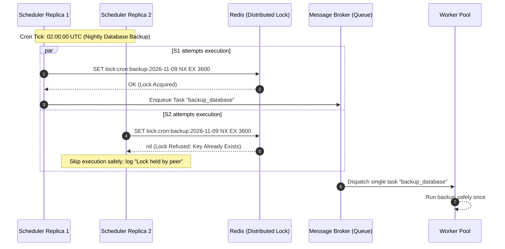
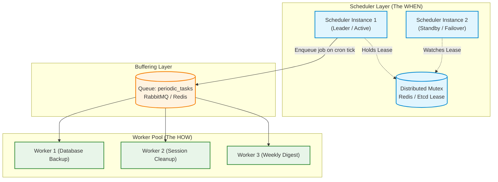
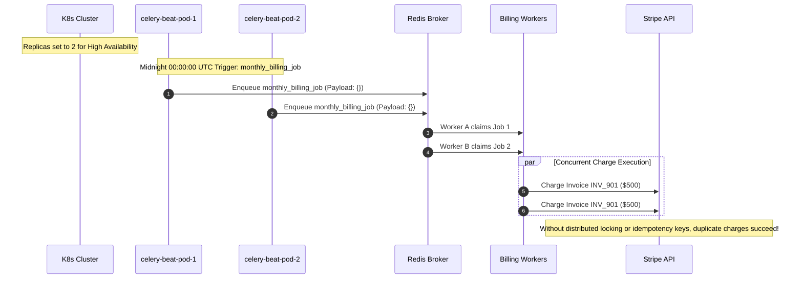

# Module 03: Scheduling Recurring Jobs

Background workloads are not always triggered by reactive user requests. Mission-critical operations must run on a calendar clock: backing up databases at 02:00 UTC, pruning expired JWT blacklists every 10 minutes, generating weekly invoice digests on Mondays, or refreshing cached third-party foreign exchange rates hourly. Relying on an operating system crontab on a single virtual machine introduces a fatal Single Point of Failure (SPOF). However, naively scaling a scheduler across multiple application instances for High Availability introduces an even more hazardous failure mode: **the duplicate run catastrophe**, where multiple scheduler replicas simultaneously enqueue the same batch task.

> [!TIP]
> **The Golden Rule:** Schedulers must only decide *when* to enqueue, never execute heavy work directly. When replicating schedulers for High Availability, guard execution with atomic distributed window locks (`SET lock:job:{window} token NX EX ttl`) or explicit leader election to guarantee that a periodic task executes strictly once per schedule window.

---

## 1. Visual Mental Models

### The Split-Brain Duplicate Run Hazard vs. Distributed Window Locking

Replicating schedulers across multiple pods without distributed mutual exclusion causes multiple instances to trigger the exact same recurring job:



### Decoupled Distributed Scheduler Architecture

The scheduler is a lightweight orchestrator that dispatches task references into the shared broker, where workers consume them with standard retry and observability semantics:



---

## 2. Structured Reference Grids

### Cron Syntax & Field Specifications

Standard 5-field UNIX cron expression format:
```text
 ┌───────────── Minute (0 - 59)
 │ ┌─────────── Hour (0 - 23)
 │ │ ┌───────── Day of Month (1 - 31)
 │ │ │ ┌─────── Month (1 - 12 or JAN - DEC)
 │ │ │ │ ┌───── Day of Week (0 - 6 or SUN - SAT)
 * * * * *
```

| Expression | Interpretation | Real-World Use Case |
| :--- | :--- | :--- |
| `*/10 * * * *` | Every 10 minutes | Pruning revoked OAuth access tokens & expired sessions |
| `0 2 * * *` | Every day at 02:00:00 UTC | Nightly full database backup and storage snapshot |
| `0 9 * * 1` | Every Monday at 09:00:00 UTC | Weekly analytics executive summary dispatch |
| `0 0 1 * *` | First day of every month at midnight | Monthly recurring customer billing renewal cycle |
| `0 */4 * * *` | Every 4 hours | Recomputing heavy materialized reporting tables |

### Scheduler Frameworks Architecture Comparison

| Capability | Celery Beat | APScheduler | Kubernetes CronJob | Temporal / Cadence |
| :--- | :--- | :--- | :--- | :--- |
| **Model** | Centralized daemon process | In-process library (Thread/Async) | Ephemeral container dispatch | Durable event-driven workflows |
| **State Storage** | In-memory or Database (`django-celery-beat`) | SQLite / PostgreSQL / Redis / Memory | Kubernetes etcd | Persistent Cassandra / MySQL / PostgreSQL |
| **High Availability** | Active-Passive via leader election | Distributed via external lock | Handled natively by K8s control plane | Native distributed clustering |
| **Dynamic Editing** | Static config or DB-backed polling | Native runtime API | Kubernetes API manifests | Dynamic workflow schedules |
| **Execution Tier** | Decoupled Celery workers | Local thread pool or external queue | Pod ephemeral execution | Decoupled Temporal activity workers |

---

## 3. Production War Story

### The Dual-Scheduler High Availability Failover Disaster

#### The Incident
To ensure zero downtime during a Kubernetes cluster upgrade, a FinTech team updated their `celery-beat` deployment replicas from `1` to `2`. At `00:00:00 UTC` on the first of the month, the recurring subscription billing task was scheduled. At `00:00:02 UTC`, customers began flooding support channels: 15,000 corporate clients received two identical invoice receipts, and credit cards were charged twice in parallel.



#### The Root Cause
1. `celery-beat` has no built-in leader election. Running multiple replicas results in every replica ticking independently and queueing identical tasks.
2. The periodic task did not acquire a distributed window lock to verify whether the `2026-11` billing cycle had already commenced.
3. The payment task lacked deterministic billing-cycle idempotency keys.

#### The Verified Production Fix
1. Reduced `celery-beat` back to a strict single-replica `StatefulSet` with `ReadWriteOnce` volume locking.
2. Wrapped all recurring jobs in an atomic Redis distributed window lock:
   ```python
   lock_key = f"lock:cron:billing:{datetime.utcnow().strftime('%Y-%m')}"
   if not redis_client.set(lock_key, "locked", nx=True, ex=86400):
       logger.warning("Billing cycle already initiated by another worker; skipping.")
       return
   ```
3. Configured deterministic idempotency keys for downstream Stripe charges: `idem_sub_{id}_{billing_cycle}`.

---

## 4. Multi-Language Production Implementations

### Go (`robfig/cron/v3` with Distributed Redis Mutex)

```go
package main

import (
	"context"
	"fmt"
	"log"
	"time"

	"github.com/go-redsync/redsync/v4"
	"github.com/go-redsync/redsync/v4/redis/goredis/v9"
	"github.com/redis/go-redis/v9"
	"github.com/robfig/cron/v3"
)

type ScheduledOrchestrator struct {
	cronEngine *cron.Cron
	rs         *redsync.Redsync
}

func NewOrchestrator(redisAddr string) *ScheduledOrchestrator {
	client := redis.NewClient(&redis.Options{Addr: redisAddr})
	pool := goredis.NewPool(client)
	rs := redsync.New(pool)

	return &ScheduledOrchestrator{
		cronEngine: cron.New(cron.WithSeconds()), // Standard cron with seconds support
		rs:         rs,
	}
}

// RegisterGuardedJob wraps recurring execution in a distributed lock
func (s *ScheduledOrchestrator) RegisterGuardedJob(spec, jobName string, action func(ctx context.Context) error) {
	s.cronEngine.AddFunc(spec, func() {
		// Scoped to minute window to prevent dual runs
		windowKey := fmt.Sprintf("lock:cron:%s:%s", jobName, time.Now().UTC().Format("200601021504"))
		mutex := s.rs.NewMutex(windowKey, redsync.WithExpiry(50*time.Second), redsync.WithTries(1))

		if err := mutex.Lock(); err != nil {
			log.Printf("[Scheduler] Job %s already claimed by another replica; skipping.", jobName)
			return
		}
		defer mutex.Unlock()

		log.Printf("[Scheduler] Executing periodic job: %s", jobName)
		ctx, cancel := context.WithTimeout(context.Background(), 45*time.Second)
		defer cancel()

		if err := action(ctx); err != nil {
			log.Printf("[Scheduler Alert] Job %s failed: %v", jobName, err)
		}
	})
}

func main() {
	sched := NewOrchestrator("127.0.0.1:6379")
	
	// Run every day at 02:00:00 UTC
	sched.RegisterGuardedJob("0 0 2 * * *", "database_backup", func(ctx context.Context) error {
		log.Println("[Backup] Snapshotting PostgreSQL database...")
		time.Sleep(2 * time.Second)
		return nil
	})

	sched.cronEngine.Start()
	select {} // Block main thread
}
```

---

### Node.js / TypeScript (`BullMQ` Repeatable Jobs with Mutex)

```typescript
import { Queue, Worker, Job } from 'bullmq';
import IORedis from 'ioredis';

const connection = new IORedis('redis://127.0.0.1:6379', { maxRetriesPerRequest: null });

// 1. Queue configuration for recurring jobs
export const cronQueue = new Queue('recurring-maintenance', { connection });

export async function registerPeriodicSchedules() {
  // BullMQ natively handles HA repeatable jobs using Redis keys
  await cronQueue.add(
    'prune-expired-sessions',
    {},
    {
      repeat: {
        pattern: '*/10 * * * *', // Every 10 minutes
      },
      jobId: 'session-pruning-cron', // Deduplication key
    }
  );

  console.log('[Scheduler] Repeatable schedule registered in Redis.');
}

// 2. Worker executing the scheduled tasks
export const cronWorker = new Worker(
  'recurring-maintenance',
  async (job: Job) => {
    console.log(`[Worker] Running scheduled maintenance: ${job.name} at ${new Date().toISOString()}`);

    if (job.name === 'prune-expired-sessions') {
      // Execute cleanup
      console.log('[Worker] Deleted 432 expired session rows.');
    }

    return { processedAt: new Date().toISOString() };
  },
  { connection }
);
```

---

### Python (`Celery Beat` + Redis Distributed Window Lock Decorator)

```python
import functools
from datetime import datetime, timezone
import redis
from celery import Celery
from celery.schedules import crontab

app = Celery(
    'scheduled_tasks',
    broker='redis://127.0.0.1:6379/0',
    backend='redis://127.0.0.1:6379/1',
)

redis_client = redis.Redis(host='127.0.0.1', port=6379, db=2)

def distributed_window_lock(window_format="%Y-%m-%d-%H-%M", ttl_seconds=300):
    """
    Decorator guaranteeing that a scheduled task executes strictly once
    per time window, even if multiple Beat schedulers fire it.
    """
    def decorator(func):
        @functools.wraps(func)
        def wrapper(*args, **kwargs):
            now_str = datetime.now(timezone.utc).strftime(window_format)
            lock_key = f"lock:cron:{func.__name__}:{now_str}"
            
            # Atomic SETNX with expiration
            acquired = redis_client.set(lock_key, "locked", nx=True, ex=ttl_seconds)
            if not acquired:
                print(f"[Lock Guard] Task {func.__name__} for window {now_str} already running; skipping.")
                return {"skipped": True, "reason": "window_lock_held"}

            return func(*args, **kwargs)
        return wrapper
    return decorator

# Configure Celery Beat Schedule
app.conf.beat_schedule = {
    'nightly-database-backup': {
        'task': 'tasks.backup_database',
        'schedule': crontab(hour=2, minute=0), # 02:00 UTC
        'options': {'queue': 'periodic_tasks'},
    },
    'prune-stale-tokens': {
        'task': 'tasks.prune_tokens',
        'schedule': crontab(minute='*/10'),   # Every 10 minutes
        'options': {'queue': 'periodic_tasks'},
    },
}

@app.task(name='tasks.backup_database')
@distributed_window_lock(window_format="%Y-%m-%d", ttl_seconds=86400)
def backup_database():
    print("[Cron Worker] Starting full database snapshot...")
    return {"status": "SUCCESS", "backup_file": "pg_dump_20261109.sql.gz"}
```

---

## 5. Practical Hands-On Verification

### 1. Test Atomic Redis Distributed Window Lock

Verify lock behavior directly against the Redis CLI to inspect mutual exclusion:

```bash
# Instance 1 acquires lock for current hour
redis-cli SET lock:cron:backup:2026-11-09-02 "worker-pod-1" NX EX 3600
```

**Output:**
```text
OK
```

```bash
# Instance 2 attempts to acquire same lock
redis-cli SET lock:cron:backup:2026-11-09-02 "worker-pod-2" NX EX 3600
```

**Output:**
```text
(nil)
```
*(Instance 2 receives `(nil)` and cleanly terminates without executing the duplicate backup).*

### 2. Verify Celery Beat Schedule Inspection

```bash
celery -A scheduled_tasks beat --loglevel=INFO
```

**Output:**
```text
[2026-11-09 02:00:00,005: INFO/MainProcess] Scheduler: Sending due task nightly-database-backup (tasks.backup_database)
[2026-11-09 02:10:00,001: INFO/MainProcess] Scheduler: Sending due task prune-stale-tokens (tasks.prune_tokens)
```

---

## 6. Operational Validation Checkpoints

<details>
<summary><strong>Checkpoint 1: The Daylight Saving Time (DST) Skipping & Doubling Trap</strong></summary>

**Scenario:** A financial reporting task is configured with `crontab(hour=2, minute=30)` on a server set to local US Eastern Time (`America/New_York`). In November, when the clock falls back one hour, the job executes twice. In March, when clocks spring forward from 02:00 to 03:00, the job skips completely and never runs. How do you permanently eliminate this failure mode?

*Explanation:*
Local wall-clock times are discontinuous during Daylight Saving Time transitions (02:00–03:00 either occurs twice or does not exist).
**The Rule:** Configure schedulers and servers strictly in **UTC (`timezone='UTC'`)**. UTC never experiences leaps or duplicate hours. If a customer demands localized delivery (e.g., 9:00 AM in Tokyo, Paris, or New York), calculate localized UTC offsets dynamically per user rather than setting the scheduler's base clock to a regional timezone.
</details>

<details>
<summary><strong>Checkpoint 2: The Job Overrun Avalanche</strong></summary>

**Scenario:** An intensive indexing job is scheduled to run every 5 minutes (`*/5 * * * *`). Due to a sudden increase in data volume, the job begins taking 9 minutes to complete. What occurs over the next 30 minutes if the scheduler does not enforce execution gating?

*Explanation:*
Every 5 minutes, the scheduler blindly injects another indexing task into the broker. While Job 1 is still processing, Job 2 begins, then Job 3, and Job 4. These concurrent heavy jobs compete for database CPU and memory, slowing down execution further until database connections exhaust and the entire database crashes.
**The Fix:** Enforce a **Coalesce / Overrun Guard**. In Celery/Go, check a running mutex (`SET lock:indexing "active" NX EX 900`). If a previous run is still in-flight, immediately skip the new tick and emit an alert that job execution duration exceeds schedule frequency.
</details>

<details>
<summary><strong>Checkpoint 3: Scheduler Clock Drift vs. Database Timestamps</strong></summary>

**Scenario:** A cron job runs every hour to query rows: `SELECT * FROM events WHERE created_at >= NOW() - INTERVAL '1 hour'`. Over time, random events are permanently missed and skipped by the query. What causes this subtle bug?

*Explanation:*
Two major causes:
1. **Clock Skew:** The scheduler's host clock and the database server's clock differ by several seconds.
2. **Transaction Commit Invisibility:** A row created at 01:59:59 might not be committed until 02:00:02 due to a long transaction. When the job fires at 02:00:00, that row is invisible. In the next run at 03:00:00, the row is older than 1 hour and skipped forever.
**The Fix:** Use a **Watermark / High-Water Tracking Table**. Rather than using floating time windows (`NOW() - INTERVAL`), store the exact primary key or timestamp of the last processed record (`last_processed_id`). Each batch queries from `WHERE id > last_processed_id ORDER BY id ASC LIMIT 1000`.
</details>

---

## Next

[04-transactional-emails](../04-transactional-emails/README.md) — you've been
"sending emails" as a stand-in for slow work all track. Now you'll actually
build them: the anatomy of a transactional email, personalizing with dynamic
data, sending from a background task (tying straight back to module 00), and
the deliverability basics (SPF/DKIM) that decide whether your mail lands in
the inbox or the spam folder.
