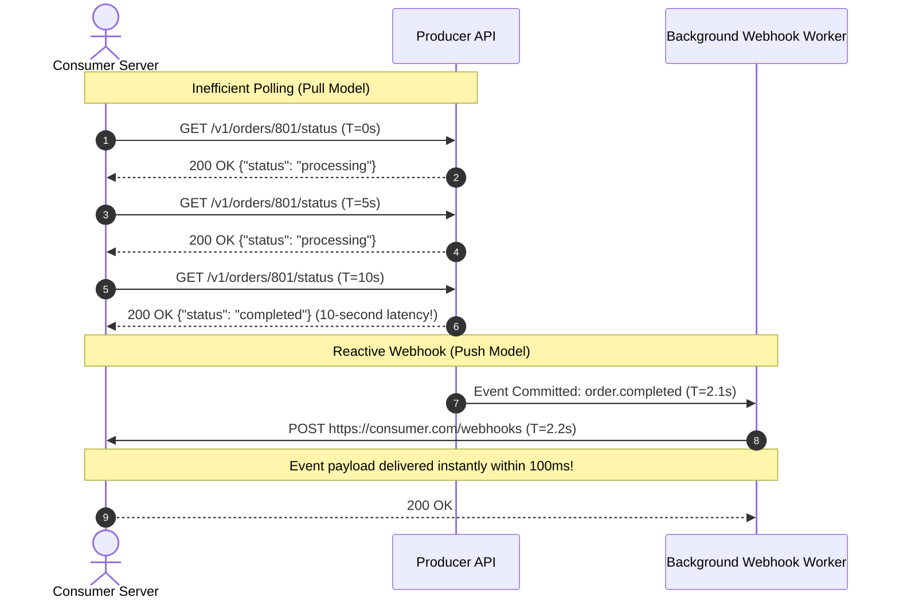
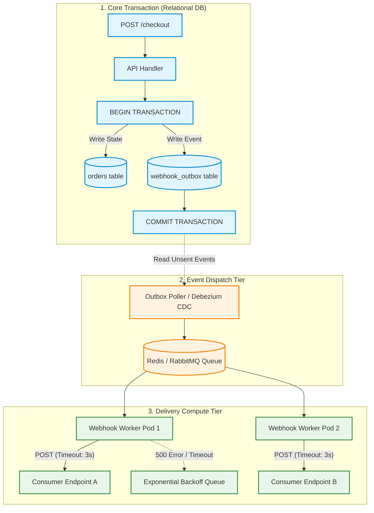
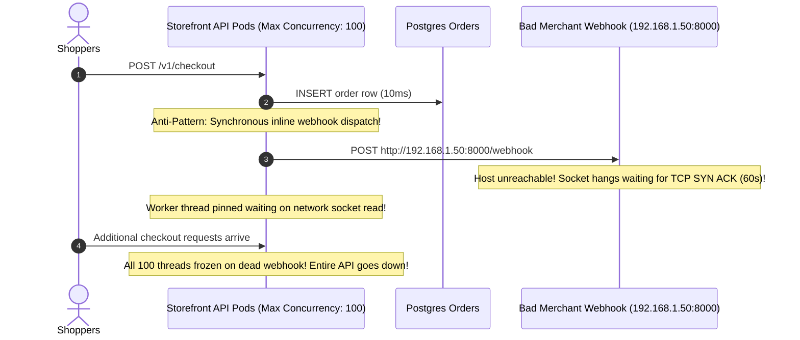

# Module 05: Webhooks Fundamentals

In distributed architectures, services must inform external applications when state transitions occur: a subscription renews, an invoice settles, a video completes transcoding, or a delivery package arrives. The primitive approach to cross-system data discovery is **polling**—requiring consumers to query `GET /orders/123/status` on a repetitive timer. Polling is computationally wasteful (over 98% of poll requests return unchanged state), introduces latency bounded by the polling interval, and exposes producer APIs to self-inflicted denial-of-service traffic. **Webhooks invert this paradigm** by turning your server into an active push publisher: the moment an event commits, your system dispatches an HTTP `POST` containing a structured payload directly to registered consumer endpoints.

> [!TIP]
> **The Golden Rule:** Always decouple webhook event emission from HTTP request lifecycles using the Transactional Outbox Pattern, fan out delivery asynchronously with aggressive HTTP timeouts ($\le 3$ seconds), and enforce immutable Event IDs (`evt_...`) to allow consumers to deduplicate retries.

---

## 1. Visual Mental Models

### Polling (Pull) vs. Webhook (Push) Communication

Polling squanders server compute and network bandwidth on empty checks, whereas webhooks notify consumers instantaneously upon event commitment:



### The Transactional Outbox Webhook Delivery Pipeline

Delivering webhooks requires bulletproof decoupling. If your database writes the order, but the server crashes before enqueueing the webhook, the event is permanently lost. The **Transactional Outbox Pattern** ensures zero event loss:



---

## 2. Structured Reference Grids

### Polling vs. Webhook Architectural Tradeoffs

| Evaluation Metric | Client-Driven Polling (Pull) | Webhook Callbacks (Push) |
| :--- | :--- | :--- |
| **Notification Latency** | High (Average: $\frac{\text{Interval}}{2}$, up to full interval) | Sub-second (Real-time push upon DB commit) |
| **Server Bandwidth & CPU** | Wasteful ($90\%+$ queries yield no state change) | Optimal (Requests occur strictly when events happen) |
| **Consumer Infrastructure** | Trivial (Requires only outbound HTTP client) | Moderate (Requires public HTTPS endpoint and SSL cert) |
| **Network Security** | Simpler (No ingress ports required on consumer) | Demanding (Receiver must expose open ingress firewall port) |
| **Backpressure Control** | Consumer dictates pace by slowing query timer | Producer can overwhelm consumer unless throttled |

### Standard Webhook Envelope Wire Format (JSON)

An enterprise-grade webhook payload must be self-describing, carrying unambiguous event identification, schema versions, and timestamps:

```json
{
  "id": "evt_1N4bC52eZvKYlo2CL88Q71rM",
  "object": "event",
  "api_version": "2026-03-01",
  "created": 1794229200,
  "type": "payment.succeeded",
  "pending_webhooks": 1,
  "request": {
    "id": "req_89ab10f2",
    "idempotency_key": "idem_cart_9021"
  },
  "data": {
    "object": {
      "id": "py_3Mtw",
      "amount": 4900,
      "currency": "usd",
      "customer": "cus_901a",
      "status": "succeeded"
    }
  }
}
```

---

## 3. Production War Story

### The Merchant Dev-Server Hang That Paralyzed Checkout

#### The Incident
An API platform serving 2,500 e-commerce storefronts allowed merchants to configure webhook endpoints for order notifications. A newly onboarded merchant configured their webhook target URL to point to an unrouted internal development server (`http://192.168.1.50:8000/webhook` or an unresponsive AWS EC2 staging instance). That evening, during an e-commerce flash sale, the platform's API latency spiked to 60 seconds, and the main gateway crashed with `504 Gateway Timeout` errors across all 2,500 stores.



#### The Root Cause
1. **Synchronous In-Band Dispatch:** The legacy codebase dispatched webhooks directly inside the checkout request handler before returning `200 OK` to the customer.
2. **Missing HTTP Timeouts:** The HTTP client had no socket connection timeout or read timeout configured, allowing Python's default system socket timeout (often 60–120 seconds) to hold threads hostage.
3. **No Domain Validation:** The webhook registration endpoint permitted private IP ranges (RFC 1918) without running SSRF validation.

#### The Verified Production Fix
1. Moved webhook dispatch entirely out of the web request lifecycle into dedicated background worker queues.
2. Enforced strict 3-second connect and read timeouts on all outbound webhook HTTP dispatches.
3. Isolated merchant delivery queues so one unresponsive subscriber cannot exhaust concurrency for healthy subscribers.

---

## 4. Multi-Language Production Implementations

### Go (Resilient Outbound Webhook Dispatcher)

```go
package main

import (
	"bytes"
	"context"
	"encoding/json"
	"fmt"
	"log"
	"net"
	"net/http"
	"time"
)

type WebhookEvent struct {
	ID        string      `json:"id"`
	Type      string      `json:"type"`
	CreatedAt int64       `json:"created_at"`
	Payload   interface{} `json:"data"`
}

type WebhookDispatcher struct {
	client *http.Client
}

func NewWebhookDispatcher() *WebhookDispatcher {
	return &WebhookDispatcher{
		client: &http.Client{
			// Strict timeouts to prevent worker starvation
			Timeout: 3 * time.Second,
			Transport: &http.Transport{
				DialContext: (&net.Dialer{
					Timeout:   2 * time.Second, // Max time to establish TCP connection
					KeepAlive: 30 * time.Second,
				}).DialContext,
				MaxIdleConns:        100,
				IdleConnTimeout:     90 * time.Second,
				TLSHandshakeTimeout: 2 * time.Second,
			},
		},
	}
}

func (d *WebhookDispatcher) Dispatch(ctx context.Context, endpointURL string, event WebhookEvent) error {
	body, err := json.Marshal(event)
	if err != nil {
		return fmt.Errorf("serialize event: %w", err)
	}

	req, err := http.NewRequestWithContext(ctx, http.MethodPost, endpointURL, bytes.NewReader(body))
	if err != nil {
		return fmt.Errorf("create request: %w", err)
	}

	req.Header.Set("Content-Type", "application/json")
	req.Header.Set("User-Agent", "Platform-Webhook-Deliverer/v1.0")
	req.Header.Set("X-Event-ID", event.ID)
	req.Header.Set("X-Event-Type", event.Type)

	resp, err := d.client.Do(req)
	if err != nil {
		return fmt.Errorf("delivery failed (transient network error): %w", err)
	}
	defer resp.Body.Close()

	if resp.StatusCode < 200 || resp.StatusCode >= 300 {
		return fmt.Errorf("subscriber returned non-2xx status: %d", resp.StatusCode)
	}

	log.Printf("[Webhook] Successfully delivered event %s to %s (Status: %d)", event.ID, endpointURL, resp.StatusCode)
	return nil
}
```

---

### Node.js / TypeScript (`BullMQ` Isolated Delivery Worker)

```typescript
import { Worker, Job } from 'bullmq';
import axios from 'axios';
import IORedis from 'ioredis';

const connection = new IORedis('redis://127.0.0.1:6379', { maxRetriesPerRequest: null });

export interface WebhookDeliveryJob {
  eventId: string;
  eventType: string;
  targetUrl: string;
  payload: Record<string, unknown>;
  attemptNumber: number;
}

export const webhookWorker = new Worker<WebhookDeliveryJob>(
  'webhook-deliveries',
  async (job: Job<WebhookDeliveryJob>) => {
    const { eventId, eventType, targetUrl, payload } = job.data;
    console.log(`[Worker] Delivering ${eventId} (${eventType}) to ${targetUrl}`);

    try {
      const response = await axios.post(
        targetUrl,
        {
          id: eventId,
          type: eventType,
          created: Math.floor(Date.now() / 1000),
          data: payload,
        },
        {
          timeout: 3000, // Hard 3-second timeout
          headers: {
            'Content-Type': 'application/json',
            'X-Event-ID': eventId,
            'X-Delivery-Attempt': (job.attemptsMade + 1).toString(),
          },
          validateStatus: (status) => status >= 200 && status < 300,
        }
      );

      console.log(`[Worker] Delivered ${eventId} with response ${response.status}`);
      return { status: response.status };
    } catch (err: any) {
      console.warn(`[Worker Warning] Delivery to ${targetUrl} failed: ${err.message}`);
      throw err; // Trigger exponential retry backoff
    }
  },
  {
    connection,
    concurrency: 15,
  }
);
```

---

### Python (`Celery` + Transactional Outbox Worker)

```python
import time
import requests
from celery import Celery

app = Celery('webhook_service', broker='redis://127.0.0.1:6379/0')

@app.task(
    bind=True,
    name='tasks.dispatch_webhook',
    autoretry_for=(requests.exceptions.RequestException,),
    max_retries=5,
    retry_backoff=True,
    retry_backoff_max=300,
    retry_jitter=True,
)
def dispatch_webhook(self, event_id: str, target_url: str, event_type: str, data: dict):
    """
    Asynchronously delivers a webhook payload with strict timeout boundaries.
    """
    payload = {
        "id": event_id,
        "type": event_type,
        "created": int(time.time()),
        "data": data,
    }

    headers = {
        "Content-Type": "application/json",
        "X-Event-ID": event_id,
        "X-Delivery-Attempt": str(self.request.retries + 1),
    }

    try:
        # Enforce 2s connection timeout and 3s read timeout
        response = requests.post(target_url, json=payload, headers=headers, timeout=(2.0, 3.0))
        response.raise_for_status()
        return {"status": "DELIVERED", "status_code": response.status_code, "event_id": event_id}
    except requests.exceptions.HTTPError as exc:
        # Don't retry on customer 4xx errors except 429
        if 400 <= exc.response.status_code < 500 and exc.response.status_code != 429:
            print(f"[Webhook Terminal Failure] Endpoint rejected with {exc.response.status_code}. Aborting.")
            return {"status": "ABORTED", "reason": str(exc)}
        raise
```

---

## 5. Practical Hands-On Verification

### 1. Test Outbound Webhook Delivery via HTTP Mock

Dispatch an event to a test listener endpoint and inspect headers:

```bash
curl.exe -i -X POST http://localhost:8080/webhook-listener \
  -H "Content-Type: application/json" \
  -H "X-Event-ID: evt_test_9012" \
  -H "X-Event-Type: order.created" \
  -d '{"id": "evt_test_9012", "type": "order.created", "data": {"order_id": 8901, "total": 99.00}}'
```

**Output:**
```http
HTTP/1.1 200 OK
Content-Type: application/json
Date: Mon, 09 Nov 2026 15:52:00 GMT
Content-Length: 38

{"received": true, "event_id": "evt_test_9012"}
```

---

## 6. Operational Validation Checkpoints

<details>
<summary><strong>Checkpoint 1: The Dual-Write Race Condition in Event Emission</strong></summary>

**Scenario:** A developer writes code to emit a webhook immediately after updating a row:
```python
db.execute("UPDATE orders SET status = 'paid' WHERE id = 101")
webhook_service.dispatch("order.paid", order_data) # Direct network call
db.commit()
```
If the database crashes during `commit()`, what critical consistency failure occurs?

*Explanation:*
The external world received an `order.paid` webhook, triggering the merchant to ship goods. However, because the database transaction failed to commit and rolled back, the order remains `unpaid` in the primary database.
**The Fix:** Use the **Transactional Outbox Pattern**. Write the webhook event into an `outbox` database table *inside the same SQL transaction* as the order update. Commit atomically. A separate background relay worker polls or tails the CDC stream of committed outbox records to guarantee zero phantom events.
</details>

<details>
<summary><strong>Checkpoint 2: The Shared Queue Head-of-Line Blocking Avalanche</strong></summary>

**Scenario:** Your webhook system uses a single FIFO Redis list to deliver webhooks for 1,000 corporate merchants. One merchant experiences an outage; their endpoint times out on every request for 4 hours. Suddenly, all other 999 merchants report they have stopped receiving webhooks. Why?

*Explanation:*
Because all events share a single worker pool and FIFO queue, failed deliveries for the broken merchant continuously retry and saturate all available worker concurrency slots. Healthy merchants are starved behind the backlogged failures (**Head-of-Line Blocking**).
**The Fix:** Partition delivery queues per tenant or employ a fair-share round-robin draining mechanism. Route retry attempts to a secondary `retry_queue` so new first-attempt events bypass backlogged retries.
</details>

<details>
<summary><strong>Checkpoint 3: The Danger of "Fat" vs. "Thin" Payloads Under Concurrency</strong></summary>

**Scenario:** You send a "fat" payload containing `{"order_id": 101, "status": "processing", "items_count": 2}`. While the webhook is in-flight across the internet, the user adds another item and the order transitions to `processing` with `items_count: 3`. If the consumer processes the first webhook after the second update occurred in your DB, what happens?

*Explanation:*
The consumer processes stale snapshot data, potentially overwriting their local database with outdated state.
**The Solution:**
1. **Thin Payload:** Emit only `{"event_id": "evt_101", "type": "order.updated", "order_id": 101}` and require the consumer to fetch current state via authenticated `GET /api/v1/orders/101`.
2. **Version Sequencing:** If sending "fat" payloads, always include an incrementing `version` or timestamp (`updated_at`). The consumer discards events with a `version` less than or equal to their currently stored version.
</details>

---

## Next

[06-webhooks-security-and-reliability](../06-webhooks-security-and-reliability/README.md)
— now flip to the receiving side, which is where the security lives. You'll
verify webhook signatures with HMAC (the way Stripe and GitHub do it),
acknowledge fast and process asynchronously, make receivers idempotent by
deduping on event ID, and test webhooks locally with a tunnel like ngrok.
