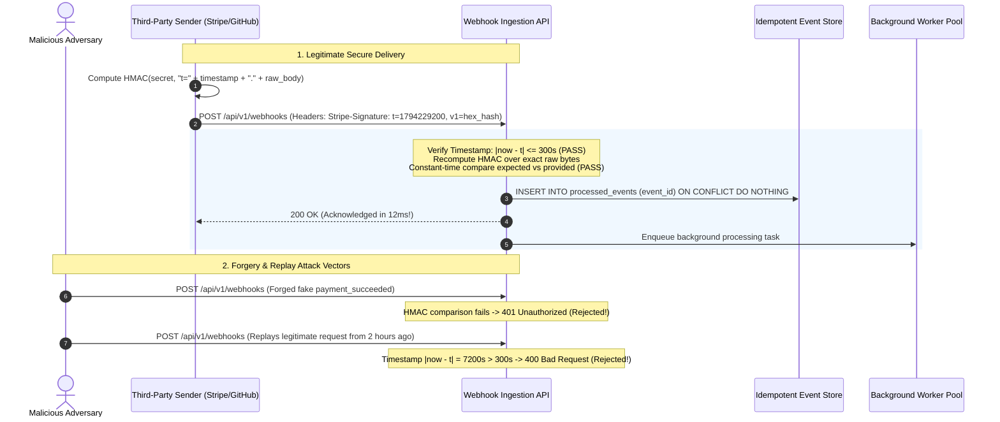
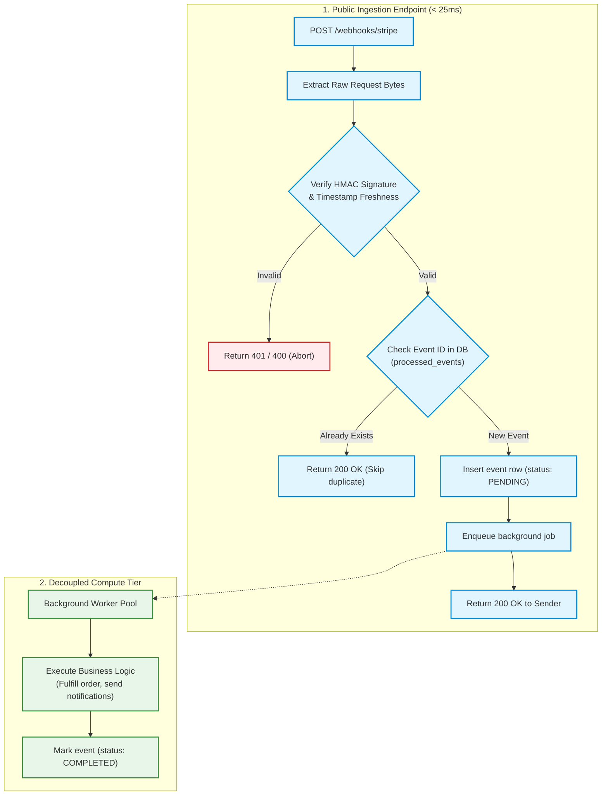
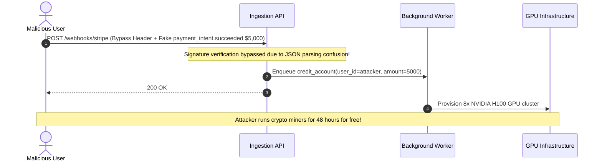

# Module 06: Webhooks Security and Reliability

Exposing a public webhook ingestion endpoint means deploying an unauthenticated, publicly reachable URL that performs privileged business actions: crediting customer balances, provisioning cloud resources, or updating order fulfillment states. Because webhook URLs are easily exposed through logs, browser history, or developer portals, treating any incoming HTTP `POST` as trusted is an invitation to catastrophic fraud. To build a hardened ingestion endpoint, you must master cryptographic **HMAC signature verification**, **anti-replay timestamp validation**, **constant-time comparisons**, and the **Ack-Fast, Process-Later** pattern.

> [!TIP]
> **The Golden Rule:** Always verify HMAC-SHA256 signatures over exact raw payload bytes using constant-time equality comparisons, reject requests outside a strict timestamp freshness window ($\le 300\text{s}$), and return `200 OK` immediately after recording the event into an idempotent datastore before delegating execution to background workers.

---

## 1. Visual Mental Models

### Cryptographic Webhook Ingestion & Anti-Replay Defense

A production receiver validates both cryptographic authenticity (via HMAC-SHA256) and temporal freshness (via signed timestamps) before accepting an event:



### The "Ack-Fast, Process-Later" Architecture

Never execute heavy business logic, PDF generation, or third-party API calls inside the inbound webhook HTTP handler. Acknowledge within milliseconds to prevent sender timeouts and retry cascades:



---

## 2. Structured Reference Grids

### Webhook Threat Modeling & Defense Strategies

| Threat Vector | Attack Mechanism | Real-World Impact | Defense Architecture |
| :--- | :--- | :--- | :--- |
| **Forged Payload** | Adversary discovers endpoint URL and submits fake `order.paid` payload | Inventory theft, arbitrary balance crediting | Shared secret HMAC-SHA256 signature verification |
| **Replay Attack** | Eavesdropper captures signed request from network logs and re-transmits it | Multiple service activations, duplicate crediting | Signed timestamps with strict drift tolerances ($\le 5\text{ mins}$) |
| **Timing Attack** | Attacker measures microseconds taken by `==` to brute-force valid signatures | Incremental forgery of authentication signatures | Constant-time comparison (`crypto/subtle`, `compare_digest`) |
| **JSON Mutation Flaw** | Parsing JSON into an object and re-serializing alters whitespace/keys | Valid webhooks rejected; developers bypass security | Compute HMAC directly on raw incoming byte stream |
| **Sender Starvation** | Ingestion handler performs slow DB/API work; exceeds sender's 5s timeout | Sender triggers retry storm, crashing receiver | **Ack-Fast Pattern**: Persist and return `200 OK` immediately |

### Common Webhook Signature Headers

| Platform | Signature Header | Signed Payload Composition | Format |
| :--- | :--- | :--- | :--- |
| **Stripe** | `Stripe-Signature` | `t={timestamp}.{raw_body}` | `t=1794229200,v1=9a2b8...` |
| **GitHub** | `X-Hub-Signature-256` | `{raw_body}` | `sha256=4f6a1...` |
| **Svix / Standard** | `svix-signature` | `{msg_id}.{timestamp}.{raw_body}` | `v1,g0hM...` |
| **Shopify** | `X-Shopify-Hmac-Sha256` | `{raw_body}` | Base64 encoded SHA256 digest |

---

## 3. Production War Story

### The JSON Serialization Bug & The $84,000 Free Credits Forgery

#### The Incident
A fast-growing cloud hosting provider automated account balance top-ups via Stripe webhooks. During a refactoring to standard web frameworks, a middleware was introduced that automatically parsed incoming JSON into Python dictionaries before route handlers executed. The developer re-serialized the dictionary to JSON bytes to check the HMAC signature:
```python
# Fatal Flaw: Re-serializing parsed JSON
payload_bytes = json.dumps(await request.json()).encode('utf-8')
```
Because `json.dumps()` formatted JSON with different spacing and key ordering than Stripe's original payload, valid signatures began failing. Under pressure to restore checkout functionality, a developer deployed a temporary patch:
```python
if settings.DEBUG or request.headers.get("X-Bypass-Signature") == "secret":
    # Bypass verification temporarily
```
Within 48 hours, an attacker found the bypass in a decompiled frontend build, forged 120 fake payment events, and provisioned $84,000 worth of GPU compute instances for crypto mining before detection.



#### The Root Cause
1. **Payload Canonicalization Failure:** Verifying signatures over re-serialized JSON instead of the original raw wire bytes.
2. **Security Degradation Under Pressure:** Disabling cryptographic authentication in production when integration tests broke.

#### The Verified Production Fix
1. Captured `request.raw_body` directly from the low-level HTTP socket before any JSON deserialization occurred.
2. Implemented strict constant-time HMAC verification with timestamp expiration checks.
3. Added automated end-to-end integration tests using official Stripe mock CLI tools.

---

## 4. Multi-Language Production Implementations

### Go (Constant-Time HMAC + Raw Body + Replay Window)

```go
package main

import (
	"crypto/hmac"
	"crypto/sha256"
	"crypto/subtle"
	"encoding/hex"
	"errors"
	"fmt"
	"io"
	"net/http"
	"strconv"
	"strings"
	"time"
)

const (
	WebhookTolerance = 300 * time.Second // 5 minute freshness window
)

// VerifyStripeSignature validates timestamp and HMAC-SHA256 signature
func VerifyStripeSignature(rawBody []byte, header string, secret string) error {
	var timestampStr string
	var signatureHex string

	// Parse header: "t=1794229200,v1=9a2b8c..."
	pairs := strings.Split(header, ",")
	for _, pair := range pairs {
		parts := strings.SplitN(strings.TrimSpace(pair), "=", 2)
		if len(parts) != 2 {
			continue
		}
		switch parts[0] {
		case "t":
			timestampStr = parts[1]
		case "v1":
			signatureHex = parts[1]
		}
	}

	if timestampStr == "" || signatureHex == "" {
		return errors.New("malformed webhook signature header")
	}

	// 1. Verify Timestamp Freshness (Anti-Replay)
	timestampInt, err := strconv.ParseInt(timestampStr, 10, 64)
	if err != nil {
		return errors.New("invalid timestamp format")
	}
	eventTime := time.Unix(timestampInt, 0)
	if time.Since(eventTime).Abs() > WebhookTolerance {
		return fmt.Errorf("webhook timestamp outside tolerance window: %v", eventTime)
	}

	// 2. Compute Expected HMAC: HMAC-SHA256(secret, "t={timestamp}.{rawBody}")
	signedPayload := []byte(fmt.Sprintf("%s.", timestampStr))
	signedPayload = append(signedPayload, rawBody...)

	mac := hmac.New(sha256.New, []byte(secret))
	mac.Write(signedPayload)
	expectedSig := hex.EncodeToString(mac.Sum(nil))

	// 3. Constant-Time Comparison (Timing Attack Defense)
	if subtle.ConstantTimeCompare([]byte(expectedSig), []byte(signatureHex)) != 1 {
		return errors.New("hmac signature verification failed")
	}

	return nil
}

func WebhookHandler(w http.ResponseWriter, r *http.Request) {
	if r.Method != http.MethodPost {
		http.Error(w, "Method not allowed", http.StatusMethodNotAllowed)
		return
	}

	// Must read exact raw bytes before JSON decoding!
	rawBody, err := io.ReadAll(r.Body)
	if err != nil {
		http.Error(w, "Failed to read request body", http.StatusBadRequest)
		return
	}
	defer r.Body.Close()

	sigHeader := r.Header.Get("Stripe-Signature")
	secret := "whsec_live_example_secret_09a1"

	if err := VerifyStripeSignature(rawBody, sigHeader, secret); err != nil {
		http.Error(w, fmt.Sprintf("Unauthorized: %v", err), http.StatusUnauthorized)
		return
	}

	// Persist event and return 200 OK immediately
	w.WriteHeader(http.StatusOK)
	w.Write([]byte(`{"received":true}`))
}
```

---

### Node.js / TypeScript (`crypto.timingSafeEqual` + Fastify / Express)

```typescript
import express, { Request, Response } from 'express';
import crypto from 'crypto';

const app = express();
const WEBHOOK_SECRET = process.env.WEBHOOK_SECRET || 'whsec_9012a';

// CRITICAL: Preserve raw body buffer for verification
app.use(
  express.json({
    verify: (req: any, _res, buf) => {
      req.rawBody = buf;
    },
  })
);

export function verifyWebhookSignature(
  rawBody: Buffer,
  signatureHeader: string,
  secret: string,
  toleranceSeconds = 300
): boolean {
  const parts = signatureHeader.split(',');
  const timestamp = parts.find((p) => p.startsWith('t='))?.split('=')[1];
  const signature = parts.find((p) => p.startsWith('v1='))?.split('=')[1];

  if (!timestamp || !signature) return false;

  // 1. Anti-Replay Timestamp Check
  const eventTime = parseInt(timestamp, 10);
  const currentTime = Math.floor(Date.now() / 1000);
  if (Math.abs(currentTime - eventTime) > toleranceSeconds) {
    return false; // Stale or replayed request
  }

  // 2. Compute Expected HMAC over raw bytes
  const signedPayload = `${timestamp}.${rawBody.toString('utf8')}`;
  const hmac = crypto.createHmac('sha256', secret);
  hmac.update(signedPayload);
  const expectedSignature = hmac.digest('hex');

  // 3. Constant-Time Comparison to prevent timing attacks
  const expectedBuffer = Buffer.from(expectedSignature, 'utf8');
  const providedBuffer = Buffer.from(signature, 'utf8');

  if (expectedBuffer.length !== providedBuffer.length) return false;
  return crypto.timingSafeEqual(expectedBuffer, providedBuffer);
}

app.post('/api/v1/webhooks', async (req: any, res: Response) => {
  const sig = req.headers['stripe-signature'] as string;

  if (!sig || !verifyWebhookSignature(req.rawBody, sig, WEBHOOK_SECRET)) {
    return res.status(401).json({ error: 'Invalid webhook signature' });
  }

  const event = req.body;
  console.log(`[Webhook Receiver] Verified Event ID: ${event.id}`);

  // Acknowledge immediately; do NOT perform long tasks synchronously
  res.status(200).json({ received: true });
});
```

---

### Python (`FastAPI` + `hmac.compare_digest`)

```python
import time
import hmac
import hashlib
from fastapi import FastAPI, Request, HTTPException, status
from pydantic import BaseModel

app = FastAPI()
WEBHOOK_SECRET = b"whsec_test_secret_9041"
TOLERANCE_SECONDS = 300

@app.post("/api/v1/webhooks")
async def handle_webhook(request: Request):
    # 1. Read exact raw bytes directly from request stream
    raw_body = await request.body()
    signature_header = request.headers.get("Stripe-Signature")
    
    if not signature_header:
        raise HTTPException(status_code=status.HTTP_401_UNAUTHORIZED, detail="Missing signature header")

    # 2. Parse signature header: "t=1794229200,v1=9a2b8..."
    try:
        header_map = dict(item.strip().split("=", 1) for item in signature_header.split(","))
        timestamp = int(header_map["t"])
        provided_sig = header_map["v1"]
    except (ValueError, KeyError):
        raise HTTPException(status_code=status.HTTP_400_BAD_REQUEST, detail="Malformed signature header")

    # 3. Freshness Check (Anti-Replay)
    if abs(time.time() - timestamp) > TOLERANCE_SECONDS:
        raise HTTPException(status_code=status.HTTP_400_BAD_REQUEST, detail="Timestamp outside tolerance window")

    # 4. Compute Expected HMAC
    signed_payload = f"{timestamp}.".encode("utf-8") + raw_body
    computed_mac = hmac.new(WEBHOOK_SECRET, signed_payload, hashlib.sha256).hexdigest()

    # 5. Constant-Time String Comparison
    if not hmac.compare_digest(computed_mac, provided_sig):
        raise HTTPException(status_code=status.HTTP_401_UNAUTHORIZED, detail="Signature mismatch")

    # 6. Idempotency Check & Async Hand-off
    event_data = await request.json()
    event_id = event_data.get("id")
    
    # Fast database check: INSERT INTO processed_events ...
    print(f"[Webhook Verified] Event ID {event_id} authenticated successfully.")
    
    return {"received": True}
```

---

## 5. Practical Hands-On Verification

### 1. Generate Signature & Dispatch Webhook via Terminal

Compute a valid HMAC-SHA256 signature and test verification with `curl.exe`:

```bash
# Set parameters
TIMESTAMP=$(date +%s)
SECRET="whsec_test_secret_9041"
BODY='{"id":"evt_101","type":"payment.succeeded","amount":5000}'

# Generate HMAC-SHA256 digest
SIG=$(echo -n "${TIMESTAMP}.${BODY}" | openssl dgst -sha256 -hmac "${SECRET}" | sed 's/^.* //')

# Dispatch authenticated request
curl.exe -i -X POST http://localhost:8000/api/v1/webhooks \
  -H "Content-Type: application/json" \
  -H "Stripe-Signature: t=${TIMESTAMP},v1=${SIG}" \
  -d "${BODY}"
```

**Output:**
```http
HTTP/1.1 200 OK
Content-Type: application/json
Date: Mon, 09 Nov 2026 15:58:00 GMT
Content-Length: 17

{"received":true}
```

### 2. Verify Replay Attack Rejection

Re-run the exact same curl command with an artificially aged timestamp ($T - 600\text{s}$):

```bash
OLD_TS=$((TIMESTAMP - 600))
OLD_SIG=$(echo -n "${OLD_TS}.${BODY}" | openssl dgst -sha256 -hmac "${SECRET}" | sed 's/^.* //')

curl.exe -i -X POST http://localhost:8000/api/v1/webhooks \
  -H "Content-Type: application/json" \
  -H "Stripe-Signature: t=${OLD_TS},v1=${OLD_SIG}" \
  -d "${BODY}"
```

**Output:**
```http
HTTP/1.1 400 Bad Request
Content-Type: application/json

{"detail":"Timestamp outside tolerance window"}
```

---

## 6. Operational Validation Checkpoints

<details>
<summary><strong>Checkpoint 1: The Raw Body vs. JSON Middleware Trap</strong></summary>

**Scenario:** In an Express or FastAPI application, you install standard body parsing middleware. In the webhook route handler, you attempt to verify the signature by re-serializing the parsed object: `crypto.createHmac('sha256', secret).update(JSON.stringify(req.body))`. In testing with Postman it works, but 30% of real Stripe webhooks fail verification. Why?

*Explanation:*
JSON does not enforce key ordering or whitespace consistency. Stripe may serialize `{"id":"evt_1","amount":50}` while your language runtime outputs `{"amount": 50, "id": "evt_1"}`. Because cryptographic hashing algorithms like SHA-256 are avalanche-sensitive, a single whitespace or key-order change produces a completely different digest.
**The Fix:** Always configure middleware to preserve the exact raw binary buffer (`Buffer` or `bytes`) as received over the TCP socket before any decoding.
</details>

<details>
<summary><strong>Checkpoint 2: The Subtle Timing Side-Channel Vulnerability</strong></summary>

**Scenario:** A security auditor flags the line `if signature == expected_signature:` as a high-severity vulnerability and insists on replacing it with `hmac.compare_digest` or `subtle.ConstantTimeCompare`. The junior developer argues that functionally both return a boolean. Why is standard string equality dangerous here?

*Explanation:*
Standard string comparison (`==`) evaluates characters sequentially and terminates on the first mismatch (**Early Exit**). If the first character differs, it returns in 2 nanoseconds; if the first 15 characters match, it returns in 18 nanoseconds. By sending thousands of forged signatures and measuring sub-microsecond latency variations, an attacker can determine matching characters one by one, reconstructing valid signatures without knowing the secret. Constant-time algorithms always examine all bytes regardless of mismatches.
</details>

<details>
<summary><strong>Checkpoint 3: Proper HTTP Response Codes on Duplicate Deliveries</strong></summary>

**Scenario:** Your webhook receiver processes an event, credits a user's balance, and records the `event_id` in Postgres. Due to a network blip, the sender doesn't receive the HTTP response and retries the webhook 5 minutes later. Your receiver detects the `event_id` already exists. What HTTP status code should you return?

*Explanation:*
You must return **`200 OK` (or `202 Accepted`)**.
Returning `500 Internal Server Error` or `409 Conflict` signals to the sender that delivery failed, causing the sender to back off and continue retrying indefinitely. Returning `200 OK` confirms safe receipt and tells the sender to stop retrying.
</details>

---

## Free PDF notes

Download these notes as a printable PDF, with every diagram and interview questions: [SD-C-020: Webhooks](https://backendroadmap.com/notes/system-design/SD-C-020.pdf). Each section in one file: [Phase 2, APIs (PDF)](https://backendroadmap.com/notes/system-design/Phase2_APIs_Notes.pdf).

## Next

[07-websockets-and-server-sent-events](../07-websockets-and-server-sent-events/README.md)
— webhooks push events server-to-server. Next you'll push events server-to-
*browser* in real time: when to use WebSockets vs. Server-Sent Events vs.
polling, a real FastAPI WebSocket endpoint, the connection leak a careless
implementation causes, and broadcasting to many connected clients. This module
also carries the track's second cumulative review.
