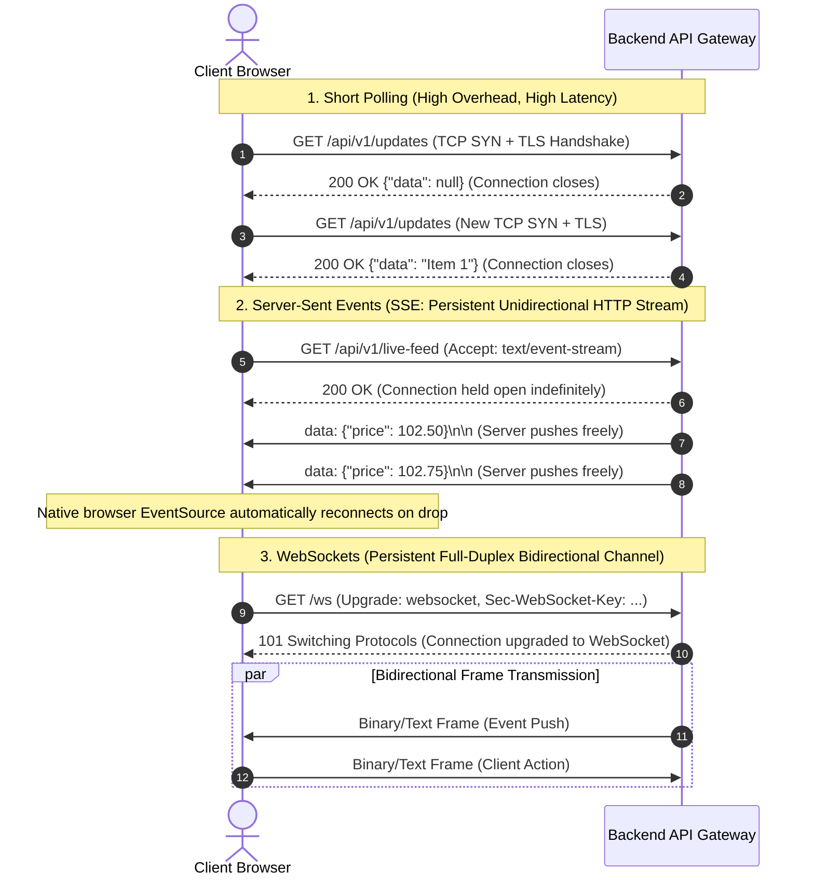
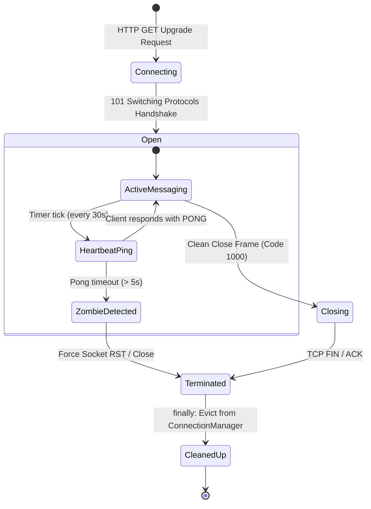
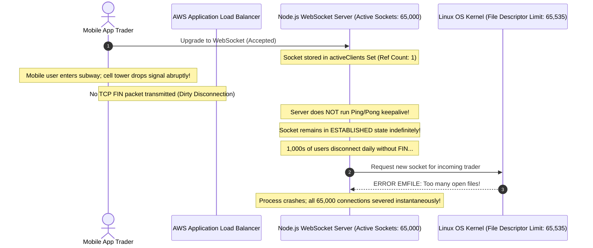

# Module 07: WebSockets and Server-Sent Events

Standard HTTP follows a strict request-response lifecycle: the client initiates, the server responds, and the connection closes. This paradigm fails for real-time applications—collaborative document editing, live chat, real-time trading feeds, and job progress indicators—where the server must push state updates immediately without waiting for client polling. Modern backends bridge this gap using **Server-Sent Events (SSE)** for unidirectional server-to-client streaming, and **WebSockets** for low-latency, full-duplex bidirectional communication. However, managing thousands of persistent TCP connections introduces complex operational hazards: memory bloat, proxy timeouts, and catastrophic socket file-descriptor leaks.

> [!TIP]
> **The Golden Rule:** Use Server-Sent Events (SSE) over HTTP/2 for unidirectional server-to-client telemetry and notifications; reserve full-duplex WebSockets for high-frequency, bidirectional interactions. Always register connections with defensive `finally` eviction and heartbeats (`Ping/Pong`) to prevent socket descriptor leaks.

---

## 1. Visual Mental Models

### Polling vs. Server-Sent Events vs. WebSockets Protocol Comparison

Understanding transport layer behavior is essential for choosing the right real-time primitive:



### WebSocket Connection Lifecycle & Heartbeat Management

Unclean client disconnections (airplane mode, network drops, sleeping devices) leave ghost connections on the server unless pruned via periodic ping/pong frames:



---

## 2. Structured Reference Grids

### Real-Time Transport Technology Matrix

| Feature | Short / Long Polling | Server-Sent Events (SSE) | WebSockets |
| :--- | :--- | :--- | :--- |
| **Protocol** | Standard HTTP/1.1 or HTTP/2 | Standard HTTP/1.1 or HTTP/2 | WebSocket Protocol (`ws://`, `wss://`) via RFC 6455 |
| **Directionality** | Client-to-Server pull | Server-to-Client push only | Full-duplex bidirectional |
| **Wire Format** | JSON / XML / HTML | Text stream (`text/event-stream`) | Framed Text or Raw Binary (ArrayBuffer/Blob) |
| **Reconnection** | Managed manually by JS loop | **Built-in browser auto-reconnect** | Managed manually via client application code |
| **Proxy & Firewall Traversal**| Flawless (Standard HTTP) | Excellent (Transparent over HTTP/2) | Can be blocked by strict enterprise proxies / inspection |
| **Primary Use Cases** | Infrequent updates, low traffic | Stock tickers, notifications, LLM token streaming | Collaborative canvas, chat, multiplayer games |

### Wire Framing Comparison: SSE vs. WebSocket

#### Server-Sent Events (SSE) Wire Format
```http
HTTP/1.1 200 OK
Content-Type: text/event-stream
Cache-Control: no-cache
Connection: keep-alive

id: 1042
event: order_status
data: {"order_id": 9012, "status": "shipped"}

: keepalive heartbeat comment

id: 1043
event: order_status
data: {"order_id": 9012, "status": "delivered"}

```

#### WebSocket Frame Wire Anatomy (RFC 6455)
```text
 0                   1                   2                   3
 0 1 2 3 4 5 6 7 8 9 0 1 2 3 4 5 6 7 8 9 0 1 2 3 4 5 6 7 8 9 0 1
+-+-+-+-+-------+-+-------------+-------------------------------+
|F|R|R|R| opcode|M| Payload len |    Extended payload length    |
|I|S|S|S|  (4)  |A|     (7)     |             (16/64)           |
|N|V|V|V|       |S|             |   (if payload len==126/127)   |
| |1|2|3|       |K|             |                               |
+-+-+-+-+-------+-+-------------+ - - - - - - - - - - - - - - - +
|     Masking-key (if MASK set) (32 bits)                       |
+-------------------------------+-------------------------------+
|    Payload Data (Masked if sent from Client)                  |
+---------------------------------------------------------------+
```

---

## 3. Production War Story

### The Ghost Socket Leak & The 65,000 File Descriptor Crash

#### The Incident
A fast-growing FinTech platform launched a live crypto trading terminal. Within two weeks, the backend WebSocket cluster running on AWS ECS started crashing every 48 hours during peak market volatility. Memory climbed monotonically, CPU usage rose to 100%, and new clients were greeted with `502 Bad Gateway`. The application logs displayed the fatal kernel error: `socket: too many open files (EMFILE)`.



#### The Root Cause
1. **Missing Heartbeats:** The server had no application-level `ping/pong` heartbeat checks. When mobile devices dropped connection without a formal TCP `FIN` handshake, the OS kernel left the TCP socket in the `ESTABLISHED` state indefinitely.
2. **Missing Cleanup in Error Paths:** When write errors occurred during broadcasts, exceptions were caught but the failed socket was not evicted from the active client registry.
3. **Exhaustion of System File Descriptors:** Each ghost connection held a file descriptor open until the operating system's `ulimit -n` ceiling (65,535) was breached.

#### The Verified Production Fix
1. Implemented a 30-second ping/pong sweep interval:
   ```javascript
   ws.isAlive = true;
   ws.on('pong', () => { ws.isAlive = true; });
   // If isAlive is false on next sweep, terminate socket
   ```
2. Ensured all socket registrations are wrapped in defensive `try ... finally` blocks to guarantee immediate deregistration upon disconnect.
3. Increased the container's file descriptor limit via Docker `ulimits: nofile: 1048576`.

---

## 4. Multi-Language Production Implementations

### Go (High-Performance WebSocket Hub with Heartbeats)

```go
package main

import (
	"log"
	"net/http"
	"sync"
	"time"

	"github.com/gorilla/websocket"
)

const (
	writeWait  = 10 * time.Second
	pongWait   = 60 * time.Second
	pingPeriod = (pongWait * 9) / 10
)

var upgrader = websocket.Upgrader{
	ReadBufferSize:  1024,
	WriteBufferSize: 1024,
	CheckOrigin: func(r *http.Request) bool {
		return true // Validate origin in production!
	},
}

type Client struct {
	hub  *Hub
	conn *websocket.Conn
	send chan []byte
}

type Hub struct {
	clients    map[*Client]bool
	broadcast  chan []byte
	register   chan *Client
	unregister chan *Client
	mu         sync.Mutex
}

func NewHub() *Hub {
	return &Hub{
		clients:    make(map[*Client]bool),
		broadcast:  make(chan []byte),
		register:   make(chan *Client),
		unregister: make(chan *Client),
	}
}

func (h *Hub) Run() {
	for {
		select {
		case client := <-h.register:
			h.mu.Lock()
			h.clients[client] = true
			h.mu.Unlock()
		case client := <-h.unregister:
			h.mu.Lock()
			if _, ok := h.clients[client]; ok {
				delete(h.clients, client)
				close(client.send)
			}
			h.mu.Unlock()
		case message := <-h.broadcast:
			h.mu.Lock()
			for client := range h.clients {
				select {
				case client.send <- message:
				default:
					close(client.send)
					delete(h.clients, client)
				}
			}
			h.mu.Unlock()
		}
	}
}

// readPump reads messages and handles ping/pong timeouts
func (c *Client) readPump() {
	defer func() {
		c.hub.unregister <- c
		c.conn.Close()
	}()

	c.conn.SetReadDeadline(time.Now().Add(pongWait))
	c.conn.SetPongHandler(func(string) error {
		c.conn.SetReadDeadline(time.Now().Add(pongWait))
		return nil
	})

	for {
		_, _, err := c.conn.ReadMessage()
		if err != nil {
			if websocket.IsUnexpectedCloseError(err, websocket.CloseGoingAway, websocket.CloseAbnormalClosure) {
				log.Printf("[WebSocket] Read error: %v", err)
			}
			break
		}
	}
}

// writePump handles outbound frames and periodic ping heartbeats
func (c *Client) writePump() {
	ticker := time.NewTicker(pingPeriod)
	defer func() {
		ticker.Stop()
		c.conn.Close()
	}()

	for {
		select {
		case message, ok := <-c.send:
			c.conn.SetWriteDeadline(time.Now().Add(writeWait))
			if !ok {
				c.conn.WriteMessage(websocket.CloseMessage, []byte{})
				return
			}
			if err := c.conn.WriteMessage(websocket.TextMessage, message); err != nil {
				return
			}
		case <-ticker.C:
			c.conn.SetWriteDeadline(time.Now().Add(writeWait))
			if err := c.conn.WriteMessage(websocket.PingMessage, nil); err != nil {
				return
			}
		}
	}
}
```

---

### Node.js / TypeScript (`ws` Heartbeat Hub + Express SSE Endpoint)

```typescript
import express, { Request, Response } from 'express';
import { WebSocketServer, WebSocket } from 'ws';
import http from 'http';

const app = express();
const server = http.createServer(app);

// ==========================================
// 1. Server-Sent Events (SSE) Endpoint
// ==========================================
app.get('/api/v1/stream', (req: Request, res: Response) => {
  res.setHeader('Content-Type', 'text/event-stream');
  res.setHeader('Cache-Control', 'no-cache');
  res.setHeader('Connection', 'keep-alive');
  res.flushHeaders();

  // Push an event every 2 seconds
  const interval = setInterval(() => {
    const payload = JSON.stringify({ timestamp: Date.now(), status: 'HEALTHY' });
    res.write(`event: ping\ndata: ${payload}\n\n`);
  }, 2000);

  req.on('close', () => {
    clearInterval(interval);
    console.log('[SSE] Client disconnected; stream cleared.');
  });
});

// ==========================================
// 2. Resilient WebSocket Server with Ping/Pong
// ==========================================
interface ExtWebSocket extends WebSocket {
  isAlive: boolean;
}

const wss = new WebSocketServer({ server, path: '/ws' });

function heartbeat(this: ExtWebSocket) {
  this.isAlive = true;
}

wss.on('connection', (ws: ExtWebSocket) => {
  ws.isAlive = true;
  ws.on('pong', heartbeat);

  ws.on('message', (message: string) => {
    console.log(`[WS] Received: ${message}`);
    ws.send(JSON.stringify({ echo: message.toString() }));
  });

  ws.on('close', () => {
    console.log('[WS] Connection cleanly closed');
  });
});

// Sweep interval: Terminate unresponsive ghost sockets
const interval = setInterval(() => {
  wss.clients.forEach((client) => {
    const ws = client as ExtWebSocket;
    if (ws.isAlive === false) {
      console.warn('[WS] Terminating unresponsive zombie socket');
      return ws.terminate();
    }
    ws.isAlive = false;
    ws.ping();
  });
}, 30000);

wss.on('close', () => clearInterval(interval));
```

---

### Python (`FastAPI` ConnectionManager with `finally` Eviction)

```python
import asyncio
from fastapi import FastAPI, WebSocket, WebSocketDisconnect
from fastapi.responses import StreamingResponse

app = FastAPI()

class ConnectionManager:
    def __init__(self):
        self.active_connections: list[WebSocket] = []

    async def connect(self, websocket: WebSocket):
        await websocket.accept()
        self.active_connections.append(websocket)
        print(f"[Manager] Client connected. Total: {len(self.active_connections)}")

    def disconnect(self, websocket: WebSocket):
        if websocket in self.active_connections:
            self.active_connections.remove(websocket)
            print(f"[Manager] Client disconnected. Total: {len(self.active_connections)}")

    async def broadcast(self, message: str):
        # Iterate over copy to allow safe mutation on error
        for connection in list(self.active_connections):
            try:
                await connection.send_text(message)
            except Exception:
                self.disconnect(connection)

manager = ConnectionManager()

# ==========================================
# 1. FastAPI WebSocket Route
# ==========================================
@app.websocket("/ws/chat")
async def websocket_chat_endpoint(websocket: WebSocket):
    await manager.connect(websocket)
    try:
        while True:
            data = await websocket.receive_text()
            await manager.broadcast(f"Broadcast: {data}")
    except WebSocketDisconnect:
        print("[Endpoint] Clean disconnect triggered.")
    finally:
        # Non-negotiable: Always evict in finally block!
        manager.disconnect(websocket)

# ==========================================
# 2. FastAPI Server-Sent Events Route
# ==========================================
async def event_generator():
    for i in range(10):
        await asyncio.sleep(1)
        yield f"id: {i}\nevent: progress\ndata: {{\"percent\": {i * 10}}}\n\n"

@app.get("/api/v1/sse/progress")
async def sse_progress_endpoint():
    return StreamingResponse(event_generator(), media_type="text/event-stream")
```

---

## 5. Practical Hands-On Verification

### 1. Test Server-Sent Events (SSE) via Terminal

Stream live event frames directly over HTTP using `curl.exe`:

```bash
curl.exe -N -i http://localhost:8000/api/v1/sse/progress
```

**Output:**
```http
HTTP/1.1 200 OK
content-type: text/event-stream
transfer-encoding: chunked

id: 0
event: progress
data: {"percent": 0}

id: 1
event: progress
data: {"percent": 10}

id: 2
event: progress
data: {"percent": 20}
```

### 2. Verify WebSocket Handshake Headers

Inspect protocol switching using `curl.exe`:

```bash
curl.exe -i -N \
  -H "Connection: Upgrade" \
  -H "Upgrade: websocket" \
  -H "Host: localhost:8000" \
  -H "Origin: http://localhost:8000" \
  -H "Sec-WebSocket-Key: SGVsbG8sIHdvcmxkIQ==" \
  -H "Sec-WebSocket-Version: 13" \
  http://localhost:8000/ws/chat
```

**Output:**
```http
HTTP/1.1 101 Switching Protocols
connection: Upgrade
upgrade: websocket
sec-websocket-accept: icAZ4wKdBIKFfn0AbAY7qzsx+7g=
```

---

## 6. Operational Validation Checkpoints

<details>
<summary><strong>Checkpoint 1: The Single-Instance In-Memory Broadcast Blind Spot</strong></summary>

**Scenario:** You deploy your WebSocket server to AWS Kubernetes with 4 pod replicas behind an Application Load Balancer. User Alice connects to Pod 1, and User Bob connects to Pod 2. Alice sends a chat message. Bob never receives the message, even though the logs show `Broadcast sent to 1 client`. Why?

*Explanation:*
The `ConnectionManager` stores active socket references in process local memory (`active_connections = []`). Pod 1 has no knowledge of the sockets open on Pod 2.
**The Solution:** Use an external Pub/Sub backplane (such as **Redis Pub/Sub** or **NATS**). When Pod 1 receives a message, it publishes it to a Redis channel (`PUBLISH chat:room_1 "msg"`). All 4 pods subscribe to the Redis channel and broadcast the message down to their locally connected clients.
</details>

<details>
<summary><strong>Checkpoint 2: The AWS ALB 60-Second Idle Timeout Cliff</strong></summary>

**Scenario:** Customers report that exactly 60 seconds after opening your WebSocket application without typing, the connection abruptly drops with code `1006 (Abnormal Closure)`. What cloud infrastructure mechanism caused this?

*Explanation:*
Cloud load balancers (such as AWS ALB, GCP Cloud Load Balancing, and NGINX) enforce an **Idle Timeout** (default: 60 seconds for ALB). If zero TCP bytes traverse the socket for 60 seconds, the load balancer assumes the connection is dead and silently terminates the socket.
**The Fix:** Configure an application-level ping/pong heartbeat interval (e.g., every 25 seconds) or adjust the load balancer's idle timeout attribute for WebSocket listener target groups.
</details>

<details>
<summary><strong>Checkpoint 3: The Unidirectional Notification Over-Engineering Anti-Pattern</strong></summary>

**Scenario:** A development team builds a dashboard notification system using WebSockets. They find themselves managing custom reconnection backoff logic, cross-pod session affinity, sticky routing, and complex reverse proxy upgrade rules. How could this architecture have been simplified?

*Explanation:*
Because notifications are strictly unidirectional (**Server-to-Client**), using WebSockets introduced unnecessary complexity.
**The Superior Choice:** **Server-Sent Events (SSE)**. SSE operates over standard HTTP/2, traverses all existing firewalls and proxies without special upgrade headers, supports standard CDN caching, and modern browsers natively provide automatic reconnection and event ID replay tracking via `EventSource`.
</details>

---

## Free PDF notes

Download the notes for each video on this page as a printable PDF, with every diagram and interview questions: [SD-B-014: WebSockets](https://backendroadmap.com/notes/system-design/SD-B-014.pdf), [SD-B-015: SSE vs Long Polling vs WebSockets](https://backendroadmap.com/notes/system-design/SD-B-015.pdf), [SD-B-016: HTTP Streaming](https://backendroadmap.com/notes/system-design/SD-B-016.pdf). Each section in one file: [Phase 2, Networking (PDF)](https://backendroadmap.com/notes/system-design/Phase2_Networking_Notes.pdf).

## Next

[08-pub-sub-architecture](../08-pub-sub-architecture/README.md) — module 07
left a gap: a connection manager can only broadcast to clients on its own
process. Next you'll close it with the publish/subscribe pattern — using Redis
Pub/Sub as a backplane so a message from any process reaches connections on
every process — and learn the crucial difference between a pub/sub bus (fire-
and-forget, lost if nobody's listening) and a durable task queue.
